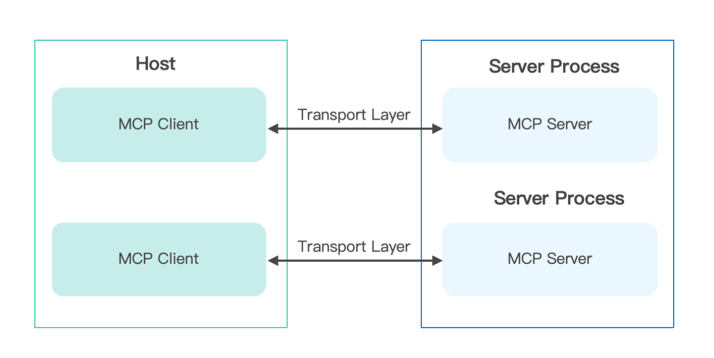
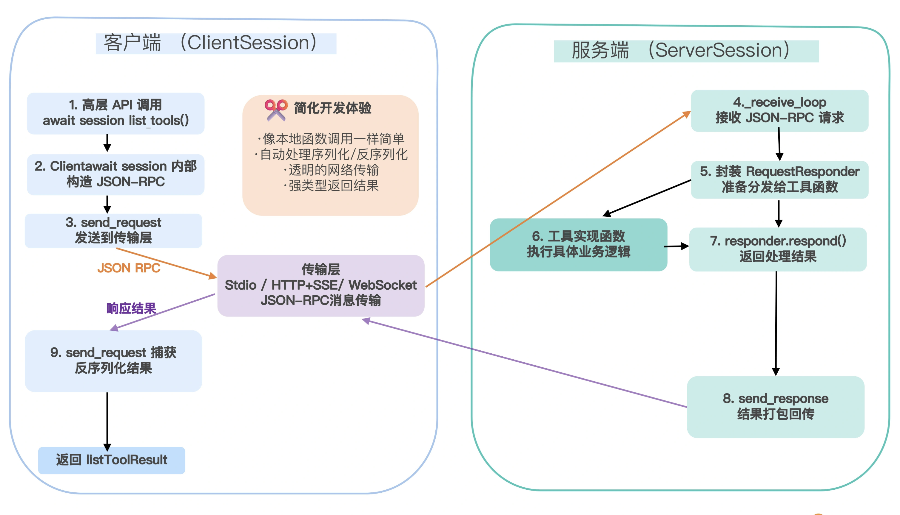
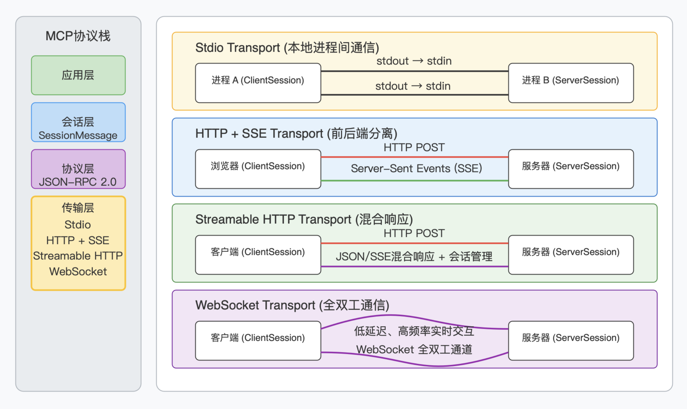
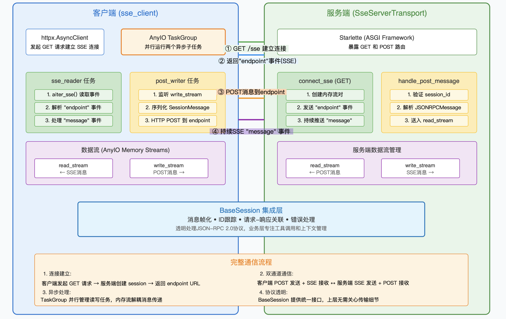
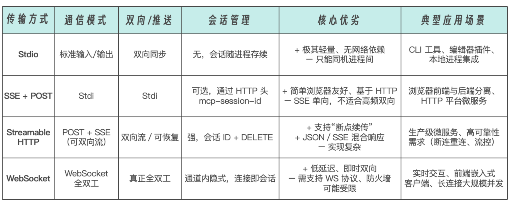
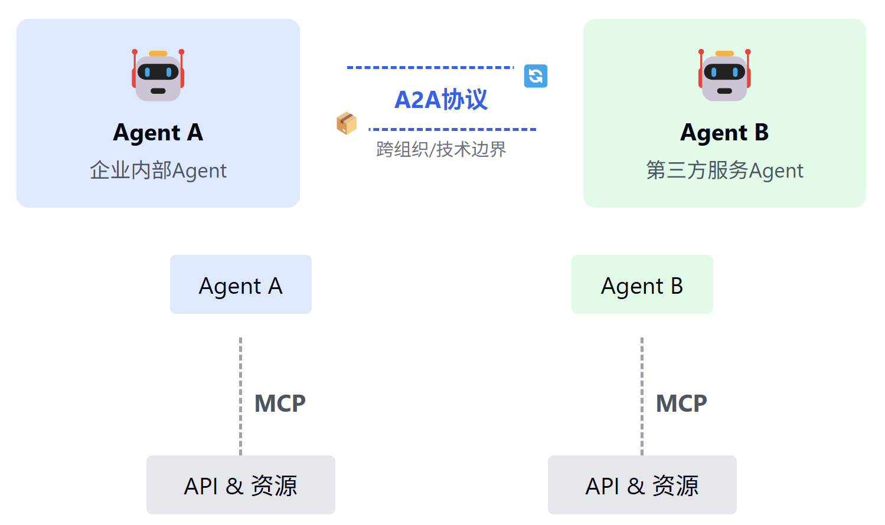
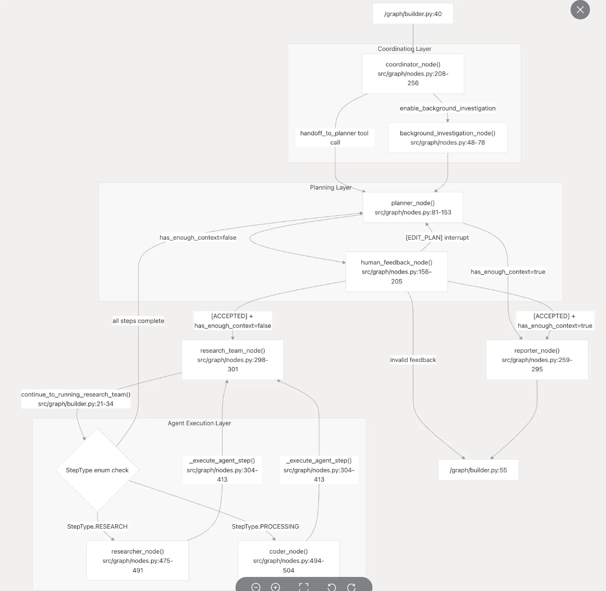
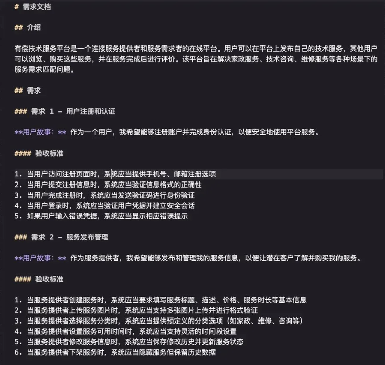

# Agent 与协议框架（学习笔记汇编）

从「什么是 Agent」讲到「Agent 之间怎么对话」：Agent 的五级能力划分与三大组件、工具与上下文协议 MCP、代理间协作协议 A2A、两类多 Agent 框架路线与协作架构模式，最后是编排框架（LangGraph）、Spec 驱动开发与一套十阶段的 Agentic Workflow 实施指南。

> [!info] 来源边界
> 原始笔记记录于 2025-07 ~ 2026-01，主要是阅读摘录、协议规格整理和个人理解。其中 `A2A和多Agent协作功能说明文档.md`、`Agentic Workflow实现流程详细指南.md` 里原有若干指向 `/usr/local/app/workspace/...` 的本地图片路径，**这些图片在本机不存在（属于当时运行环境的临时产物），已从本文中移除**，文字内容完整保留。原文完整保存在 `backups/obsidian-cleanup-20260921/整理前笔记与配置.zip`。

## 1. Agent 是什么

### 1.1 从预测式 AI 到自主代理

从「处理被动、离散任务、预测或创建内容」的 AI，转向「自主解决问题并执行任务」的新型软件——它是一个完整应用，能制定计划并采取行动来实现目标，把 LLM 的推理能力和实践能力结合起来，处理模型本身无法完成的复杂多步骤任务，且不需要人每次干预引导。

**三大组成**：模型（大脑，处理信息、评估、决策）、工具（连接外部世界，执行操作与收集信息）、编排层（处理规划、记忆与推理策略执行）。

**本质理解**：Agent 是致力于**上下文窗口策划艺术**的系统，是一个无休止的循环——组装上下文 → 提示模型 → 观察结果 → 为下一步重新组装上下文。上下文可能包含系统指令、用户输入、会话历史、长期记忆、权威来源的接地知识、可用工具清单、已调用工具的结果。对这种注意力的精密管理，使其推理能力能够解决新颖情况并达成目标。

### 1.2 代理式问题解决的五个步骤

1. **获取任务**：由一个具体的高级目标启动。
2. **扫描环境**：感知环境获取上下文，编排层获取可用资源。
3. **深入思考**：推理模型驱动的核心思考循环，分析任务并制定计划。
4. **采取行动**：编排层执行计划中的第一个具体步骤，调用适当工具。
5. **观察迭代**：观察行动结果，回到思考。

### 1.3 五级代理系统

| 级别 | 名称 | 能力 |
|---|---|---|
| 0 | 核心推理系统 | 仅含 LLM，完全基于预训练知识作答 |
| 1 | 连接型问题解决者 | 连接并利用外部工具，不再局限于静态知识（搜索、金融 API、RAG） |
| 2 | 战略型问题解决者 | 有上下文工程，能战略性规划复杂多部分目标；准确性取决于专注且高质量的上下文 |
| 3 | 协作式多代理系统 | 多 Agent 协同，Agent 把其他 Agent 视为工具，通过为其他 Agent 创建任务来行动 |
| 4 | 自进化代理 | 识别自身能力差距，动态创建新工具甚至新 Agent 来填补，从使用固定资源转向积极扩展资源 |

## 2. 核心架构：模型、工具与编排

### 2.1 LLM 大脑

模型选择不能只看基准分数，应考察处理复杂多步骤问题的推理能力与可靠的工具使用能力。**先定义业务问题，再用直接对应业务结果的指标测模型。** 可用多个模型组队按能力分工；模型 router 可以是自动或硬编码的，但会影响优化性能与成本。

### 2.2 工具

工具让 Agent 超越静态训练数据，获取实时信息并采取行动。工具接口是一个三部分循环：定义工具能做什么 → 调用 → 观察结果。

- **检索信息**：RAG 查向量数据库；结构化数据走自然语言转 SQL。
- **执行动作**：把已有 API 与代码函数包装成工具；更动态的任务可让 Agent 即时编写并执行代码。
- **函数调用**：需要清晰指令、安全连接与编排；给 Agent 一份结构化契约，描述工具用途、所需参数与预期响应。

### 2.3 编排层

决定模型何时推理、哪个工具该行动、行动结果如何影响下一步。

- **核心设计选择**：确定 Agent 的自主程度，在确定性可预测的工作流与高自主性决策之间权衡。框架必须为可观察性而构建——Agent 行为异常时，无法简单地在模型的「思考」里设断点。
- **指令引导**：system prompt / 核心指令提供约束与身份定位。
- **上下文增强**：短期记忆维护对话历史；长期记忆提供跨会话持久性。编排器赋予 Agent 预取与主动查询自身历史的能力，使其能记住用户偏好或几周前类似任务的结果，实现真正个性化且持续的体验。

### 2.4 多系统模式

- **协调器（Coordinator）**：引入「经理」Agent 分析复杂请求、分割主任务、把子任务路由给合适的专家 Agent，再汇总响应形成最终答案。适合动态或非线性任务。
- **序列（Sequential）**：类似数字装配线，一个 Agent 的输出直接成为下一个的输入。适合线性工作流。
- **迭代细化（Iterative Refinement）**：生成器创建内容 + 批评者按标准评审，形成反馈闭环。侧重质量与安全。

### 2.5 部署与服务

需要会话历史与记忆持久性等服务。可依赖专门平台（如 Vertex AI Agent Engine），也可以把 Agent 装进 Docker 容器部署到标准运行时（Cloud Run、GKE）。

## 3. MCP：模型上下文协议

### 3.1 解决的问题

传统上把 AI 系统接到外部工具要逐个集成 API——每个 API 都是独立的门，各有自己的钥匙和规则。要让 Agent 同时具备「网络搜索 + 数据库查询 + 文本翻译」，通常要写三套适配器：搜索要手拼 HTTP 请求、处理 OAuth、解析 HTML/JSON、捕获超时；数据库要配 JDBC/ODBC、管连接池、拼 SQL、逐行读 ResultSet；翻译服务要对接签名算法、限流、错误码。接入新工具就重复一遍，代码冗余、维护困难。

MCP 把这些细节藏到服务器端：服务端注册好 Search、QueryDB、Translate 三个工具，Agent 发起同一套 JSON-RPC 调用即可，底层 HTTP 请求、鉴权、连接管理和结果解析都由 MCP 服务器负责。核心理念是「**模型主控、客户端驱动服务器调用**」。

```json
{
  "method": "callTool",
  "params": { "tool": "Translate", "input": "Hello, world!", "target_lang": "zh" }
}
```



### 3.2 与既有方案的区别

| 方案 | 局限 |
|---|---|
| OpenAI Function Calling | 只绑在 GPT 系列上，调用规范、参数定义与返回格式深度耦合在 OpenAI 的 API 流程中，无法扩展到其他模型 |
| LangChain Tools | 支持多模型多工具，但所有能力都要写在 LangChain 框架里，跨框架/语言/团队复用需重造适配逻辑 |
| JSON-RPC | 通用但太底层，只管「发什么请求、收什么响应」，不含上下文管理、并发会话、流式返回、能力发现 |

MCP 提供的四件事：统一工具描述（所有能力用同一份 tool.json 注册，模型按名字调用）、会话与权限（自动管理多轮对话状态、工具访问权限与鉴权流程）、流式与事件（内建流式返回、异步回调、事件订阅）、多传输层（HTTP/REST、WebSocket、RPC、消息队列）。

### 3.3 协议层：host / client / server

- **host**：界面应用；**client**：客户端；**server**：提供上下文工具与执行能力的进程或服务。

生命周期三步：① Host 的 MCP Client 向 Server 发起 `initialize` 请求，交换协议版本与能力列表，再用 `initialized` 通知确认；② 正常通信，双向 Request–Response（同步调用）或单向 Notification（异步事件）；③ 优雅收尾，任一端 `close()` 或底层通道断开。

四类消息：Request（期待响应）、Result（成功响应）、Error（失败返回）、Notification（单向、无需响应）。

**BaseSession 的设计**（`mcp/shared/session.py`）：把 JSON-RPC 消息的读写、帧解析、请求–响应关联、通知分发的通用逻辑全部封装，派生类只需关注「收到请求/通知后如何处理」或「要发送哪些高层类型化消息」。

核心属性：

| 属性 | 作用 |
|---|---|
| `_read_stream` / `_write_stream` | AnyIO 内存流，异步收发 SessionMessage |
| `_request_id` | 自增计数器，给每个请求分配唯一 ID |
| `_response_streams` | `dict[RequestId, MemoryObjectSendStream]`，每发一个请求就开一个「答案流」 |
| `_in_flight` | `dict[RequestId, RequestResponder]`，跟踪尚未完成的对端请求，便于取消/超时清理 |
| `_exit_stack` | 异步上下文管理栈，统一关闭流与任务 |

上下文管理：`__aenter__` 创建 TaskGroup 并启动 `_receive_loop` 并行监听所有消息；`__aexit__` 依次关闭资源、取消接收循环任务，保证退出不挂起。

核心方法：
- `send_request()`：分配请求 ID → 在 `_response_streams` 注册缓冲为 1 的内存流 → 把 Pydantic 请求模型序列化为 JSONRPCRequest → 写入 `_write_stream` → 在响应流上阻塞等待（可设超时）→ 拿到 JSONRPCError 抛 McpError，超时抛带 408 的 McpError，否则反序列化 result 返回 → 无论成败都清理流与注册记录。
- `_send_response()`：正常结果构造 JSONRPCResponse（含 ID + result），错误构造 JSONRPCError，写入 `_write_stream`。
- `send_notification()`：构造无 ID 的 JSONRPCNotification（部分传输层可带 `related_request_id`），直接写入、不等待响应。
- `_receive_loop()`：持续读取并按类型分流——JSONRPCRequest 校验后包装成 RequestResponder 放入 `_in_flight`，先调 `_received_request` 钩子，未响应再交给 `_handle_incoming`；JSONRPCNotification 校验后调 `_received_notification`（若是取消通知则查找并取消对应 in-flight 请求）；JSONRPCResponse/Error 按 ID 找到响应流写入，找不到则视为意外消息转交 `_handle_incoming`。

可重写钩子：`_received_request`、`_received_notification`、`_handle_incoming`。

**上层实现**：
- `ClientSession`：构造时注入读写流、超时与各类回调（sampling、roots、日志、通用消息处理）；`initialize()` 先发 initialize 请求，收到 InitializeResult 后再发 InitializedNotification 完成握手。重写 `_received_request` 处理服务端发来的 `sampling/createMessage`、`roots/list`、`ping` 等请求；`_received_notification` 目前只处理日志消息，其余委托给用户提供的 message_handler。
- `ServerSession`：握手逻辑内嵌在两个钩子里——首次遇到 InitializeRequest 就保存 client_params 并返回包含能力集、版本号、说明的 InitializeResult；收到 InitializedNotification 才进入 Initialized 状态，未初始化前的其他请求会抛 RuntimeError。`check_client_capability(cap)` 读取客户端声明的能力做权限/兼容性检查。高层接口如 `send_log_message` / `send_resource_updated` / `send_tool_list_changed` / `create_message` / `list_roots` / `send_ping` 让服务端像调本地函数一样驱动模型取样、根列表查询或心跳。上行消息在 `_handle_incoming` 中推入内存队列，这正是 `@server.call_tool()`、`@server.list_prompts()` 等装饰器能把请求路由到业务函数的基础。

**一次典型调用**：Host 启动时实例化 ClientSession 与 ServerSession 并对接底层读写流 → 客户端 `initialize()` → 服务端钩子返回 InitializeResult → 客户端发 InitializedNotification → 进入已初始化阶段 → 客户端 `await session.list_tools()` 内部构造 JSON-RPC 请求发出 → 服务端 `_receive_loop` 接收、包装为 RequestResponder 交给注册的工具函数 → 工具执行完 `responder.respond()` → `_send_response` 回传 → 客户端 `send_request` 反序列化为 ListToolsResult。



### 3.4 传输层

| 传输 | 机制 | 适用 |
|---|---|---|
| Stdio | 借助标准输入输出完成同机进程间双向通信，一端 stdout 通过管道接入另一端 stdin | 本地进程（无需网络端口，轻量透明，跨语言跨平台） |
| HTTP + SSE | 服务端用 SSE 推送，客户端用 HTTP POST 发送 | 浏览器前端与微服务后端分离部署 |
| Streamable HTTP | 同一路径混合 POST 与 SSE，支持 session-id 管理、断点续传、JSON/SSE 混合响应 | 更完善的 HTTP 场景 |
| WebSocket | 全双工，双方可随时推送 JSON-RPC 消息 | 低延迟、高频实时双向交互 |

所有传输都遵循 JSON-RPC 2.0；Host 启动时构造两端 Session 并把读写流对接到相应底层通道。

**stdio 实现**：从操作系统层面看三条标准流都是文件描述符，可用管道把一端 stdout 连到另一端 stdin（如 `producer | consumer`）。服务端的 `stdio_server()` 是异步上下文管理器，包装 `sys.stdin`/`sys.stdout` 为 UTF-8 文本流，启动两个协程：一个不断从 stdin 读整行、反序列化为 JSONRPCMessage 再封装为 SessionMessage 放入 read_stream；另一个从 write_stream 取出 SessionMessage 序列化并逐行写 stdout。客户端的 `stdio_client()` 把工具进程作为子进程打开（按平台拼装命令与环境变量，用 AnyIO `open_process` 启动，stderr 重定向便于排错），同样创建一对内存流，退出上下文时优雅终止子进程避免孤儿进程。

**SSE 实现**：SSE 通过一次 GET 建立单向持久连接，服务器以 `text/event-stream` 持续推送，浏览器原生支持（EventSource）。MCP 的 `sse_client` 用 `httpx.AsyncClient` + `httpx_sse.aconnect_sse` 发起带较长读超时的 GET，成功后启动两个子任务：`sse_reader` 逐条读 SSE 事件，遇到第一条 "endpoint" 事件解析出用于 POST 客户消息的 URL 并通知调度器，之后每条 "message" 事件反序列化成 JSONRPCMessage 放入 read_stream；`post_writer` 等待上层写入，序列化为 JSON 后 POST 到 endpoint_url。也就是「SSE 读 + POST 写」的双通道。服务端用 Starlette 暴露两个路由：`connect_sse`（GET 建连，为每个会话创建一对内存流与 session_id，用 EventSourceResponse 先发 "endpoint" 事件再持续下发 "message"）与 `handle_post_message`（POST 收消息，从查询参数取 session_id 校验后把请求体送入对应 read_stream）。







## 4. A2A：代理间协作协议

### 4.1 为什么需要 A2A

三个背景问题：

1. **模型与外部世界的割裂**：大模型是基于概率计算的新范式，需要与传统结构化计算结合（工具调用），但两者目前是割裂的，传统 API 调用零散且不标准。
2. **Agent 协作的孤岛效应**：不同框架（LangGraph、AutoGen、CrewAI）各自为政，缺乏统一通信标准，跨平台协作如同「鸡同鸭讲」。
3. **复杂场景的工程化瓶颈**：从搜索助手到企业知识中台，RAG 与多 Agent 系统需要处理多源数据、多模态交互与长时任务，现有工具链难以提供统一方案。

A2A（Agent2Agent）由 Google 于 2025 年 4 月推出的首个标准智能体交互协议，让不同 Agent 能相互「加好友」，即使由不同供应商或框架构建也能互操作。可以理解为 Agent 之间聊天用的「通用语言」。

四个特性：**统一协议**（所有 Agent 使用同一消息 schema 做能力发现与调用）、**异步协作**（支持流式与异步返回，可并发处理多任务）、**灵活扩展**（新 Agent 即插即用，无需额外适配器）、**解耦实现**（Agent 专注业务，传输、鉴权、错误处理由协议层统一管理）。



### 4.2 核心概念

- **Agent Card**：位于 `/.well-known/agent.json` 的 JSON 能力说明书，包含 API 端点、技能、认证方式等，是能力发现与自动集成的基础，允许客户端 Agent 识别并利用最佳 Agent。
- **Task**：Agent 间围绕 task 对象协作，有生命周期与状态更新、最终产物（artifact），支持即时完成与长跑任务。状态流转：

```text
submitted（已提交）→ working（处理中）→ (input-required 需要额外输入) → completed / failed / canceled
另有 unknown（未知）
```

- **Artifact**：任务产出的结构化结果。
- **Message**：双方互发的消息，携带上下文、用户指令或中间产物；消息包含若干 **Part**，每个 Part 指明内容类型（文本/文件/结构化数据），便于双方就 UI 呈现形式（图片、表单、视频）协商。
- **角色模型**：服务端提供 API 接口（必须实现 `tasks/send` 等标准方法），处理请求、管理状态、推送结果；客户端作为发起方，发现能力、构造并发送任务请求、消费结果。

### 4.3 协议工作流程与接口

1. **能力发现**：每个 Agent 用 JSON 格式的 Agent Card 公布能力（如检索文档、调度会议）。
2. **任务管理**：围绕 task 展开协作，有生命周期、状态更新与最终产物。
3. **消息协作**：互发消息，消息中的 parts 指明内容类型，便于协商呈现形式。
4. **状态同步**：通过 SSE 等机制保持实时状态同步，确保用户看到最新进度与结果。

核心接口：

| 接口 | 作用 |
|---|---|
| `tasks/send` | 同步发送任务，返回最终任务状态 |
| `tasks/sendSubscribe` | 流式发送任务（SSE），流式推送任务更新 |
| `tasks/get` | 查询任务状态 |
| `tasks/cancel` | 取消任务 |
| `GET /.well-known/agent.json` | 发现 Agent 信息，返回 Agent 卡片 |

请求与响应示例：

```json
{
  "jsonrpc": "2.0", "id": 1, "method": "tasks/send",
  "params": {
    "id": "de38c76d-...",
    "message": { "role": "user", "parts": [{ "type": "text", "text": "请分析下面5位候选人是否符合岗位需求，并推荐最佳人选。" }] },
    "metadata": {}
  }
}
```

```json
{
  "jsonrpc": "2.0", "id": 1,
  "result": {
    "id": "de38c76d-...",
    "sessionId": "c295ea44-...",
    "status": { "state": "completed" },
    "artifacts": [{ "name": "result", "parts": [{ "type": "text", "text": "第二位候选人最符合你的需求!" }] }],
    "metadata": {}
  }
}
```

通信机制：基础模式为 HTTP + JSON-RPC 风格接口；高级功能支持实时推送（SSE，`tasks/sendSubscribe`）与异步通知（Webhook 回调）；通过 Part 类型实现多模态，代理间可预先协商交互形式。

设计原则：拥抱代理能力（允许不共享内存、工具和上下文的自然协作）、基于现有标准（HTTP/SSE/JSON-RPC，易于集成既有 IT 栈）、默认安全（支持企业级身份验证与授权）、支持长时任务（从快速任务到数小时甚至数天的深度研究）、与模态无关（支持音视频流）。

最小实现示意：

```python
from python_a2a import A2AServer, Message, TextContent, MessageRole, run_server

class EchoAgent(A2AServer):
    def handle_message(self, message):
        if message.content.type == "text":
            return Message(
                content=TextContent(text=f"Echo: {message.content.text}"),
                role=MessageRole.AGENT,
                parent_message_id=message.message_id,
                conversation_id=message.conversation_id,
            )

if __name__ == "__main__":
    run_server(EchoAgent(), host="0.0.0.0", port=5000)
```

### 4.4 A2A 与 MCP 的关系

- **MCP**：连接 LLM 与数据、资源、工具的标准，专注标准化不同模型与框架之间的「函数调用」，用于本地信任连接。
- **A2A**：应用层协议，让 Agent 以「代理（或用户）」身份通信，而不是以工具身份。
- 关系：**互补而非互斥**——建议工具使用 MCP，Agent 使用 A2A。

一个便于记忆的类比：LLM 是大脑，MCP 是 Agent 的手（工具），A2A 是 Agent 的嘴（对话）。

## 5. 多 Agent 框架的两条技术路线

### 5.1 自主多 Agent 框架

体现真正的 Agent 理念：每个 Agent 具备环境感知、自主决策和动作执行能力，多个 Agent 通过消息传递和协商实现分布式协作，能根据环境变化动态调整策略，展现智能涌现特性。

代表：**AutoGen**（微软，多 Agent 协作，支持角色专业化与动态协商）、**ADK**（Google Agent Development Kit，完整 Agent 生命周期管理与多 Agent 编排）、**CrewAI**（面向任务，强调角色定义与责任链）、**Agno**（轻量高性能，专注多模态与团队协作）。

特征：自适应性（基于上下文动态调整策略与执行路径）、协作涌现（去中心化协商与任务分解）、认知集成（深度整合推理、规划、反思能力）。

### 5.2 编排式框架

采用工作流思维，通过预定义的流程图或状态机组织 LLM 调用和组件交互。系统整体表现出「智能」，但执行路径是确定性的，更像「智能化的工作流」。

代表：**LangChain**（基于 Chain 抽象的组件编排）、**LangGraph**（有向无环图状态机，确定性状态转换与条件分支）、**Eino**（字节跳动，基于 Pipeline 与 Graph 模式）。

### 5.3 对比

| 维度 | 自主多 Agent | 编排式 |
|---|---|---|
| 控制模式 | 分布式自治决策，Agent 间协商 | 集中式流程编排，确定性执行 |
| 适用场景 | 开放域问题求解、创造性任务、多专业协作 | 结构化业务流程、数据处理管道、标准化作业 |
| 扩展方式 | 水平扩展角色，垂直增强能力 | 节点扩展与流程图复杂化 |
| 可预测性 | 涌现行为，结果多样性高 | 确定性执行，结果可复现 |
| 系统复杂度 | Agent 交互复杂，调试困难 | 流程清晰，易调试与监控 |
| 技术实现 | 消息传递与对话协议 | 状态机与有向图执行 |

### 5.4 Go 生态的机会（tRPC-Agent-Go）

主流自主多 Agent 框架（AutoGen、CrewAI、ADK、Agno）主要基于 Python；Go 凭借并发性能、内存安全与部署便利在微服务架构中重要，但成熟框架 Eino 专注编排式架构，Go 的自主多 Agent 框架较少。tRPC-Agent-Go 因此定位为 Go 生态的自主多 Agent 框架：采用自主多 Agent 架构、深度集成 tRPC 微服务生态（复用服务治理与可观测性基础设施）、满足复杂业务场景的智能化改造需求。框架集成 LLM、智能规划器、会话管理、可观测性与工具生态，支持创建自主与半自主 Agent，具备推理、工具调用、子 Agent 协作与长期状态保持能力。

## 6. 多 Agent 协作的架构模式

| 模式 | 描述 | 优势 | 适用场景 |
|---|---|---|---|
| 主从（Master-Slave） | 主 Agent 负责任务分解与结果整合，多个从 Agent 执行专门任务 | 集中控制、责任明确、易管理 | 可明确分解的复杂任务（文档处理、多维度分析） |
| 对等网络（P2P） | 所有 Agent 地位平等、直接通信，无中央控制点 | 高度自治、无单点故障、可扩展 | 分布式问题解决、创意协作、去中心化应用 |
| 专家团队（Expert Team） | 不同领域专家 Agent 组成团队，各负责擅长领域 | 专业化分工、高质量输出 | 跨领域问题、需要多专业知识的任务 |
| 工作流（Workflow） | 按预定义顺序协作，前一 Agent 输出是下一个的输入 | 流程清晰、可追踪、可预测 | 标准化业务流程、顺序依赖强的任务 |
| 黑板（Blackboard） | 多个 Agent 围绕共享的「黑板」数据空间工作，各自贡献方案 | 灵活协作、增量解决问题 | 复杂问题分析、创新方案生成、模式识别 |

## 7. 应用场景

**企业应用**：企业流程自动化（不同职能 Agent 协同完成端到端流程）、IT 服务管理（员工申请笔记本时，Agent 与负责库存检查、采购审批、设备配置的其他 Agent 交互）、供应链管理（需求预测、库存优化、物流调度、供应商沟通协同）、客户支持增强（一线客服把专业问题转交二线专家 Agent）、企业通信与协同办公（销售 AI 通知客服 AI 跟进客户技术问题）。

**垂直领域**：金融服务（投资咨询系统：数据分析、研究、预测、建议）、零售运营（需求预测、库存分配、供应链协调、定价优化）、社交媒体营销（内容策略师 + 参与度预测器）、个性化旅行规划、自主云运维（监控 Agent 感知延迟峰值，扩展 Agent 响应）、医疗健康（协作诊断、治疗方案制定、病历管理）。

**新兴应用**：机器人群（搜索救援快速覆盖大面积区域并定位幸存者、农业精准作业、太空探索）、个人助理智能化（把特定任务委托给更专业的外部 Agent）、个性化学习平台、研究系统（一个 Agent 规划研究过程，再创建并行 Agent 同时搜索信息）。

## 8. LangGraph：编排框架的核心概念

LangGraph 是用 LLM 构建**有状态、多参与者**应用的框架，提供编排复杂工作流的底层基础架构，不抽象提示与架构，让开发者完全控制 Agent 实现，同时提供执行保证。本质是定义一个「AI 推理团队」里有哪些角色（节点）、如何逻辑接力（边）、共享的推理记忆是什么（状态），以及如何自我修正与迭代（循环）。

- **节点**：推理链上的能力单元。
- **边**：
  - 常规边（Normal Edge）：最简单的「下一步」指令，确定性的线性步骤。
  - 条件边（Conditional Edge）：LangGraph 的精髓。在推理路径上引入逻辑分叉，通常由一个「项目经理」角色的 LLM 判断。例如初稿完成后由质量评审判断：通过 → 终稿发布；需修改 → 回到初稿撰写；信息不足 → 转向网络搜索补充资料。
- **状态**：贯穿始终的「推理记忆体」，是被不断更新的数据集合，是整个推理过程的上下文。价值在于：**推理可追溯**（结果出问题时可回溯状态的演变，看到哪个环节哪个「成员」出了问题）、**协同推理的基础**（所有节点围绕同一状态工作，保证信息一致）、**用户交互的入口**（把状态中的信息暴露给前端，实现「正在为您搜索机票…」这类实时反馈）。

**DeerFlow 案例**的三层结构：

- 协调层（右上）：团队的「项目经理」，接收初始任务，做初步背景调查后把任务分配给规划部门。
- 规划层（中）：团队的「大脑」与策划中心，思考如何完成并制定行动计划，判断手上信息是否足够（`has_enough_context`），不够则向人类专家求助（`human_feedback_node`）。
- 代理执行层（左下）：团队的「研发部」，计划批准后动手，内含不同「专家」——负责上网查资料的研究员（`researcher_node`）与负责处理信息或写代码的程序员（`coder_node`）。



## 9. Spec 驱动开发（kiro / AWS Spec）

Spec 用来解决「如何把模糊想法转化为详细实施计划、跟踪和验收标准」的问题。每个 Spec 是一个文件夹，含三个核心文件：

- `requirements.md`：需求文档（用 EARS 语法写用户故事和验收标准）。
- `design.md`：技术方案（架构、流程、注意事项）。
- `tasks.md`：任务清单（todolist，便于跟踪）。

EARS 语法示例（原笔记截图）：



配合 Claude Code 的使用流程：

1. 在项目下建立 `CLAUDE.md`（可参考 CloudBase-AI-ToolKit 的 rules 配置）。
2. 启动 Claude Code，输入原始需求（把想法、用户故事直接写进对话框），Claude 会自动读取 `CLAUDE.md` 开始需求澄清与确认。
3. 需求确认后输出 `requirements.md`。
4. 自动进入 `design.md` 阶段，输出架构、技术选型、接口、测试策略等。
5. 根据 `design.md` 生成 `tasks.md`，拆分为可执行的 todolist。
6. 逐步实现与验收。

CloudBase AI ToolKit 已内置这套工作流（`https://github.com/TencentCloudBase/CloudBase-AI-ToolKit/`）。

## 10. Agentic Workflow 十阶段实施指南

整体分三大类阶段，共十个环节：

| 类别 | 阶段 |
|---|---|
| 规划设计 | 需求定义与分析、工作流架构设计、代理能力规划、技术栈选择 |
| 开发实现 | 提示工程与代理开发、工具与环境集成、工作流编排与实现、测试与验证 |
| 运维优化 | 部署与监控、持续优化与迭代 |

**1. 需求定义与分析**：业务目标、用户场景、功能需求列表、性能要求（响应时间、并发）、合规与安全需求。步骤：需求访谈 → 用户研究（旅程图）→ 功能需求文档（必要 + 可选）→ 性能与合规指标 → 需求评审 → 输出文档。

**2. 工作流架构设计**：工作流模型（串行/并行/混合）、状态管理机制、决策节点与分支逻辑、错误处理与回退、数据流规划。步骤：分析业务选模型 → 状态图（全部状态与转换条件）→ 确定关键决策点 → 设计异常恢复 → 规划节点间数据流 → 架构评审 → 输出文档与原型。

**3. 代理能力规划**：代理角色定义（职责与权限）、交互模式、自主决策范围、人机交互时机、专业化设计。步骤：确定需要的代理类型与数量 → 定义职责与权限 → 设计交互协议 → 确定自主边界与干预点 → 为特定任务定制能力。

**4. 技术栈选择**：基础模型、工作流引擎、集成技术（API、消息队列）、存储方案、部署环境。步骤：评估模型性能/成本/适用性 → 比较工作流引擎或确定自研 → 选集成技术与协议 → 设计存储（性能与安全）→ 规划基础设施。

**5. 提示工程与代理开发**：系统提示设计、工具使用模板、决策推理框架、上下文管理、短期与长期记忆。步骤：为每个角色设计系统提示与角色定义 → 开发工具调用模板保证准确性 → 实现思考/规划/执行框架 → 开发上下文传递机制 → 实现记忆系统 → 能力测试与优化。

**6. 工具与环境集成**：API 接口开发、工具调用封装、资源访问控制、环境感知、第三方服务集成。步骤：开发外部系统交互接口 → 封装统一调用接口 → 实现权限管理 → 开发环境感知能力 → 集成第三方数据源 → 集成测试。

**7. 工作流编排与实现**：节点实现、转换逻辑编码、并行处理机制、监控点设置、编排引擎。步骤：实现各节点功能 → 编码转换条件 → 实现并行处理 → 设置监控与日志 → 开发编排引擎 → 单元与集成测试。

**8. 测试与验证**：单元测试、集成测试、端到端测试、性能测试、安全测试。步骤：制定测试计划与用例 → 单元 → 集成 → 端到端模拟真实场景 → 性能与负载 → 安全 → 分析修复 → 回归。

**9. 部署与监控**：环境准备、部署流程、监控系统、告警机制、日志管理。

**10. 持续优化与迭代**：数据收集（执行数据与用户反馈）、性能分析、代理能力提升、工作流结构与决策逻辑调整、新功能规划。

**最佳实践**：

- 规划设计：充分理解业务需求、避免过早进入技术实现；选择合适的工作流模型平衡复杂性与灵活性；明确定义角色避免职责重叠；技术选型考虑长期维护与扩展。
- 开发实现：迭代开发，先核心后扩展；系统提示设计是能力关键，需精心设计与持续优化；工具集成考虑安全与错误处理；工作流状态应持久化，确保可恢复。
- 测试部署：设计覆盖异常情况的测试用例；建立监控告警机制；灰度发布降低风险；保留人工干预作为自动化失败的后备。
- 持续优化：建立明确性能指标定期评估；收集用户反馈改进体验；持续优化提示工程与代理能力；定期评估新技术与模型并适时更新组件。

## 11. 发展趋势

- **Agentic AI 普及**：Agent 更自主，能规划、行动并适应动态输入，实现目标驱动的决策。
- **标准化与互操作性**：A2A 等协议推动 Agent 间标准化通信，打破平台与框架壁垒。
- **复杂任务处理能力增强**：多 Agent 系统通过专业化与协作处理更复杂、多步骤的任务。
- **人机协作深化**：人更多参与决策支持与结果评估。
- **垂直领域落地**：医疗、金融、制造、农业等行业智能化转型加速。

---

## 待补

- A2A 的认证/授权细节（Agent Card 中的认证方式如何协商）。
- LangGraph 的持久化与断点恢复机制。
- MCP 的 sampling 能力在实际业务中的用法。

---

**来源**：`notes/agent 介绍.md`（2026-01）、`notes/MCP.md`（2025-07，含协议层源码解读）、`notes/a2a.md`、`notes/A2A (2).md`、`notes/A2A和多Agent协作功能说明文档.md`（含参考文献 7 篇）、`notes/Agentic Workflow实现流程详细指南.md`、`notes/langGraph.md`、`notes/kiro spec.md`。
