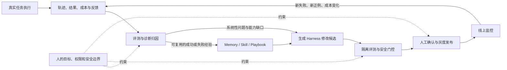

# Agent 自进化飞轮：从 Harness 优化到工程闭环

> [!abstract] 核心结论
> 当前最可落地的 Agent 自进化，不是让模型随意重写自己，也不只是让一次输出反复修改，而是让 **Harness 根据真实任务反馈持续改进**。
>
> 一个可靠的闭环是：**执行产生轨迹 → 评测与归因 → 经验进入记忆或 Playbook → 生成局部修改 → 独立验证与门控 → 灰度生效 → 新数据回流**。其中，评测决定方向，记忆负责积累，工程链路负责让改进安全落地，人负责目标和边界。

## 一、先区分三种“自进化”

| 层次 | 修改对象 | 是否跨任务保留 | 当前特点 |
|---|---|---:|---|
| Artifact 迭代 | 本次代码、答案或方案 | 否 | 更接近 Self-Refine，本次结果变好，下次仍从头开始 |
| Harness 自改进 | Prompt、Skill、Memory、Tool、上下文策略、工作流与编排 | 是 | 即时、可观察、可验证、可回滚，是当前性价比较高的路线 |
| Model 进化 | 模型参数或架构 | 是 | 能把能力写进模型，但数据、训练成本和风险更高 |

视频将 Harness 概括为模型之外支撑 Agent 运行的整体，包括 Prompt、Tool、Skill、Memory、上下文管理、多智能体编排和 Agent Loop。不同 Harness 使用同一个模型，最终效果仍可能明显不同。

视频还提出一个实用的约束视角：Agent 优化通常需要在**效果、成本、耗时**之间取平衡。真正的进化不能只看任务得分；如果效果提升只是因为增加了数倍 Token、重试次数或延迟，就需要单独说明它付出的预算。

## 二、自进化飞轮的完整运行链

飞轮的价值不在于单独拥有评测、记忆或 Skill 生成，而在于每一环的输出能成为下一环的输入：

1. 评测识别出的好经验触发记忆写入，而不是把所有轨迹全部保存。
2. 评测给出的失败模式和归因进入修改链路，而不是停留在报表里。
3. 修改经过验证、审核和灰度后真正影响 Agent 行为。
4. 新版本的线上表现重新进入评测，形成下一轮燃料。

任何一条数据通路断开，系统都只是拥有若干功能，不会产生持续复利。

## 三、第一齿：评测决定飞轮朝哪里转

在自进化系统中，评测至少有三种职责：

- **方向指引**：发现问题集中在哪里，下一轮应该改什么。
- **质量门控**：验证候选版本是否真的优于基线，并检查是否引入回归。
- **经验筛选**：决定哪些轨迹值得沉淀为长期记忆、反例或 Skill。

因此，评测错误不只会错放一个版本，还可能让错误经验进入记忆和 Skill，长期污染后续任务。评测可信度应优先于自动化复杂度。

### 评测体系的基本原则

1. **能用确定性规则就不用 LLM Judge**：代码测试、SQL 结果、格式、字段完整性、延迟和成本应优先自动校验。
2. **结果和过程都要评**：最终答案正确，不代表推理和工具路径可靠；还要检查冗余调用、跳过校验、碰巧答对等问题。
3. **日常粗评，失败细查**：先用任务级指标筛选，再对失败案例做 step、tool call 或决策节点级归因。
4. **生成者和评估者分离**：开放任务使用独立评估器、结构化维度和人工抽样校准。
5. **同预算比较**：固定模型、Token、工具和重试预算，避免把“多花钱”误判为“进化”。
6. **评测集隔离**：train 用于暴露失败和生成改进方向，val 用于筛选候选，test 只做上线前验证，并持续回流新的真实失败样本。

### Skill 需要额外证明增量价值

一个 Skill 存在于上下文中，不等于它真的有用。至少需要验证：

- 有 Skill 与无 Skill 的对照实验；
- 评测任务具有足够难度，能显示增量；
- 轨迹中确实执行了 Skill 的关键步骤；
- 不只是结果碰巧正确，规定的校验路径也被执行；
- 环境和模型变化后定期复评，删除已经失效或被模型能力覆盖的 Skill。

## 四、第二齿：记忆的核心是治理，不是存储

这一部分与 [[2026 Agent Memory 研究方向与架构比较]] 的结论一致：向量库只是候选召回部件，记忆系统还必须处理写入、更新、冲突、遗忘、来源、权限和上下文预算。

### 写入：策展而不是全存

- 只有任务成功、评测通过或用户确认等明确信号，才触发正式写入。
- 失败经验以“反例、陷阱和失效条件”保存，不伪装成正向规则。
- 一次成功先进入临时学习记录；多次验证、边界清楚、可自动验收后，才晋升为稳定记忆或 Skill。
- 系统性问题更适合改 Prompt/Skill；偶发个例更适合作为带场景的反例记忆。

### 存储：保留事实源和生命周期

- 原始轨迹保留为事实源，摘要、画像、索引和 Skill 是可重新生成的派生层。
- 每条记忆记录版本、时间、来源、触发原因和适用范围。
- 支持更新、合并、失效、衰减、主动遗忘和冲突仲裁。
- 错误记忆的淘汰速度应快于好经验的晋升速度，因为错误规则的全局伤害更大。

### 读取：渐进披露并限制预算

默认只加载少量高层背景；任务到来后，再用关键词、语义和精确匹配寻找中层事实；只有需要证据时才回溯原始轨迹。目标不是召回越多越好，而是在有限上下文中提供最少但足够的证据。

## 五、第三齿：把修改 Harness 做成 Agent CI/CD

从发现问题到安全生效，可以拆成八个环节：

1. **诊断归因**：判断根因属于 Prompt、Memory、Skill、Tool、执行逻辑、编排还是评估器。
2. **信号汇聚**：合并本轮诊断、历史 Playbook 和外部研究，而不是只看一个失败案例。
3. **生成候选**：生成少量局部修改方案，优先输出 Diff，避免全文重写覆盖正确逻辑。
4. **隔离评测**：每个候选在独立环境、相同预算下运行。
5. **安全门控**：依次进行语法、回归、统计显著性、历史规则一致性和人工语义审核。
6. **灰度发布**：先在小流量观察成功率、成本、延迟和用户反馈，出现严重退化时自动回滚。
7. **监控回流**：把灰度和线上出现的新失败自动加入下一轮种子池。
8. **经验沉淀**：把“怎么改 Agent”的有效方向和失败尝试写入独立 Playbook，避免下一轮重复试错。

这里需要区分两类经验：

- **任务记忆**回答“Agent 遇到这类任务应该怎样做”。
- **进化 Playbook**回答“过去怎样修改 Agent 有效，哪些方向已经失败”。

两者都需要版本和来源，但服务对象不同，不应混在一个无结构的记忆池里。

## 六、第四齿：人负责方向、授权和慢变量

完全人工会使飞轮转不起来，完全自主又可能快速放大错误。更合理的方式是按风险和稳定性分级授权，并根据历史表现动态升降级。

以下节点需要保留人工控制：

1. 具有全局影响的规则级记忆写入。
2. Prompt、Skill，尤其安全、拒答和权限规则的最终修改。
3. 发现回归后，决定冻结、修复还是回滚到哪个版本。
4. 新领域冷启动时，提供首批评测样本、经验种子和成功标准。
5. 设定 Agent 能修改什么、不能修改什么的权限边界。

人工审核也要防止“审核疲劳”：先由自动门控过滤明显无效的候选，再批量呈现差异、评测数据和代表案例，让人只处理机器无法判断的语义和业务问题。

### 局部改善不等于长期方向正确

每次改动都通过回归测试，系统仍可能发生缓慢的方向漂移。例如评估器偏好长答案，Agent 会在多轮进化中越来越啰嗦，分数上升却偏离“准确且简洁”的原始目标。

除了任务成功率，还应持续观察平均输出长度、Token、工具调用次数、拒答率和风格等方向性指标，并定期人工审查一段时间内的 Skill、记忆和行为变化。

## 七、最常见的失败模式

| 失败模式 | 后果 | 主要防线 |
|---|---|---|
| 错误归因 | 在错误组件不断追加规则，Harness 逐渐成为难以维护的规则堆 | 细粒度诊断；多轮不改善时转查 Tool/API 和数据层 |
| 弱评估器与 Reward Hacking | Agent 学会迎合 Judge，而非真正完成任务 | 规则优先、独立评估、元评测集、人工校准 |
| 只优化当前案例 | 局部分数提高，其他任务退化 | train/val/test 隔离、回归集和线上灰度 |
| 记忆污染、过期和冲突 | 错误经验跨任务扩散 | 来源、版本、失效、冲突解决和快速淘汰 |
| Skill 越积越多 | 上下文膨胀，调用冲突，维护成本升高 | 对照实验、定期复评、合并与删除无增量 Skill |
| 审核请求过多 | 人开始机械通过，形成虚假安全感 | 自动门控、批量异步审核、渐进放权与自动降级 |

## 八、怎样启动第一圈

文章给出的落地顺序不是先建设全自动平台，而是先证明一个手动闭环能够成立：

1. 选一个反馈明确、链路较短的任务范围。
2. 建立一批能覆盖核心失败类型的初始评测案例。
3. 用 Markdown 保存少量种子 Skill、记忆、反例和进化 Playbook。
4. 手动完成一次“执行—评测—归因—修改—复评—保留或回滚”。
5. 闭环稳定后，再逐步加入候选自动生成、CI 门禁、版本管理、灰度回流和跨会话 Dreaming。

最适合冷启动的场景通常有两个特征：存在真实、低歧义的业务反馈，并且从发现问题到验证修复的反馈延迟较短。

## 九、与现有笔记的关系

- [[2026 Agent Memory 研究方向与架构比较]] 已经覆盖原始证据、记忆治理、渐进加载和“经验晋升为 Skill”的条件；本笔记把这些能力放进更大的自进化闭环中。
- [[DeepSeek Harness：亮点、关键机制与成熟度边界]] 中的追加式 `SessionEvent`、可重放上下文和插件接缝，可以作为轨迹采集、修改插入和验证回放的运行时基础；但这些架构能力本身不等于已经具备自进化。
- 视频提供了“为什么优先优化 Harness”的方向判断；公众号文章补充了评测、记忆、发布和控制怎样连接成工程飞轮。

## 证据边界

> [!warning] 来源性质
> 本笔记是两份二手内容与已有笔记的综合整理，不代表相关效果数字已经得到独立验证。

- 视频转写包含“自信化”等语音识别错误，本文结合上下文统一按“自进化”理解。
- 视频中的未来判断和“效果—成本—耗时”框架属于讲述者观点。
- 公众号文章给出的若干收益比例、案例提升和具体阈值，在可读页面中没有完整呈现可复核的实验设置与原始数据；在项目决策或正式报告中引用前，需要回到论文、代码和评测配置逐项核验。
- 文中确定性较高的是闭环结构和工程风险；具体数值、统一阈值和“业界共识”应视作待验证主张。

## 来源

1. 视频转写：`转写全文_逐行.txt`，本次对话由用户提供，原文件位于微信临时文件目录。
2. [公众号原文：一篇讲透 Agent 自进化飞轮怎么搭](https://mp.weixin.qq.com/s/5VDN-T9K8Wr-DaQ15-I6CA)
3. [公开可读转载：Agent 自进化飞轮——评测、记忆、落地、控制](https://zhuanlan.zhihu.com/p/2075259023729993271)
4. [[2026 Agent Memory 研究方向与架构比较]]
5. [[DeepSeek Harness：亮点、关键机制与成熟度边界]]

## 2026-09-21 用户原话：Harness 首轮上下文与记忆注入位置

归档说明（助手添加）：本节标题、日期和来源链接由助手添加，正文逐字保留。这是用户对工作电脑 Session 的阶段性观察和经验判断；首轮 Token 数量、提示词层级及遵循率未在此独立核验，不覆盖上文调研结论。后续跨 Harness 的插入位置仍待分析。

来源：[[01-日志/日报/2026-09-21-晚间交流原文#01 Harness 首轮上下文与记忆注入位置]]。

今天的话主要是做了两件事情啊，首先第一件事情就是我把我。工作的电脑上里边的harness包括这个DSH，嗯cloud code open code这啊可能还有codex吧，把它的这个啊所有的session进行导出，然后分类，也就相当于把我阶段性的目前为止工作做了一个。呃，归纳和总结。然后呢，这个时候我就发现了两件事情，一个就是这些哈尼斯它本身呢，在你输入第一个这个呃。问句或者说第一第一个输入之后呢，它的。Token消耗数量已经来到了几十K这样一个量级，那这里边可能opencode会长一些六十几K，然后cloudcode五十几K，DSH可能只有十几K。这里边它主要是可能包含它预制的一些system prompt, 然后一些这个MCP加载的工具，它原生的一些工具，还有啊Agent.md等等等等的一些这样的context的组成部分。然后这里边其实啊，除了哥哥哈内斯他原生的。带了一些文具，还有他原生的一些这种，嗯。设定以外呢，最多的来源就是我们自己人为配置的skill，还有装上的MCP所在的这些tool。其中这个MCP如果有一些比如说飞书的MCP，它可能有100个左右的这样的工具，这样的话它会消耗非常非常多的上下文。虽然说这个东西在后续其实啊，会在后面的这个书里面都会被cache给覆盖掉，但是在首轮里，它也是相当大的一部分这个输入，另外的话可能这里边的一些东西会打架，会矛盾。啊，就会导致一些skill或者一些工具的调用的过程会出现问题。我们在做第一版的这个记忆的时候，我们是通过在agent.md或者说在cloud.md啊去进行一个这样的呃注入，然后让他去遵循我们啊给他一些skill或者给他一些工具。但是这样的方式我们在后期看来，它的调用率其实是没有那么高的，或者说做不到百分之百。但是我们又不想通过做hops啊这样的方式来去把这些东西的注入，那后面经过分析这些prompt呢，我们发现啊，以DSH为例啊，因为它的这种改动的这个啊成本比较低，它的这些东西都是插件化的，我们发现其实在一些比较。深层次或者优先级很高的这一地方去插入对应的这些描述的话，它的遵循率是非常高的，它不会被后期的这种上文压缩给处理掉，然后也不会被其他的一些定义给关掉，相当于它是有最高优先级的。那在这个地方去啊植入一些我们的描述。啊，他的这种遵循概率会非常高。可以类比于它的出厂设置，那当然不同的哈，那它的这个组成也会不一样嘛。这个后面我们可以专门的去做一些分析，看看这个呃对应的哈内斯在哪个地方插入会效果好一些。当然，这个地方啊，就是我的个人的一些通过经验里总结的一些洞见吧，这个要作为知识去记录一下。

## 关联阅读（2026-10-11 助手添加）

- [[02-主题/AI与LLM/Agent 信任曲线：验证、技能与硬约束（Lauren Tan 谈 GrokBot 工程实践）|Agent 信任曲线：验证、技能与硬约束]]：同为「怎么让 agent 稳定产出」，本篇从 Harness（上下文装配）方向解决；该篇主张 prompt/rules/skills 都是软层，**真正可靠的是代码库架构与静态分析**（lint、编译期诊断、CI 阻断），并把「人在 PR 上留下的每条人工评论」视为待修复的系统缺陷。两者互补，属视频讲者观点，不代表用户已确认立场。
