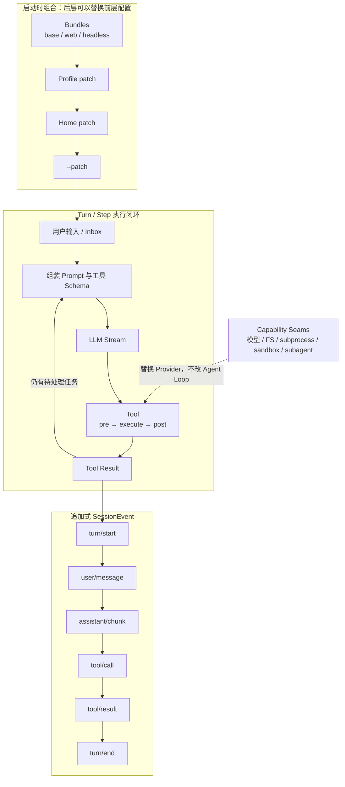

# DeepSeek Harness：亮点、关键机制与成熟度边界

> [!abstract] 核心结论
> DeepSeek Harness 的真正亮点不是“换了一个更聪明的模型”，而是把 Coding Agent 做成一个**可组合、可替换、可重放的运行时**：模型、工具、Agent Loop、Session Log、权限和 UI 都可以通过插件与配置进行替换。
>
> 对 Agent Memory 最值得关注的是它的 `SessionEvent → deriveMessages() → 模型上下文` 链路：模型看过的内容必须能够从追加式事件日志中重建。

## 当前状态

- 本机已验证版本：`0.1.0-rc.6`
- 发布时间：npm 包于 2026-08-10 首次发布
- 官方定位：Developer Preview
- 官方明确说明：后续会出现兼容性破坏
- 架构机制置信度：高
- 性能与稳定性优于其他 Coding Agent：目前没有足够证据

## 一张图看懂运行机制



## 五个关键机制

### 1. Everything is a plugin

Harness 基于 Cordis 构建。以下组件都不是不可替换的“核心特权层”，而是插件：

- 模型适配器
- 工具注册表
- Session Log
- Agent Loop
- 权限与 Sandbox
- Web UI 与 Headless Runner

插件向共享上下文注册服务、类型化事件和副作用；插件卸载时，相应注册可以撤销。

这意味着扩展 Harness 时，优先选择“在现有插件旁挂载一个新插件”，而不是修改统一的大型核心。

### 2. Profile、Bundle 与 Patch 分层组合

一个正在运行的 `dsh`，本质上是启动时拼装出的插件树。配置按以下顺序叠加：

1. Profile 中声明的 Bundles
2. Profile 自己的 `cordis.patch.yml`
3. Harness Home 下的全局 Patch
4. 启动参数中的 `--patch`

后面的层可以按 ID 替换前面的一整行配置。本机可以使用下面的命令审计最终结果：

```bash
dsh --profile web --dump-config
```

本机配置中可以看到 retry、JSONL persistence、sandbox、permission presets、skills、goals、plan mode、compaction、subagents、workflow 和 agent loop 等独立插件。

### 3. Turn / Step 构成可拦截的任务闭环

Harness 将一次执行分成两个层级：

- `Turn`：从认领输入开始，到没有待处理任务为止。
- `Step`：一次模型请求，以及该请求触发的工具调用。

一个 Step 的主要路径是：

> 认领输入 → 组装 Prompt 与工具 Schema → 模型流式输出 → 工具调用 → `pre/execute/post` → 写入结果 → 判断是否继续

关键阶段会发出类型化事件，因此插件可以观察、改写或拦截请求与工具执行。

> [!note] 与“结果确定性”的关系
> 这套结构为“执行 → 观察 → 校验 → 修正”提供了架构接缝，但 Harness 本身并不自动保证任务正确。成功标准、测试和纠错策略仍需要由上层 Agent 或工作流定义。

### 4. 追加式 SessionEvent 是模型上下文的事实源

Harness 使用 append-only 的 `SessionEvent` 日志保存持久事实。官方架构明确提出：

> Model-visible means logged.

也就是：任何进入模型请求的内容，都必须能够从日志中重新构造。

`deriveMessages()` 负责从日志投影出模型历史；原始 `assistant/chunk` 则用于保留流式回放和 UI 还原能力。以下功能都建立在同一个事件流上：

- Resume
- Fork
- Replay
- Transcript
- Telemetry
- Persistence

这对 Agent Memory 的启发是：**将原始轨迹作为事实源，把摘要、上下文窗口和 UI 状态作为可重新生成的投影。**

### 5. Capability Seams 解耦 Provider 与 Agent Loop

一个能力接缝包含三种角色：

- Service Definition：定义接口
- Provider：提供具体实现
- Consumer：使用能力，通常表现为模型可调用工具

例如文件系统与 subprocess 共享同一个“执行世界”。将 Provider 指向远程 Sandbox 后，Bash、PTY 和 LSP 可以一起迁移，而不必为 Agent Loop 创建专门分支。

同样的思路也应用于模型、Subagent、后台任务、目标管理、UI 和编辑器集成。

## 它真正解决了什么

| 传统问题 | Harness 的对应机制 |
|---|---|
| 更换模型或工具需要修改 Agent 主循环 | 插件注册与 Capability Seams |
| 不同产品形态需要维护多套 Agent | Profile + Bundle 组合出 Web、Headless 等形态 |
| 上下文来自多个临时状态，难以恢复 | Append-only SessionEvent + `deriveMessages()` |
| 工具权限散落在工具实现中 | Guarded Tool Pipeline + Sandbox/Approval Policy |
| 执行过程难以观测和插入策略 | `agent/*`、`tools/*`、`session/event` 等事件 |

## 成熟度与风险边界

> [!warning] 当前更适合研究和试用
> Harness 仍处于 rc 开发者预览阶段。官方仓库的 `BENCHMARK.md` 目前只说明怎样运行基准，没有公布与成熟 Coding Agent 的成功率、成本或延迟对比结果。

当前值得关注的风险包括：

1. **插件化带来的配置复杂度**：Provider、插件版本和 Patch 层叠加后，故障定位可能跨越多个包。
2. **事件日志不等于自动恢复**：社区在 rc.6 上报告，工具分发崩溃后可能留下没有对应 `tool/result` 的 `tool_calls`，使会话后续持续返回 400，只能新建会话。
3. **安全 Hook 需要防止 fail-open**：社区报告 `defaultTimeoutMs: 0` 可能使 Hook 执行失败后静默放行工具调用。
4. **底层模型问题仍会穿透 Harness**：模型工具调用格式、空响应、视觉能力等问题，不会因为更换运行时自动消失。
5. **缺少独立对比证据**：目前可以高置信评价架构设计，但不能高置信断言它比 Codex、Claude Code 等产品更稳定或更高效。

## 对 Agent Memory 工作的启发

这套设计最值得借鉴的不是插件数量，而是下面三条架构原则：

1. **原始轨迹是事实源**：模型消息、工具调用和结果先进入不可变事件流。
2. **上下文是投影**：模型当前看到的 Messages，应当能够从事件与策略重新生成。
3. **扩展逻辑通过接缝进入**：压缩、记忆注入、权限、遥测和模型适配不直接耦合主循环。

它与 [[2026 Agent Memory 研究方向与架构比较]] 中“保留原始证据、让摘要和索引成为派生层”的结论是一致的。

## 证据等级

| 判断 | 置信度 | 原因 |
|---|---:|---|
| 全插件架构、分层组合、事件日志与执行流程 | 高 | 官方架构文档，并与本机 `dump-config` 一致 |
| Web UI、权限、Skills、Subagents 等功能存在 | 高 | 官方文档与本机安装验证 |
| 当前存在会话恢复和 Hook 配置风险 | 中 | 社区提供复现与源码定位，但尚不能视为维护者正式结论 |
| 性能、成本、成功率优于其他 Coding Agent | 低 | 暂无正式、可比的公开基准 |

## 主要来源

- [DeepSeek Harness README](https://github.com/deepseek-ai/deepseek-harness/blob/master/README.md)
- [DeepSeek Harness Architecture](https://github.com/deepseek-ai/deepseek-harness/blob/master/docs/architecture.md)
- [Web UI Guide](https://github.com/deepseek-ai/deepseek-harness/blob/master/docs/user/guide/index.md)
- [Benchmark Instructions](https://github.com/deepseek-ai/deepseek-harness/blob/master/BENCHMARK.md)
- [社区报告：工具崩溃后会话无法恢复](https://github.com/deepseek-ai/deepseek-harness/discussions/571)
- [社区报告：Hook 超时误配置可能 fail-open](https://github.com/deepseek-ai/deepseek-harness/discussions/583)

## 本机验证记录

```bash
dsh --version
# 0.1.0-rc.6

dsh --profile web --dump-config

npm view @deepseek-ai/dsh version time --json
```
