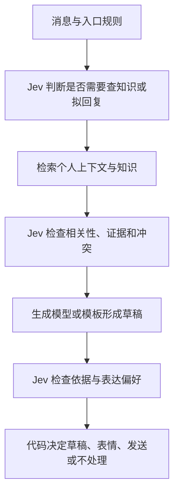

# Jev 技术与应用调研：别人怎样把快速判断接进软件

你今天说的 GEV／GV，根据“前 OpenAI 研究人员创办、三种输出、255 个选项”等线索，可以确认对应 **TypeSafe AI 的 Jev**。它于 2026 年 9 月 15 日公开发布。本文截至 9 月 22 日，因此看到的主要是发布首周的接入、实验和早期应用，还不足以总结成成熟的行业共识。[发布说明](https://typesafe.ai/blog/introducing-system-one-models-and-jev)

**最值得保留的认识是：把“选哪条路、哪些材料有用、结果是否达标”变成单独的小问题，让 Jev 返回选项和概率，再由代码决定下一步。** 你的 Tool／Skill 路由、上下文筛选设想，都已有公开实现可以参考。需要补上的认识是：格式正确、判断正确、概率可信，是三件不同的事。

阅读顺序：想先看别人怎么用，读第三节；想理解机制，读第一、二节；想看 Laya 等开源实现，读第五节；最后第六节对应你的 MyContext。

本次是文档和代码调研，没有调用付费模型、重跑公开评测，也没有把个人会话上传到外部模型。数字均注明是谁测的；示例中的业务判断不是实测结果。

相关原始记录：[[01-日志/日报/2026-09-22-晚间交流原文]]、[[02-主题/AI与LLM/GEV 模型与轻量路由：口述学习记录]]、[[02-主题/AI与LLM/MyContext：口述学习记录]]。原始口述保持原样，本篇单独记录核验和修正。

## 一、从收到一条消息开始，理解 Jev 做了什么

假设 MyContext 收到：“把上周讨论的接入方案发我一下。”

系统需要先判断它是不是知识查询，检索后判断哪些片段有用，再决定材料够不够生成回复。如果每一步都请求一个聊天模型写一段分析，程序最后往往只取一个分类或一个布尔值。

Jev 把接口改成了三个部分：

- `state`：供判断的材料，例如消息、检索结果、用户偏好。
- `questions`：这次要判断的具体问题，可以有多个。
- `criteria`：选项或评分标准，由调用方定义。

它返回的 `answers` 直接对应各个问题。**通俗地说，就是把一份材料和几张答题卡交给模型，拿回程序能读取的勾选结果。** API 的 JSON 是传输这些值的容器；不能因为仍然看见 JSON，就认为模型在逐字生成 JSON。[API 文档](https://docs.typesafe.ai/api)

### 1. Choice：在给定选项里选一个

例如从 `reply`、`knowledge_lookup`、`uncertain` 中选择。结果包含选中的选项、各选项概率、`confidence`。单题最多 255 个选项，选项可以在每次请求时重新提供。[Choice 文档](https://docs.typesafe.ai/primitives/choice)

**通俗理解：菜单可以每次换，模型看菜单作答。** 这和只训练过固定几个业务标签的专用分类器，在使用方式上有所不同。

还要区分“这些里面哪个最好”与“这些里面有没有能用的”。即使三个候选都不合适，强制三选一仍然会产生冠军。因此实际项目经常把 Choice 和适用性判断一起用。

### 2. Score：在有顺序的标准上打分

假设给证据质量定义三个等级：

| 等级位置 | 明确含义 |
|---|---|
| 0 | 没有回答问题需要的信息 |
| 1 | 有部分信息，但缺关键事实 |
| 2 | 包含足以回答问题的关键信息 |

模型返回每个等级的概率，以及等级位置的加权平均。举例，分布为 `[0.1, 0.3, 0.6]`，分数就是 `0×0.1 + 1×0.3 + 2×0.6 = 1.5`。这是解释用的假设数字。

**通俗理解：它判断一份材料更接近哪个档次。** 你口述里的“第二种输出是排序”需要修正：原生类型是评分；可以先逐项评分，再由代码排序。官方支持 2—10 个有序等级，位置从 0 开始。[Score 文档](https://docs.typesafe.ai/primitives/score)

### 3. Noul：返回“是”的概率

例如：“这条消息只是确认收到吗？”返回 `noul: 0.82`，表示模型估计“是”的概率为 0.82，而不是已经替你决定执行“确认收到”这个动作。Noul 没有另一个单独的 `confidence` 字段。[Noul 文档](https://docs.typesafe.ai/primitives/noul)

**通俗理解：模型给倾向，程序定门槛。** 将概率与什么阈值比较，是业务策略；0.5 不是所有任务的默认正确答案。

## 二、技术细节：公开了什么，仍不知道什么

### 1. 可以确认的是非逐词输出，不能确认的是 BERT 架构

TypeSafe 公开宣称 Jev 使用新的模型架构、并行输出机制和 RLCD（面向校准决策的强化学习），并放弃自由文本生成。但本次没有找到足以复现其完整网络和训练流程的官方技术论文或权重。[发布说明](https://typesafe.ai/blog/introducing-system-one-models-and-jev)

因此，“它一定是 encoder-only”“就是 BERT 加分类头”“参数量很小”“具体用了 MoE”，都不能作为已证实事实。**不逐词输出，描述的是如何产生答案；是否使用 encoder-only，描述的是内部网络结构。前者推不出后者。** 第五节会用可读源码解释几种实现路径，但它们不是 Jev 的内部结构证据。

这条技术路线也不是从零出现：BERT 已经说明双向编码器可以接任务输出层；GLiClass 已提供运行时传入标签的零样本分类。Jev 更值得研究的产品组合，是动态题目、概率输出、多题执行方式和托管服务，而不是把分类本身当成新发明。[BERT 原论文](https://arxiv.org/abs/1810.04805)、[GLiClass 项目](https://github.com/Knowledgator/GLiClass)

### 2. 为什么快：省去逐词生成，并合并同一份材料上的判断

普通自回归模型输出多个结果时，仍需按顺序生成答案 token；即使只生成很短的 JSON，也有这段解码过程。Jev 的官方接口则把同一 `state` 上的问题并行、隔离地评估，避免题目逐一完成后再轮到下一题。[并行模式文档](https://docs.typesafe.ai/patterns/fan-out)

一个便于理解的近似模型是：

```text
串行调用：读材料 → 答第 1 题 → 再调用 → 答第 2 题 → ……
同批判断：同一份材料 → 多道独立判断 → 代码汇总并选择后续动作
```

需要给你原来的理解加两个限定：

第一，LLM 也可以发起相互独立的并行请求，并使用前缀缓存。“第八题一定受前七题污染”只适用于某些把问题和答案串在一起的组织方式，不是所有 LLM 部署的必然结果。SemIf 的公开实现也展示了使用普通开放模型共享前缀、并行读取选项分数的路径。[SemIf](https://github.com/TheoLeeCJ/SemIf)

第二，接口说题目隔离，不等于答案统计独立，更不保证多道题在逻辑上互相一致。不能随意把几个概率相乘，当作整条链成功的概率。

**通俗理解：几位阅卷员同时看同一份材料，不必等前一个交卷；但他们可能犯相同的错，也可能给出相互矛盾的判断。**

有真实依赖的步骤仍要先后执行：没有检索结果，就不能先判断检索结果是否足够；没有生成的草稿，就不能先审核草稿。所谓提前并行，可以提前问候选分支的问题，再由代码采用有用的答案，不能提前获得尚未产生的信息。

### 3. RLCD 的目标：概率要和真实命中率对得上

“校准”可以这样理解：模型对 100 次判断都报大约 80% 的把握，长期看应该有大约 80 次判断正确。它是**一批预测的统计性质**，不是某一次答案的保证。TypeSafe 把这个目标称作 RLCD，但公开的目标描述不等于完整训练配方。[官方训练概念说明](https://docs.typesafe.ai/introduction/machine-learning-primer)

还要分清：

- `probabilities` 表示各答案的概率分布。
- `confidence` 是从分布形状计算的概括值，主要反映答案是否集中。
- “这个概率在我的中文业务里真的可信”需要标注样本验证。

**通俗理解：模型很坚定，与模型很靠谱，是两回事。** 文档中的 confidence 演示公式也不应直接当成服务端精确公式。[Confidence 文档](https://docs.typesafe.ai/confidence)

### 4. 规格和边界：32K 记忆需要补完整

截至本次读取，官方列出的版本是 `jev-1.13.0`，`jev-latest` 指向它：

| 项目 | 官方当前说明 |
|---|---|
| 输入 | 文本，可包装成字符串、对象或数组；不直接读图片、音频、视频 |
| 单题上下文 | `state + 最长的一道题` 不超过 32K token |
| 整个请求 | `state + 全部题目` 不超过 64K token |
| 输入价格 | 每百万 token 0.042 美元 |
| 输出收费 | 免费 |
| 语言 | 英语表现最好；中文等语言需要单独验证 |
| 个性化 | 当前不提供按客户数据微调或 LoRA；通过输入材料和题目表达规则 |

这些是官方规格，不是本次性能测试。版本、价格和限流会变动；做评估应固定版本。[Models 文档](https://docs.typesafe.ai/models)

价格量级示例：若每次请求共 2,000 个计费输入 token，则模型输入费约 `2,000 / 1,000,000 × 0.042 = 0.000084 美元`。这不包括生成模型、检索、网络及重试成本。

官方也明确承认当前版本会受长输入中的无关内容、对抗指令、复杂间接推理影响，精确计数、运算、日期比较不可靠。公开示例甚至出现一对看似互补的 Noul 概率之和为 1.19。**“格式不会跑出选项”不能扩大成“没有事实错误、没有上下文干扰、不会被提示注入影响”。**[已知弱项，复核日期 2026-09-17](https://docs.typesafe.ai/model-jaggedness/jev-1.13)

另外，生成模型已有约束输出方案。Outlines 等工具可以把输出限制到枚举、结构化类型等。比较 Jev 时，应比较速度、成本、判别质量和概率用途，而不是拿“只靠一句提示要求 JSON”的弱基线代表所有生成模型。[Outlines 官方文档](https://dottxt-ai.github.io/outlines/latest/features/core/output_types/)

## 三、别人具体怎么用：八种可追到原始资料的做法

### 1. 给 Agent 选 Skill：先挑候选，再判断有没有必要加载

**来源与状态：** TypeSafe 官方 cookbook；另有 `skillranker` 的实现源码。前者是厂商实验，后者证明这种设计已经被实现，不等于独立复现了厂商效果。

官方方案面对 182 个 Skill，第一轮读取目录并选候选，同时判断这轮是否需要 Skill；第二轮只读前三个候选的更多细节，再做选择和适用性检查。最后把建议放进本轮提示，让主 Agent 决定是否采用。

在其 488 个请求的实验中，错误加载 Skill 的比例从 16.8% 降至 7.3%。这是特定模型、目录和任务集的结果。[Skill suggestion](https://docs.typesafe.ai/cookbooks/skill_suggestion)

`skillranker` 的重排代码则明确组合了一个 Choice 和每个候选各自的 `fits::<option>` Noul，还允许 `__none__`。**相对最好，不一定绝对合适。**[固定提交源码](https://github.com/Dicklesworthstone/skillranker/blob/fd63f4d441a92b5ab686f9303a9dbe0d15019eac/src/jev/rerank.rs)

**你可以借的做法：** Tool／Skill 路由保留“无需工具／都不适合”这条路；先小范围找候选，再细看容易混淆的描述。不是让模型看见一张菜单就必须点一道菜。

### 2. 筛选 RAG 材料：把“相关”拆成几个不同问题

**来源与状态：** 官方可读 cookbook，不是生产效果背书。

它先从 81 段材料里检索出 12 段，然后对每个“问题—片段”组合，问四个 Noul：是否相关、是否包含可用证据、是否反驳问题前提、是否包含操纵回答的指令。同一个片段的四题放在一次请求中，不同片段并发处理。

**通俗理解：找来的材料可能“话题很像但没答案”，也可能“恰恰证明你问错了”。后者应该保留，而不是当噪声删掉。**[Classifying RAG passages](https://docs.typesafe.ai/cookbooks/classifying_rag_passages)

**你可以借的做法：** MyContext 的检索结果至少区分“回答证据、冲突证据、背景、无关”。这一点延续了你知识库 [[02-主题/AI与LLM/RAG 与记忆系统（学习笔记汇编）#7. 召回与重排|召回与重排]] 的问题，但新增的是把“是否值得进入回答上下文”拆成多个判断维度。

### 3. 在 Agent 内决定用哪个模型、是否允许工具执行

**来源与日期：** LangChain，2026-09-17，《Building a Harness with Jev》。

LangChain 提供 `TypeSafeClassifier`，返回分类结果；示例把 Jev 接到 middleware：一个模块判断请求用便宜模型还是更强模型，另一个在工具运行前判断风险。相关 middleware 位于 `experimental` 名称空间，应按实验性接口理解。[LangChain 原文](https://www.langchain.com/blog/building-a-harness-with-jev)

**通俗理解：主模型负责处理任务，旁边有一个快判断模块负责分流或拦截。** 决策服务并不自动拥有执行权限，实际工具调用仍由程序完成。

**你可以借的做法：** 把 MyContext 的分流放到明确的流程节点；规则能确定的事情直接执行规则，语义模糊的部分再交给 Jev。

### 4. 给 Agent 的运行记录打分：便宜到可以更频繁地检查

**来源与日期：** LangSmith 于 2026-09-21 宣布接入 Jev 评估器。每个判断维度成为一个反馈字段，能用于筛选运行记录、画图和告警。[LangSmith 官方文章](https://www.langchain.com/blog/jev-is-now-available-in-langsmith-evals)

配套实验把天气 Agent 的 **5 条固定轨迹，各重复评估 100 次**。Jev 的 500 次 pass/fail 与一位人工标注者全部一致，平均调用 0.44 秒。关键限定：这是 5 个不同案例，不是 500 个不同任务；主要支持可重复性，不能据此声称通用准确率 100%。[实验仓库与方法](https://github.com/danielgshea/jev-as-a-judge)

**你可以借的做法：** 先在 MyContext 的历史回复上离线检查“是否有依据”“是否答到问题”“是否符合给定表达习惯”，再决定是否让这些分数影响线上回复档位。稳定给分仍需要人工样本校验。

### 5. 控制浏览器：从当前页面的可执行动作里选择

**来源与状态：** Browser Use 的 `jev-ultrafast`，有公开运行循环和测量边界。

程序读取 DOM 中可见控件，建立本步可执行动作和目标列表；Jev 选择操作与目标。需要输入自由文本时，再叫一个生成模型写文本。执行器在点击前重新检查页面和目标，模型不会直接生成任意选择器或可执行代码。

仓库展示约 7 秒的航班查询，并明确重复测试只有一个任务的少量运行，不能当广泛可靠性评测。[项目说明](https://github.com/browser-use/jev-ultrafast)、[动作空间与输出校验代码](https://github.com/browser-use/jev-ultrafast/blob/main/jev_ultrafast/model.py)

**通俗理解：把页面变成有限菜单，让模型点按钮；真正需要“写”的时候再调用会写的模型。**

**你可以借的做法：** “文字回复／表情／暂不处理”的选择适合做有限动作；具体回复正文仍由生成模型或模板提供。选择了“完成”也要用业务状态核实完成。

### 6. 裁剪工具历史：省上下文时保留找回原文的路

**来源与状态：** `omp-jev-compaction` 社区插件，维护者报告了真实会话回放和信息保留测试，本次未复跑。

它让 Jev 判断工具调用及结果是否仍有用，把不需要的结果缩成短头部和恢复路径；用户和助手文本保持原样。为避免频繁改动前缀导致缓存失效，它会复用已经作出的裁剪决定。

值得注意的是，维护者的测试里，缩减后上下文对植入问题的回答率只有 63%—75%；保存被裁剪内容，可以让遗漏信息有机会重新读回，**不代表主模型每次都会主动找回**。[实现说明与测试边界](https://github.com/jerryfane/omp-jev-compaction)

**你可以借的做法：** 过滤本轮上下文时保留原始存储和稳定 ID；把“本次不加载”与“永久删除记忆”分开。还要同时看缓存命中、重读次数和最终答案质量，不能只看删掉多少 token。

### 7. 小模型先做、Jev 检查、有问题才升级

**来源与状态：** 官方 `SDE cascade`，结构化信息抽取实验。

先让便宜模型抽取字段；Jev 检查字段是否有来源支持、是否从无关位置抽来、是否漏值；发现问题才调用更强的推理模型重做。页面包含单个例子及 100 个提示上的实验，示例使用较早的 `jev-1.12`，不能直接套用到当前版本。[官方案例](https://docs.typesafe.ai/cookbooks/sde_cascade)

**通俗理解：先让便宜的同事完成，再让快速质检员筛出需要专家处理的部分。**

**你可以借的做法：** 先生成草稿，检查“是否无依据”“是否缺关键内容”，再决定接受、重做或交给用户。审核本身也会漏错，所以衡量的是整条流程的错误率，而不是检查器单独看起来是否自信。

### 8. 把大量自由文本变成可统计字段

**来源与日期：** 2026-09-21 的研究预印本《Calibrated Decisions at Scale》。

作者用 Jev 处理交通事故叙述：先筛查 499,500 条记录，对其中 195,857 条使用 27 个结构化问题，再用 2,416 项盲评人工判断审核概率和结果。论文报告对人工标签的 F1 为 0.908；F1 综合衡量误报和漏报，不等同于“90.8% 的记录全部正确”。作者同时强调，校准表现取决于具体模型，不能因“决策模型”这个类别而免于审核。[论文](https://arxiv.org/abs/2609.24052)

**通俗理解：把一堆文字记录转成一张能统计的表，而且抽样检查这张表。** 这是早期研究结果，不是已被广泛复现的结论。

**你可以借的做法：** 你把 AI 会话按项目分类的实验与它相似；一条会话可能涉及多个项目时，可以每个项目各问一个 Noul，而不是强制归入唯一项目。

### 补充：X 上能看到什么，哪些本次没能直接核验

检索发现的 X 原帖链接包括：

| 线索 | 日期 | 对应入口与核验程度 |
|---|---|---|
| Browser Use 快速浏览器演示 | 09-17 | [作者原帖](https://x.com/gregpr07/status/2100411066966749359)；已用上述官方项目交叉核查实现 |
| 工具历史打分与裁剪 | 09-17 | [Tamara 原帖](https://x.com/tamarajtran/status/2100694549362553153)；另找到了上述独立插件，不据此认定两者是同一项目 |
| 用自然语言规则折叠 X 内容 | 09-17 | [Marcel Pociot 原帖](https://x.com/marcelpociot/status/2100520134481735729)；只作应用线索，未核查实现 |
| LangChain 的 Jev 评测 | 09-19 | [官方原帖](https://x.com/LangChain/status/2101454284927959080)；已用官方博客和实验仓库核查 |

**访问限制：** 本次直接打开这些 X 页面返回 403／503。原帖 URL 与日期由社区案例索引提供；索引只用于发现线索，不作为技术结论的证据，也未采用其点赞量或宣传倍数。无法回到代码或作者原文的项目，不列为已验证案例。[线索索引](https://jevnotes.com/cases/)

## 四、独立评测怎样修正“又快又准”的直觉

`dhruvmehra/jevbench` 在 2026-09-22 发布了三个数据集、各抽样 500 条的比较。下面只摘录 77 类银行意图识别，延迟是单样本串行调用的中位数：

| 模型／使用条件 | 准确率 | 中位延迟 |
|---|---:|---:|
| 专门微调的 DistilBERT | 88.0% | 8 ms |
| Claude Sonnet 5，零样本 | 77.4% | 1,995 ms |
| Jev 1.13，经 OpenRouter | 76.4% | 389 ms |
| Laya 英文基础版，本地 | 38.2% | 130 ms |

[原始结果表](https://github.com/dhruvmehra/jevbench/blob/main/docs/results/2026-09-22-n500-summary.md)

这张表不能用来宣布一个总冠军。DistilBERT 先见过该领域的标注训练数据，其他模型只接收类别描述；本地模型和远程 API 的延迟也不是同一硬件口径。准确率排除了请求错误，错误率另报。500 条样本上的一两个百分点差距，更不宜强行排名。[测试方法](https://github.com/dhruvmehra/jevbench)

它至少提醒我们三点：

1. **Jev 比生成模型快，不等于比传统意图分类器快。** 有稳定标签和数据时，小分类器依然值得比较。
2. **Jev 和强生成模型的差距取决于任务。** 这里准确率相近；不能扩大成所有任务同等能力。
3. **开源模型有相同接口，不等于相同零样本能力。** Laya 的这个基础版在大量细分标签上明显吃亏。

这里的第三点也与 Laya 自己的模型卡相符：基础版在其 typed-decisions 测试上只有 0.362，0.766 属于在该测试任务训练集上微调的专用版本。“Laya 全面超越 Jev”的说法遗漏了训练条件和对比口径。[Laya 模型卡](https://huggingface.co/convaiinnovations/laya)

## 五、想学内部机制，可以看这些开放实现

### 1. Laya：双向编码器读取选项，再给选项打分

Laya 的代码可直接检查。以下解释基于 `573e5b6` 提交，不代表 Jev 的结构。

其输入大致这样拼接：

```text
题型 + 问题说明
选项标记 + 选项 A 的描述
选项标记 + 选项 B 的描述
……
待判断的材料
```

双向编码器读取整段内容；后接决策层，在各个选项标记的位置取出向量，由一个打分网络输出分数。`softmax` 将分数变成加起来为 1 的概率。Choice 取最大者；Score 对等级位置求期望；Noul 读取“是”的概率。[组装输入与模型源码](https://github.com/NandhaKishorM/laya/blob/573e5b62696ba441230cd6be71d593331b5d23af/laya/common.py)

**通俗理解：给每个选项放一个“读数点”，模型通读材料后，从这些点上读出哪个答案更合适。** 不需要先把答案写成一句话。

英文模型卡标注总计 421M 参数、默认 512 token；多语言版 322M、默认 1,024 token。注意预算包括题目、选项和材料，不能把完整长会话都塞进去。[模型卡](https://huggingface.co/convaiinnovations/laya)

一个容易误解的实现细节是：`system_one` 会遍历每道题，分别执行 `build_sequence(state, question)`，再组成 batch 送进模型。**一批执行多道题，并不等于共享所有题的 state 编码计算。** 本次读到的 Laya 实现仍然为各题构造独立输入行。[推理代码](https://github.com/NandhaKishorM/laya/blob/573e5b62696ba441230cd6be71d593331b5d23af/laya/agent.py)

训练方面，Laya 公开了基于概率评分规则的奖励，并在推理时做温度调整：对原始分数除以温度，再转概率。温度可以让概率更尖或更平；这有助于校准，但不能把本来选错的类别自动变对，也不能保证换领域后仍校准。[训练与推理说明](https://github.com/NandhaKishorM/laya)

### 2. SemIf：保留普通开放模型，直接读取候选答案的分数

SemIf 原名 OpenJev，明确表示它复现的是接口模式，而非 Jev 未公开的网络和训练。

它用冻结的开放模型，从模型对指定答案的 logits——也就是归一化前的分数——直接计算选项概率。材料相同时，可以先处理共享前缀，再并行处理问题后缀。

**通俗理解：不让模型把选择写出来，而是在它准备选答案时直接读取计分板。** 它说明 encoder-only 并非实现这一使用方式的唯一道路。项目也承认快速路径可能引入数值差异，需要比较结果。[SemIf 原始项目](https://github.com/TheoLeeCJ/SemIf)

### 3. jevlike：更适合拆开学习，不宜当成等价替代

`jevlike` 提供训练、评估和预测流程，用一遍前向计算给文本选项评分，包含游戏控制实验。它不是调用 Jev 的客户端，也没有证明重建了 Jev；README 还区分了早期本地实验与 quickstart 能复现的范围。[jevlike](https://github.com/vinnylarouge/jevlike)

你口述里的“欧麦 GV”本次没有定位到唯一项目，可能涉及名字相近的开源工具，暂不擅自对应。已核实的 Laya、SemIf、jevlike 足以展示三种可继续读代码的入口。

| 想解决的问题 | 优先读什么 |
|---|---|
| 快速理解现成 API 如何嵌进系统 | Jev 官方 cookbook |
| 理解编码器怎样变成动态选项分类器 | Laya 的 `common.py` 与 `agent.py` |
| 理解现有 LLM 怎样免去逐词输出 | SemIf |
| 做一个便于拆解的小研究实验 | jevlike |

## 六、对应你的 MyContext：哪些判断适合先拆出来

以下是依据公开模式形成的**设计建议**，不是已替你实现的方案，也不是任何模型效果承诺。

主链可以保持你今天描述的顺序：规则入口 → 语义分流 → 检索 → 材料检查 → 生成草稿 → 回复检查 → 由业务规则决定动作。



### 第一处：把“要做什么”与“现在允许做什么”分开

Choice 可以判断 `reply / knowledge_lookup / uncertain`。但收到私聊或被 @，只说明进入某条处理路径；不自动证明应该直接替用户发送消息。

接近你业务的请求结构可以写成下面这样。**这是依据接口形状编写的示例，没有真实调用，也没有推荐阈值。**[请求协议](https://docs.typesafe.ai/api)

```json
{
  "model": "jev-1.13.0",
  "state": {
    "message": "把上周讨论的接入方案发我一下",
    "recent_context": [],
    "retrieval_has_run": false
  },
  "questions": {
    "route": {
      "type": "choice",
      "instructions": "判断处理这条消息需要优先做什么。历史方案不在当前材料中时，不应直接编写方案内容。",
      "criteria": {
        "reply": "已有材料足够，优先形成回复草稿",
        "knowledge_lookup": "需要先查找历史材料或知识",
        "uncertain": "无法判断对方需要什么"
      }
    },
    "ack_only": {
      "type": "noul",
      "instructions": "这条消息是否只需要确认收到，且没有索取信息、要求行动或提出新问题？"
    }
  }
}
```

程序可以把 `ack_only` 的判断用于候选策略；最终是否发一个表情，还取决于当前会话规则和用户偏好。两个答案若冲突，需要代码决定优先级。

### 第二处：材料有用，不等于已经足够回答

先逐片段判断它是否提供证据，再对保留下来的材料整体判断缺了哪些必要条件。

例如一段记忆能证明“上周确实讨论过方案”，却不包含“最后采用哪个方案”。它是相关背景，但仍不够回答。对没有把握的片段，可以降低优先级或保留原文引用，不宜直接删除。

### 第三处：个性化要拆成能观察的维度

“这像不像我？”包含太多判断。可以拆成：是否使用了我不常用的称呼、语气是否过于正式、是否做了未经证据支持的承诺、是否符合明确提供的表达偏好。

模型得到哪些偏好和示例，才可能判断哪些维度；它不会因为叫“决策模型”就自动了解用户。亲密度、时间间隔等已有统计值可由代码计算，再作为判断材料。

### 开始验证时，最值得观察三个结果

1. 路由是否让真正需要回复的消息走错路，特别是“无需回复”的误判。
2. 材料筛选后，最终回复是否丢了关键事实，是否需要反复重新检索。
3. 整条链的延迟和费用是否下降，而不只是 Jev 单次调用很便宜。

不需要一开始就替换所有判断。先选一处有历史样本、容易核对的节点，同时比较现有规则、当前模型和 Jev；记录概率及人工结果，再决定阈值。若某一判断能用确定规则直接得到，插入远程模型未必有收益。

## 七、这次调研更新了哪些认识

| 今天的认识 | 核验后的表达 |
|---|---|
| GEV／GV | 对应的产品名是 Jev |
| 大概率类似 BERT | 是可实现的路径；Jev 自身架构未证实 |
| 三种输出：选择、排序、0／1 | Choice、按有序标准评分的 Score、“是”的概率 Noul |
| 多题并行、不会互相污染 | 官方说隔离评估；不保证跨题逻辑一致，也不消除 state 中的噪声 |
| 输出绝对稳定 | 类型受约束；重复性、准确率、校准要分别验证 |
| 比意图识别模型快很多 | 对生成式判断有速度优势的证据；不保证胜过专用小分类器 |
| 上下文 32K | 单题配合 state 为 32K；整个请求另有 64K 总预算 |
| Laya 等是开源复刻 | 是相关开放实现；不能等同于 Jev 的权重、训练或泛化效果 |
| 可在多环节介入，省时间和 token | 方向成立；真实收益受串行依赖、误判、重试和缓存影响 |

**当前判断的把握：** 接口机制和代码用法的证据较强；闭源架构、跨领域优势、中文个性化回复效果仍不足。若你自己的中文历史样本显示准确率不足、校准失效，或新增调用使全链更慢，就应调整采用范围，即使公开演示非常亮眼。

## 附录：来源索引与事实核查

以下来源均于 2026-09-22 访问。未标发布日期的活文档以访问日为准，不把抓取日期冒充发布日。

### 优先阅读的原始资料

| 来源 | 时间／性质 | 最值得看什么 |
|---|---|---|
| [TypeSafe 发布说明](https://typesafe.ai/blog/introducing-system-one-models-and-jev) | 09-15；厂商 | 产品目标与官方性能主张 |
| [API](https://docs.typesafe.ai/api)、[Models](https://docs.typesafe.ai/models) | 活文档；厂商 | 调用协议、版本、上下文、价格 |
| [Choice](https://docs.typesafe.ai/primitives/choice)、[Score](https://docs.typesafe.ai/primitives/score)、[Noul](https://docs.typesafe.ai/primitives/noul) | 活文档；厂商 | 三种输出的精确定义 |
| [RLCD 概念](https://docs.typesafe.ai/introduction/machine-learning-primer)、[Confidence](https://docs.typesafe.ai/confidence)、[并行模式](https://docs.typesafe.ai/patterns/fan-out) | 活文档；厂商 | 概率、置信度与多题执行 |
| [Jev 1.13 弱项](https://docs.typesafe.ai/model-jaggedness/jev-1.13) | 09-17 复核；厂商 | 宣传材料之外的失败条件 |
| [Skill 选择](https://docs.typesafe.ai/cookbooks/skill_suggestion)、[RAG 筛选](https://docs.typesafe.ai/cookbooks/classifying_rag_passages)、[抽取级联](https://docs.typesafe.ai/cookbooks/sde_cascade) | 活文档；官方实验 | 具体输入、题目和后续代码 |
| [LangChain Harness](https://www.langchain.com/blog/building-a-harness-with-jev) | 09-17；集成方 | 路由与执行前检查 |
| [LangSmith Evals](https://www.langchain.com/blog/jev-is-now-available-in-langsmith-evals) | 09-21；集成方 | 在线评估入口 |
| [jev-as-a-judge](https://github.com/danielgshea/jev-as-a-judge) | 09-18 实验开始；作者代码 | 5 条轨迹重复评估的真实口径 |
| [skillranker 重排源码](https://github.com/Dicklesworthstone/skillranker/blob/fd63f4d441a92b5ab686f9303a9dbe0d15019eac/src/jev/rerank.rs) | 固定提交；第三方实现 | Choice 加独立适用性检查 |
| [jev-ultrafast](https://github.com/browser-use/jev-ultrafast) | 访问日版本；作者实现 | DOM 动作空间、文本生成分工 |
| [omp-jev-compaction](https://github.com/jerryfane/omp-jev-compaction) | 访问日版本；第三方实现与自测 | 缓存代价、信息损失和恢复路径 |
| [jevbench 结果](https://github.com/dhruvmehra/jevbench/blob/main/docs/results/2026-09-22-n500-summary.md) | 09-22；独立开发者自测 | 同批分类任务上的收益与反例 |
| [事故叙述编码论文](https://arxiv.org/abs/2609.24052) | 09-21；预印本 | 大规模分类与人工概率审核 |
| [Laya 模型卡](https://huggingface.co/convaiinnovations/laya)、[源码](https://github.com/NandhaKishorM/laya) | 访问日版本；作者材料 | 架构、微调条件和公开局限 |
| [SemIf](https://github.com/TheoLeeCJ/SemIf)、[jevlike](https://github.com/vinnylarouge/jevlike) | 访问日版本；第三方实现 | 两种不同的开放实现路径 |
| [BERT](https://arxiv.org/abs/1810.04805)、[GLiClass](https://github.com/Knowledgator/GLiClass)、[Outlines](https://dottxt-ai.github.io/outlines/latest/features/core/output_types/) | 原论文／官方项目 | 分类与约束输出已有的技术基础 |

### 承重判断的核查记录

| 判断 | 回查方式 | 结论与保留条件 |
|---|---|---|
| 不生成文本是否意味着不会错 | 对照发布说明与弱项页、独立评测 | 不成立；结构约束不提供语义正确性保证 |
| Jev 是否适合当 Skill router | 读取官方 cookbook 与固定提交重排代码 | 用法存在；官方降错幅度没有在本次独立复现 |
| 上下文是不是只有 32K | 直接回查 Models | 应区分每题与请求总预算 |
| LangChain 是否证明准确率 100% | 回查实验 README 的案例数、重复次数、人工标签 | 只有 5 条不同轨迹，不能推广 |
| Jev 是否一定更快、更准 | 回查 09-22 分类结果与训练条件 | 对比对象、任务与训练数据会改变结论 |
| Laya 是否共享一次 state 编码 | 读取 `agent.py` 的逐题组装及 `common.py` | 当前实现逐题建立输入行；批处理不等于共享编码 |
| Laya 的 0.766 是否代表基础版 | 对照模型卡三份 checkpoint | 不是；属于针对该基准训练的版本 |
| 上下文裁剪是否无损 | 回查插件的 recall 与 parking 说明 | 不是；可恢复与没有丢失上下文是不同事情 |
| X 上的用法是否亲自核验原帖 | 尝试直接访问，再回查代码或作者博客 | 原帖访问失败；仅保留线索及可独立核对的部分 |

### 少量原文锚点

- TypeSafe 发布说明使用了 “can’t hallucinate”；弱项页同时承认 “Jev suffers from context rot”。因此本文只认可有限输出域，不接受“完全无错误”的扩大解释。
- LangChain 实验自己注明：“five agent runs and one human reviewer”。重复测量与任务多样性不能混为一谈。
- SemIf 明说：“it does not reproduce Jev's undisclosed model or training”。接口相似不是内部机制相同的证明。

### 尚未解决的分歧与覆盖范围

**闭源结构仍未知。** 本篇解释的是外部协议和可检查的替代实现，不推断参数量、注意力结构或训练数据配方。

**校准不能只听类别宣称。** 官方训练目标、独立分类结果和最新论文都不支持把“校准”理解为换任何领域都自动成立。

**评测不是统一排行榜。** 专用微调与零样本、API 网络延迟与本地推理、不同硬件与不同选项数不可直接混比。LangChain 接入方也有推广该集成的动机，不能把它的实验当成完全无利益关联的独立审计。

**数据保留口径有差异。** TypeSafe Models 页提到企业 ZDR 条款，而 LangSmith 09-21 接入文提醒当前该接入不提供 ZDR。两者可能指不同计划或接入路径；本次未核实账号合同，不能推导“普通调用默认零留存”。这与“不用客户数据训练”也是不同的问题。

**没有拿热度证明成熟度。** GitHub 星数、X 浏览量、展示视频均不作生产可靠性的证据。本次主要覆盖技术合同、路由、RAG、评估、浏览器执行、上下文裁剪与开放实现，未全面测试生态，也未对中文 MyContext 做实测。

### 本次认识变化的来源

从今天的口述出发，保留了你提出的多节点分类、路由与过滤思路；通过官方输出定义修正了 Score／Noul 的含义；通过独立评测收窄了速度和精度主张；通过读取 Laya 代码，把“并行一批计算”与“共享一次编码”分开。以上为本次助手调研判断，尚不视为用户已确认的长期观点。

## 关联阅读（2026-09-28 助手添加）

- [[02-主题/思维方式/判断新技术的五层框架与 hype 机制|判断新技术的五层框架与 hype 机制]]：课代表立正视频（2026-09-28 转写）持相反立场——认为 Jev 用碰瓷式对比制造 hype、本地小模型读 logits 归一化即可替代。本篇调研结论（Jev 把判断变成小问题的接口有价值）与该视频观点冲突，两者均不代表用户已确认立场，留待对照。
