# LLM 架构与训练基础（学习笔记汇编）

把六篇零散的 LLM 基础笔记（2025-07 至 2025-12 陆续记录）按「一条数据从输入到输出」的顺序重排：分词 → 嵌入 → 位置编码 → Transformer 堆叠 → MoE → 训练 → 推理部署。原理、公式和代码保留，重复论述合并。

> [!info] 来源边界
> 原始笔记记录于 2025-07-22 ~ 2025-12-01，内容是阅读资料摘录加个人理解，不是完整教材。本文只做结构重排与去重，未改写技术判断；原文完整保存在 `backups/obsidian-cleanup-20260921/整理前笔记与配置.zip`。
> 配套阅读：后训练与 RL 实操见 [[02-主题/AI与LLM/后训练实战：SFT 与 GRPO（项目笔记汇编）|后训练实战]]，检索与记忆见 [[02-主题/AI与LLM/RAG 与记忆系统（学习笔记汇编）|RAG 与记忆系统]]。

## 0. 全局视角

- 模型构建过程：**预训练**（学习知识）→ **后训练**（指令微调 + 人类对齐，学会解决任务、价值观对齐）。
- Scaling law：参数量 N、训练数据量 D、计算资源 C 同比例增长时，模型性能呈幂律提升，近似 `C ≈ 6ND`。
- 数据到输出的主链路：

```text
输入 → 分词器 → embedding → (+位置编码) → N × Transformer Block → lm_head → softmax → 采样
                                                 │
                                    ┌────────────┴────────────┐
                                    自注意力(GQA/MHA/MLA) + FFN(SwiGLU)
                                    每个子层带残差与归一化(Pre-Norm/RMS)
```

## 1. 分词器（Tokenizer）

分词器把自然语言切成更小的单位（token）再向量化。目标是在**单词级**和**字符级**之间找平衡点：词表不能太大，同时要保留足够语义。

| 粒度 | 问题 |
|---|---|
| 词汇级 | 无法处理未知词汇，出现 OOV |
| 字符级 | 丢失 token 语义信息，序列太长 |
| 子词级 | 主流方案（BPE / WordPiece / Unigram） |

- **BPE**：把语料拆成单字符构建初始词表，迭代统计出现频率最高的相邻字符对合并成新子词加入词表，直到达到预设词表大小。初始化时加入分隔符是为了切分尽量合法、保留语义。例如 `hello` → `he ll o`。
- **BBPE**：把 BPE 从字符集拓展到**字节集**。处理 Unicode 时基础字符集过大，而按字节看最多 2⁸=256 种状态，基础字符集固定为 256，可跨语言共享词表、显著缩减词表大小。
- **WordPiece**：合并准则不是频率，而是**最大化语言模型似然**，等价于衡量相邻子词的互信息（AB 相邻概率 ÷ A、B 概率之积）。

一个输入从文本到张量的完整过程：

```python
# 1. 分词
from transformers import BertTokenizer
tokenizer = BertTokenizer.from_pretrained('bert-base-chinese')
tokens = tokenizer.tokenize("我爱学习自然语言处理")   # ['我','爱','学习','自然','语言','处理']

# 2. 索引映射
ids = tokenizer.convert_tokens_to_ids(tokens)

# 3. 添加特殊标记
ids = [101] + ids + [102]        # [CLS] ... [SEP]

# 4. padding
padded_ids = ids + [tokenizer.pad_token_id] * (10 - len(ids))

# 5. 转张量 →[N, T]
import torch
input_ids = torch.tensor([padded_ids])

# 6. 送入 embedding 层 →[N, T, d]
embeddings = embedding_layer(input_ids)
```

## 2. 嵌入（Embedding）

分词后的 one-hot 编码与词嵌入矩阵相乘得到词嵌入向量；向量之间的距离反映相似性（点积、余弦相似度）。

- **word embedding**：`word2vec` 的 CBOW（由上下文预测目标词）与 skip-gram（由当前词预测上下文），能较好捕捉语义关系。
- **sentence embedding**：把句子映射为固定长度向量，常见做法是对每个 token 最后一层的输出做均值池化。
- 训练路径：基于上下文 / 基于统计信息 / 基于预训练模型。

## 3. 位置编码

点积操作本身无序，所以必须注入位置信息。

| 方案 | 做法 | 外推能力 |
|---|---|---|
| 绝对（正余弦） | 位置编码向量直接加到词嵌入上；也可用可学习矩阵替代 | 差，长序列频谱混淆，可学习式限制最大长度 |
| 相对（T5 Bias） | 不加位置向量，而在每层 Self-Attention 的 logits 阶段加可学习相对位置偏置 bᵢⱼ：`softmax(QKᵀ/√dₖ + bᵢⱼ + mask)`；bᵢⱼ 只与位置差 j−i 有关并离散成少量桶 | 有一定外推，作用于每一层 |
| 旋转 RoPE | 对词向量按「相邻两维」切成 d/2 个 2D 平面旋转，第 i 个平面频率 θᵢ = 10000^(−2i/d)，位置 m 旋转角度 mθᵢ，旋转矩阵为无参数分块对角矩阵 | 统一了绝对与相对：点积结果中含 m−n 的相对信息；角度固定，超预训练长度仍会失效 |
| ALiBi | 直接给 attention score 加与相对距离成正比的惩罚偏置 | 相对，简单有效 |
| DeepSeek 解耦 RoPE | Q、K 拆两部分：低维走 RoPE（rope），高维保留文本嵌入（nope），再合并 | 缓解长文本场景的位置干扰 |
| YaRN | 非线性插值把 RoPE 外推到更长序列，高频用复杂缩放、低频用普通缩放 | 长序列外推 |

要点：
- RoPE 的价值在于**可拆分性**，能与 Transformer 加速框架结合，长文本上更有优势。
- 旋转保持向量长度不变，只改变与 x 轴夹角，因此句尾新增 token 不影响开头向量，利于 KV 缓存。

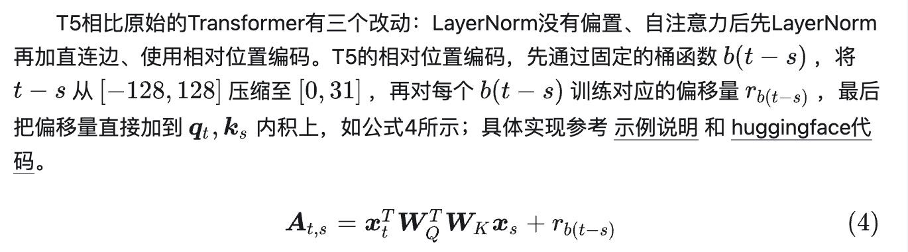

## 4. Transformer 结构

### 4.1 自注意力

`attn = V @ softmax(Q @ Kᵀ / √dₖ)`

- Q 查询当前 token 与其他 token 的相关度，K 是关键信息，V 是实际被加权的内容。
- softmax 负责归一化、抹平差距；缩放 √dₖ 是避免高维点积过大，softmax 后把小的结果压得过小、梯度消失。
- 位置索引上，注意力对序列位置无偏好，需要 mask 保证自回归性。

注意力变体（省显存主线）：

| 方案 | 机制 | 收益 |
|---|---|---|
| MHA | 多头各自一套 Q/K/V，捕获不同子空间 | 表达能力强 |
| MQA | Q 多头、K/V 只有一套 | 省显存，但过于激进 |
| GQA | 分组，组内多个 Q 共享 K/V | 折中，工程验证 4 个 Q 共享 1 组 KV 较好 |
| MLA | 输入低秩投影到 latent 向量 C 作为 KV 输入，升维矩阵吸收进 Q 和 O 的计算 | 进一步压缩 KV Cache，时间换空间 |
| FlashAttention | 分块 + online softmax 减少显存读写 | 长序列提速 |

### 4.2 FFN / 激活

- FFN 是两个全连接层加中间非线性，权重量承载训练中习得的**记忆**；作用是整合注意力层提取的分散特征，并把特征维度映射到输出空间。
- **SwiGLU**：门控机制用 swish 激活动态调节信息流，连续可导缓解梯度消失，非单调性可捕捉更复杂的非线性，参数效率优于 ReLU + 线性层。
- 激活函数谱系：sigmoid（两侧饱和、梯度消失、指数运算慢）→ ReLU（解决梯度消失、带来稀疏性，但易神经元坏死）→ GELU（`x·Φ(x)`，平滑）→ Swish/SwiGLU。无非线性激活时，再多层也退化为线性模型。

### 4.3 残差与归一化

残差连接（add）提供输入直达输出的通路：一是引入恒等映射，网络只需学「如何修正输入」，更易拟合；二是反向传播多一个 +1 项，缓解梯度消失。

归一化的意义与位置：

| 类型 | 说明 |
|---|---|
| LN | `((x − μ)/σ)·γ + β`，把每层激活拉回 0 均值、单位方差，兼具正则效果，降低过拟合 |
| RMSNorm | 去掉减均值，仅除均方根 `(x/RMS(x))·γ`，计算更省、数值更稳，长序列推理分布更稳（LLaMA、Falcon、Mistral） |
| DeepNorm | 在 LN 基础上于残差连接中对激活值按比例缩放 |

| 位置 | 特点 |
|---|---|
| Post-Norm | 残差相加后再归一化，正则强、早期层最稳；但梯度要穿过每层 LN，深层易指数衰减/爆炸，需 warmup |
| Pre-Norm | 先归一化再进子层；残差提供「直接路径」，深层训练稳定、不依赖 warmup；理论上等效深度不如 Post-Norm，正则较弱（主流选择） |
| Sandwich-Norm | 输入输出两头都夹，约束方差、防止信息膨胀，适合极宽 FFN |

可学习参数 γ（scale，初始化为 1）与 β（bias，初始化为 0）的作用是把强行拉平的分布重新拉伸/偏移回模型最舒服的区域：去掉 γ 会让深层激活过小、梯度消失；去掉 β 会把均值强制为 0，后续 ReLU 一半神经元恒为 0 导致信息坍塌。

### 4.4 解码器与三种架构形态

- 编码器（Encoder）：双向自注意力，理解和分析输入（BERT）。
- 解码器（Decoder）：mask 注意力保证自回归；cross-attention 接受编码器信息。
- 三种形态：Encoder-Decoder / Encoder-Only / Decoder-Only（当前生成式主流）。
  - Decoder-Only 分因果解码器（单向掩码注意力）与前缀解码器（输入侧双向、输出侧单向）。
- 输出层：多层堆叠后 → final norm → `lm_head`（d → vocab）→ softmax → 采样/贪心。无论哪种架构，最后一步都是同一个 lm_head 矩阵乘法。

Qwen 系的典型 Decoder Block（Pre-Norm）：

```text
RMSNorm → GQA 自注意力(q_norm/k_norm) → 残差
        → RMSNorm → SwiGLU FFN → 残差
```

原笔记中保留的结构与组件图（2025-07 记录）：

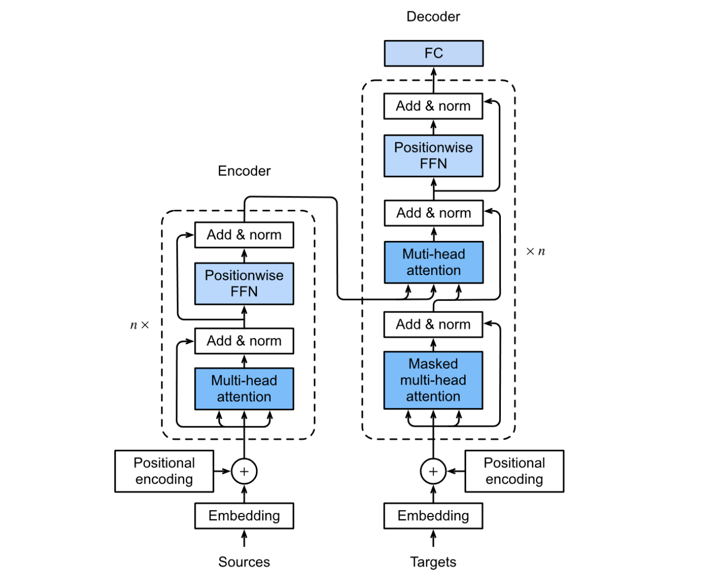
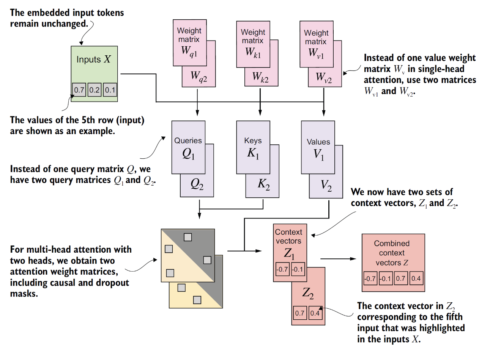
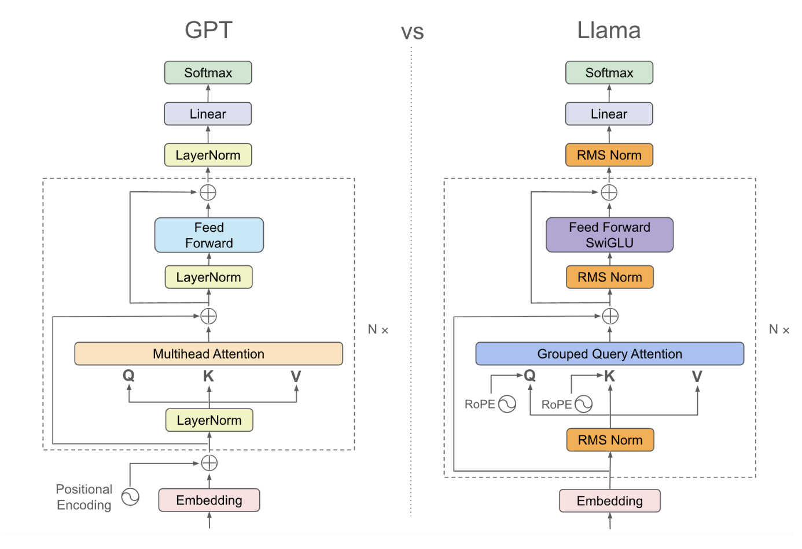
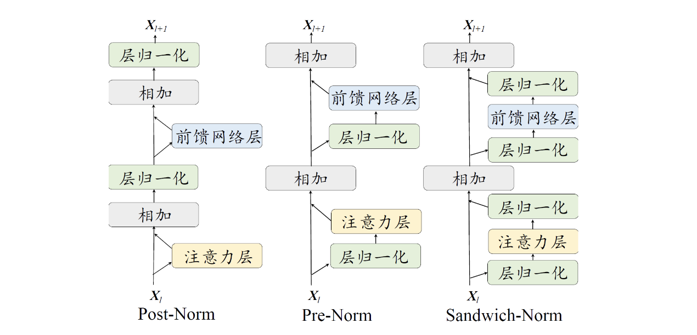
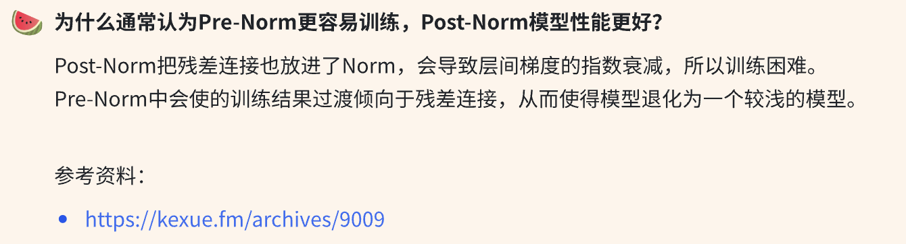
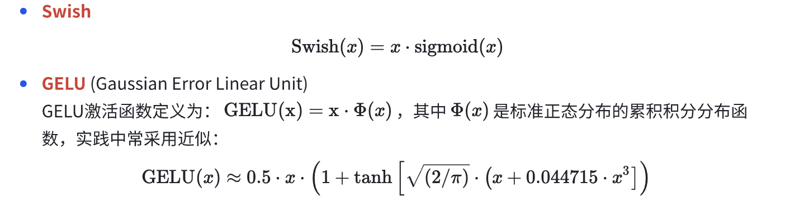
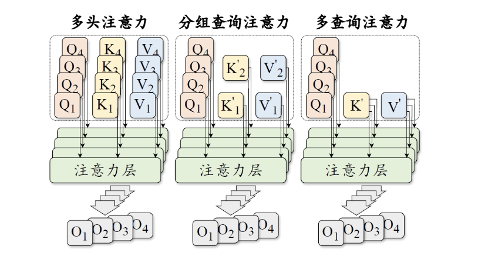
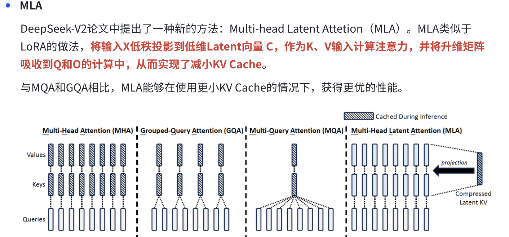
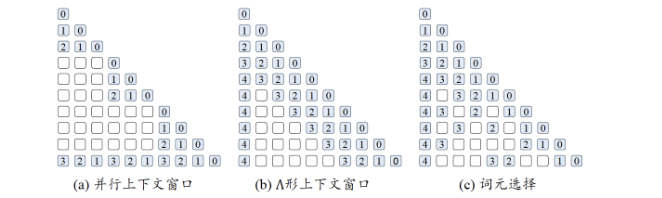

### 4.5 复杂度速查

| 操作 | 复杂度 |
|---|---|
| 生成 Q/K/V 矩阵 | O(n·d²) |
| 注意力分数 | O(n²·d) |
| 归一化注意力分数 | O(n²) |
| 加权求和 | O(n²·d) |
| Self-Attention 合计 | O(n²d) |
| Multi-Head Attention | O(h·n²·d_h) = O(n²d) |
| Multi-Query Attention | O(h_q·n·d) |

长序列优化：稀疏/局部/全局/随机注意力、分块注意力、文本截断与分段、摘要压缩、动态注意力窗口。

## 5. MoE 与 DeepSeek 实战

### 5.1 混合专家（MoE）

- 思路：与其让一个超大稠密网络对所有 token 统一计算，不如拆成多个专家模块，用门控在推理时只激活最相关的少数专家，实现**稀疏激活**——整体参数量巨大，单次推理实际访问的参数被大幅缩减（如 80B 总参数只激活 13B）。
- 门控网络是一个带 softmax 的简单网络，学习把输入送给哪个专家：① 加噪声（提升鲁棒性、辅助负载均衡）② 取 top-K ③ softmax。
- **负载均衡**是落地必须解决的问题。从 batch 视角看：10 个 token 被路由到 6 个不同专家，各专家的 batch 极不均匀，算力利用率下降；且训练中门控易收敛到只选少数头部专家并自我强化，形成过载/闲置分化。DeepSeek V3 在门控引入**可学习偏置项**，让低使用率专家获得更多机会。
- 共享专家负责通用任务，路由专家负责特定任务；美团 LongCat 进一步用「零计算专家」取消公共专家以降低推理开销。

### 5.2 DeepSeek 的关键机制

- **细粒度专家划分 + 共享专家分离**：专家拆得更细（如每个 0.5B），总参 6710 亿但单 token 仅激活 370 亿（约 5.5%），显著降本。
- **MLA（多头潜在注意力）**：为注意力加一道中间环节，先把 Key/Value 聚合到一组紧凑的可学习隐式向量（低秩压缩），再在潜在空间做多头注意力，既保留多头对不同维度的关注，又大幅降低长序列的算力与存储负担。GQA 靠少数投影省空间，但序列很长时复杂度仍逼近 n²；MQA 只留一组 KV 又太激进，MLA 是折中。
- **后训练**：把预训练阶段「意外找到的有效提示语」固化成任何场景都能稳定触发的技能。重点是指令微调对齐（多任务联合训练）+ 强化学习对齐 GRPO。

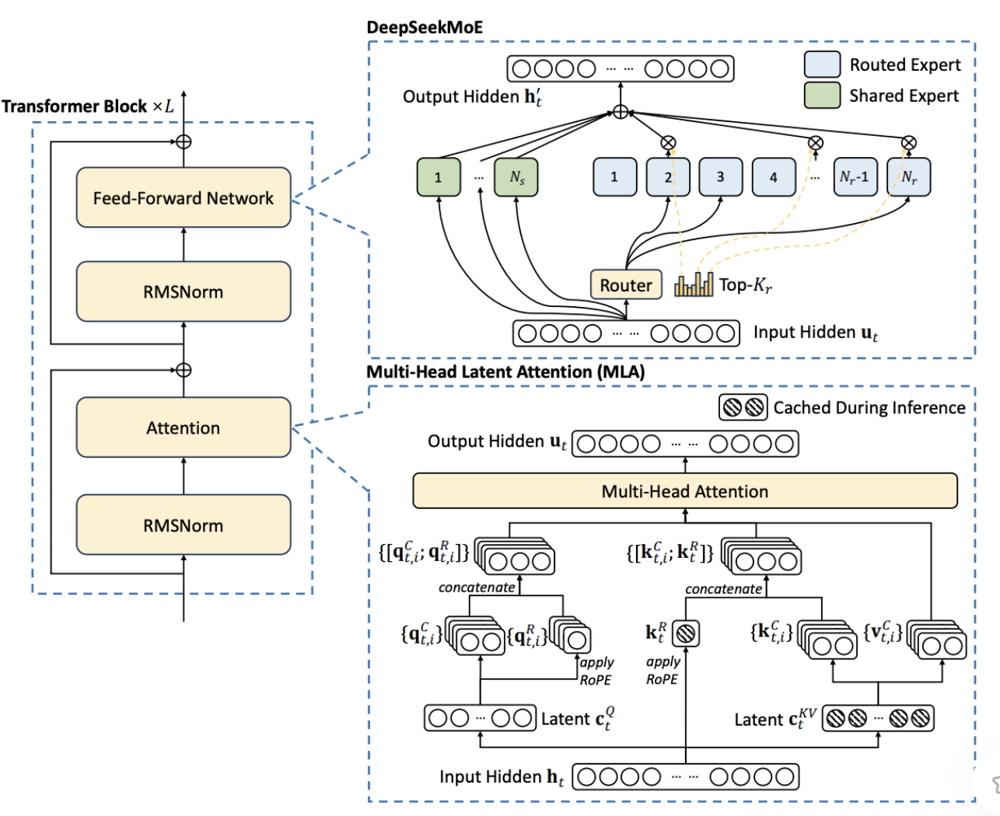
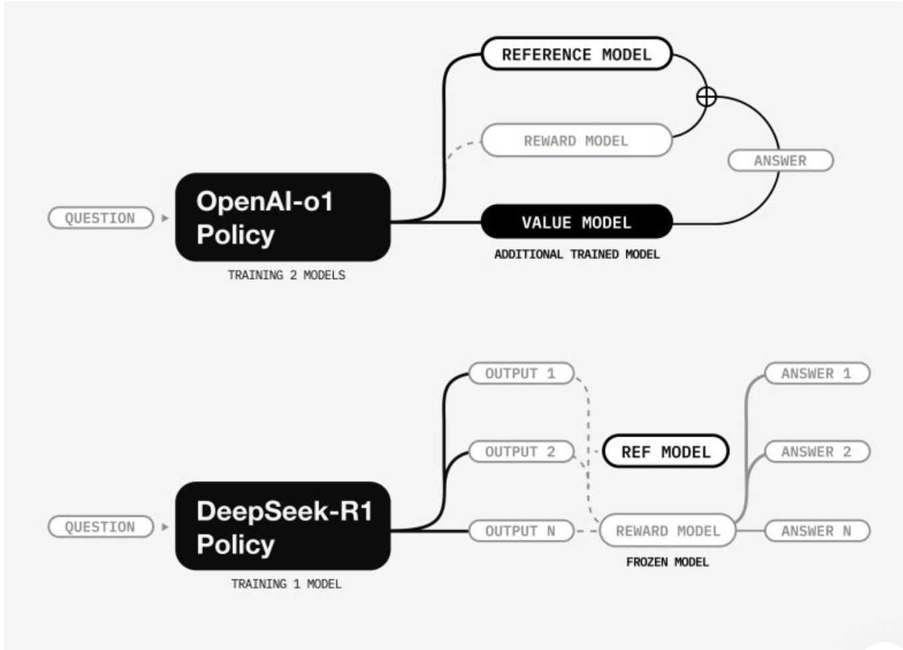

## 6. 训练

关键要素：数据、参数、损失函数（衡量答案与真实答案的差距）、优化器、正则化（防止死记硬背）。

### 6.1 预训练

数据流：质量过滤（如 DataJuicer 框架：质量过滤、敏感内容过滤、去重）→ 分词 → 数据调度（混合比例与训练顺序；精调时按技能依赖顺序编排数据集效果更好）。

训练循环六步：
1. 数据流设计：动态分块、掩码生成
2. 初始化：模型参数、优化器
3. 前向传播：并行策略、激活重计算
4. 损失计算：交叉熵/MSE、正则化、权重衰减
5. 反向传播：梯度计算与累积
6. 参数更新：优化器步骤、学习率调整

预训练任务：语言建模（预测下一个词元、前缀语言建模、中间填充）、去噪自编码、混合去噪器。

- batch size：可采用动态批次，前期小批次让 loss 尽快下降，后期大批次让下降更稳。
- 学习率：预热阶段 + 衰减阶段。
- 正则化：L1（加权重绝对值）、L2（加权重平方）；Dropout 随机丢弃部分参数，防止过度依赖少数关键参数。

### 6.2 并行与显存优化

| 手段 | 说明 |
|---|---|
| 数据并行 | 每张卡维护完整模型副本，输入数据分片 |
| 张量并行（tp/mp） | 每张卡持有所有 layer 的一部分参数，各算一部分 activation 后汇总 |
| 流水线并行（pp） | 按 layer 维度拆分模型，串行前向；SFT 场景 GPU 少、global batch 不大，较少使用 |
| 上下文并行（cp） | 如 256k 序列、cp=8 时每卡先算 32k 内的 attention 再汇总 |
| ZeRO | 分阶段减少优化器状态冗余存储（优化器参数 → 梯度 → 模型参数），需用时再从其他卡读取 |
| FSDP | 参数、优化器状态、梯度全分片，前向时只加载当前所需分片 |
| 激活重计算 | 只保存每层输入，反向时重算层内激活值 |
| 混合精度 | FP32 存储、FP16 计算，需要损失缩放 |

**显存占用估算**

- 训练 = 参数 + 梯度 + 优化器 + 激活值
  - 参数：参数量 × 精度字节（7B、fp32 → 28 GB）
  - 梯度：与参数量相同
  - 优化器：Adam 为参数量的 2 倍（一阶矩 + 二阶矩）；SGD 无额外占用
  - 激活值：`batch_size × seq_len × hidden_size × num_layers × num_attention_heads`（调 batch size 或用混合精度）
- 推理 = 参数 + KV Cache + 激活值
- 其他固定开销：代码库内核 0.8–1G、ZeRO 相关 1–4G、中间结果与显存碎片 0.5–1G。

原笔记中的训练数据、学习率与显存计算图：


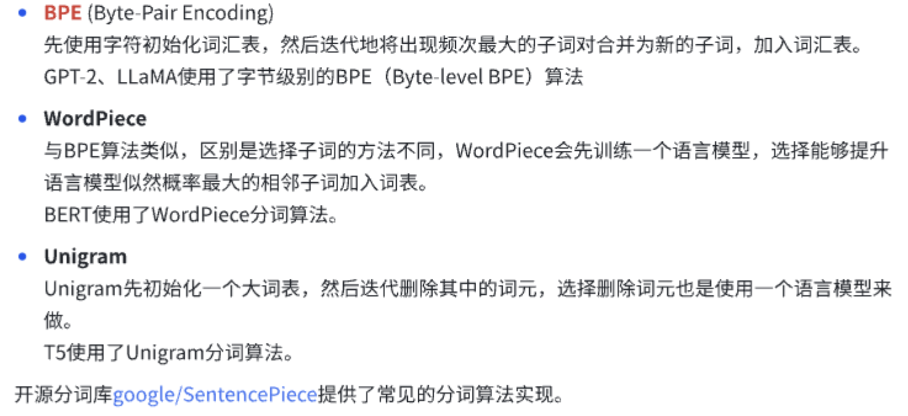
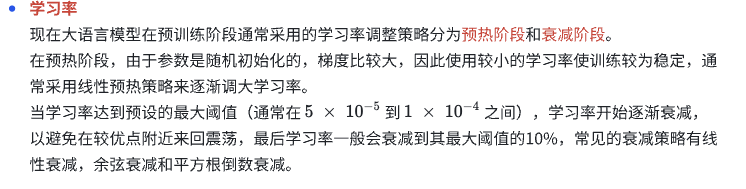
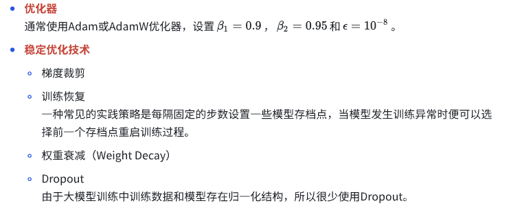
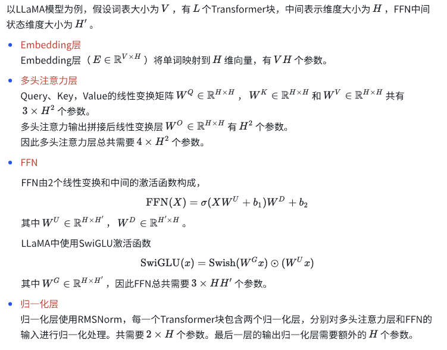
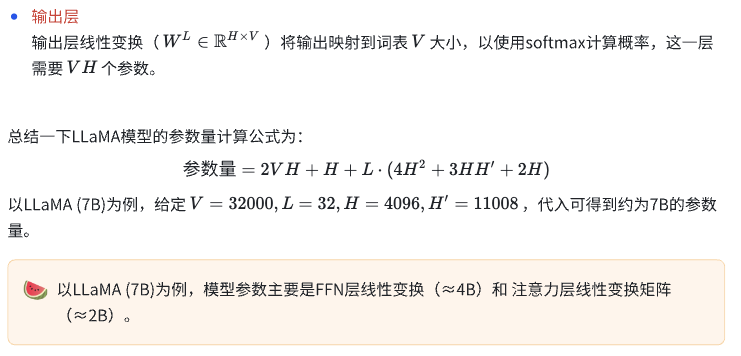
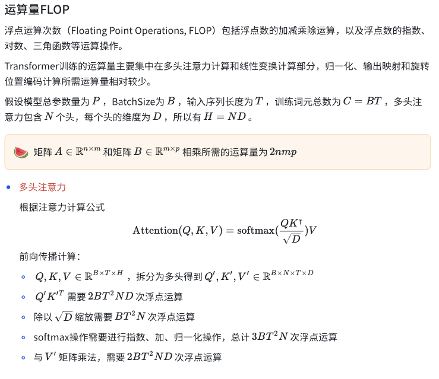
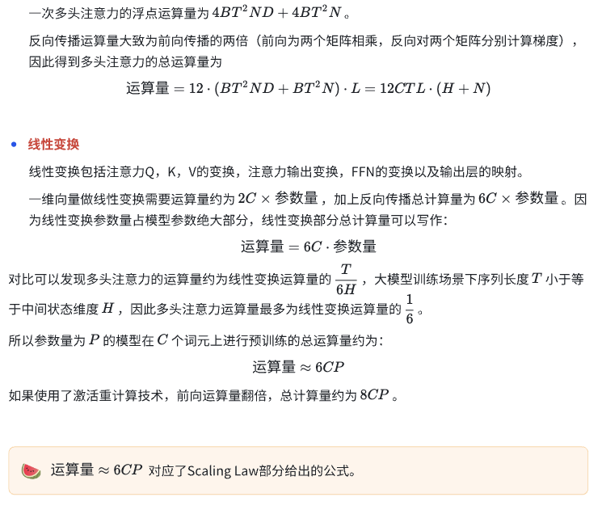
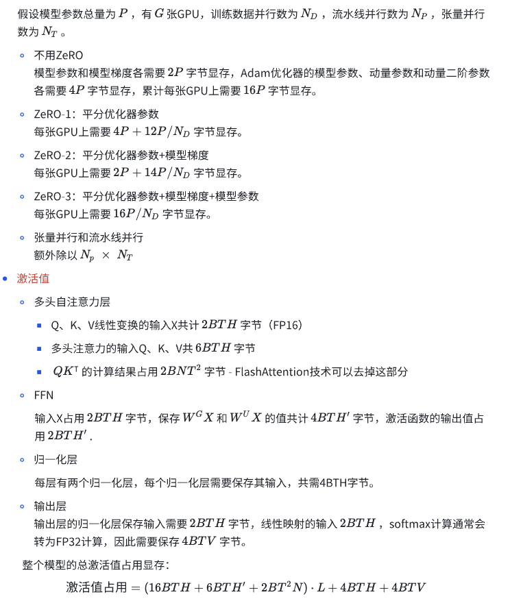
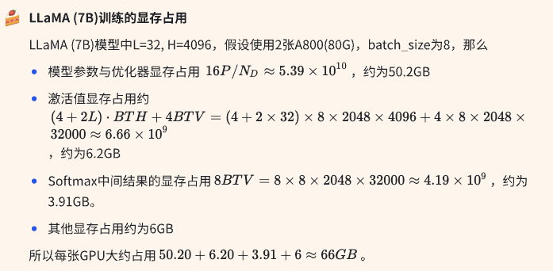
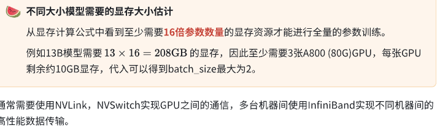
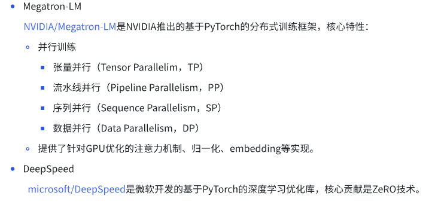
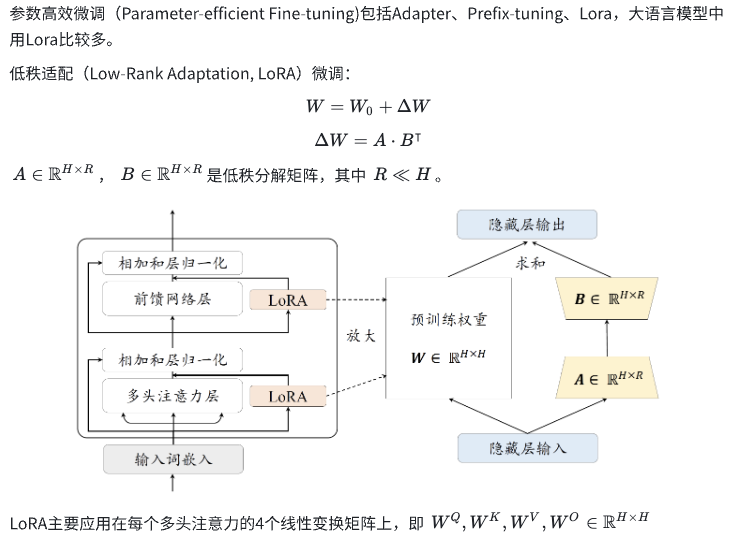
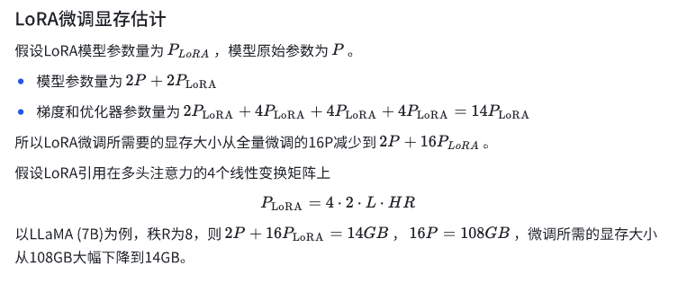

### 6.3 SFT（指令微调）

- 用自然语言形式的数据对预训练模型做参数微调，把指定知识注入模型，适合高难度任务（如蒸馏）；会一定程度损害泛化性，且微调模型能力不会超过蒸馏源模型。
- 数据格式：任务描述 + 任务输入 + 任务输出；训练时**遮蔽指令部分 token，只对响应部分计算损失**。
- 与预训练的数据差异：

| 维度 | 预训练 | 微调 |
|---|---|---|
| 样本来源 | 无标注纯文本，滑窗 512–4096 token | 下游已标注样本（分类、QA 对、摘要-原文对） |
| 掩码策略 | 随机 15% mask 或 causal mask | 不随机 mask，只在标签位置计算 loss |
| batch 构成 | 语料 shuffle 后连续取 | 按标签分层采样，保证各类别比例均衡 |

- 微调的梯度特征：任务头（随机初始化）先拿到最大梯度；顶层 2–4 层梯度范数占总能量 70% 以上，底层几乎不动；低学习率 + 早停使参数只在「预训练盆地」内做微小游走。

参数高效微调路线：

| 方法 | 做法 | 取舍 |
|---|---|---|
| 全量微调 | 更新全部参数 | 效果最好，成本高、可能遗忘预训练知识 |
| LoRA | 冻结原权重，只训练低秩适配矩阵 | 省显存，受低秩近似能力限制 |
| Adapter | Transformer 层间插入适配器 | 模块化，可动态加载 |
| Prefix / Prompt Tuning | 优化输入前缀或软提示，不动模型权重 | 几乎零计算开销，适合快速实验 |
| 部分微调 | 冻结部分层，只训练高层或特定模块 | 数据少时避免过拟合，保留底层特征 |

### 6.4 人类对齐与 RL

强化学习把语言模型规训成对话模型。与 SFT 的差别在于反馈粒度：

- SFT 针对单个 token 反馈，要求模型给出确切答案；RL 针对整段输出反馈，可兼顾表达多样性、对微小变化更敏感。
- RL 更容易缓解幻觉：SFT 极易让求知型 query 产生幻觉，而 RL 可以通过定制奖励函数让模型学会「依赖内部知识、放弃回答」。
- RL 还能处理多轮对话的奖励累积问题。
- 目标函数两部分：让结果分布与 SFT 阶段近似（KL 约束），同时让回答趋向高分。

| 算法 | 要点 |
|---|---|
| PPO | 四个模型：policy 产生策略、reference 计算更新幅度、reward 打分、critic 估优势；policy 和 critic 需更新。目标函数含似然与梯度裁剪，奖励含 KL 散度 |
| DPO | 用偏好数据训练，本质不算 RL；通过数学推导把优势用 policy 表示，跳过奖励模型，训练更简单稳定 |
| GRPO | PPO 的优化：取消 critic，显著降显存；同一 prompt 生成一组结果，以组内平均奖励为基线，用差值体现优势；KL 从奖励项提到目标函数 |
| DAPO | 在 GRPO 上改进：动态采样、上下裁剪解耦、token 级优势估计 |

原笔记中的算法示意图：

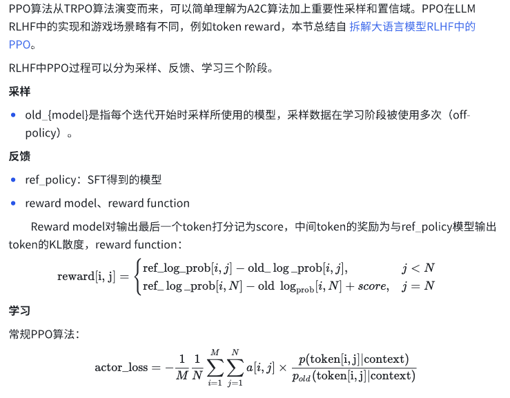
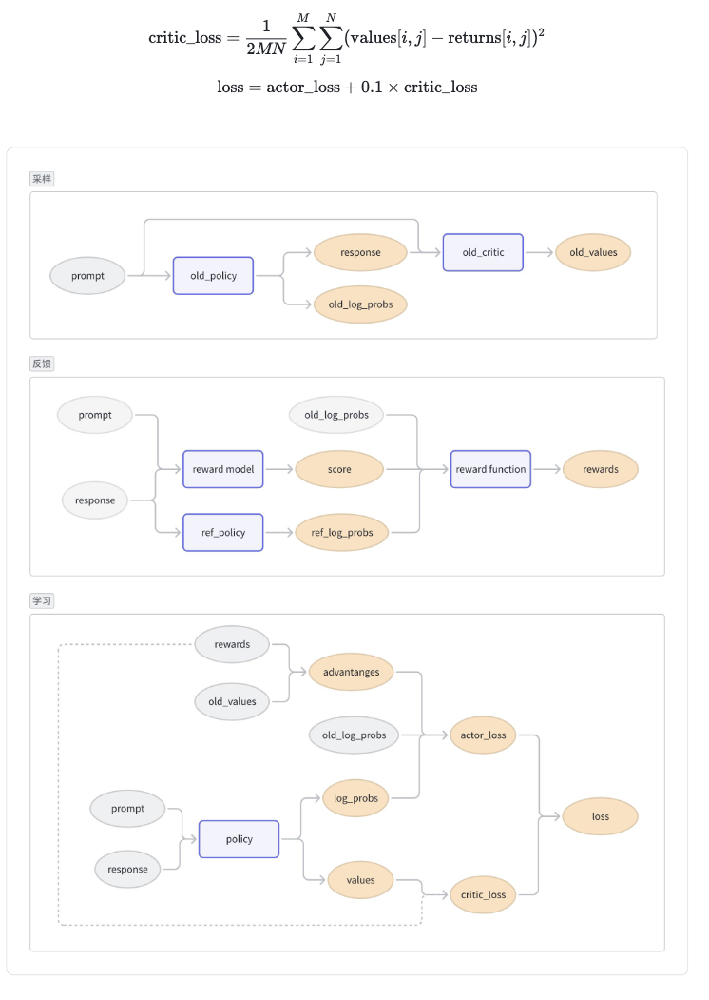
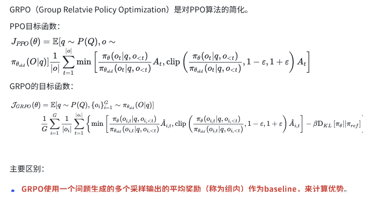
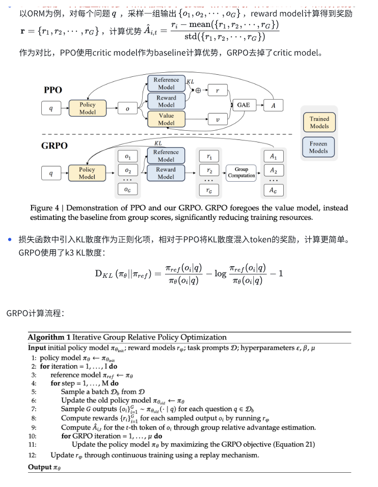
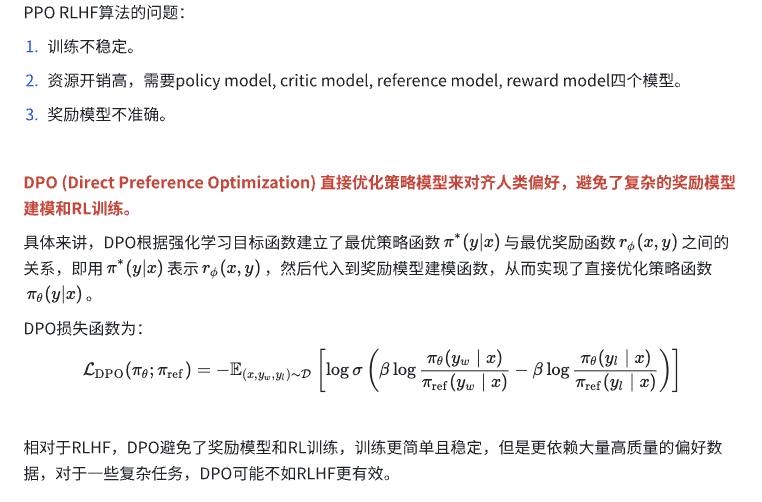

> GRPO 的工程实现、奖励函数设计与踩坑记录见 [[02-主题/AI与LLM/后训练实战：SFT 与 GRPO（项目笔记汇编）|后训练实战]]。

## 7. 推理与部署

### 7.1 解码策略

- 贪心搜索：可加长度惩罚、重复惩罚，或扩展为 Beam Search。
- 随机采样：温度采样、top-K、top-P。

### 7.2 性能与优化

- 指标：TTFT（首 token 延迟）、TPOT（每 token 输出时间）；瓶颈分 GPU 指标与模型性能指标；解码分全量解码与增量解码。
- PD 分离：prefill 是计算密集型、decode 是显存密集型，分离部署提升效率。
- KV Cache：缓存前向过程中的键值对，避免前序上下文重复计算。
- Continuous Batching：多请求打包为一个 batch，短请求先结束、新请求动态加入。
- 注意力优化机制：safe softmax → online softmax → FlashAttention（配合 Tiling）。
- 量化：把连续输入映射到离散输出集合；参数、KV Cache、激活、通信、QKV 均可量化；方法分量化感知训练（QAT）与训练后量化（PTQ）。

原笔记中的推理优化图：

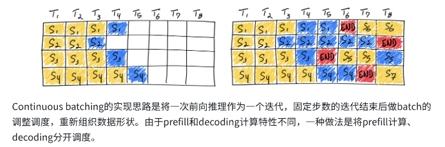
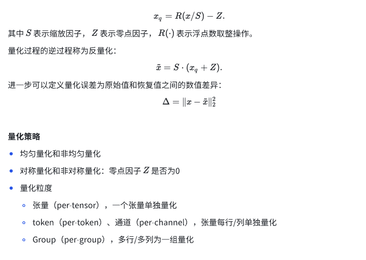

## 8. 学习时的骨架式理解（原始速记）

保留几段当时用来自我检验的极简理解，便于快速回忆：

- 神经网络：拟合函数 → 拟合世界（输入 → 输出）。
- 语言模型：本质是完形填空。
- 注意力：加权求和，分配注意力。
- PyTorch 架构：tensor（张量）、parameter（可优化参数）、module（容器）、autograd（计算梯度）、optimizer（优化参数）。
- 归一化为什么必要：梯度与本身数值有关，值过大过小都会导致梯度爆炸或消失，需要把标准差拉到 1；RMSNorm 相比 LN 少了减均值和算均值两步。
- 位置编码演进：绝对 → 相对 → RoPE（利用三角恒等式，点积后与和、差有关，两两一组旋转）；三角函数有周期性，长度超过训练长度后模型无法区分远近 → YaRN 用非线性插值把 RoPE 外推到更长序列，高低频分别处理。

## 9. 待补与待验证

- MLP 切分、attention 切分的具体张量并行实现细节。
- 训练资源与显存计算的具体公式推导（原笔记只留了结论与截图）。
- FlashAttention 的 tiling 与 online softmax 推导。
- 各量化方法（GPTQ/AWQ/FP8）在混元系模型上的实测对比。

---

**来源**：`notes/LLM总结.md`（2025-10~12）、`notes/总结.md`（2025-07~08）、`notes/分词.md`、`notes/AI工程基础.md`、`notes/思考.md`、`notes/系统实战.md`。
