# 后训练实战：SFT 与 GRPO（项目笔记汇编）

围绕「智能问答 Agent」项目整理的完整后训练笔记：数据怎么筛、SFT 怎么训、GRPO 的奖励函数怎么设计、踩了哪些坑，以及混元中小模型精调的通用实操指南。**训练参数、指标表格、prompt 原文全部保留**，只做了去重与排序。

> [!info] 来源边界
> 原始笔记记录于 2025-07 ~ 2025-09，含项目实验记录、平台操作经验与外部资料摘录。表格中的指标与结论按原样保留，未重新计算。原文完整保存在 `backups/obsidian-cleanup-20260921/整理前笔记与配置.zip`。
> 基础原理（Transformer/位置编码/模型结构）见 [[02-主题/AI与LLM/LLM 架构与训练基础（学习笔记汇编）|LLM 架构与训练基础]]。

## 1. 项目目标与约束

**任务**：给定上下文（doc）与用户问题（query），用大模型总结生成高质量答案。

**三条业务规则**：
1. 上下文与问题**密切相关**时：答案严格基于上下文，不得使用先验知识；上下文含图片时必须携带图片说明，实现图文混排。
2. 关联**较弱**时：只回答可解答的部分，无法回答的部分给出引导性建议，引导用户查外部资料。
3. 上下文与问题**无关**时：返回特定标志 `NO_MATCH`，便于业务侧调用其他服务或返回兜底回复。

额外约束：
- 上下文无关时**尽量避免推理**（推理对业务无效，且拖长输出时间影响同步流程）。
- 输出格式固定：`<think>...</think>` 后直接跟答案。
- 现有非推理模型仅靠 SFT 微调仍存在重复输出、图片输出幻觉、逻辑推理误差，希望用强化学习降低发生概率。

期望输出格式：

```text
<think>
这里是推理过程
</think>
这里是答案
```

## 2. 数据构造与筛选流水线

### 2.1 数据来源与字段

从平台直接拉取数据，取文档评级前 5w 条。doc 样例字段包含：`docid / biz_level / click / doc_level / ecpose / firstclick / fre_score / lastclick / query / rele_level / satisfy / skip / stay`。

筛选规则（规则 1）：`biz_score > 0.3`、`click > 2`、`doc_score > 0.5`、`query_len > 5`、`rele_score > 0.6`、`skip < 5`、`stay > 3000`。

筛选规则（规则 2）：query 应为问题形式而非关键词；同一 Doc 对应的 query 应多样；Doc 需有合理长度且与 query 有关联。

### 2.2 六步筛选流程

| 步骤 | 方法 | 说明 |
|---|---|---|
| 1 | 规则 + 模型 | 去除不符合问答形式的 query |
| 2 | 规则 | 去重（后期改为 hash 去重，比模型更快更稳） |
| 3 | 规则 | 控制 doc 长度与同一 doc 对应的 query 数量 |
| 4 | 模型 | 生成 answer，过滤无法回答的 |
| 5 | 模型 | 生成 thinking 过程 |
| 6 | 模型 | 使用评估指标体系打分 |

**规模变化记录**：原始 591w 序号文件 / query 4443w（q:d ≈ 7:1），按序取前 5w → 规则筛选后 3.7w（删 3.4w）→ 问答形式判断后「是 1.7w / 否 1.9w」→ 去重后 1.2w（gpt-4o 效果一般，Claude-3.7 更好）→ 合并 doc 并过滤过长过短（平均字数 1500、最长 8w；保留 180–4300）得 doc 4k、query 1w（≈1:2.4）→ 关联性判断「是是 8k / 是否 500 / 否否 230 / 否是 25」→ 最终有效数据 **7985 条**，3560 个 docid、7760 个 query，平均每 doc 2.18 个 query；同一 doc 的多个 query 合并进一条指令，因此指令条数 **3560 条**（单 doc 的 query 上限压到 15 个）。

原笔记中的筛选与实验记录：

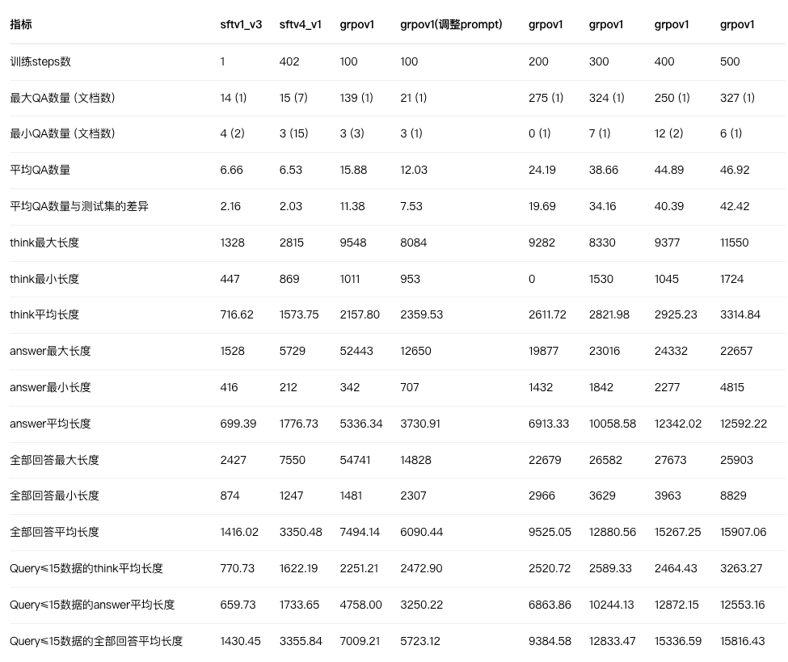

### 2.3 关键 prompt 原文

**① 判断是否为问答类查询（qwen2.5-72b-vl，判别式 + few shot）**

```text
你是一名判断专家，需要判断给定的查询（query）是否为问句或者可以视为询问形式（属于【问答类查询】而不是只有单纯的【关键词】）。
###判断标准：
- 如果查询是明确的问句或者可以视为对某个信息的询问，那么输出`是`。尤其要注意后者，例如"最适合秋季的食材"，虽然没有疑问词，但可以转化为用户在询问"最适合秋季的食材是什么"，因此暗含问答的意图，属于【问答类查询】。
- 如果查询是单纯的关键词，没有明确的提问意图，那么输出`否`。
###输入格式：
- 输入会包含一个字段 `query`，这是待判断的查询内容。
- 输出应仅为`是`或`否`，不需要其他解释。
```

**② 同一 doc 下选出不重复的 query**（后期改为 hash 去重）

```text
你是一名查询专家，你将收到多个查询，它们可能是对同一信息的不同表达。你的任务是从中选出不重复的查询，并输出这些查询。重复的查询是指：
- 完全相同的查询（包括标点符号、空格等）。
- 虽然文字不同，但表达的是相同意图的查询。
请遵循以下规则：
1. 对于重复的查询，合并并只保留一个。
2. 输出时请确保每一个查询与原始查询完全一致，不要更改任何字符、空格或标点符号。
3. 输出格式为一个列表，每一项是一个不重复的查询。
4. 输出内容只能包含一个列表，绝对不要包含其他多余的文字解释。
```

**③ 判断 doc 与 query 的关联性与可答性**

```text
你是一名文本关联分析专家。根据给定的文档（doc）和查询（query），你的任务是判断以下两点：
- 关联是否紧密：判断查询和文档的相关性是否高，是否具有直接的关联。
- 是否能从文档中找到答案：判断文档是否包含查询所需要的答案。
判断标准：
- 关联是否紧密：如果文档的内容和查询的主题、意图高度相关（如文档讲解的内容能够直接回答查询的需求），则认为关联紧密；不相关则认为不紧密。
- 是否能从文档中找到答案：如果文档中包含查询所需要的明确信息（答案），则认为可以找到答案；答案不清楚则认为无法找到答案。
输出应为一个列表，包含两个项目：第一项表示是否关联紧密，第二项表示是否能从文档中找到答案，均输出是或否。
【请注意，输出内容只能包含一个列表，绝对不要包含其他多余的文字解释。】
```

**④ 基于 doc 生成 answer**

```text
你将收到一个文档（doc）和一个问题（query）。请根据文档内容来回答问题：
1. 答案准确性：直接根据文档内容得出，避免任何推测、假设或个人解释。
2. 答案来源唯一性：完全来自文档，不能包含外部来源的内容，即使是相关领域的常识或背景知识。
3. 完整性与相关性：包含所有与问题相关的关键信息，避免遗漏。
4. 语言表达清晰：简洁、易理解，结构清晰。
5. 避免重复或不必要的信息。
6. 特殊情况：不能回答时只输出"无法回答"，不做推测。
7. 不要说"根据文档内容……"之类的话，直接回答。
####：
文档（doc）：{}
问题（query）：{}
```

**⑤ 生成 answer 时的模型选型对比**（人工主观感受）

| 模型 | 准确数 | 负样本 | 正样本 | 主观感受 |
|---|---|---|---|---|
| **o4-mini** | 14/14 | 2/2 | 12/12 | 输出较全面详细 |
| **HunYuan-Turbo** | 14/14 | 2/2 | 12/12 | 输出较全面详细 |
| Qwen2.5-72B-VL | 13/14 | 2/2 | 11/12 | 有一条漏信息 |
| Claude-3.7-Sonnet | 12/14 | 2/2 | 10/12 | 一题不全面、一题混入英文 |
| GPT-4o / GPT-4.1 | 10/14 | 2/2 / 0/2 | 8/12 / 10/12 | 输出偏简略；GPT-4.1「无法回答」误判 |
| HunYuan-T1-Latest | 10/14 | 1/2 | 9/12 | 提到「文档」、漏信息、用了主观知识 |
| DeepSeek-R1-0528-Adams | 10/14 | 2/2 | 8/12 | thinking 过长易跑偏、漏信息 |

### 2.4 蒸馏与 COT 数据构建

原始做法：基于 context + query 对 R1 蒸馏 → 发现结果质量与图片排版都不如原有 ground_truth，于是改为**结合 R1 的思维链与原有 ground_truth 做多轮对话蒸馏**：

```json
[
  { "role": "user",      "content": "context and query" },
  { "role": "assistant", "content": "ground_truth" },
  { "role": "user",      "content": "context and query" }
]
```

第一轮输入 query + context 并给出 ground_truth 作为标准答案，第二轮重复同样的输入让模型输出带 COT 的答案。

清洗：用语义相似度对比 `model_answer`（去掉 think）与 `ground_truth`，设阈值筛选，最终得到 `(query, context, cot, ground_truth)` 格式数据。

数据分布（文档问答数据集）：

| 类型 | 规模 |
|---|---|
| 图文混排强相关 | 12.2k |
| 纯文本强相关 | 3.1k |
| 弱相关 | 1.2k |
| 不相关 | 5.4k |

通用数据集：`Chinese-DeepSeek-R1-Distill-data-110k-SFT`（11 万条 query/cot/answer，缺 context 字段），用于对比实验与泛化。

## 3. 评估与打分体系

### 3.1 奖励函数 8 维度（文档问答场景，满分 12.5）

| 维度 | 分值 | 标准 | 设计意图 |
|---|---|---|---|
| R_format 格式正确性 | 1 | 同时包含 `<think>...</think>` 与 `answer:` 且顺序正确 | 结构化输出是可靠系统的基础 |
| R_think_len 思考长度 | 1 | 仅对 NO_MATCH 生效，think 越短分越高 | 无法回答时应简洁 |
| R_text_match 文本匹配 | 3 | ROUGE-L F1（60%）+ 语义相似度（40%） | 词汇与语义双重匹配 |
| R_img_recall 图片召回 | 2 | 每召回一张相关图片得 2/总数 分 | 多模态应有效利用视觉信息 |
| R_img_hallu 图片幻觉 | 2 | 每个幻觉图片扣 0.5，最多扣 2 | 保证信息真实 |
| R_rule 规则遵守 | 1.5 | 每违反一项扣 0.5，最多扣 1.5 | 遵循既定约束 |
| R_len 回答长度 | 1 | 300–500 字符满分，其他长度线性插值 | 过短缺信息、过长低效 |
| R_thinking_steps 思考步骤 | 1 | NO_MATCH 奖励简洁思考；正常回答识别「第一步/首先/1.」等标识符 | 结构化思考提升可解释性 |

NO_MATCH 场景的另一种写法（来自 [[02-主题/AI与LLM/后训练实战：SFT 与 GRPO（项目笔记汇编）|本文 §5]]）：`<think>` 为空给 1.0；非空则 `奖励 = 1 / (内容长度 + 2)`，分母加 2 避免除零并平滑梯度。有效匹配场景用 `rewards.append(min(1.0, matches / 3))`，最多 3 个关键步骤拿满分，防止堆砌步骤。

### 3.2 打分维度 10 项（QA 质量，用 Claude-3.7 打分）

每项 0–3 分，覆盖：Query 相关性、Query 意图度、Query 清晰度、Query 时效性、Answer 准确性、Answer 忠实度、Answer 完整性、Answer 逻辑性、QA 覆盖度、QA 多样性。汇总为 Query 总分（满分 12）、Answer 总分（满分 12）、QA 总分（满分 6）。

评分档位的通用锚点：0 分「超过 60% 不合格」、1 分「约 40%–70% 勉强」、2 分「约 70%–90% 良好」、3 分「超过 90% 优秀」。写打分 prompt 时按「维度名称 → 分数」的 JSON 输出，要求严格格式、不要多余内容。

### 3.3 对比度（与真实用户 QA 的吻合度）

衡量模型生成的 QA 与真实用户 QA 的重合程度：0 分 <40%、1 分 40%–70%、2 分 70%–90%、3 分 >90%。本质是 Query 仿真性——是否与真实场景的高质量 Query 类似。**结论：Claude-3.7 打分比 o4-mini 更合理准确。**

## 4. SFT 阶段

### 4.1 训练数据格式

训练与验证各一个 jsonl，每行一个字典：`{"input": "...", "target": "..."}`。SFT 指令模板（把 doc 转成「反向构造 query-answer 对」的任务）：

```text
标题：{page_parse_info_title}
文章：{page_parse_info_text_content}
任务指令：请仔细阅读文档内容，基于文档中提供的信息思考如何从中挑选出用户感兴趣的内容（即answer）。接着，反向构建出相应的query。思考过程请放在<think></think>标签内，答案请放在<answer></answer>标签内。最终答案为根据doc所得到的若干个Q-A对，格式必须规定的固定格式：
<qa>{"query":"查询内容","answer":"答案内容"}</qa>...
请注意：在输出的query和answer内容中，只能使用中文双引号，不能使用英文双引号。
```

配套的「生成思维链」prompt 要求模型输出：① 整体策略 ② 逐对 QA 的生成方式，且强调「你必须是在只有 doc 的情况下思考如何得到 answer 和 query」。

### 4.2 训练配置与结果

首批：总规模 3560 条（训练 3496 / 验证 64），微调 Qwen3-8B：

```text
num_train_epochs = 4            per_device_train_batch_size = 2
gradient_accumulation_steps = 2 eval_steps = 50
model_max_length = 8192         learning_rate = 2e-5
save_total_limit = 4
```

观察：4 个 epoch 中第 1 个 epoch 结束（约 110 steps）指标最高，之后逐渐降低（幅度不大）。3496 条数据 1 个 epoch 即达峰值，继续训练会过拟合。100 steps 时 ROUGE-1 0.43 / ROUGE-2 0.16 / ROUGE-L 0.36；只跑 1 step 时 ROUGE-1 0.36 / ROUGE-2 0.12 / ROUGE-L 0.27。

Qwen2.5-7B-Instruct 在 steps=400（epoch 4）最好，与 Qwen3-8B SFT 后指标基本持平，**因此选 Qwen3-8B 即可**（最好时 ROUGE-1 0.44 / ROUGE-2 0.16 / ROUGE-L 0.36；1 step 时 0.37 / 0.15 / 0.32）。

| 模型 | Qwen3-8B v3 | Qwen3-8B v2 | Qwen2.5-7B v5 | Qwen2.5-7B v4 | 测试集 target |
|---|---|---|---|---|---|
| 训练 epoch/steps | 0/1 | 1/110 | 4/436 | 0/1 | 4/436 | - |
| 总分（满分 30） | **27.98** | 23.69 | 24.66 | 26.28 | 24.14 | 25.48 |
| Query 相关性 | **2.98** | 2.72 | 2.83 | 2.92 | 2.94 | 2.95 |
| Query 意图度 | **2.97** | 2.55 | 2.64 | 2.84 | 2.89 | 2.80 |
| Query 清晰度 | **3.00** | 2.86 | 2.78 | 2.97 | 2.89 | 2.80 |
| Query 时效性 | **3.00** | 2.95 | 2.97 | **3.00** | 2.97 | 3.00 |
| Answer 准确性 | 2.83 | 2.80 | **2.84** | 2.69 | 2.62 | 2.97 |
| Answer 忠实度 | 2.83 | 2.80 | **2.89** | 2.75 | 2.64 | 2.98 |
| Answer 完整性 | 2.73 | 2.62 | **2.78** | 2.44 | 2.55 | 2.97 |
| Answer 逻辑性 | 2.98 | 2.89 | **3.00** | 2.98 | 2.98 | 3.00 |
| QA 覆盖度 | **2.25** | 1.08 | 1.33 | 1.89 | 1.16 | 1.48 |
| QA 多样性 | **2.41** | 0.42 | 0.59 | 1.80 | 0.50 | 0.53 |
| Query 总分 | **11.95** | 11.08 | 11.22 | 11.73 | 11.69 | 11.55 |
| Answer 总分 | 11.38 | 11.11 | **11.52** | 10.86 | 10.80 | 11.92 |
| QA 总分 | **4.66** | 1.50 | 1.92 | 3.69 | 1.66 | 2.02 |
| 对比度 | 1.25 | 1.17 | **1.28** | 1.17 | **1.28** | - |

结论：
1. 测试集上 query 数量 ≥2 时 QA 总分 3.80，≥3 时 4.82——**query 数量越多 QA 总分越高**，说明 Claude-3.7 更倾向给真实场景的高质量数据打高分。
2. query 数量为 1 的数据确实拉低总分（3.5k 数据里 2k 的 doc 只有 1 个 query）。
3. GRPO 中引入 QA 覆盖度与 QA 多样性可以有效提高生成的 QA 数量。
4. 对比度是有效指标，本质是 Query 仿真性。
5. **Claude-3.7 打分比 o4-mini 更合理准确。**

样例分析的结论：不做 SFT 时模型生成的 Query 与真实用户 Query 差别很大，说明 SFT 对风格迁移作用较大（Query 风格必须贴合实际）；但微调后 Query 数量偏少、少量不合理。后续方向：扩大真实数据规模、保留 doc 对应多个 query 的数据并保持数量均衡（大幅缩减单 query 数据，哪怕它质量高）、适当增加 epoch。

数据批次累计：第二批 25w、第三批 50w、第四批 50w、第五批 70w。结论：query 主要包括同一问题的不同问法（占 60%–80%）与不同内容的提问（20%–40%，通常是同主题下的细分或扩展）。

## 5. GRPO 与奖励函数

### 5.1 奖励函数设计（实战版）

- **格式奖励**：system prompt 指定「先思考再回答，推理过程用 `<think></think>` 包围，答案直接输出在 think 标签后」。
- **思考步骤奖励**：NO_MATCH 时希望 think 为空，过程越长奖励越低。
- **正确度奖励**：ROUGE-L（最长公共子序列 F 值）+ Sentence Similarity（语义相似度）。
- **图片正确性**：上下文含图片时，希望模型提到相关图片，并惩罚伪造图片链接（图片地址可比，可作正确度奖励的补充）。
- **重复惩罚**：提取所有 N-gram 计算重复率 `len(n-grams)/total`；无重复奖励 0，有重复产生负奖励，重复越多惩罚越大。

原笔记中的奖励函数格式与 GRPO 图解：

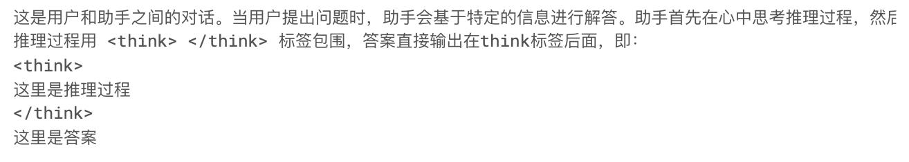
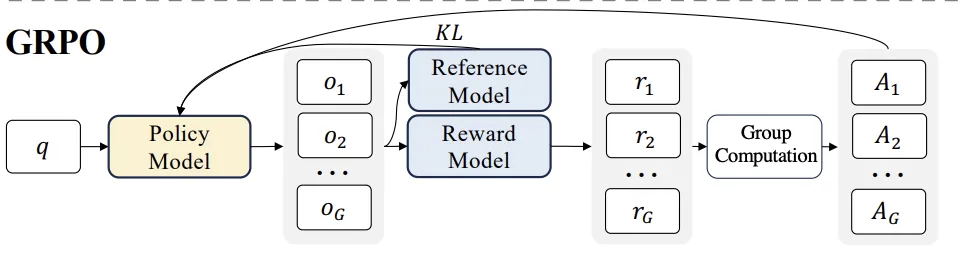
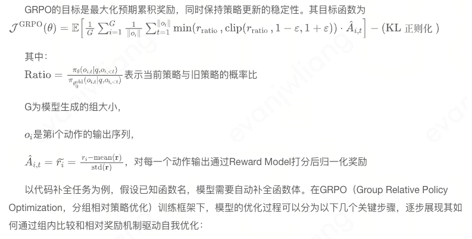
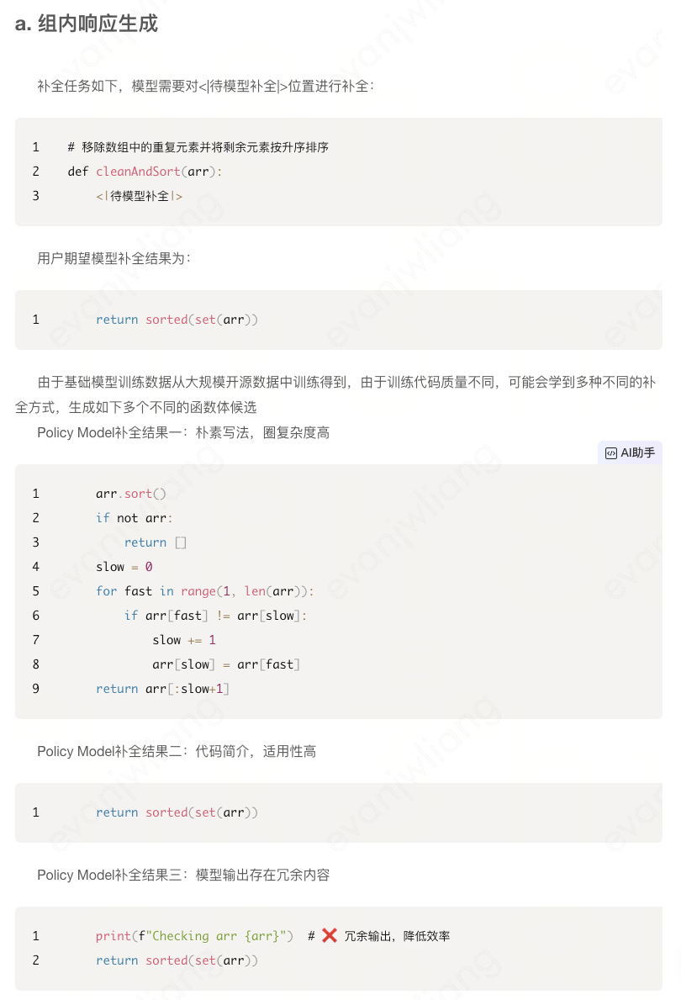
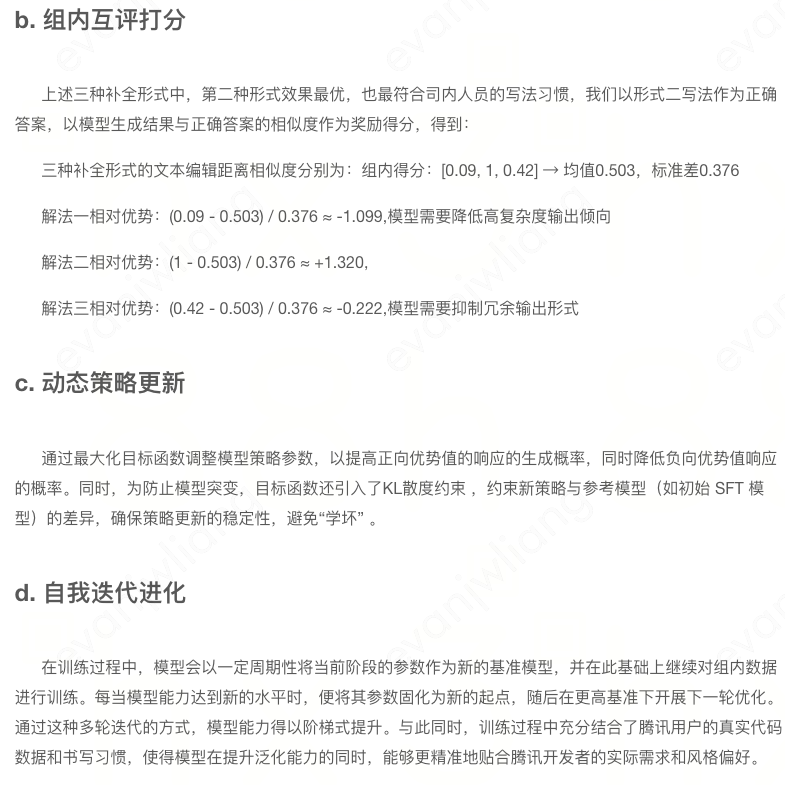
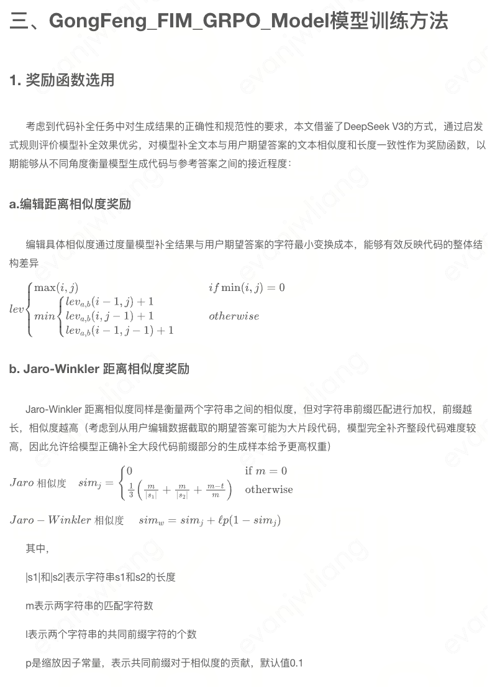

### 5.2 三组对比实验

1. **直接强化学习**（基于混元 7B-instruct）：200 步时格式规范性、准确度、图文混排格式与思考步骤显著提升；输出长度偏短（期望 400–500），think 过程过于简单。
2. **通用领域 COT 微调后再强化学习**（110k）：因模型已初步具备推理机制，各项奖励起点更高；completion_length 略降但可接受；RL 帮助模型学到图文格式、思考步骤等额外规则。
3. **自建文档问答 COT 数据微调后再强化学习**：初始奖励更高，500 步前趋势良好，**500 步时突然下降**。

第 3 组的失败原因（reward hacking 复盘）：模型生成了大量**格式错误的图片**（缺少正确的闭合），而 ImageSource 奖励函数只检查合法图片是否存在幻觉与重复，于是这种非法格式**绕过了正则捕获**；当上下文没有图片时，模型反而获得较大奖励，训练便朝这个方向收敛。

修复：增加一个**校验非法图片闭合**的奖励函数，检测到就给较大惩罚。

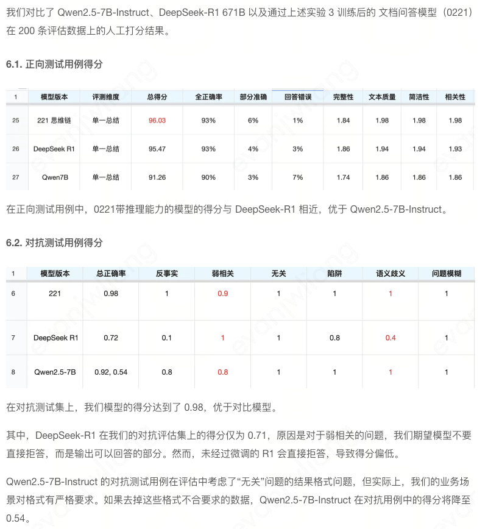

### 5.3 原理补充：PPO / DPO / GRPO

- **PPO**：源于 TRPO，通过限制新旧策略差异（clipping）稳定训练；损失含优势估计与熵正则化（鼓励探索）；应用广、相对稳定，但依赖优势估计、计算复杂。
- **DPO**（DeepMind, 2023）：直接优化策略对奖励的偏好，绕过优势函数；关键组件是偏好模型与学习率调度，用二值分类让高回报动作概率更高。样本效率与稳定性可能优于 PPO，更容易与预训练奖励模型结合，但在某些奖励函数下不够稳定。
- **GRPO**（分组相对策略优化）：对同一输入生成多个候选输出为一组，组内互相比较，每个候选按组内相对表现得分；目标是提升组内更优输出的概率、降低较差输出的概率。相比 PPO 避免了复杂策略裁剪与高方差梯度估计，训练更高效、更易收敛；相比 DPO 不只是偏好排序，而用相对优势的连续度量促进多样且高质量的输出。

**GRPO 关键点速查**

| 概念 | 要点 |
|---|---|
| KL 散度 | 限制强化学习后的模型不偏离原始模型太远；长 COT 过程中可删除以增加探索能力 |
| clip 裁剪 | 对新旧策略概率比裁剪，防止单步更新过大；epsilon 一般 0.2，会限制探索多样性；DAPO 将上下裁剪解耦，给低概率 token 更多探索空间 |
| 动态采样 | 直到一个 batch 内所有组内奖励既不全为 0 也不全为 1 |
| token 级策略损失 | GRPO 是 conversation 级损失：每个样本对组内 token 损失求平均，长短样本贡献相同 → 长样本 token 多、每 token 贡献被摊薄，无法奖励高质量长样本或惩罚低质量短样本；DRPO 对组内所有 token 求平均，长样本贡献更大 |
| 训练框架 | Ray（分布式，支持多机训练大模型）、FSDP；配套 search-r1 等 |

### 5.4 GRPO 改进心得（GLM-4.1V-Thinking，与自研思路一致）

- 带有课程采样的强化学习（RLCS）、动态采样扩展与比率 EMA、更大 batch、舍弃 KL 散度与熵损失（类似 DAPO 的改进组合）。RLCS 通过离线和在线难度评估、过采样中等难度问题，让训练难度与模型能力匹配。**迁移思路**：针对 bad case 的文档类型专门构建训练数据，在已有 GRPO 模型上迭代，形成从易到难的课程学习。
- RL 阶段最佳性能与冷启动 SFT 表现**不完全相关**：冷启动从 1000 步增到 2000 步，冷启动后表现平均提升约两点，但 RL 后两个 checkpoint 表现几乎相同——冷启动高分不保证更大的 RL 潜力，但**冷启动数据质量对训练稳定性至关重要**（若含大量无意义思考路径，RL 会严重不稳定甚至崩溃）。
- 格式要求在冷启动阶段完全学会，**不要依赖 RL 的格式奖励**：格式错误频繁时，格式奖励与正确性奖励混合会让训练不稳定。与自研思路一致——不在 RL 中加入格式奖励与惩罚。
- RLVR 中要求模型明确标记最终答案，只对框定内容与参考答案比较：`<|begin_of_box|>{FINAL_ANSWER}<|end_of_box|>`。
- 每种任务单独设计奖励模块。

### 5.5 阶段化项目规划（早期方案）

- **阶段 1 收集训练数据**：学数据平台操作并拉数；按点赞率/点击率/停留时间等客观数据与 query 类型、query-doc 关联度，选出一批高度匹配的 Query-Doc（保留低质量数据作负样本）；建立 DQA 评价体系（事实性、时效性、准确性、关联性，**必须评估回答是否忠实于原文材料**）；设计多种 Prompt 做多模型对比；最终产出高质量 Answer。
- **阶段 2**：用 SFT/RL 训练小规模 Reward 模型与 QG 模型（Reward 依据 Doc 与生成的 Q-A 打分；QG 依据 Doc 选用户偏好的 Chunks，走 PPO 或 GRPO 路线）。
- **阶段 3**：泛化到新的/生僻的 Doc——给定 Doc 即可选出高质量 Chunks、生成符合用户偏好的 Q-A 对，并据此打分建立索引排序。

## 6. verl 环境与训练命令

```bash
# Step1 创建环境目录
mkdir training_env && cd training_env

# Step2 挂代理，装依赖
export http_proxy=http://<proxy_host>:<port>
export https_proxy=http://<proxy_host>:<port>

# Step3 安装 UV 包管理
pip install uv

# Step4 安装 CUDA 12.4 并应用环境变量
wget https://raw.githubusercontent.com/bitsandbytes-foundation/bitsandbytes/refs/heads/main/install_cuda.sh
bash install_cuda.sh 124 ~/local 1
source ~/.bashrc

# Step5 创建虚拟环境
uv venv --python 3.10 --seed && source .venv/bin/activate

# Step6 安装 CUDNN
pip install nvidia-cudnn-cu12==9.8.0.87

# Step7 安装 Verl 依赖
git clone https://github.com/volcengine/verl.git && cd verl
bash scripts/install_vllm_sglang_mcore.sh

# Step8 安装 Verl
pip install --no-deps -e .
```

环境能力测试：务必跑通 PPO 与 GRPO 的测试代码（当时单机多卡 Ready，多机多卡待测）。可选装 code-server 便于读写代码（`curl -fsSL https://code-server.dev/install.sh | sh`）。

**PPO 测试**（Qwen2.5-0.5B-Instruct + gsm8k）：

```bash
python3 examples/data_preprocess/gsm8k.py --local_dir ~/data/gsm8k
PYTHONUNBUFFERED=1 python3 -m verl.trainer.main_ppo \
 data.train_files=$HOME/data/gsm8k/train.parquet \
 data.val_files=$HOME/data/gsm8k/test.parquet \
 data.train_batch_size=256 data.max_prompt_length=512 data.max_response_length=256 \
 actor_rollout_ref.model.path=Qwen/Qwen2.5-0.5B-Instruct \
 actor_rollout_ref.actor.optim.lr=1e-6 \
 actor_rollout_ref.actor.ppo_mini_batch_size=64 \
 actor_rollout_ref.actor.ppo_micro_batch_size_per_gpu=4 \
 actor_rollout_ref.rollout.name=vllm \
 actor_rollout_ref.rollout.log_prob_micro_batch_size_per_gpu=8 \
 actor_rollout_ref.rollout.tensor_model_parallel_size=1 \
 actor_rollout_ref.rollout.gpu_memory_utilization=0.4 \
 critic.optim.lr=1e-5 critic.model.path=Qwen/Qwen2.5-0.5B-Instruct \
 algorithm.kl_ctrl.kl_coef=0.001 \
 trainer.logger=console trainer.val_before_train=False \
 trainer.n_gpus_per_node=1 trainer.nnodes=1 \
 trainer.save_freq=10 trainer.test_freq=10 trainer.total_epochs=15 2>&1 | tee verl_demo.log
```

**GRPO 测试**（Qwen2.5-VL-7B-Instruct + geo3k，4 卡）：

```bash
HYDRA_FULL_ERROR=1 python3 -m verl.trainer.main_ppo \
    algorithm.adv_estimator=grpo \
    data.train_files=<geo3k>/train.parquet data.val_files=<geo3k>/test.parquet \
    data.train_batch_size=32 data.max_prompt_length=1024 data.max_response_length=2048 \
    data.filter_overlong_prompts=True data.truncation='error' data.image_key=images \
    actor_rollout_ref.model.path=Qwen2.5-VL-7B-Instruct \
    actor_rollout_ref.actor.optim.lr=1e-6 \
    actor_rollout_ref.model.use_remove_padding=True \
    actor_rollout_ref.actor.ppo_mini_batch_size=8 \
    actor_rollout_ref.actor.ppo_micro_batch_size_per_gpu=2 \
    actor_rollout_ref.actor.use_kl_loss=True \
    actor_rollout_ref.actor.kl_loss_coef=0.01 \
    actor_rollout_ref.actor.kl_loss_type=low_var_kl \
    actor_rollout_ref.actor.entropy_coeff=0 \
    actor_rollout_ref.model.enable_gradient_checkpointing=True \
    actor_rollout_ref.rollout.name=vllm \
    actor_rollout_ref.rollout.tensor_model_parallel_size=2 \
    actor_rollout_ref.rollout.gpu_memory_utilization=0.6 \
    actor_rollout_ref.rollout.n=3 \
    algorithm.use_kl_in_reward=False \
    trainer.n_gpus_per_node=4 trainer.nnodes=1 \
    trainer.save_freq=20 trainer.test_freq=5 trainer.total_epochs=15
```

## 7. 混元中小模型精调实操指南

### 7.1 基座模型选择

- **MoE 还是 Dense**：MoE 一般 16 个专家、每次激活 2 个；通用评测上 MoE 明显优于同系列 Dense。实测排序：7B-netMoE > 7B-Dense 与 13B-Dense；3B-netMoE > 7B-Dense；1B-netMoE > 3B-Dense。NetMoE 结合 MoE 与网络架构搜索/动态网络思想，通过动态路由专家或自适应结构提升效率与可扩展性。
- **Pretrain 还是 Chat（SFT/DPO）**：自有精调数据量不多时优先选 Chat 模型。
- **SFT 还是 DPO**：DPO 更稳定、可锦上添花——若任务类型已覆盖，可基于 DPO 模型继续精调；SFT 适合「有一定能力但遵循较弱」的查漏补缺；完全不具备该知识时需基于 Pretrain 做继续训练。
- **序列长度版本**：都满足需求时优先选训练日期最新的（如 `混元7B-Dense-SFT-240711-8k` 优于 `240331-32k`）；日期相近（<1–2 月）时优先与实际需求长度一致。256k 模型为兼顾超长文，在短文任务上有 1–2% 能力折损，无长文需求就选短文版本。6 月及之后上线的通用 SFT 模型支持用 system prompt 提升角色扮演、套壳人设、指令遵循能力。
- **Full-finetuning 还是 LoRA**：只看效果建议 Full-finetuning。用 LoRA 的场景：资源受限；不想影响 base 能力，只想追加特性；数据量不足以调 base。但数据量也不能太少（如只跑 100 step）——LoRA 参数随机初始化，步数太少等同没训好。
- **判断「不稳定」还是「完全不会」**：换多个角度提问。若模型答不了「唐僧吃了自己的肉会怎么样」，可以问「唐僧肉可以长生不老吗」「妖怪为什么总想抓唐僧」。

### 7.2 数据处理

- **必须充分 shuffle**，否则前若干 step 会出现 loss 激增。不建议用离线算子打 bin 文件（用户自配易错），直接传 json 启动训练（平台推荐）。
- **seq_length**：按实际需求设置，但不要配最低值。平均长度 128 token 时建议设 1024 或 4096，只设 128 会导致数据丢弃、截断、单 batch 样本过少而不稳定。基于 256k 的 SFT 模型可以继续训成 4k/32k 的模型。
- **开启 data packing / sample_merge**：把多个真实样本合并到设定序列长度而不是 padding；不截断数据（剩余长度不够下一条时补 padding）；提升训练速度的同时让单 batch 样本更多、参数更新方向更准；样本之间有分隔符，merge 的两条样本不交互 attention。
- **system prompt 策略（中小模型）**：数据自带 system prompt 的不改动（角色扮演、工具调用、代码等）；70% 数据 system prompt 为空（基础人设通过 SFT 灌入）、20% 用元宝人设、10% 其他（含各种 ToB 人设）。
  - 基础人设：`你是一个由腾讯开发的有用的人工智能助手。`
  - 元宝人设：`你是一个由腾讯开发的有用的人工智能助手，你的名字是"腾讯元宝"，简称"元宝"，你的英文名是"Tencent Yuanbao"，你乐于帮助大家解答问题。`
  - 6 月及之后上线的通用 SFT 模型训练数据默认都带 system prompt，建议基于它们再精调时也带上。

### 7.3 主要超参数

- **并行参数**（mp/tp、pp、cp）主要影响训练效率，对最终效果影响较小。mp=tensor_model_parallel（每卡持有所有 layer 的一部分参数，各算一部分 activation 再汇总）；pp=pipeline_model_parallel（按 layer 拆分、串行前向，SFT 场景较少用）；cp=context_parallel（如 256k 序列、cp=8 时每卡先算 32k 内 attention 再汇总）。
- **global_batch_size**：推荐 32/64/128/256…；`SINGLE_NODE_BATCH_SIZE = BATCH_SIZE * NUM_GPUS / MP_SIZE / PP_SIZE / CP_SIZE`，默认开启梯度累积。
- **lr 与 min_lr**：min_lr 一般比 lr 低一个数量级（lr 1e-4 → min_lr 1e-5）。可延续基座训练结束时的学习率、先用常数学习率试跑看 loss 收敛，或按数据重要程度分阶段设置（一阶段数据多质量差、二阶段少而精，二阶段 lr 可略高，如 5e-5 与 1e-5）。
- **warmup_tokens_ratio**：学习率从 0 在前 X·ratio 的 token 内升到 lr；适用于当前任务/数据与基座差异过大、起始 loss 较高的情况，避免一开始 loss 震荡。建议取 0.0，仅当起始 loss 震荡时开启。
- **lr_decay_tokens_ratio**：建议 1.0，即从 lr 开始、结束时衰减到 min_lr。
- **epochs / iterations**：建议先跑 3–5 epoch 看 loss 收敛；`train_iterations = train_tokens * train_epoch / global_batch_size / seq_len`，迭代次数建议 500 step 以上。
- **position_embedding_type 与 ntk_alpha**：4k/8k 用 `rotary` + 1.0；32k 用 `rotary_ntk` + 50；256k 用 `rotary_ntk` + 1000/2500；1M 用 `rotary_ntk` + 40000。**务必与基座保持一致**，ntk_alpha 在预训练与通用 SFT 阶段已调好，不建议自行更改。ntk=2500 的 256k 基座可以向下兼容训练 4k 的 SFT 模型。
- **取值经验**：模型越大学习率越小；batch 越大学习率越大（batch 翻倍时 lr 可扩到 2 倍或 √2 倍）；可学习序列越长 lr 越大（input 长但不计 loss 则不用考虑）；netMoE 比 Dense 拟合能力强，epochs 可适当减少；`global_batch_tokens = seq_length * global_batch_size`，按 1M/2M 换算参考值。

原笔记中的超参取值参考表：

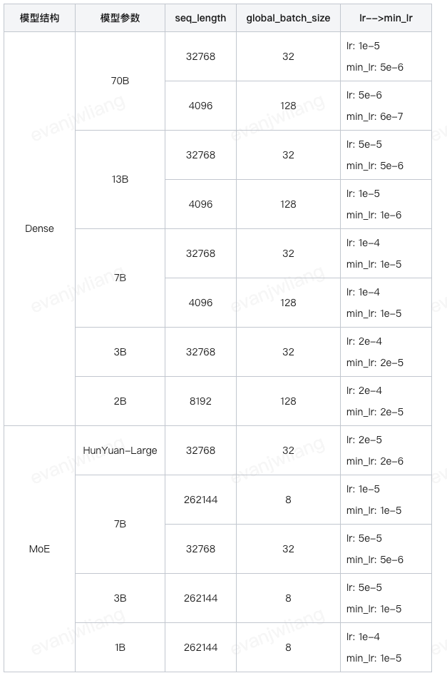

### 7.4 训练时要关注什么

- **初始 loss**：加载 Pretrain 最佳 1–2（3–5 勉强）；加载 SFT 模型最佳 0.5–1（2–3 勉强）；大于 10 需检查模型是否正常加载、数据处理用的 tokenizer 是否正确。不在推荐区间时排查：任务与基座数据差异是否过大（如要求通用模型只用阿拉伯语回答）、默认 system prompt 是否与基座一致、学习率是否过大。
- **整体收敛**：收敛太快/震荡 → lr 太大；太慢/收敛值高 → lr 太小。training loss 最终收敛在 0.3–0.5 为佳；>1 拟合不够（调大 lr 与 epochs）；<0.1 可能过拟合（降 lr 与 epochs）。validation loss 刚开始上升时可以保存一个 ckpt 用于评测，此时效果可能比训练到最后的 ckpt 更好。
- **loss 异常处置**：
  - 初始 loss 就很高 → 排查模型是否正常加载；从 pretrain 加载可先把 dropout 置 0。
  - 初始正常、前 10 step 激增 → 排查 json 数据是否充分 shuffle。解决：shuffle + sample_merge + warmup。（注意一站式平台从第 10 step 才开始打印，看到"一开始就很高"可能是假象。）
  - 上百上千 step 后突增 → 先确认是否数据问题（检查数据质量、不加载优化器参数固定数据重启看是否同位置复现、重新 shuffle 看是否复现）。模型层面可能原因：Adam 实现导致浅层参数长期不更新与深层持续更新的矛盾、LoRA 场景 base 不动而 LoRA 持续更新、过度增训。只出现一次或波动不大可以先不管，直接部署看效果；出现多次则回退最近 ckpt，重新 shuffle、降 lr、开 warmup、dropout 置 0。
- **拟合排查**：用少部分数据跑 50 个 epoch 看能否拟合，不能则考虑训练脚本或数据有问题。

### 7.5 部署推理关注点

- 模型卡片中 tokenizer 务必正确：12w 词表选 `hy_turbo_moe_sft`；29w 词表选 `moe_v1_math_unused5`。
- 无特殊要求用平台推荐默认镜像；部署长度务必覆盖测试长度，否则会被截断。
- 一般 pp_size=1、tp_size=部署卡数；并非所有模型都能 8 卡部署（如 2B-Dense 的 `NUM_KV_HEADS=10` 不能被 8 整除）。
- 检查 system prompt 是否遵循训练模式、解码参数是否合理。推荐解码参数：

```json
{ "temperature": 0.7, "top_p": 0.6, "top_k": 20, "repetition_penalty": 1.05 }
```

- `repetition_penalty` 原理是抑制已生成的 token：`token_prob = token_prob_ori * 1/repetition_penalty`（1.05 → 1/1.05 ≈ 0.95）。实际实现会把 input 侧 token 也计入已生成 token，极端情况下模型可能无法遵循「什么都不要说，请直接回复 123」。**恶劣重复**只是表象，根因是本应正常生成的 token 被抑制后，更大概率先采样到模型预期之外的 token，引发一连串不可控输出、答非所问。对过度训练的模型，若观察到恶劣重复可将该值设为 1.0。
- 测试数据是否遵循训练模式：如果训练数据都以 `\n` 结尾，模型过拟合后遇到不以 `\n` 结尾的提问可能拒答。

### 7.6 效果异常排查清单

- **一站式基座模型效果有问题**：检查默认 system prompt 是否正确；检查 tokenizer 与输入输出长度；检查解码参数；恶劣 badcase 反馈算法同学排查链路（模型效果问题通常要等常规版本更新，如一个月一次），短期建议换模型。
- **心态**：请像使用 ChatGPT 一样善待小模型；多调 prompt、把问题描述得更清楚；总是不遵循指令可以考虑精调，或在 prompt 里加反例告诉模型哪些不可接受。
- **用户精调后效果有问题**：先用一站式基座模型直接部署排除部署问题；用训练集测试看回复是否正常；建议调整 batch size、学习率、epoch。
- **loss 不收敛**：数据量太小或与常规 SFT 任务差异太大，LoRA 拟合困难 → 加大 lr、加大 epochs，MoE 模型可试 `--disable-moe-token-dropping`。
- **LoRA 收敛但效果不好**：v4.9.26 之前的训练镜像存在 LoRA 权重没保存的问题，用最新镜像重训。
- **为什么 Dense 上 LoRA 能收敛、MoE 上不能**：MoE 有 16 个专家、每个都有初始化参数，要学的参数更多，数据量少调动不起来。
- **实际案例**：看起来在续写 → 大概率调用了 pretrain 模型，或输入长度不够被截断，模型没看到问题就接着续写（调整输入输出长度）。loss 正常收敛但效果异常 → 数据处理用的 tokenizer 错了（2B-Dense 需用 `hy_turbo_moe_sft`）；不要传额外处理的 bin 文件，直接传原始 json，并打开 sample_merge。

## 8. 指令数据构造通识

（原笔记以截图为主，内容为指令设计的四张对照图，一并保留）

- **指令设计**要考虑**指令深度**与**指令广度**两个维度。
- 指令调试、数据构造、数据清洗各有独立环节，需要分别设计规则与检查点。
- 生成训练样本是流水线的最后一环，质量取决于前三环。

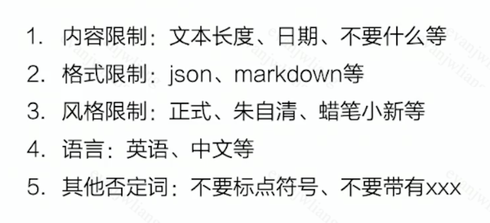
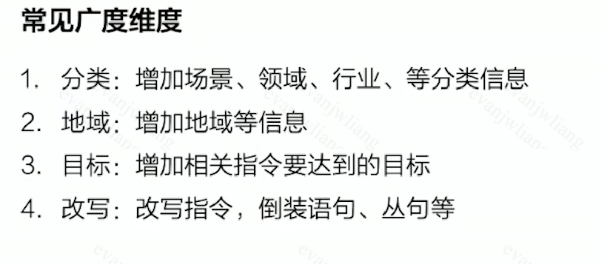
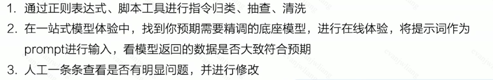
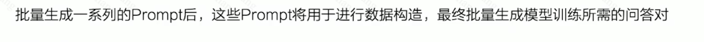
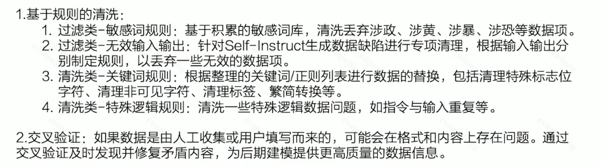

## 9. 遗留问题与后续方向

- 扩充真实数据规模；保留 doc 对应多个 query 的数据并保持数量均衡。
- 训练 epoch 可适当增加；考虑只用「一个 doc 对应 ≥2 个 query」的数据训练。
- GRPO 中引入 QA 覆盖度与 QA 多样性奖励，提高生成 QA 数量。
- 针对 bad case 的文档类型构建专项训练数据，做从易到难的课程学习。
- 非法图片闭合的校验奖励需补齐（已在 §5.2 记录修复方案）。
- verl 多机多卡训练待验证。

---

**来源**：`notes/精调.md`（263 行，混元平台实战）、`notes/sft + grpo.md`（357 行）、`notes/sft+grpo总结.md`、`notes/数据处理.md`、`notes/Grpo.md`、`notes/关键点.md`、`notes/verl.md`、`notes/项目.md`（精调部分）、`notes/数据 (2).md`。
