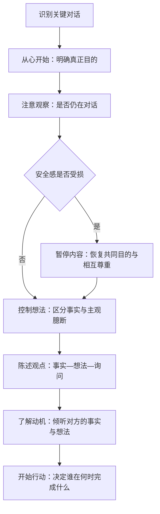

# 《关键对话》读书笔记

> [!abstract] 全书主线
> 关键对话不是靠更强硬地证明自己，也不是靠回避冲突来维持表面和平。真正有效的做法是：先明确自己希望为双方和关系实现什么；持续观察安全感；在失去安全时先修复共同目的和相互尊重；再把事实、想法与感受放进共享观点库，邀请对方共同修正；最后把对话转化为明确的决定与行动。

## 一句话理解

**对话的目标不是赢过对方，而是在高风险、强情绪和观点分歧中，仍让真实信息安全地流动，并据此形成更好的决定。**

这本书围绕三个问题展开：

1. 当自己或对方被情绪带走时，怎样重新回到对话？
2. 怎样既坦诚表达分歧，又不破坏对方的安全感？
3. 怎样让“谈清楚了”继续变成明确的决定、责任和行动？

## 全书地图：让信息重新流动

| 环节 | 核心问题 | 主要工具 |
|---|---|---|
| 识别 | 这是不是关键对话？ | 高风险、观点不同、情绪激烈 |
| 定向 | 我真正想实现什么？ | 从“心”开始、拒绝傻瓜式选择 |
| 观察 | 我们是否还在交流信息？ | 识别沉默与暴力 |
| 修复 | 为什么对方不再感到安全？ | 道歉、对比法、共同目的法 |
| 自省 | 我是在描述事实，还是讲自己编的故事？ | 行为方式回顾、改变主观臆断 |
| 表达 | 怎样把敏感观点说出来？ | 综合陈述法 |
| 倾听 | 怎样帮助对方说出真实想法？ | 询问、确认、重述、主动引导 |
| 落地 | 怎样避免谈完以后不了了之？ | 决策方式、行动人、目标、期限、检查 |

> [!important] 两条贯穿全书的线
> 一条是**共享观点库**：让双方掌握的事实、判断、感受和经验充分进入讨论。另一条是**安全感**：让每个人相信自己可以坦诚表达，而不会因此被羞辱、压制或置于不利位置。没有安全感，观点库就会因沉默而贫乏，或因暴力而被单方面占据。

## 第一章：何谓关键对话

> [!abstract] 章节主旨
> 一场对话同时具备高风险、观点不同和情绪激烈三个特点时，就进入了“关键对话”。越是会影响工作、关系和长期结果的话题，人越容易退回本能反应，也越需要有意识地保持对话。

### 1. 关键对话的三个条件

- **高风险**：结果对参与者很重要，失败会带来明显代价。
- **观点不同**：双方掌握的信息、解释或期待并不一致。
- **情绪激烈**：害怕、愤怒、委屈、尴尬等情绪开始影响判断。

普通交谈可能在一句话之间变成关键对话。例如，讨论工作方案本来风险不高，但当对方质疑能力、权责或承诺时，情绪和利害关系会迅速上升。

### 2. 本能反应通常不是对话

面对威胁时，身体更容易进入“对抗或逃跑”。在沟通中，它表现为强迫对方接受自己的看法，或者干脆不再表达真正想法。两者看似相反，实质上都停止了信息的自由交流。

> [!quote] 高亮
> 关键对话的三个特征：高风险、不同观点、激烈情绪。

### 3. 真正重要的是面对难题的方式

稳固的关系和有效的组织，并不是因为它们没有冲突，而是因为参与者能够公开讨论高风险、情绪化和有争议的问题。问题能否被看见、被说清楚，决定了后续是否可能被解决。

### 本章收束

识别关键对话，是为了在本能反应接管之前提醒自己：此刻最重要的不是立即反击或退出，而是有意识地保护信息交流。

> [!reflection] 我的联想与修订
> 待补充：最近哪一场对话同时具备高风险、观点不同和情绪激烈？我是从哪个信号意识到它已经不再是普通交流的？

## 第二章：掌握关键对话

> [!abstract] 章节主旨
> 对话的核心是让意义自由流动。双方把各自掌握的事实和解释放入共享观点库，才可能形成更完整的判断、真正的承诺和可执行的决定。

### 1. 对话不是轮流发言，而是共享意义

每个人看到的事实、经历和解释都不完整。有效对话不是一方用语言战胜另一方，而是让双方掌握的信息都进入同一个观点库，并允许彼此检验。

共享观点库越充足，决定越可能接近真实情况。即使最终没有完全一致，参与者也更容易理解决定是如何形成的。

### 2. 沉默会留下无声的反对

当人们认为说真话不安全时，他们可能表面赞同，实际保留自己的判断。没有进入观点库的信息不会消失，而会变成消极执行、私下抵制或后续反复出现的问题。

### 3. 暴力会制造违心的服从

控制、羞辱、贴标签或借助权力压人，可能迅速换来口头服从，却无法换来认同。对方不再提供不同信息，决策者也因此失去纠错机会。

### 4. 拒绝“坦诚或尊重”的二选一

本书反复反对一种傻瓜式选择：要么说出真话、伤害关系，要么照顾关系、隐瞒真话。更有价值的问题是：

> [!question]
> 我怎样才能既百分之百坦诚，又百分之百尊重对方？

这不是保证每次都能完美兼顾，而是迫使自己寻找沉默与暴力之外的第三条路。

### 本章收束

衡量对话质量的标准，不是谁说得更多或谁最后获胜，而是重要信息是否充分进入共享观点库，以及参与者是否在理解信息的基础上形成决定。

> [!reflection] 我的联想与修订
> 待补充：我更容易把哪些信息留在自己的观点库里？背后担心的风险是什么？

## 第三章：从“心”开始——如何确定目标

> [!abstract] 章节主旨
> 对话失控时，最先需要调整的不是措辞，而是动机。只有重新看见真正目的，才能从“赢过对方、惩罚对方或逃离不适”回到建设性行动。

### 1. 压力会悄悄替换目标

进入对话时，我们可能本想解决问题；受到反对后，目标却变成证明自己正确、让对方后悔，或尽快结束尴尬。目标一旦改变，行为会随之改变，再好的技巧也会被听成操控。

### 2. 暂停互动，像局外人一样观察自己

发现自己开始沉默或暴力时，先从对话内容中短暂退出，问自己：

- 我希望为自己实现什么？
- 我希望为对方实现什么？
- 我希望为我们之间的关系实现什么？
- 如果这些才是我真正想要的，我现在应该怎样做？

这些问题一方面提醒自己什么真正重要，另一方面让被情绪挤压的思考能力重新上线。

### 3. 拒绝傻瓜式选择

当脑中只剩“要么忍，要么翻脸”“要么我赢，要么他赢”时，可以分三步拆开：

1. **说明想要什么**：重新说清对自己、对方和关系的真正目的。
2. **说明不想要什么**：指出自己并不希望造成的后果。
3. **提出更复杂的问题**：怎样既实现前者，又避免后者？

### 本章收束

关键对话首先是动机问题，其次才是表达问题。技巧只有服务于真实、长期且兼顾双方的目的时，才可能建立安全感。

> [!reflection] 我的联想与修订
> 待补充：在压力下，我最容易把“解决问题”换成哪一种临时目标——赢、罚还是逃？

## 第四章：注意观察——如何判断对话氛围是否安全

> [!abstract] 章节主旨
> 对话高手同时观察两件事：谈话内容，以及谈话赖以继续的安全条件。一旦有人转向沉默或暴力，就把它看成安全感下降的信号，而不是立即把对方定义成难以沟通的人。

### 1. 不只看内容，还要看条件

人在争论中容易过度关注“这句话对不对”，忽略双方已经无法平静交换信息。适当降低对内容的关注，转而观察安全感，可以帮助大脑从狭窄的防御状态中恢复。

一个重要的认知转换是：对方的抵触不一定只是因为内容难听，也可能是因为他从表达方式中感受到威胁、不尊重或不良意图。

### 2. 沉默：有意让信息离开观点库

| 形式 | 常见表现 | 信息发生了什么 |
|---|---|---|
| 掩饰 | 讽刺、粉饰、含糊其辞 | 真正观点被伪装 |
| 逃避 | 转移话题、避开重点 | 关键内容没有被讨论 |
| 退缩 | 不回应、离开、放弃参与 | 自己退出观点库 |

### 3. 暴力：试图强迫观点进入观点库

| 形式 | 常见表现 | 信息发生了什么 |
|---|---|---|
| 控制 | 打断、夸张、绝对化、垄断谈话 | 限制别人表达 |
| 贴标签 | 把人归为某种负面类型 | 用定性代替理解 |
| 攻击 | 贬低、威胁、羞辱 | 以伤害迫使对方退让 |

### 4. 同时观察自己的影响

观察不能只用来诊断对方。更重要的问题是：我的语气、措辞、表情和权力位置，正在增加还是减少对方的安全感？如果只看到对方“情绪化”，却看不到自己的影响，观察就会变成新的指责工具。

### 压力应对方式测试

> [!info] 计分规则
> 题号后括号内是评分表要求的答案。实际选择与它一致时记为 ☑，不一致时记为 ☐。以下保留原测评记录；它描述的是一次自评结果，不直接等同于稳定人格。

#### 图 4-1　压力应对方式评估分值表

| 沉默式 | 得分 | 暴力式 | 得分 |
|---|---:|---|---:|
| **掩饰** ☐ 5（是） ☐ 6（是） | 0/2 | **控制** ☑ 7（是） ☐ 8（是） | 1/2 |
| **逃避** ☑ 3（是） ☑ 4（是） | 2/2 | **贴标签** ☐ 9（是） ☐ 10（是） | 0/2 |
| **退缩** ☑ 1（是） ☑ 2（是） | 2/2 | **攻击** ☐ 11（是） ☐ 12（是） | 0/2 |
| **合计** | **4/6** | **合计** | **1/6** |

#### 图 4-2　对话技巧评估分值表

| 对应章节与模块 | 评分项 | 得分 |
|---|---|---:|
| **第 3 章：从“心”开始** | ☑ 13（否） ☑ 19（是） ☑ 25（否） | 3/3 |
| **第 4 章：注意观察** | ☑ 14（否） ☑ 20（是） ☑ 26（是） | 3/3 |
| **第 5 章：保证安全** | ☐ 15（是） ☑ 21（是） ☑ 27（否） | 2/3 |
| **第 6 章：控制想法** | ☑ 16（是） ☑ 22（否） ☑ 28（否） | 3/3 |
| **第 7 章：陈述观点** | ☐ 17（是） ☑ 23（否） ☑ 29（是） | 2/3 |
| **第 8 章：了解动机** | ☑ 18（是） ☐ 24（是） ☑ 30（是） | 2/3 |
| **第 9 章：开始行动** | ☑ 31（否） ☑ 32（否） ☐ 33（否） | 2/3 |

> [!note] 暂时可读出的信号
> 这次测评里，沉默式反应明显高于暴力式，尤其集中在逃避与退缩；对话技巧各模块得分相对均衡。它更适合用作练习方向：当自己想转移话题、结束交流或不再表达时，把这一刻识别成安全感警报。是否属于稳定模式，还需要结合真实对话复盘验证。

### 本章收束

“注意观察”是整套方法的总开关。即使一时记不起具体技巧，只要能发现自己或对方已经离开对话，就有机会暂停、修复并重新开始。

> [!reflection] 我的联想与修订
> 待补充：最近一次选择逃避或退缩时，我当时感觉什么不安全？是担心冲突、被否定、关系受损，还是认为沟通无效？

## 第五章：保证安全——如何让对方畅所欲言

> [!abstract] 章节主旨
> 当安全感受损时，继续争论内容通常只会升级冲突。正确顺序是暂停内容，判断共同目的或相互尊重出了什么问题，先修复安全，再返回议题。

### 1. 安全感建立在两个条件上

- **共同目的**：对方相信你关心他的目标，并愿意寻找双方都能接受的结果。
- **相互尊重**：对方相信你把他当作值得尊重的人，而不是需要制服、羞辱或利用的对象。

共同目的出问题时，常见信号是防御、绵里藏针、无端指责和反复争论；尊重出问题时，对话会迅速转成自尊保卫战。

### 2. 必要时真诚道歉

如果自己的言行确实破坏了共同目的或相互尊重，应当承认并道歉。道歉不是放弃议题，而是对自己造成的影响负责，让双方重新具备讨论议题的条件。

### 3. 用对比法消除误解

当自己的真实意图被误解时，可以同时说明：

- **我不想表达什么**：否定对方担心的不尊重或不良意图。
- **我真正想表达什么**：确认尊重、关心和真实目的。

例如：“我不是在否定你过去的投入；我想讨论的是目前的分工是否会让项目后期失去明确责任。”

> [!warning] 对比法不是道歉
> 如果已经说了伤人的话，应先道歉。对比法用于防止或纠正意图误解，不是把伤害包装成“你理解错了”，也不是收回真正需要讨论的问题。

### 4. 用共同目的法走出策略冲突

双方常常不是目的冲突，而是把各自偏好的策略误当成唯一目标。共同目的法分四步：

1. **积极寻找共同目的**：承诺继续讨论，直到找到双方都能接受的方案。
2. **识别策略背后的目的**：分别询问“为什么想这样做”，把手段和结果拆开。
3. **开发共同目的**：若具体目的仍不同，寻找更高层、更长期且双方都重视的目标。
4. **共同构思新策略**：在共同目的下重新生成方案，不再只在原来的两个选项中争输赢。

### 本章收束

安全不是让所有内容都变得舒服，而是让不舒服的内容仍然可以被讨论。发现安全感下降时，先暂停议题、修复目的和尊重，再回到事实与分歧。

> [!reflection] 我的联想与修订
> 待补充：我通常把哪一种具体方案误当成目的？如果追问“为什么”，双方可能共享的更高层目标是什么？

## 第六章：控制想法——如何在愤怒、恐惧或受伤时展开对话

> [!abstract] 章节主旨
> 他人的行为不会跳过解释过程直接制造我们的情绪。见闻与情绪之间，还有一段由自己生成的主观臆断。找回这段过程，就能区分事实与故事，并重新选择回应。

### 1. 行为方式模型

情绪是真实存在的，但引发情绪的解释未必准确。事件发生得越快，我们越容易忘记自己做过解释，把“他没有回复消息”直接体验成“他不尊重我”。

### 2. 从行为向事实反推

发现自己陷入沉默或暴力时，沿模型反向检查：

1. **行为**：我正在沉默、控制、贴标签或攻击吗？
2. **感受**：是什么更准确的情绪推动了这个行为？
3. **想法**：我讲了一个怎样的故事，才产生这种情绪？
4. **见闻**：其中哪些是任何人都能看到或听到的事实？

“他是控制狂”“她故意挖苦我”包含判断与归因；“他连续三次打断我的汇报”“她说了某一句话”才更接近可核对的事实。

### 3. 三种常见的“小聪明式想法”

| 想法 | 内在台词 | 被忽略的信息 |
|---|---|---|
| 受害者想法 | 这不是我的错 | 自己的行为或不作为对问题的影响 |
| 大反派想法 | 都是你造成的 | 对方可能存在的正常、复杂动机 |
| 无助者想法 | 我也没办法 | 沉默与暴力之外仍可选择的行动 |

这些想法的问题不一定是完全虚假，而是信息不完整，并且刚好替当前的错误行为辩护。

### 4. 把故事补充完整

- 把受害者变成参与者：**我是否故意忽略了自己在问题中的责任？**
- 把大反派变成正常人：**一个理智而正常的人为什么可能这样做？**
- 把无助者变成行动者：**我的真实目的是什么？为了实现它，我现在可以怎样做？**

这样做不是替对方免责，也不是否认真实伤害，而是先让自己的判断恢复完整，避免用错误故事制造更多伤害。

### 本章收束

控制想法不是压住情绪，而是放慢“事实—解释—情绪—行为”的自动链条。事实需要被核对，解释需要被质疑，行为仍然可以被选择。

> [!reflection] 我的联想与修订
> 待补充：最近一次强烈情绪中，我脑中最先出现的是受害者、大反派还是无助者想法？被遗漏的事实是什么？

## 第七章：陈述观点——如何循循善诱而非独断专行

> [!abstract] 章节主旨
> 坦诚和尊重并不冲突。表达敏感观点时，从可核对的事实开始，明确说明自己的解释，同时把解释作为可修正的判断，并真诚邀请对方提供不同信息。

### 1. 综合陈述法

| 步骤 | 做法 | 作用 |
|---|---|---|
| 分享事实经过 | 先说可观察、争议较小的事实 | 提供安全起点 |
| 说出你的想法 | 说明这些事实让自己形成了什么判断 | 让对方知道问题与严重性 |
| 征询对方观点 | 询问对方看到的事实和解释 | 扩充共享观点库 |
| 做出试探表述 | 用“我担心”“我目前的理解是”表达 | 区分判断与事实 |
| 鼓励做出尝试 | 真诚欢迎反驳、补充和纠正 | 让邀请不是形式 |

### 2. 先说事实，但不能只说事实

事实较少引发争议，也最容易被核对，所以适合做开端。如果一上来就说“你根本不负责”，对方只能先应对指责；如果说“过去两次交付都比约定时间晚一天”，双方至少有一个可检查的起点。

但只列事实也不够。对方可能不知道你为什么提出这些事实，也无法理解你担心的后果。完整表达需要把“我看到什么”和“我如何理解”都说出来。

### 3. 试探不是软弱

“我可能遗漏了什么”“目前我有些担心……”表示的是对自己信息边界的诚实，不是对观点道歉。可以放弃绝对化和强硬姿态，但不必放弃真正的判断与问题。

### 4. 真正鼓励对方纠正自己

如果邀请只是“你还有什么意见吗”的形式，而语气已经表明反对会受到惩罚，对方仍不会说出真实想法。鼓励尝试意味着愿意听到与自己不同的信息，并允许这些信息改变结论。

### 一个简化表达模板

> [!example]
> 我观察到……（事实）。这让我担心／目前我理解为……（想法）。我可能没有看到完整情况，你当时是怎么考虑的？（征询与鼓励）

### 本章收束

综合陈述法不是柔化观点，而是让观点的形成过程可以被看见和检验。越是坚定的判断，越需要区分事实、解释和邀请。

> [!reflection] 我的联想与修订
> 待补充：我最近想说却没有说的一件事，能否先改写成“事实—想法—询问”？

## 第八章：了解动机——如何帮助对方走出沉默或暴力

> [!abstract] 章节主旨
> 无法强迫一个人进入对话，但可以通过好奇、尊重和倾听降低风险，让对方更愿意说出行为背后的事实、想法与感受。

### 1. 用好奇替代反击

对方的沉默或攻击同样可能是一种自我保护。把这些表现只理解为不讲理，会让自己做出对称的沉默或暴力；把它看成安全感不足的信号，才有机会追溯行为背后的原因。

一个有用的问题是：**为什么一个理智而正常的人会这样反应？** 这不是预先认同，而是让自己保持足够的好奇心。

### 2. 四种倾听技巧

这四种方法按介入程度逐渐加深：

1. **询问观点**：直接表达想了解对方看法的兴趣。
2. **确认感受**：客观说出从语气、表情或行为中观察到的情绪信号。
3. **重新描述**：用自己的话复述理解，确认是否准确。
4. **主动引导**：当对方仍难以开口时，谨慎猜测可能的想法或感受，帮助他找到表达起点。

主动引导承担的误判风险最高，应在前三种方法无效、且确实希望理解对方时使用。猜错并不可怕，关键是以可纠正的方式表达。

### 3. 理解不等于认同

倾听的任务是先准确还原对方的行为模式，而不是立即裁决谁对谁错。理解对方为什么这样想，不代表接受其结论或容忍伤害；它只是为后续比较双方信息建立基础。

### 4. 用“赞同—补充—比较”回应差异

听完对方后，不要立刻寻找最小差异进行反驳：

- **赞同**：明确指出双方一致的部分。
- **补充**：对方遗漏信息时，先保留一致之处，再加入自己的信息。
- **比较**：确实不同时，并列双方的事实与解释，说明差异在哪里。

很多争执中，事实差异只占很小部分，其余冲突来自双方对事实的解释。先找一致点，可以避免把细小差异扩大成整场对抗。

### 本章收束

了解动机不是猜透别人，而是通过安全的倾听，让对方亲自补全其事实、想法和感受。回应时先找一致，再补充或比较。

> [!reflection] 我的联想与修订
> 待补充：当别人情绪激烈时，我更习惯解释、反驳还是追问？哪一种倾听技巧最不自然？

## 第九章：开始行动——如何把关键对话转变成行动和结果

> [!abstract] 章节主旨
> 信息充分流动不代表已经形成决定，形成决定也不代表会自动执行。对话结束前必须明确怎样决策，以及谁在什么时间完成什么、如何检查。

### 1. 先明确怎样做决定

| 方式 | 谁做最终决定 | 适用情况 | 主要代价 |
|---|---|---|---|
| 命令式 | 外部权威或负责人 | 已有明确权限或规则 | 参与和承诺较低 |
| 顾问式 | 决策者征求意见后决定 | 需要信息，但不需人人同意 | 意见不一定被采纳 |
| 投票式 | 多数人 | 有若干合理方案且重视效率 | 少数意见可能被忽略 |
| 共识式 | 所有关键参与者 | 高风险复杂问题，执行依赖共同支持 | 时间成本最高 |

并非参与越多越好。应根据四个问题选择：谁真正关心、谁具备相关知识、谁必须支持执行、参与人数是否足以做出好决定。

### 2. 把“我们”拆成具体责任

“我们之后推进一下”通常意味着没有明确行动人。每项任务至少需要说明：

- **谁**负责；多人参与时谁对整体结果负责；
- **做什么**，完成标准是什么；
- **何时**完成；
- **如何跟进**，在哪个节点检查结果。

目标越抽象，双方对“完成”的理解越容易不同。必要时用一个实际案例说明预期结果。

### 3. 记录决定并按节点复查

记录不是官僚动作，而是建立共同记忆。对话结束后，应保留结论、行动人、目标、截止时间和检查方式；到约定节点，根据记录复查，而不是依赖各自记忆。

### 本章收束

好的关键对话有两个终点：先得到更完整的共同理解，再得到明确的决定和行动。缺少第二步，对话可能只留下短暂的“谈得很好”。

> [!reflection] 我的联想与修订
> 待补充：我经历过哪些“已经达成一致、后来却没有行动”的对话？当时缺的是决策方式、责任人、完成标准还是跟进？

## 第十章：案例分析

> [!abstract] 章节主旨
> 不同场景使用的是同一条主线：先处理自己的目的和故事，识别安全问题，再用事实和试探性判断开始对话。真正需要讨论的往往不是一次事件，而是反复出现的行为模式及其影响。

### 1. 不要在长期积累的愤怒中开始

问题拖得越久，越容易在脑中把对方写成“大反派”。即使措辞没有直接攻击，语气、表情和身体语言也会泄露敌意。开始重要对话前，应先区分事实与故事，恢复基本尊重。

### 2. 讨论模式，而不只讨论最新事件

如果同类问题反复出现，最新一次事件只是入口，真正的问题可能已经变成“不遵守承诺”“无法提前暴露风险”或“双方不再信任”。只争论这一次的细节，会让核心模式继续存在。

### 3. 信任需要按范围讨论

一个人在某件事上失信，不等于其所有方面都不可信。把局部问题扩大成对整个人的否定，会强化大反派想法，也让修复变得困难。更准确的做法是说明：在哪个范围内、因为什么事实，当前信任受到影响，以及需要什么证据才能恢复。

### 4. 权力越高，越要观察自己的影响

管理者可能没有主动威胁，却通过绝对化表达、打断、身份差异或过去的惩罚经验让他人害怕。不能只用“我没有恶意”判断安全，还要观察对方是否真的敢于提供不同意见。

### 5. 明确期望，不靠暗示

面对积极性、责任和协作问题，应明确说明期待、责任边界和遇到困难时的通知方式。暗示要求对方猜测标准，失败后又容易让双方进入指责与辩解。

### 本章收束

案例没有提供万能台词，而是反复训练同一种判断顺序：真正目的是什么、事实是什么、自己编了什么故事、安全是否存在、应该讨论事件还是模式、最后怎样形成行动。

> [!reflection] 我的联想与修订
> 待补充：当前最想解决的问题是一件孤立事件，还是已经形成反复模式？更准确的议题应该怎样命名？

## 我的高亮信号

> [!info] 说明
> 以下根据本机 Calibre 中 177 条高亮的章节分布和重复主题整理。它只能说明阅读时哪些内容更容易引起注意，不等于你已经赞同这些观点，也不代表稳定的个人特征。第四章包含 31 条“是／否”测评作答，不能与正文高亮直接比较。

### 高亮分布

| 章节 | 全部标记 | 正文标记 | 主要关注 |
|---|---:|---:|---|
| 第1章 何谓关键对话 | 5 | 5 | 关键对话的定义与重要性 |
| 第2章 掌握关键对话 | 11 | 11 | 共享观点库、沉默与强迫的后果 |
| 第3章 从“心”开始 | 13 | 13 | 真正目的、拒绝傻瓜式选择 |
| 第4章 注意观察 | 42 | 11 | 安全感、沉默与暴力、压力测评 |
| 第5章 保证安全 | 31 | 31 | 共同目的、尊重、对比法、策略与目的 |
| 第6章 控制想法 | 17 | 17 | 事实与故事、三种小聪明式想法 |
| 第7章 陈述观点 | 23 | 23 | 综合陈述法、坚定而不绝对化 |
| 第8章 了解动机 | 17 | 17 | 四种倾听技巧、赞同—补充—比较 |
| 第9章 开始行动 | 8 | 8 | 决策、责任人、完成标准与检查 |
| 第10章 案例分析 | 10 | 10 | 模式问题、信任、权威与明确期望 |

### 反复出现的五个关注方向

1. **对话失控首先是安全问题。** 第四、第五章连续标记了安全感、共同目的、相互尊重、道歉与对比法，说明“为什么人不再愿意说真话”是明显的阅读线索。
2. **同时保留坦诚和尊重。** 从拒绝傻瓜式选择，到综合陈述法中的事实、试探和邀请，你多次标记了不必在“忍住”和“强硬”之间二选一。
3. **把目的和策略分开。** 第五章对共同目的法的四步都有标记，尤其关注了“具体方案只是策略，策略背后的结果才是目的”。
4. **把事实和故事分开。** 第六、七章的高亮集中在可观察事实、主观判断和绝对化表达的区别，以及怎样把自己的推理过程呈现给对方。
5. **让对话落实为责任。** 第九、十章关注了明确行动人、完成标准、检查方式，以及越过单次事件讨论反复模式。

> [!note] 一个等待验证的阅读假设
> 从高亮和测评合在一起看，这本书对当前最有价值的部分可能不是“说服别人的话术”，而是一条从回避重新回到表达的路径：**发现自己想退出 → 判断什么不安全 → 先修复目的与尊重 → 从事实开始说出判断 → 邀请对方补全信息。** 这是阅读痕迹推断，需用真实对话复盘确认。

## 与现有知识库的连接

### 与《高效能人士的七个习惯》：从理解原则到高风险操作

[[《高效能人士的七个习惯》读书笔记#第八章：习惯五·知彼解己——移情沟通的原则|习惯五·知彼解己]]强调先理解、后表达；《关键对话》把这个原则放进高风险和强情绪场景，进一步提供了可操作方法：识别安全危机，用询问、确认、重述和主动引导帮助对方开口，再用赞同—补充—比较处理分歧。

[[《高效能人士的七个习惯》读书笔记#第九章：习惯六·统合综效——创造性合作的原则|习惯六·统合综效]]强调寻找第三种方案；本书的共同目的法解释了第三种方案从哪里来：先把冲突的策略与背后的目的分开，再在更高层共同目的下重新生成策略。

两本书的共同点是都反对“不是我赢，就是你赢”；区别是，《高七》更偏向原则和关系框架，《关键对话》更偏向对话失控时的即时诊断与修复。

### 与《原子习惯》：识别自动化的压力反应

[[《原子习惯》读书笔记#第四章：行为改变的过程始于觉察|行为改变始于觉察]]关注自动行为如何重新进入意识；本书的“注意观察”处理的是相似问题：沉默和暴力往往已经自动发生，只有先准确命名，才可能改变。

[[《原子习惯》读书笔记#第三章：四个简单步骤，让你建立更好的习惯|习惯回路]]可以帮助理解压力应对的自动链条，但两者不能简单等同。《原子习惯》关注提示、渴望、回应和奖赏；《关键对话》更强调见闻、主观解释、情绪和行为，并要求把事实与解释拆开。

可以把关键对话练习缩小成一个习惯入口：一旦察觉自己想逃避、退缩或控制，就先问一句“我现在是在描述事实，还是在讲故事？”

## 最小实践：关键对话前一页纸

> [!tip] 使用方式
> 不必同时使用全书所有技巧。先选一场确实重要的对话，在开始前花几分钟写完下面这张一页纸；对话后只复盘一个最明显的转折点。

### 1. 界定议题

- 这场对话的高风险是什么？
- 我们有哪些不同观点？
- 当前最强烈的情绪是什么？
- 这是一次事件，还是反复出现的模式？

### 2. 回到真正目的

- 我希望为自己实现：
- 我希望为对方实现：
- 我希望为我们的关系实现：
- 我不希望这场对话变成：
- 怎样既实现真正目的，又避免不希望的结果？

### 3. 拆开事实与故事

- 我亲眼看到或亲耳听到的事实：
- 我根据事实形成的解释：
- 我当前的情绪：
- 我可能正在讲的故事：受害者／大反派／无助者
- 我忽略的自身责任或其他合理解释：

### 4. 设计开场

- **事实**：我观察到……
- **想法**：这让我担心／目前我理解为……
- **邀请**：我可能遗漏了什么，你是怎么考虑的？
- **必要时的对比说明**：我不是想……；我真正想……

### 5. 观察安全

- 对方出现沉默了吗：掩饰／逃避／退缩？
- 对方出现暴力了吗：控制／贴标签／攻击？
- 共同目的是否清楚？
- 相互尊重是否仍然存在？
- 如果安全受损：需要道歉、对比说明，还是重新寻找共同目的？

### 6. 形成行动

- 决策方式：命令／顾问／投票／共识
- 行动人：
- 行动目标与完成标准：
- 截止时间：
- 检查方式与时间：

### 7. 对话后短复盘

- 哪一刻开始不安全？
- 我当时转向了沉默、暴力还是继续对话？
- 哪个动作帮助信息重新流动？
- 下一次只改进哪一个动作？

## 读完后值得长期保留的检查清单

- [ ] 先判断这是否已经是一场关键对话。
- [ ] 开口前确认真正目的，不把赢、惩罚或逃避当成目标。
- [ ] 同时观察内容和安全感。
- [ ] 把沉默与暴力看作安全警报，不急着给人定性。
- [ ] 安全受损时先暂停内容，恢复共同目的和相互尊重。
- [ ] 该道歉时道歉，不用对比法代替道歉。
- [ ] 区分策略与目的，在共同目的下寻找新策略。
- [ ] 区分可观察事实与主观故事。
- [ ] 留意受害者、大反派和无助者三种自我辩护。
- [ ] 用事实—想法—询问表达敏感观点。
- [ ] 倾听时依次尝试询问、确认、重述和主动引导。
- [ ] 回应差异时先赞同，再补充或比较。
- [ ] 对话结束前明确决策方式、行动人、目标、期限和检查。
- [ ] 反复发生时讨论行为模式，不只争论最新一次事件。

## 来源与整理说明

- 全书内容来源：本机 Calibre 书库中的 EPUB《关键对话：如何高效能沟通（原书第 2 版）》；书库作者字段为“科里·帕特森”，本笔记用“科里·帕特森等”表示合著作品。
- 个人高亮：177 条，记录时间为 2026-08-21 至 2026-09-04，覆盖第 1—10 章。
- 177 条总标记中，第四章包含 31 条单字“是／否”测评作答；“我的高亮信号”已把它们与正文标记分开，避免误判章节关注度。
- 本笔记保留全书概念结构、个人高亮关注方向和实践入口，没有逐条复制全部高亮。
- “章节主旨”和正文解释属于基于原书与高亮的整理候选稿；“我的高亮信号”属于阅读痕迹推断；“我的联想与修订”等待后续结合原文和实际经历补充。
- 笔记暂时保留“在读”状态，不因高亮已覆盖正文而自动判断已经读完。

## 阅读联想

> [!info]
> 这里保留后续审稿时产生的原始联想、AI 讨论与当前认识。AI 不代写个人经历，也不从高亮反推你已经认同某个观点。

### 待整理

#### 我的原始联想

#### AI 讨论

#### 当前认识

**证据状态**：待补充
