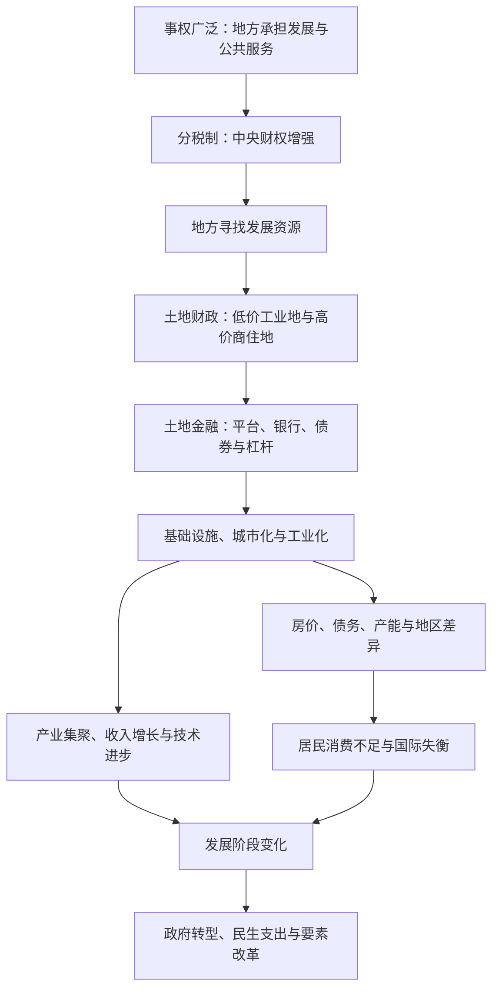

# 《置身事内》读书笔记

> [!info] 整理边界
> 本轮依据本地 EPUB 的目录与正文整理。章节中的“我的联想与修订”留待对照原书后补充，不把助手的概括写成用户已经认可的判断。2026-08-31 留下的土地财政分析保留在文末“阅读关联”中。

> [!abstract] 全书主线
> 理解中国经济，不能只看市场中的企业、价格与个人选择，还要看政府掌握什么资源、承担什么事务、受到什么激励，以及地方政府怎样参与土地开发、融资、投资和产业发展。上篇从地方政府的微观行为出发，下篇再解释这些行为如何汇成城市化、房价、债务、地区差异、低消费和贸易冲突等宏观现象。

## 一句话理解

**先看政府具体怎样做事，再理解这些微观机制如何塑造我们看到的经济结果。**

这本书提供的不是一套脱离现实的政策立场，而是一条分析链：

沿着这条链，可以反复追问四个问题：

1. 这件事由哪一级政府负责，为什么？
2. 它掌握哪些信息和资源，又承担什么后果？
3. 制度给各方设置了怎样的激励？
4. 局部行动累积后，会产生什么宏观结果和代价？

## 全书地图：从微观机制到宏观现象

| 部分 | 章节 | 核心问题 |
|---|---|---|
| 上篇·微观机制 | 第一章 地方政府的权力与事务 | 政府事务为什么这样划分，地方政府为何拥有广泛权力？ |
| 上篇·微观机制 | 第二章 财税与政府行为 | 财权、财力与事权如何匹配，土地财政为何形成？ |
| 上篇·微观机制 | 第三章 政府投融资与债务 | 城投、土地金融和地方债务如何连接？ |
| 上篇·微观机制 | 第四章 工业化中的政府角色 | 地方政府怎样通过投资、补贴和引导基金参与产业发展？ |
| 下篇·宏观现象 | 第五章 城市化与不平衡 | 土地、房价、人口流动和地区差异如何互相影响？ |
| 下篇·宏观现象 | 第六章 债务与风险 | 债务为何累积，又怎样传导和化解风险？ |
| 下篇·宏观现象 | 第七章 国内国际失衡 | 低消费、产能与贸易冲突之间有什么联系？ |
| 总结 | 第八章 政府与经济发展 | 地区竞争和政府转型怎样解释发展成就与现实问题？ |

> [!important] 阅读这本书的顺序
> 后半部分讨论的房价、债务和经济失衡，并不是彼此孤立的现象。它们建立在前半部分的地方治理、财税、土地和投融资机制之上。先理解政府为什么这样行动，再讨论这些行动的结果，更接近本书的论证顺序。

## 前言：从了解现状开始

> [!abstract] 章节主旨
> 判断中国经济之前，要先理解政府在其中怎样运作。理论可以提供观察角度，但不能代替对现实机制的描述；当现实与熟悉的理论不一致时，第一步应是弄清“是什么”和“为什么”。

### 1. 本书把政府和政策放在分析中心

常见的经济学叙述以价格、企业和经济周期为主角，这本书则把政府放在中心。原因是政府不只制定规则或分配经济成果，也通过土地、金融、国企、公共服务和产业政策参与生产过程。

因此，政府不是市场之外的背景条件，而是经济运行机制的一部分。不了解政府的事务、资源和激励，就很难理解地方投资、城市建设、企业融资、房价和债务为什么呈现现在的形态。

> [!quote] 原文
> 在我国，想脱离政府来了解经济，是不可能的。

### 2. 理论应帮助理解现实，而不是提前裁决现实

作者提醒，舶来的理论有其解释力，但不能把它直接变成先入为主的标准。现实与理论不符时，如果立即认定现实荒谬，就会错过理解制度为什么形成、怎样运作以及解决了什么问题的机会。

这里的“理解”并不等于赞同。它要求先把事实、机制、收益与代价说清，再进行判断。一本书中的单一理论也只能照亮复杂现象的一个侧面，不能替代全部事实。

### 3. 全书重在解释“是什么”和“为什么”

本书较少直接给出作者个人的政策主张。涉及“怎么办”时，重点也放在解释正在实施的政策及其逻辑。对读者来说，先看清政策制定者面对什么约束、试图解决什么问题，比先接受一个抽象答案更有用。

这也给阅读设定了一条边界：书中机制可以帮助解释问题，但书中使用的历史数据不能自动证明今天仍然如此。遇到当期判断，还需要补充时间匹配的数据和材料。

### 4. 地方政府投融资是贯穿全书的线索

上篇依次讨论地方政府的事务、财税、土地融资、投资和债务；下篇再把这些微观行为与城市化、工业化、房价、地区差异、债务风险、低消费和贸易冲突连接起来。

这意味着，全书并不是八个独立专题的拼接。地方政府掌握的权力和资源，决定了它能采取什么行动；这些行动长期累积，才形成后半部分讨论的宏观现象。

### 本章收束

前言先确定了本书的观察位置：置身现实机制之内，先描述政府怎样参与经济，再判断这套机制产生了什么结果。理论的作用是辅助理解和比较，而不是跳过事实直接得出结论。

> [!reflection] 我的联想与修订
> 待对照原书后补充：我过去理解经济新闻时，是否经常直接从结果跳到立场，而没有追问中间的政府行为与传导机制？

## 上篇：微观机制

## 第一章：地方政府的权力与事务

> [!abstract] 章节主旨
> 政府事务并不是简单按照一张固定清单划分。公共服务的覆盖范围、信息由谁掌握、上下级激励能否对齐，共同决定了权力应放在哪一级。中国地方政府在属地管理下拥有广泛的资源和行动空间，也因此成为经济发展的直接参与者。

### 1. 先看政府体系怎样实际运作

中国形成了中央、省、市、县区、乡镇五级政府体系。各级主要机构层层对应，地方部门又同时处在纵向的业务关系和横向的属地领导中，也就是常说的“条块关系”。

纸面上的机构设置不能完整说明权力怎样运行。跨部门、跨地区的事务需要协调，当现有流程无法形成共识时，决策往往向上集中；经常出现的跨部门事务，则会通过分管领导或领导小组推进。

官僚体系中的人事安排同样重要。同一套制度由不同的人执行，结果可能很不一样。理解政府行为时，需要同时看两类约束：一方是否有能力做事，以及是否有意愿做事。前者与资源和信息有关，后者与激励有关。

### 2. 外部性与规模经济决定公共事务的边界

如果一项事务只影响本地，通常适合由本地处理；如果它的影响跨越行政边界，就需要共同上级协调。学校主要服务本地居民，而跨市、跨省的污染会影响其他地区，两类事务需要不同层级的政府介入。

公共服务还存在规模经济：服务更多人可以分摊固定成本，但覆盖范围过大又会增加拥挤、距离和管理成本。行政区划因此要在扩大规模收益与控制服务成本之间寻找平衡。

人口密度、地理条件和语言文化都会改变这个平衡。人口稠密地区可以在较小范围内形成规模收益；山川阻隔与语言差异会提高沟通和服务成本。行政区划长期稳定，而人口和经济活动会变化，这种速度差又会推动撤县设区、都市圈和区域一体化等调整。

行政边界也会产生现实代价。省际交界地区往往距离各自的中心较远，基础设施和公共服务容易不足；污染、道路和市场分割等跨区域问题，也可能因为责任分散而难以解决。

### 3. 信息优势让形式权威与实际权威分离

上级在形式上拥有最终决策权，但不可能收集和处理所有地方信息。下级更接近现场，往往掌握信息优势，因此即使权力名义上属于上级，实际决策也可能主要由下级完成。

有效治理需要在两者之间保持平衡：下级信息更多、又承担主要后果时，应有较强自主权；事情对更大范围影响显著时，上级需要介入。但介入过多会削弱下级的主动性，介入太少又可能放任局部利益损害整体利益。

信息在传递中还可能失真或被隐瞒，因此政府需要文件、会议、统计、审计和督察制度。监督本身也受信息约束：指标能否准确测量、上级是否拥有独立信息源，会直接影响监督效果。

当规则无法覆盖所有复杂情形，权力和责任就会更加依赖具体的人。专业人员因掌握细节而拥有实际影响力；上级在关键岗位上也会重视个人信任。制度、信息和信任在这里共同维持组织运转。

### 4. 激励相容决定权力放下去以后能否运转

所谓激励相容，是一方希望推进的事情，另一方既愿意做，也有能力做好。对目标明确、流程标准、结果容易衡量的专业事务，垂直管理更容易形成一致的责任和评价体系。

经济发展等综合事务需要协调土地、财政、金融、企业和公共服务，难以完全标准化。此时地方必须拥有调动资源的空间，也要能分享发展带来的收益，才会主动寻找适合本地的做法。

放权同时需要约束。权责应当明确，资源配置要相对稳定，预算不能无限软化，人口、资金和企业的流动也能对治理形成外部压力。激励的目标不是让地方不计代价地完成某个指标，而是让收益、责任与代价尽量由决策者共同承担。

### 5. 三项原则需要放在一起使用

本章用三个角度解释事权划分：

| 观察角度 | 关键问题 | 倾向的权力安排 |
|---|---|---|
| 外部性与规模经济 | 影响范围有多大，服务多少人最合适？ | 影响跨区时由共同上级协调；服务范围较小时交给地方 |
| 信息复杂性 | 谁更接近现场，谁能以更低成本获得关键信息？ | 信息优势明显的一方拥有更多实际决策空间 |
| 激励相容 | 谁承担责任、获得收益，又承受失败代价？ | 让权力、资源、评价和责任尽量匹配 |

三个角度并非互相竞争。行政区划既划定公共服务边界，也影响信息获取和责任归属；基础设施既扩大服务范围，也降低信息与要素流动的成本。它们共同处理的，是不同地区、部门和层级之间的利益差异与冲突。

### 6. 招商引资显示地方政府是经济参与者

招商引资把地方政府的广泛权力集中呈现出来。地方可以开发产业园区、供应和整理土地、建设基础设施，也可以通过投资平台、国企、银行协调、补贴、税收政策、招工和公共服务支持企业。

土地、资金、劳动力和科技等关键生产要素，都与政府或其附属机构存在密切联系。因此，中国的现实更接近一种政府深度参与生产和分配的混合经济，而不是政府只提供公共物品、市场负责其余部分的简单分工。

这种参与会带来发展能力，也会产生资源错配、债务和地方竞争等代价。本章先确认政府“能做什么”，后续章节再分析它“用什么资源做”以及结果如何。

### 本章收束

第一章为全书建立了分析起点：先确定谁负责什么事，再讨论谁掌握财力和其他资源。地方政府的权力范围，来自公共服务边界、信息优势和激励安排的共同作用；这既解释了地方活力的来源，也埋下了协调、监督和风险问题。

如果只保留一句话，可以写成：

> **事权划分不是一张静态清单，而是在影响范围、信息成本和行动激励之间寻找平衡。**

> [!reflection] 我的联想与修订
> 待对照原书后补充实际经历、赞同之处、疑问或反例。可以先检验：工作中的跨部门协作，是否也同时受信息分散、权责不清和激励不一致影响？这个类比在哪些地方成立，在哪些地方会过度简化？

## 第二章：财税与政府行为

> [!abstract] 章节主旨
> 财税制度不仅决定政府有多少钱，也会改变地方政府发展经济的方式。1994 年分税制增强了中央财政能力，同时保留了地方发展经济的任务。地方在预算外寻找资源，逐渐形成以低价工业用地招商、以高价商住用地获取收入的土地财政模式。

### 1. 财政承包调动了地方积极性，也削弱了中央财力

20 世纪 80 年代的财政承包制与农村、企业承包改革相似：地方完成约定的上缴额度后，可以保留更多增收。收入与本地发展直接挂钩，地方政府因此有动力兴办乡镇企业、扩大税源。

这一制度适合改革初期。它在所有权观念和市场制度尚未完全转变时，用收益分成调动了地方积极性。但承包方式各地不同，合同不够稳定，地方还可能通过减税、藏收入等方式减少上缴，最终造成中央财政收入占比和国家预算收入占 GDP 比重同时下降。

中央缺少财力，会影响跨地区协调、宏观调控和改革补偿。国企改革、救灾、国防和区域均衡都需要中央掌握足够资源，财政体制因此必须重建。

### 2. 分税制重新集中财权

1994 年分税制把税收划分为中央税、地方税和共享税，并建立相对独立的税务征收体系。作为第一大税种的增值税由地方税改为中央与地方共享，中央取得主要份额；企业所得税后来也转为共享税。

这次改革扭转了中央财力持续下降的局面，增强了国家在公共服务、区域转移支付和宏观改革中的能力。改革并非简单发一道命令，它涉及中央与各省既有利益的重新分配，税收返还和基数安排都是谈判与妥协的结果。

分税制还说明，制度出台会立刻改变参与者的行为。地方为了提高返还基数，可能突击征税；地方企业也会因所得税分成规则变化而改变注册地。分析改革效果时，不能只看规则设计，还要看各方如何回应规则。

### 3. 税收结构塑造了地方政府的偏好

分税制没有取消地方发展经济的任务，却减少了地方可自由支配的预算资金。为了扩大税源，地方更加重视招商引资，尤其青睐投资规模大、能快速增加 GDP、在生产环节贡献增值税的制造业。

我国税收主要来自企业和生产环节，居民直接缴纳的税较少。地方财政由此更容易形成“重企业、重生产”的倾向，把基础设施、土地和补贴优先用于招商；消费和民生带来的财政回报较慢，在竞争中容易被放在次要位置。

这不是说地方不关心居民生活，而是财政收益与支出责任的组合，使不同事务产生了不同的即时回报。理解地方选择时，需要先看收入从哪里来、支出由谁承担。

### 4. 土地财政补上了发展资金缺口

城市土地归国家所有，农村集体土地转为城市建设用地，需要先经过征地。1994 年改革把国有土地出让收益留给地方；1998 年住房商品化和土地管理制度调整扩大了城市土地需求，2002 年经营性用地“招拍挂”又使土地价格和出让过程更加市场化。

地方逐渐形成两种不同的供地策略：低价供应工业用地，吸引制造业并换取税收、就业和产业链；控制商住用地供应，以较高价格获得土地出让收入。工业化带来人口和住房需求，商住地升值又反过来支持工业园区和城市建设。

> [!quote] 原文
> “土地财政”的实质是“房地产财政”。

土地出让收入并不等于可以自由支配的净收益。征地、拆迁、平整和基础设施建设都会产生大量成本。土地财政的关键也不只在卖地收入，而在土地升值后形成的资产和抵押能力，下一章的“土地金融”由此展开。

### 5. 财权上收与事权下压造成基层压力

中央通过税收返还和转移支付，可以从全国总量上弥补地方预算缺口；但资金逐级分配后，不同层级和地区的情况并不相同。基层承担教育、医疗和行政运转等大量事务，可支配收入却较少，形成“财权层层上收、事权层层下压”的压力。

农村税费改革减轻了农民负担，也进一步减少了乡镇收入。后续改革通过农村公共服务保障、专项奖励、乡财县管和省直管县等方式加强上级统筹。这些措施缓解了一部分基层困难，同时也可能减少基层自主性，改革效果取决于地区条件。

### 6. 转移支付在地区均衡与激励之间取舍

沿海地区借助出口、工业集聚和土地升值获得更强财力，中西部和人口流出地区则更加依赖中央转移支付。转移支付可以缩小人均公共支出的差距，使财力较弱地区也能提供基本服务。

但资金分配同时面临信息和激励问题：上级如何知道地方真正缺多少，专项资金是否适合本地，地方会不会为了获得补助而维持低效率安排。均衡地区公共服务与保留地方主动性之间，需要持续调整。

### 本章收束

第二章解释了地方发展模式的财政起点。分税制增强了中央能力，却没有改变地方发展经济的责任；企业税收和土地收入于是共同塑造了地方行为。低价工业地换税收和就业，高价商住地换建设资金，这套模式推动了工业化和城市化，也把地方财政逐渐绑定到土地与房地产。

> **财税制度不仅分配收入，也在为地方政府的行动设定方向。**

> [!reflection] 我的联想与修订
> 待补充：分税制解决了当时什么问题？今天评价土地财政时，我是否同时看见了它形成的制度条件、历史作用和当前代价？

## 第三章：政府投融资与债务

> [!abstract] 章节主旨
> 土地财政提供当期收入，土地金融则把未来的土地收益和政府信用变成今天可以使用的资金。城投公司、银行和地方政府共同构成投融资体系，它加速了基础设施和城市开发，也形成了低回报项目、隐性担保和地方债务风险。

### 1. 融资平台连接政府资源与金融市场

政府不能像普通企业一样直接向银行借款，于是通过融资平台公司承接土地、项目和融资职能。政府可以向平台注入土地使用权、国有资产和补贴，平台再以这些资产和预期收益申请贷款、发行债券、投资基础设施或开发园区。

融资平台的项目常有公共服务属性，项目本身收入不高，但可能通过改善交通、吸引企业、抬高周边土地价值产生外部收益。因此只看单个项目利润会低估其价值；但把所有外部收益都算成回报，也可能掩盖无效投资。

银行和债券投资者通常相信地方政府会支持平台，形成隐性担保。平台因此能以较低成本获得大规模资金，风险也容易被低估并集中到银行体系。

### 2. 土地金融把土地升值转化为投资能力

土地财政的收入来自出让土地，土地金融的力量来自抵押和杠杆。地方把土地注入平台，平台借款完成征地、拆迁和基础设施建设；环境改善和产业进入推高地价，再以新的土地和收入支持下一轮融资。

循环顺利时，今天的负债可以换来未来的税收、土地价值和公共资产；经济放缓、招商失败或地价下跌时，现金收入不足，平台只能依赖再融资维持，风险就会累积。

### 3. 2008 年后地方债务快速扩张

全球金融危机冲击出口后，中央出台大规模刺激计划，地方承担了主要配套投资任务，银行也放松了对融资平台的贷款限制。基础设施投资快速增长，地方债务随之进入加速阶段。

估计地方债务时，显性政府债券容易统计，平台债务和政府承诺形成的隐性负债却边界模糊。整体债务占 GDP 的比例只能说明宏观承受力，不能掩盖层级和地区差异：基层政府、人口流出地区和回报较差的项目可能首先遇到现金流问题。

还债需要可支配现金。道路、地铁和园区即使有社会效益，也不一定直接产生足够收入。因此评估债务要同时看负债、形成的资产、项目利用率、人口流向和地方财政现金流。

### 4. 债务治理同时处理存量与增量

书中梳理了四类改革：以地方政府债券置换部分平台债务，降低利息并提高透明度；推动融资平台转型，剥离政府融资职能；约束银行和影子银行向平台输送资金；对违规举债和过度负债实行追责。

这些措施可以规范融资，却不能单独解决地方不断投资的动力。只要地方仍承担大量发展任务、依靠投资获得增长和收入，融资需求就会换一种形式出现。债务改革最终会触及政府角色：哪些项目必须由政府做，哪些可以交给市场，地方考核又奖励什么。

### 5. 官员激励会放大投资冲动

经济发展是地方主官的重要政绩，官员任期又常短于大型项目周期。为了在任期内看见结果，地方容易偏好规模大、开工快、短期能拉动 GDP 的工程，项目的长期回报和后续债务则可能留给继任者。

政绩激励能调动干部推进招商和建设，也可能导致重复投资、短期化和忽视民生。后续改革把债务、环保和民生纳入考核，并强调终身追责，试图让决策者承担更完整的后果。

普通公务员的行为不能只用晋升解释。多数人晋升概率很低，收入、职业荣誉、组织认同和具体领导方式都会影响行动。把庞大官僚体系简化成一场“晋升锦标赛”，会遗漏大量现实动力。

### 6. 腐败与发展模式相互缠绕

土地和大型项目金额高、审批权集中，容易滋生腐败。书中区分掠夺式腐败与官商合作式腐败：前者直接破坏产权和生产，后者可能与短期投资增长并存，却扭曲项目选择、积累利益网络并损害长期公平和效率。

反腐会打破旧模式中的利益链，也可能使习惯旧做法的干部在转型期变得谨慎。解决这一问题需要同步改变发展方式、权力边界和正向激励，使依法办事和主动作为能够兼容。

### 本章收束

地方债务不是单纯“收入不足”的结果。地方政府承担发展任务、掌握土地和金融资源，又能借助平台与隐性担保放大投资，才形成土地金融和债务扩张。它创造了基础设施与产业资产，也必须接受人口、利用率、现金流和长期生产率的检验。

> **看地方债，既要看借了多少钱，也要看钱投向哪里、形成什么资产、由谁产生还款现金流。**

> [!reflection] 我的联想与修订
> 待补充：我以前是否把“有债务”等同于“必然出问题”？哪些指标能帮助我区分整体承受力、局部现金流风险和风险传导？

## 第四章：工业化中的政府角色

> [!abstract] 章节主旨
> 产业发展是企业、政府和社会共同组织资源的结果。京东方、光伏产业和政府引导基金说明，政府投入可以帮助企业跨越资本、技术和市场门槛，也会带来重复投资、产能过剩和激励扭曲。判断产业政策，要进入具体行业、发展阶段和退出机制。

### 1. 京东方：用政府信用跨越高资本门槛

液晶面板行业投资巨大、周期波动强，并具有明显的规模经济和学习效应。新进入者既要承担百亿元级生产线投资，也要面对日韩和中国台湾企业的技术、专利与供应链优势，单靠企业自身很难融资。

地方政府通过投资平台参与股权融资、注入土地并协调银团贷款，帮助京东方在合肥、成都、北京等地建设生产线。这类投资的回报不能只看政府持有股份的收益，还包括国产替代、产业链集聚、就业、税收和当地产业升级。

政府支持无法保证成功。行业周期可能使生产线投产即亏损，技术路线也可能变化。京东方案例成立的重要条件包括国内市场规模、企业已有技术能力、持续研发以及地方愿意承担早期风险。

### 2. 规模、集聚和学习可以创造比较优势

复杂制造业的优势并非完全由初始资源决定。企业进入生产后，通过“边做边学”积累知识，规模扩大后摊薄成本，产业集聚又促进人才、供应商和技术外溢，原本没有的比较优势可能逐渐形成。

> [!quote] 原文
> 创新是买不来的，只能靠自己做。

自主创新不等于封闭发展。进口设备、国际贸易和吸收外部技术都是学习路径，关键是本土企业必须真正参与生产、研发与迭代，才能积累无法直接购买的经验。

### 3. 光伏：补贴、危机与竞争共同塑造产业

新能源早期成本高，市场需求本身也依赖政府创造。欧美通过电价补贴培育光伏需求，中国地方政府则通过土地、信贷和投资支持制造企业。海外补贴削减与“双反”政策叠加国内产能和债务扩张，使行业在 2012 年前后进入危机，尚德、赛维等明星企业相继陷入困境。

企业倒闭并不意味着此前积累全部消失。人才、技术、设备和供应链可以被重新组合。国内标杆电价打开市场后，行业在竞争中继续降本，逐步形成完整产业链和国际优势。

重复投资会造成浪费，也能训练工人、扩大供应链并加剧竞争。决定长期结果的关键是能否保持竞争和退出：补贴应随成本下降而退出，低效企业应能破产重组，地方保护不能长期阻止淘汰。

### 4. 政府引导基金把财政资金接入股权投资

产业引导基金通常由政府资金担任有限合伙人，将投资决策交给市场化基金管理人，并吸引社会资本共同投资。与传统补贴或国企直接投资相比，它引入了专业筛选、风险共担和股权退出机制，也能作为新的招商工具。

这种结合带来多组矛盾：财政资金强调安全，风险投资允许失败；地方资金希望项目落地本地，资本追求跨区域回报；基金需要市场化人才和薪酬，国有管理又受行政规则约束；资本市场低迷时，社会资金和退出渠道都会收缩。

引导基金的成效无法只凭设立规模判断。还要看实际出资、社会资本是否真正进入、投资项目能否成长、政府是否干预专业决策，以及失败项目能否正常退出。

### 5. 政府与市场要放进同一过程分析

京东方不是单纯的政府项目，光伏也不是单纯的市场竞争，引导基金更直接把财政资源和私人资本放进同一组织。政府掌握土地、银行、国企、大学和科研机构等资源，在工业化中必然深度参与；企业则提供技术、经营、产品和市场反馈。

判断政府介入时，应追问具体条件：行业是否有规模经济和学习效应，国内市场是否足够大，企业是否有真实技术能力，国际竞争能否形成约束，补贴和投资是否有退出机制。缺少这些条件，同一种工具可能得到完全不同的结果。

### 本章收束

第四章拒绝用一个案例证明“产业政策一定有效”或“一定失败”。政府可以帮助企业跨过早期门槛，竞争负责筛选企业，市场需求检验产品，退出机制处理失败。真正要评价的是这套组合能否持续学习、纠错并让资源离开低效项目。

> **产业政策的价值不只在扶持进入，更在进入之后能否竞争、学习和退出。**

> [!reflection] 我的联想与修订
> 待补充：我评价一个受政府支持的行业时，是只看某家企业的成败，还是会检查产业链、技术积累、机会成本和退出机制？

## 下篇：宏观现象

## 第五章：城市化与不平衡

> [!abstract] 章节主旨
> 前几章的土地、财政和工业化机制，最终落实到人口与城市空间。土地城市化快于人的城市化，人口流入地住房供给不足，人口流出地仍获得建设指标，由此产生高房价、居民债务、地区差距和公共服务错配。城市化转型的核心是让土地和公共资源跟着人走。

### 1. 城市化经历了三个阶段

1994 年以前，乡镇企业吸收农村劳动力，农民“离土不离乡”，人口没有大规模向城市集中。分税制之后，乡镇企业式微、出口制造业向沿海和城市集聚，农民工进城加速；土地出让和融资支持了城市建设，但户籍和公共服务没有同步覆盖新增人口。

党的十八大以后，政策开始强调“以人为核心的城镇化”，逐步放宽落户、改革集体土地并调整公共服务。这一转变承认，新一代流动人口已经融入城市，回到农村不能成为长期发展方案。

### 2. 人口流动与住房供给错位推高房价

现代产业和服务业具有集聚效应，就业不断向沿海和大城市集中。住房需求因此快速增加，但建设用地指标按行政区域分配，难以跨省跟随人口流动。人口流入地区供地不足，人口流出地区又可能建设过量。

高房价并不只来自需求旺盛，也来自土地和住房供给缺少弹性。银行按揭能快速增加购买力，核心城市土地却有限，金融扩张与土地稀缺结合，容易放大房地产周期。

房价上涨让家庭资产看起来增加，也提高首付与按揭负担。居民财富过度集中于住房，债务又主要来自房贷，消费会受到挤压；一旦收入或房价下降，低收入和高杠杆家庭更脆弱。

### 3. 地区均衡应关注人均水平

经济活动天然会集聚，不可能让每个地区拥有相同规模的产业和 GDP。地区协调的合理目标是缩小人均收入和基本公共服务差距，让人能够流向生产率更高、工资更高的地方，而不是在每个地区复制一套完整产业。

人口流动还能深化分工。大城市中的低技能服务业支撑高技能行业和生活质量，各地区则可以根据自身条件形成制造、农业、旅游或服务业分工。限制流动会让机会和人口分离，扩大城乡与地区收入差距。

### 4. 土地与户籍改革要服务人的流动

集体经营性建设用地入市、宅基地改革和“地票”等探索，试图让建设用地指标随人口变化重新配置。户籍改革则逐步放宽中小城市落户，并推动教育、医疗和住房等公共服务覆盖常住人口。

> [!quote] 原文
> 城市化的核心不应该是土地，应该是人。

人的流动需要城市扩充公共服务，也需要土地供应跟上住房需求。只放开户籍而不增加住房、学校和医院，会把新的压力留给流入地；只开发土地而不让人口获得完整市民待遇，又会重复“土地城市化”。

### 5. 贫富差距要同时看增长、财富与机会

改革开放显著减少了全球极端贫困，也提高了国内各收入群体的绝对收入；与此同时，城乡、地区和个人之间的收入差距扩大，房产等资产升值又加剧了财富差距和代际传递。

社会对差距的感受不仅由基尼系数决定。经济增长速度、向上流动机会、人群之间的共同经验和家庭预期都会影响容忍度。增长放缓后，如果机会减少、资产差距固化，同样的收入差距可能产生更强冲突。

政策因此要兼顾两件事：继续创造生产率和收入增长，同时扩大教育、迁移和就业机会，减少财富与身份对下一代的锁定。

### 本章收束

第五章把土地制度、地方财政和产业集聚汇合到“人”身上。过去以土地为中心的城市化快速建设了城市，却没有让土地、住房和公共服务充分跟随人口。下一阶段的重点，是让人能够迁移、定居并分享城市生产率提升带来的收入。

> **地区可以不拥有相同的经济规模，但人应有流动到机会所在之处的能力。**

> [!reflection] 我的联想与修订
> 待补充：讨论城市和房价时，我是否把人口流向、土地供给、公共服务和家庭债务放在同一条链上？“让资源跟着人走”还会遇到哪些现实约束？

## 第六章：债务与风险

> [!abstract] 章节主旨
> 债务能把未来资源转到今天，帮助家庭、企业和政府提前投资，也把不同部门连接成一套风险网络。高杠杆下，资产价格下跌会引发信贷收缩、支出下降和经济衰退。中国债务的核心问题来自投资驱动的发展结构，化解风险既要处理存量债务，也要改变继续制造债务的资源配置机制。

> [!warning] 数据时间边界
> 本章整理的是书中截至 2020 年前后的数据和作者当时的判断，适合用于理解机制，不能直接当作 2026 年债务规模、企业状况或政策效果的结论。

### 1. 债务既推动繁荣，也放大衰退

家庭借钱买房，企业借钱建设厂房，政府借钱修建基础设施，都能把未来收入转化为当期支出。债务增加时，交易和投资扩张，资产价格也容易上涨；债务收缩时，各部门同时减少支出，经济活动会快速下降。

高负债经济有一条常见的风险链：收入不足促使债务人出售资产，集中抛售压低资产价格；抵押物贬值造成银行坏账和信贷收缩；家庭、企业和政府难以借新还旧，只能进一步削减支出，最终形成衰退。

债务危机对不同群体的影响并不对称。债权人的索赔权受法律保护，高杠杆家庭和缺乏其他资产的低收入者更容易失去住房、工作和净财富，因此危机也会加剧不平等。

### 2. 欧美经验显示银行与房地产是风险枢纽

20 世纪 70 年代以后，金融自由化、跨境资本流动和金融创新扩大了信贷供给。银行规模大、杠杆高，短期负债与长期贷款之间存在期限错配，又偏爱土地和房产抵押，因此容易随房地产价格共同起落。

证券化和影子银行把贷款转移到更多金融机构，看似分散风险，实际可能削弱贷款审查，并使机构之间的关联更复杂。风险发生后，损失沿金融网络传播，很难停留在最初的债务人身上。

资金供给过多还与国际失衡和国内财富集中有关。富人消费占收入比例较低，形成大量可贷资金；中低收入群体为住房和消费借债。实体投资机会不足时，资金更容易流向房地产和金融资产，推升价格而没有同步提高生产率。

### 3. 中国债务在 2008 年后加速

全球金融危机冲击出口后，中国用大规模投资稳定需求。地方融资平台、国企和房地产企业迅速扩张，企业部门债务增长尤其明显。中国外债占比较低、债务主要以人民币计价，传统的外汇与主权债务危机风险较小，但内部部门之间的风险仍然存在。

企业债务需要区分来源和用途：融资平台债务主要对应基础设施；部分国企长期占用资金却没有形成相称收入，可能成为僵尸企业；房地产企业依赖预售、按揭和影子银行，一旦销售与融资同时收缩，现金流容易断裂。

银行是主要债权人，也持有大量债券。土地、住房和政府信用提高了抵押与担保能力，推动银行继续放贷；影子银行则绕开部分监管，把信贷链条拉长。中国影子银行多是银行业务的延伸，结构与欧美不同，分析时不能直接套用海外模式。

### 4. 风险要看局部现金流和传导路径

宏观债务率只能显示总体规模。地方、企业和家庭的资产质量、收入来源、债务期限与融资能力差异很大，整体数字可控并不代表每个主体都安全。

判断风险至少需要分开四层：债务人能否产生现金流；资产能否变现以及价格是否稳定；债权人能否承受损失；一个主体违约后会不会通过银行、就业、财政或供应链传给其他主体。

这也解释了为什么“有债务”与“系统性危机”之间还有很长的推理链。风险存在、风险暴露、风险传导和政策处置应分别判断。

### 5. 化解债务分为偿还旧债与遏制新债

已有债务只能通过增加收入、压缩支出、出售资产、债务重组或违约处理。各部门同时节支会让一个人的支出变成另一个人的收入损失，因此偿债过程可能加深衰退。

货币扩张可以缓和债务压力，但不同方式有不同分配结果。量化宽松通过购买资产注入货币，容易抬高资产价格并使资产持有者受益；财政赤字货币化把资源配置更多交给政府预算，又要求很强的财政纪律和治理能力。

遏制新增债务，需要限制房地产和土地金融的顺周期扩张，减少政府隐性担保，让低效企业退出，并发展股权等直接融资。股权融资可以共担风险，但融资结构与投资决策权相连：如果投资仍由政府和国企主导，简单把风险转给分散投资者并不稳定。

### 6. 债务问题最终是发展模式问题

投资回报足够高时，新增收入可以覆盖债务；当基础设施和工业体系趋于完善，继续依赖同样的投资方式，生产率增长可能赶不上债务增长。债务负担上升因此不只是金融部门的问题，而是原有增长模式边际回报下降的表现。

治理债务会同时触及地方政府职能、国企改革、房地产、银行体系、资本市场和收入分配。政策很难在完全不付出代价的情况下去杠杆，只能在风险、增长和分配之间持续权衡。

### 本章收束

债务是一套跨部门关系。分析时不能停在总量和单个债务人，而要追踪资产价格、银行资产、企业现金流、居民收入和政府财政如何互相连接。处理旧债可以争取时间，改变低效投资和资源配置方式才能减少新债。

> **债务风险的关键不是“债多不多”一个数字，而是收入能否覆盖债务，以及损失会沿什么路径传导。**

> [!reflection] 我的联想与修订
> 待补充：面对“债务很高，所以马上会发生危机”一类论断，我需要补问哪些现金流、资产、债权人和政策信息？

## 第七章：国内国际失衡

> [!abstract] 章节主旨
> 中国经济长期呈现高投资、高生产、低消费的结构。居民收入占比下降、储蓄率较高，使国内需求难以消化全部产出，剩余产能通过出口进入国际市场。内部资源分配因此转化为外部贸易失衡，并与制造业和技术竞争共同推动中美冲突。

### 1. 低消费来自收入份额与储蓄率

居民消费等于可支配收入减去储蓄。消费占 GDP 比重较低，既因为居民获得的收入份额一度下降，也因为居民将较高比例的收入用于储蓄。

高储蓄不能只用文化解释。计划生育减少子女数量并改变养老预期，教育、医疗和养老保障不足增加预防性储蓄，高房价又要求家庭积累首付和偿还按揭。这些经济条件会随政策和发展阶段变化，比稳定的文化特征更能解释储蓄率波动。

地方发展模式也影响居民收入份额。招商引资偏爱大企业、重资产和自动化，土地、信贷与补贴降低资本成本；劳动者的议价能力和公共服务获得相对较弱，资源更多留在政府和企业手中，并转化为投资。

### 2. 高投资在发展早期有效，边际回报会下降

工业化初期，基础设施和资本存量不足，把更多资源投入道路、工厂和机器可以快速提高生产率。居民消费占比下降不等于消费绝对下降；经济总量扩张时，收入和消费仍可能快速增长。

随着基础设施与工业体系成熟，“投资什么都有用”的阶段会结束。低效项目不能形成未来收入，债务却要继续偿还；投资挤压消费，也会使需求不足和产能过剩更加严重。资源配置需要从扩大数量转向提高质量。

政策目标随之从“做大生产”转向提高就业质量、居民收入和民生支出。要提高消费占 GDP 比重，居民收入增长需要在一段时期内快于整体经济增长，同时减少教育、医疗、住房和养老带来的不确定性。

### 3. 国内失衡会转化为贸易失衡

一国生产超过国内消费和有效投资，剩余就要通过净出口消化。中国加入 WTO 后，投资和出口快速增长，消费占比下降；美国消费超过本国产出，则通过贸易逆差和资本流入吸收其他国家的剩余。

> [!quote] 原文
> 贸易问题从来不是单纯的贸易问题。

贸易顺差和逆差是各国内部收入分配、储蓄、投资和金融结构在国际上的反映。只调整关税或汇率，可能改变贸易路径，却不一定消除产生失衡的国内结构。

### 4. 中美冲突的深层焦点是制造与技术能力

中国加入 WTO 后对美国部分地区和行业造成就业冲击，但美国制造业就业占比在此前已长期下降，技术进步和产业结构变化同样重要。把就业问题全部归因于中国，会忽略美国国内的技术、教育和分配因素。

比就业数量更持久的矛盾，是中国制造业规模和技术能力上升。后发国家往往先进入制造环节，通过生产积累知识、人才和供应链，再逐步向研发与基础科学延伸。制造业既是产品来源，也是技术学习与创新能力的载体。

中国从组装和成本优势向高附加值环节升级，会改变原有国际分工，也会与先进国家形成直接竞争。贸易、产业政策、专利和技术限制因此相互交织，冲突难以只靠增加某一类商品进口解决。

### 5. 再平衡的重点是居民收入与政府转型

扩大内需需要把更多资源转向居民，提高劳动收入和财产性收入，并增加教育、医疗、住房和社会保障支出。人口继续向城市尤其是大城市流动，有助于进入生产率更高的服务业，也要求公共服务随人口扩容。

地方政府需要减少生产性投资冲动，把更多资源用于民生。资本市场改革可以让居民分享企业增长，但前提是投资决策、公司治理和风险承担方式同步改变。

“双循环”还包括继续开放。进口会创造商贸、物流、金融和售后等服务业就业；统一国内商品和要素市场，则能扩大竞争范围、减少地方保护，让人口、资金和技术流向更高效的用途。

### 本章收束

第七章把低消费、产能过剩和贸易冲突放进同一条链。发展早期的资本积累曾快速提高生产率，发展阶段改变后，同样的资源分配方式开始形成国内需求不足和外部摩擦。再平衡的核心是让居民获得更高收入、更稳定的公共服务和更广的选择权。

> **外部贸易失衡往往是内部收入、消费和投资结构的投影。**

> [!reflection] 我的联想与修订
> 待补充：看到贸易顺差、产能过剩或消费不足时，我能否继续追踪到居民收入、储蓄动机、政府支出和企业投资？

## 第八章：总结政府与经济发展

> [!abstract] 章节主旨
> 中国的发展模式建立在地方分权、地区竞争和政府动员资源的能力上。这套模式适应了工业化早期的条件，也必须随市场、法治、人口和产业结构变化而转型。发展目标不能代替发展过程；政策需要服从初始条件、利益结构、改革顺序和社会承受能力。

### 1. 地区竞争把地方政府变成发展主体

改革开放后，属地管理给地方较大自主权，经济表现又与地方领导评价相连，形成“官场竞争+市场竞争”的结构。地方争夺企业、资金和人才，也通过政策实验、营商环境和组织方式彼此竞争。

计划经济时期相对分散的工业布局，为改革初期各地发展提供了工业基础、技术人员和基础设施。乡镇企业还承担了把农民训练成产业工人的功能。以成熟市场的静态效率回看这套分散布局，容易忽略它在发展过程中的学习价值。

地方竞争能调动积极性、允许试验并加速投资，也缺少企业竞争中的完整淘汰机制。政府不会因低效而破产，市场分割会保护本地企业，官员任期和多重目标又使绩效难以衡量。这些差异会带来重复建设、地方保护、短期化和腐败。

### 2. 有效市场与有为政府都需要建设

市场制度、产权保护、法院、税收和监管能力并非经济起飞前已经完备的条件，它们也在发展中逐步形成。发展中国家市场不完善时，政府可以动员土地、资本和组织资源，补充一部分市场能力。

政府的能力也有发展过程。国家富裕后，公众对教育、医疗、养老、环保和安全的需求会上升，政府支出占经济的比例未必下降，支出重点则应从生产投资逐步转向公共服务。

政府干预能否有效，取决于具体制度是否允许学习和纠错。产业保护若同时接受出口和市场竞争，并能逐步退出，可能培养企业；长期保护低效主体，则会积累浪费。市场和政府需要在互动中共同改进。

### 3. 政府角色要随发展阶段转型

工业化早期，资本、基础设施和信用不足，政府主导投资能集中资源、快速建设。工业体系成熟、服务业成为就业主体后，继续用土地和信贷扩大工业投资，边际收益下降，债务与产能问题上升。

转型方向包括减少政府和国企直接生产投资，强化法治与公平竞争，改善地方税源，并增加教育、医疗、住房、养老等民生支出。城市化不可逆，社会风险的缓冲机制也需要建立在城市中。

地方承担绝大部分民生服务，收入却受现有税制和房地产影响。政府转型因此不只是改变口号，还要重新安排事权、财权、转移支付和地方稳定税源。

### 4. 发展目标与发展过程必须分开

发达国家今天的市场、法治和社会保障可以作为发展目标，却不一定能直接复制成落后国家的起步方案。后发国家的核心任务是学习已有技术、动员资源并建立市场，面临的条件与技术前沿国家不同。

过去成功的本土经验也不能永久沿用。土地金融、地方竞争和投资驱动适应过特定阶段，条件变化后可能转化为债务、房价和分配负担。真正的发展能力包括调整旧模式的能力。

### 5. 可行政策受制度与利益约束

政策需要考虑权力主体和利益相关者。整体效率提高并不保证每个人受益；如果损失集中、补偿不足，理论上正确的改革也可能无法推进。改革方案是效率、利益和政治可行性的共同结果。

改革方向、顺序和节奏也是不同问题。人和组织需要时间适应，过快调整可能引发失业、债务和社会冲击，过慢又会让既得利益固化。渐进改革的核心不是拖延，而是在保持稳定的同时持续改变约束条件。

### 6. 经济学首先帮助提出好问题

经济现象由许多因素共同形成，偶然事件和历史路径都很重要。理论可以从过去提取因素并提供解释，却无法脱离时间、地点和对象直接给出答案。

有效比较既要跨国家和地区，也要跨时期；既比较数据和结果，也比较产生数据的机制。发展经济学尤其需要理解初始条件和路径依赖，谨慎对待从某个成功国家抽出的通用公式。

> [!quote] 原文
> 经济学的主要作用仍是发现和提出问题。

问题切中要害，本身就包含了对现实机制的理解。最终方案仍需在实践中权衡、试错和调整，“实事求是”和“具体问题具体分析”因此构成全书的方法论落点。

### 本章收束

第八章没有为政府与市场划一条固定边界，而是要求边界随能力和阶段调整。地方竞争、政府投资和土地金融解释了过去的发展动力；政府转型、民生支出、市场建设和要素流动决定下一阶段能否继续提高生产率与生活质量。

> **真正可持续的发展能力，包含建立一套模式，也包含在条件变化后修改这套模式。**

> [!reflection] 我的联想与修订
> 待补充：我是否习惯用发达状态下的标准否定发展过程，或用过去的成功为当前模式辩护？判断“经验是否过时”时，我会检查哪些条件？

## 结束语：置身其中，也保留认识的边界

作者在结束语中主动说明，这本书只是对复杂中国经济的一部分认识，并不提供预测。快速发展中的亲身经验影响了他的观察角度，也构成他的局限。

作者对中国的乐观最终来自个人经历与文化信念，而不是可以由经济模型证明的结论。把这一点写明，有助于读者区分三层内容：书中可检验的事实、作者提出的机制解释，以及作者个人选择相信的未来。

书的目标因此很朴素：帮助读者从政经新闻和政府文件中看见机制，在现实生活中作出更好的判断。宏观叙事最终应回到人的生活，而不是让宏伟目标遮住具体代价。

> [!quote] 原文
> 生活过得好一点，比大多数宏伟更宏伟。

### 本章收束

置身事内意味着承认自己受所处时代、制度和经验影响；认真理解现实，也意味着承认认识有限。既不把理论当成裁决现实的万能标准，也不把个人信念包装成事实，是全书最后留下的边界感。

> [!reflection] 我的联想与修订
> 待补充：读完整本书后，哪些地方改变了我理解中国经济的入口？哪些机制我接受，哪些解释仍需用数据或其他作者的研究核验？

## 全书回看：值得保留的分析框架

### 1. 一条贯穿全书的因果链

这条链提醒我，宏观结果通常不是由单一指标直接造成的。土地收入下降、地方债务上升或消费不足，都需要沿着财政、融资、投资、企业和居民行为继续追踪，才能判断影响会走多远。

### 2. 四组需要同时看见的张力

| 张力 | 一端解决的问题 | 另一端提醒的代价 |
|---|---|---|
| 中央集权与地方自主 | 统一、协调、区域均衡 | 信息不足、地方积极性下降 |
| 政府动员与市场竞争 | 跨越资本与基础设施门槛 | 错配、保护、债务与退出困难 |
| 当期投资与未来消费 | 快速积累资本、提高生产率 | 居民收入偏低、内需不足 |
| 发展速度与调整稳定 | 抓住机会、快速转型 | 失业、利益冲突和社会承受压力 |

理解一项政策时，不应只选择其中一端。更有用的问题是：当前阶段哪种约束更紧，这项政策把代价转移给了谁，新的平衡能维持多久？

### 3. 从一个经济判断向下追问

遇到“某个指标变化将导致某种资产或行业结果”的论断时，可以按以下顺序检查：

1. **指标定义**：说的是收入、净收入、现金流、债务余额还是资产价值？
2. **主体分布**：风险集中在哪些地区、层级、企业和家庭？总体平均是否掩盖局部问题？
3. **制度机制**：事权、财权、土地、银行和担保怎样连接？
4. **传导路径**：从财政到融资、投资、就业、收入和资产价格，中间需要哪些条件？
5. **缓冲与反馈**：转移支付、债务置换、货币政策、资产出售和改革能否减缓冲击？
6. **时间范围**：书中的历史机制是否仍存在，数据是否足以支持当期预测？
7. **反例条件**：什么情况出现时，原判断会失效？

这套检查可以与 [[02-主题/工作方法/用数据与既有记忆交叉验证观点#先检查已有记忆，而不是先写好一篇再补链接|用数据与既有记忆交叉验证观点]] 配合使用：本书提供机制链，当前数据负责检验链条是否仍在运转。

### 4. 读完后值得保留的五个判断

1. 政府行为要从事务、资源、信息和激励共同解释。
2. 一项发展模式可以同时创造增长和积累风险，二者来自同一套机制。
3. 总量安全不能代替对局部现金流与风险传导的检查。
4. 政策效果依赖发展阶段，过去有效的经验可能因条件变化而失效。
5. 理论最重要的用途是提出更准确的问题，再由事实和实践检验答案。

> [!info] 观点归属
> 以上五点是助手依据全书形成的候选收束，不自动视为用户已经接受的观点。后续可根据用户的原书批注删改。

## 个人高亮与阅读修订

当前 EPUB 只保留了阅读位置，没有发现可直接导出的个人高亮。因此正文中的少量“原文”由助手从章节主线中挑选，不代表用户当时标记过这些句子。

后续若补个人阅读痕迹，优先记录：

- 实际认可的原文与页码；
- 与现实经历产生连接的段落；
- 不同意、存疑或需要当期数据核验的判断；
- 阅读前后理解发生变化的地方。

## 阅读关联

### 2026-08-31：用来检验土地财政视频

> [!info] 来源边界
> 用户在 2026-08-31 表示此前读过本书；当时本文件为空。以下内容是助手根据公开资料形成的阅读关联，不代表用户已经确认的读后判断。现在已找到本地 EPUB，后续相关章节将以原书正文为主要依据继续核对。

案例及数据见 [[02-主题/工作方法/用数据与既有记忆交叉验证观点#案例：土地财政下行能否推出传统资产风险、科技受益|土地财政案例]]；讨论过程见 [[05-成长/对话成长/会话记录/2026-08-31-从房地产视频到交叉验证与记忆沉淀]]。

本次最有用的阅读问题是：**一个收入指标恶化，经过融资、政策应对和企业经营后，究竟能支持多远的预测？**

| 可回看的章节 | 对本次问题的帮助 |
|---|---|
| 第二章：财税与政府行为 | 理解土地财政与不同层级、地区的财政关系 |
| 第三章：政府投融资与债务 | 补足城投、抵押融资与存量债务的关系 |
| 第四章：工业化中的政府角色 | 检查产业发展与政府投资、补贴、引导基金的联系 |
| 第六章：债务与风险 | 把风险存在、风险传导与风险处理分别分析 |

章节名称据[正式电子书目录](https://www.dedao.cn/ebook/detail?id=bBVDEXGGLn7eB51b8NjVRqDoQJPMk3a5GP3adYrXmAxE4Ov92lgzK6ZypxLqdQjp)，未核对纸书页码。

公开书摘强调，理解经济需要考虑政府如何参与生产与资源分配，也要关注投资、生产和居民消费的结构关系。[复旦大学发布的书摘，2021-08-18](https://econ.fudan.edu.cn/info/1024/19122.htm)

兰小欢在 **2022 年访谈**中解释土地抵押融资的作用，同时提醒不要只看一项财政收入，应区分地方风险与系统性风险，考虑不同地区的应对办法。这是历史访谈中的观点，不能直接作为 2026 年没有风险的保证。[访谈原文](https://finance.ifeng.com/c/8GuooOtXljF)

据此，本次助手形成的暂时判断是：土地下行向财政、融资和相关产业传导，有机制依据；集中暴雷的时点、范围与科技股回报，需要另找当期证据。**理论上的解释与当期的验证各有作用，不能彼此替代。**

## 整理进度

- [x] 前言：从了解现状开始
- [x] 第一章：地方政府的权力与事务
- [x] 第二章：财税与政府行为
- [x] 第三章：政府投融资与债务
- [x] 第四章：工业化中的政府角色
- [x] 第五章：城市化与不平衡
- [x] 第六章：债务与风险
- [x] 第七章：国内国际失衡
- [x] 第八章：总结政府与经济发展
- [x] 结束语与全书回看
