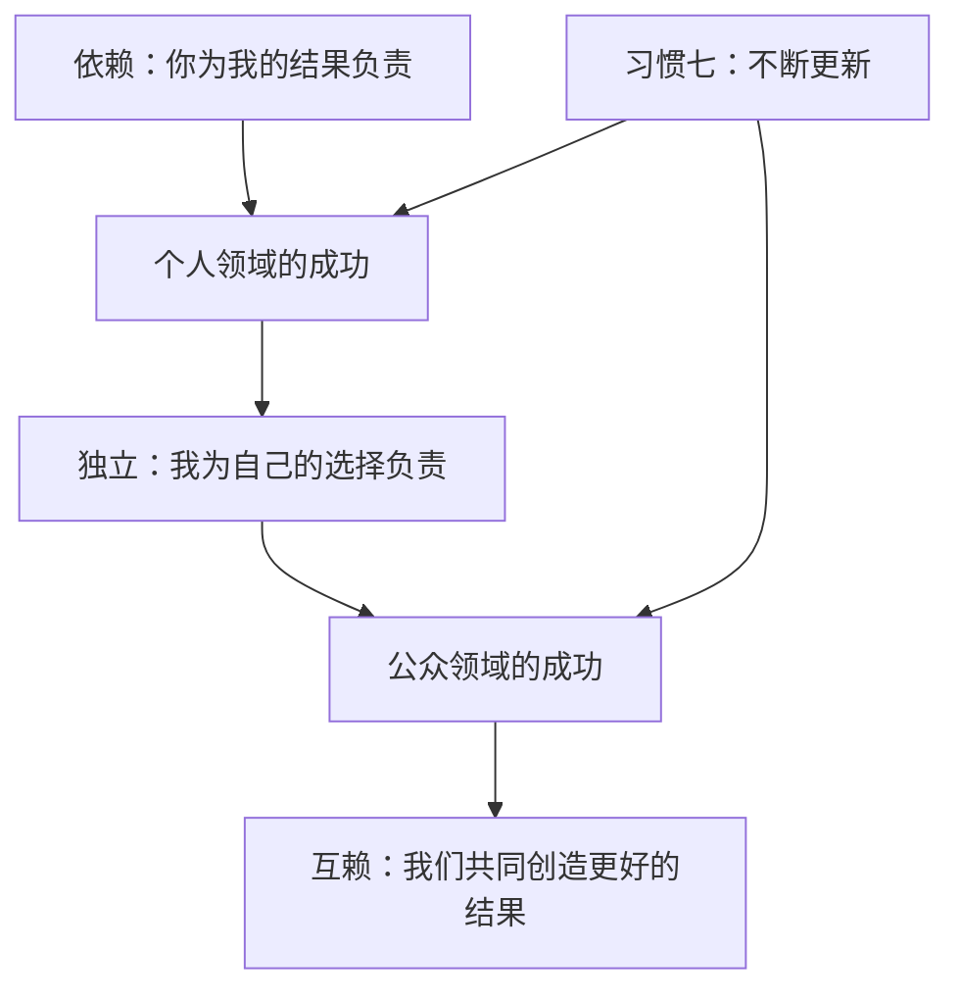

# 《高效能人士的七个习惯》读书笔记

> [!abstract] 全书主线
> 真正的高效能，不是用更快的速度塞进更多事情，而是以原则为中心，由内而外地建立品德和行动方式：先取得个人领域的成功，从依赖走向独立；再取得公众领域的成功，从独立走向互赖；最后通过持续更新，让整套系统保持长期有效。

## 一句话理解

**先决定自己要成为什么样的人，再管理行动；先建立独立的人格，再进入互赖的关系；在追求结果的同时，持续维护产生结果的能力。** ^ra-identity-direction

关联观点：[[04-读书/已读/原子习惯序+第一章#^ra-identity-habit-cycle|身份与习惯是一条双向路]]

这本书表面上讲七个习惯，底层其实只在反复回答三个问题：

1. 我依据什么原则做选择？
2. 我如何与他人建立长期有效的关系？
3. 我怎样既获得今天的成果，又不透支明天的能力？

## 全书地图：从依赖到互赖

| 成长阶段 | 习惯 | 核心问题 | 对应能力 |
|---|---|---|---|
| 个人领域的成功 | 1. 积极主动 | 我能选择怎样回应吗？ | 个人愿景 |
| 个人领域的成功 | 2. 以终为始 | 我究竟要去哪里？ | 自我领导 |
| 个人领域的成功 | 3. 要事第一 | 怎样让价值观进入日程？ | 自我管理 |
| 公众领域的成功 | 4. 双赢思维 | 能否让双方都真正受益？ | 人际领导 |
| 公众领域的成功 | 5. 知彼解己 | 我是否先真正理解了对方？ | 移情沟通 |
| 公众领域的成功 | 6. 统合综效 | 差异能否产生第三种方案？ | 创造性合作 |
| 持续进化 | 7. 不断更新 | 如何维护并增强自己的产能？ | 平衡更新 |

> [!important] 独立不是终点
> 依赖意味着把责任交给别人；独立意味着能够为自己负责；互赖则是在保持独立的基础上，主动与他人合作，创造单个人无法完成的结果。书中的顺序不能颠倒：没有前三个习惯建立的内在稳定，后面的合作很容易退化成讨好、操控或彼此消耗。

## 全书的三个底层原则

### 1. 由内而外：先改变看问题的方式

人的行为来自自己理解世界的“地图”，也就是思维定式。同一事实可以被不同的人看成完全不同的世界，因此仅仅训练沟通技巧、态度或表现，常常只能得到短期效果。

作者区分了两条路线：

- **个人魅力路线**：寻找技巧、话术和速成方法，希望快速改变结果。
- **品德路线**：从诚信、责任、勇气、公正、尊重等原则出发，让行为成为品德的自然结果。

“由内而外”并不是把一切问题都归咎于自己，而是把改变的起点放在自己的影响范围内：先检查自己的思维定式、动机和行为，再尝试改变关系与环境。

### 2. 习惯是知识、技巧与意愿的交集

- **知识**：知道要做什么、为什么做。
- **技巧**：知道怎样做。
- **意愿**：真正愿意去做。

只知道原则而不会行动，不会形成习惯；掌握技巧却缺少正确动机，也可能把技巧用于操控；只有三者相交，行为才会稳定。

### 3. 效能来自产出与产能的平衡

作者用“金蛋与鹅”解释产出/产能平衡：金蛋是今天想要的结果，鹅是持续产生结果的能力。只追逐金蛋，会耗尽健康、关系、信用、知识和工作系统；只保养鹅而没有产出，也不能解决现实问题。

这套平衡贯穿全书：

- 工作成果与能力成长；
- 当下收入与长期竞争力；
- 完成任务与维护关系；
- 个人成就与身体、精神、心智的更新。

## 习惯一：积极主动——在刺激与回应之间做选择

积极主动不是表现得热情，也不是假装环境没有限制，而是承认：即使无法选择遭遇，仍能选择自己的回应。自我意识、想象力、良知和独立意志，使人不必完全按照情绪、过去经验或外界刺激自动反应。

### 关注圈与影响圈

- **关注圈**：所有在意却未必能改变的事情，如宏观环境、他人评价、已经发生的过去。
- **影响圈**：能够直接或间接施加影响的部分，如自己的行为、承诺、沟通方式和能力建设。

积极主动的人把精力放在影响圈，影响圈会逐渐扩大；长期停留在关注圈，则容易把力量交给环境，在抱怨中进一步失去行动空间。

面对问题可以这样区分：

| 问题类型 | 例子 | 合适的起点 |
|---|---|---|
| 可直接控制 | 自己的习惯、选择、准备不足 | 改变行为 |
| 可间接控制 | 他人的态度或合作方式 | 改变影响方法和关系质量 |
| 无法控制 | 过去、既成事实、外部环境 | 接纳现实，选择态度与下一步 |

实践积极主动最直接的方法，不是许下宏大愿望，而是从小承诺开始，并一次次兑现。每次守诺，都在加强“我能对自己的选择负责”的内在证据。

## 习惯二：以终为始——先领导方向，再管理行动

所有事物都经过两次创造：先在头脑中构思，再在现实中实现。如果不主动完成第一次创造，自己的生活就容易由家庭脚本、社会期待、即时情绪或他人的评价代写。

作者用“管理与领导”区分两个层次：

- **领导**决定什么是正确的事、要去哪里。
- **管理**决定怎样把事情正确地完成。

方向错误时，越高效只会越快抵达错误地点。因此习惯二的核心产物不是一张目标清单，而是个人使命宣言：明确自己珍视的原则、想成为的人，以及希望怎样扮演人生中的不同角色。

### 以原则为中心

如果把安全感建立在金钱、工作、伴侣、家庭、名利、享乐、朋友或自我之上，一旦中心发生变化，判断和行动就会随之摇摆。原则的价值在于，它不会因为处境或他人的态度改变。

使命宣言可以从三个层次展开：

1. **原则**：哪些价值不因短期得失而改变？
2. **角色**：作为个人、伴侣、家人、朋友、专业工作者等，我分别承担什么责任？
3. **目标**：每个角色希望创造怎样的长期结果？

## 习惯三：要事第一——让价值观真正进入时间

习惯二完成第一次创造，习惯三负责第二次创造。自我管理的关键不是把所有事情安排得更满，而是让最重要的事情获得优先位置。

### 时间管理四象限

|  | 紧急 | 不紧急 |
|---|---|---|
| **重要** | 第一象限：危机、截止日期、急迫问题 | 第二象限：规划、学习、锻炼、关系建设、预防、能力提升 |
| **不重要** | 第三象限：他人的部分干扰、无价值会议、表面紧急事务 | 第四象限：无目的消遣、逃避性活动、琐碎忙碌 |

高效能的重点不是消灭第一象限，而是持续投入第二象限，以预防和准备减少未来的危机。第二象限通常不催促人，却决定了长期生活的质量。

### 从日计划转向周计划

以一周为单位，可以同时看见不同角色，避免某个单一领域吞噬全部时间：

1. 回顾使命和原则；
2. 列出本周承担的主要角色；
3. 为每个角色确定一至两个重要结果；
4. 优先把第二象限事务放入日程；
5. 每天根据现实情况调整，但不轻易牺牲重要关系和长期目标。

书中特别提醒：**效率适合用于事情，效用才适合用于人。**日程是帮助人实践价值观的工具，不应反过来让人为了进度忽视关系。

### 授权：交付结果，而不是控制方法

有效授权应明确五项内容：预期结果、指导方针、可用资源、考核标准和奖惩后果。管理者关注约定结果和边界，让执行者选择方法并对结果负责；这既减少控制成本，也培养对方的独立性。

## 从个人成功到公众成功：情感账户

进入后三个习惯之前，作者先建立了人际关系的基础：长期关系中的信任像一个情感账户。礼貌、理解、守诺、诚信会增加余额；轻蔑、失信、操控和背后议论会持续透支。

六类重要的“存款”是：

1. 真正理解对方，而不是用自己的需要猜测对方；
2. 重视礼貌、善意和看似微小的细节；
3. 信守承诺，无法履行时坦诚说明并取得谅解；
4. 事先澄清彼此的期望；
5. 对不在场的人保持忠诚，让言行一致；
6. 犯错后真诚、具体地道歉，并用行动修正。

关系中的问题不只是一项需要尽快消灭的“产出故障”，也可能是提高理解和信任这种“关系产能”的入口。

## 习惯四：双赢思维——从竞争走向共同受益

双赢不是一味温和，更不是各退一步。它要求同时坚持自己的重要利益和尊重对方的利益，在勇气与体谅之间保持成熟的平衡。

常见的人际模式包括赢/输、输/赢、输/输、只求自己赢、双赢，以及“双赢或不成交”。在长期互赖关系中，若找不到双方都能接受的方案，坦然选择暂不合作，通常比勉强达成一方受损的协议更健康。

双赢依赖三个品格基础：

- **诚信**：知道自己真正重视什么，并忠于原则；
- **成熟**：既敢于表达，也能理解和体谅；
- **富足心态**：相信价值并非固定份额，别人的成功不必等于自己的失败。

一份可执行的双赢协议同样应写清预期结果、指导方针、可用资源、考核标准和奖惩后果。双赢不能只依靠善意，还需要与之匹配的制度和流程。

## 习惯五：知彼解己——先诊断，再开方

大多数人聆听，不是为了理解，而是为了准备自己的回答。人还容易使用四种“自传式回应”：评价、追问、建议和解释，把对方的经历迅速套入自己的经验。

移情聆听不是同情，也不意味着赞同；它是暂时放下自己的框架，在理智与情感两个层面理解对方。可以由浅入深练习：

1. 复述对方的话；
2. 用自己的语言重新表达意思；
3. 说出自己感受到的情绪；
4. 同时表达对内容和情绪的理解。

当一个人真正感到被理解，防御才可能下降，沟通才进入解决问题的阶段。表达自己时，顺序也应是品德、关系、逻辑：可信的人格建立信任，对对方处境的理解建立连接，理性的方案最后才有影响力。

## 习惯六：统合综效——寻找第三种方案

统合综效不是妥协。妥协通常意味着双方各损失一点，统合综效则把差异当成资源，寻找比任何一方原方案都更好的“第三种选择”。

它成立需要三个前提：

1. 有前三个习惯带来的内在安全感，不因不同意见立刻感到受威胁；
2. 以双赢为共同目标；
3. 先理解差异背后的经验、担忧和价值。

真正重视差异，不是勉强容忍，而是承认：一个聪明而真诚的人与我意见不同，可能说明他看见了我尚未看见的部分。高信任加上坦诚交流，才可能把分歧转化为创造力。

## 习惯七：不断更新——维护产生结果的自己

习惯七对应产能建设。人需要在四个彼此影响的层面持续更新：

| 层面 | 目标 | 典型行动 |
|---|---|---|
| 身体 | 体力、耐力与健康 | 锻炼、营养、休息、压力管理 |
| 精神 | 意义、价值与内在方向 | 反思、冥想、亲近自然、重读使命宣言 |
| 心智 | 理解、判断与创造能力 | 阅读、写作、学习、规划与组织 |
| 社会/情感 | 关系、服务与内在安全感 | 移情聆听、合作、贡献、维护重要关系 |

更新不应等出现危机才开始。锻炼、学习、关系建设和精神反思都属于第二象限：因为不紧急，所以最容易被忽视；也正因为被长期忽视，才会在未来变成健康、能力或关系上的第一象限危机。

作者建议每天留出相对完整的时间进行身体、精神和心智更新，把它视为“个人领域成功的每日实践”。社会/情感层面则更多地在日常关系中完成。

七个习惯不是线性完成后便结束。积极主动使人能确立方向和安排要事；要事第一为持续更新留出空间；更稳定的个人状态又提高聆听、双赢和合作的质量。学习、承诺、行动，再进入下一轮学习，这是一条向上的螺旋。

## 再论由内而外：成为转型者

全书最后回到起点：许多表面的冲突来自更深的脚本、经验和敏感点。只调整沟通技巧，可能缓解一时，却难以根除反复出现的模式。

人能够在自己这里终止一个代际延续的消极模式。过去提供了刺激，却不能替现在决定回应；当一个人看见旧脚本、重新选择原则并稳定行动时，他就成为连接过去与未来的“转型者”。

## 我的高亮信号

> [!info] 说明
> 下面是根据 148 条 Calibre 高亮的章节分布和重复主题做出的整理。它反映“阅读时哪些内容更容易引起注意”，不等同于已经得到你本人确认的长期观点。

### 高亮分布

| 部分 | 高亮数 | 主要关注 |
|---|---:|---|
| 前言与全书基础 | 14 | 长短期平衡、品德而非技巧、自然成长、产出/产能 |
| 个人领域的成功 | 42 | 影响圈、承诺、使命与角色、第二象限、周计划与授权 |
| 人际关系与公众领域的成功 | 51 | 情感账户、双赢、移情聆听、差异与第三种方案 |
| 自我更新与再论由内而外 | 38 | 四维更新、每日个人成功、写作与阅读、代际模式 |
| 附录：时间管理 | 3 | 用第二象限管理第一象限 |

### 反复出现的五个关注方向

1. **可持续，而不是短期透支。** 从前言的长短期平衡，到产出/产能，再到习惯七的四维更新，你多次标记了“今天的结果不能牺牲未来的能力”。
2. **把控制感收回影响圈。** 你关注了问题的三种控制类型、由内而外的改变、小承诺与守诺，说明“怎样从无力感回到可行动状态”是明显的阅读线索。
3. **先定方向，再追求效率。** 使命宣言、角色、目标、第二象限和周计划都有较密集高亮。重点不是安排更多任务，而是判断哪些事值得先进入时间。
4. **关系不是技巧问题，而是信任问题。** 情感账户、守诺、明确期望、真诚道歉、先理解对方等内容被连续标记，说明你注意到了沟通背后的品德和关系基础。
5. **成熟同时需要勇气与体谅。** 双赢部分的高亮最多集中在不讨好、不压抑，也不强硬控制；既表达自己，也理解对方，并在差异中寻找更好的方案。

> [!note] 一个值得保留的总判断
> 从高亮结构看，这本书对你最有价值的部分可能不是“七条提高效率的技巧”，而是一套让个人效能长期可持续的完整结构：**原则提供方向，主动性提供起点，周计划把方向落地，信任与聆听支撑合作，四维更新负责长期续航。**

## 与现有知识库的连接

### 与《原子习惯》：方向层与行为层

[[原子习惯序+第一章|《原子习惯》]]更擅长回答“怎样让一个行为稳定发生”：设计提示、降低阻力、强化反馈、用重复塑造身份。本书更先追问“这个行为是否值得重复”：原则、使命、角色、重要性和关系后果。

两本书可以形成上下两层：

- 《高效能人士的七个习惯》负责**选择方向与要事**；
- 《原子习惯》负责**把要事设计成可重复的系统**。

只用前者，可能知道什么重要却难以持续；只用后者，可能很稳定地重复一件方向并不重要的事。

### 与“焦虑”：从关注圈回到影响圈

[[焦虑]]把职业、收入和未来生活的不确定感，与“构建人生长期图景”联系起来。本书提供了两个可以衔接的动作：

1. 用使命、角色和长期目标描述想走向哪里；
2. 把担忧拆成可直接控制、可间接控制和无法控制三类，只为前两类安排下一步行动。

这样做不是消除不确定性，而是防止注意力长期停留在没有行动出口的关注圈。

### 与 AI 阅读联想系统：保留观点来源

这篇笔记按照 [[AI 阅读联想系统]] 的边界，区分了全书观点、高亮分布与 AI 的归纳推断。高亮可以证明你关注过什么，但不能自动证明你赞同什么；尚未出现的个人联想，也不由 AI 代写成你的认识。

## 最小实践：角色—目标—本周要事

与其同时“实践七个习惯”，更适合先建立一个能带动习惯一、二、三和七的小循环。

### 1. 写下本周的主要角色

- 个人：
- 家人/伴侣：
- 工作角色：
- 学习与成长：
- 朋友/社区：

### 2. 每个角色只写一个期望结果

不要写“多学习”“多陪伴”这类方向，写成本周结束时能够确认的结果。

### 3. 选出本周最重要的三件第二象限事务

- [ ] 要事一：
- [ ] 要事二：
- [ ] 要事三：

### 4. 先安排要事，再接受变化

把它们放进具体时间段。临时任务出现时，重新判断重要性，而不是默认让所有“紧急”覆盖原来的选择。

### 5. 周末做一次短复盘

- 我把多少精力放在了影响圈？
- 哪个角色被我忽视了？
- 哪项第二象限投入减少了未来的问题？
- 我在哪段关系里需要增加一次情感账户存款？
- 身体、精神、心智、社会/情感四个层面，下周最需要更新哪一个？

## 读完后值得长期保留的检查清单

- [ ] 遇到问题时，先区分关注圈与影响圈。
- [ ] 做重要决定前，检查它是否符合长期原则和角色目标。
- [ ] 每周优先安排少量第二象限事务，而不是只处理眼前紧急。
- [ ] 对事追求效率，对人判断效用与关系后果。
- [ ] 进入分歧时，同时保留表达自己的勇气和理解对方的体谅。
- [ ] 给建议前，先确认自己是否真正理解了对方。
- [ ] 不急于在两个方案之间折中，先寻找可能的第三种方案。
- [ ] 定期更新身体、精神、心智和社会/情感四个层面。
- [ ] 检查自己是否为眼前产出透支了长期产能。

## 来源与整理说明

- 全书内容来源：本机 Calibre 书库中的 EPUB《高效能人士的七个习惯》。
- 个人高亮：148 条，记录时间为 2026-07-12 至 2026-07-26。
- 本笔记保留的是全书结构、概念关系、高亮关注方向与实践入口，没有把全部原文高亮重复收录为书摘。
- 高亮信号部分属于基于阅读痕迹的推断，等待后续阅读联想或实践复盘进一步确认。

## 阅读联想

### 2026-08-13 · 与原子习惯的联系

> [!quote] 当前阅读片段
> 先决定自己要成为什么样的人，再管理行动

**来源片段**：[[04-读书/已读/《高效能人士的七个习惯》读书笔记#^ra-identity-direction|先决定自己要成为什么样的人]]

**关联片段**：[[04-读书/已读/原子习惯序+第一章#^ra-identity-habit-cycle|身份与习惯是一条双向路]]

#### 我的原始联想

原子习惯中也提到了对应的概念，你要先建立和习惯相关的身份认同，从内心觉得应该做这样的事，会更容易形成习惯

#### AI 讨论

两本书共享“身份会引导行动”这一核心方向，但侧重点不同。《高效能人士的七个习惯》强调先决定想成为怎样的人，为行动确定方向；《原子习惯》进一步说明，身份也需要通过小行动和重复习惯不断获得证据并被强化。两者共同构成“身份引导行动，行动反过来塑造身份”的循环。

#### 当前认识

行为和身份认同是互相加强的关系，行为可以帮助建立身份认同，身份认同反过来帮助吧行为作为习惯坚持下去

**证据状态**：讨论性判断，尚未进行原文核对
