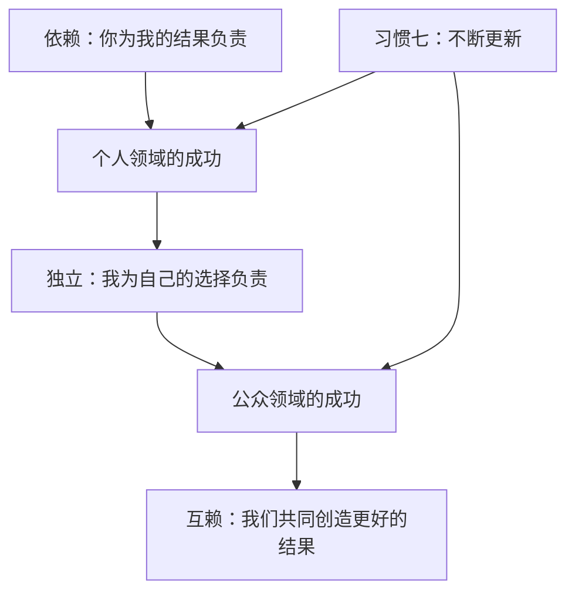

# 《高效能人士的七个习惯》读书笔记

> [!abstract] 全书主线
> 真正的高效能，不是用更快的速度塞进更多事情，而是以原则为中心，由内而外地建立品德和行动方式：先取得个人领域的成功，从依赖走向独立；再取得公众领域的成功，从独立走向互赖；最后通过持续更新，让整套系统保持长期有效。

## 一句话理解

**先决定自己要成为什么样的人，再管理行动；先建立独立的人格，再进入互赖的关系；在追求结果的同时，持续维护产生结果的能力。** ^ra-identity-direction

关联观点：[[《原子习惯》读书笔记#^ra-identity-habit-cycle|身份与习惯是一条双向路]]

这本书表面上讲七个习惯，底层其实只在反复回答三个问题：

1. 我依据什么原则做选择？
2. 我如何与他人建立长期有效的关系？
3. 我怎样既获得今天的成果，又不透支明天的能力？

## 全书地图：从依赖到互赖

| 成长阶段 | 习惯 | 核心问题 | 对应能力 |
|---|---|---|---|
| 个人领域的成功 | 1. 积极主动 | 我能选择怎样回应吗？ | 个人愿景 |
| 个人领域的成功 | 2. 以终为始 | 我究竟要去哪里？ | 自我领导 |
| 个人领域的成功 | 3. 要事第一 | 怎样让价值观进入日程？ | 自我管理 |
| 公众领域的成功 | 4. 双赢思维 | 能否让双方都真正受益？ | 人际领导 |
| 公众领域的成功 | 5. 知彼解己 | 我是否先真正理解了对方？ | 移情沟通 |
| 公众领域的成功 | 6. 统合综效 | 差异能否产生第三种方案？ | 创造性合作 |
| 持续进化 | 7. 不断更新 | 如何维护并增强自己的产能？ | 平衡更新 |

> [!important] 独立不是终点
> 依赖意味着把责任交给别人；独立意味着能够为自己负责；互赖则是在保持独立的基础上，主动与他人合作，创造单个人无法完成的结果。书中的顺序不能颠倒：没有前三个习惯建立的内在稳定，后面的合作很容易退化成讨好、操控或彼此消耗。

## 前言：变化的世界，不变的原则

> [!abstract] 章节主旨
> 世界的变化会不断制造新的压力，但技术、速度和工具无法代替基本原则。真正持久的效能来自对原则的实践，以及对今天的产出和明天的产能保持平衡。

新版前言把七个习惯放进一个变化越来越快的世界中重新审视。技术提高了处理信息和完成工作的速度，却没有替人回答几个更根本的问题：方向是否正确、关系是否可信、能力是否在增长，以及今天的成果是否透支了未来。

作者认为，越是在不确定的环境里，越需要依靠相对稳定的原则。诚信、责任、公正、尊重、合作和持续成长并不会因为工具改变而失效。环境会改变原则的表现方式，却不会取消原则本身。

> [!quote] 高亮
> 我们绝对不能无视平衡的原则，我们要平衡现在和将来两种需要。

这里已经埋下全书最重要的判断：效能不能只用眼前的成绩衡量。健康、关系、能力、信任和组织文化都是产能；如果用透支它们的方式换取结果，短期的高产出最终会反噬长期表现。

### 本章收束

变化越快，越不能只追逐新技巧。真正需要反复确认的是：我依据什么原则做选择，以及我是否同时照顾了眼前结果和长期能力。

> [!reflection] 我的联想与修订
> 待按章阅读后补充实际经历、赞同之处、疑问或反例。

## 如何善用本书：以实践和复述来阅读

作者建议不要把这本书当成一次读完就结束的知识输入，而要把它当作会反复返回的行动手册。七个习惯按照人的成长次序展开，真正的理解来自实践，而不只是记住概念。

书中还建议带着“准备教给别人”的心态阅读，并在短时间内复述所学。复述会迫使人辨认自己是否真的理解了概念，也会让原则从被动接收变成主动组织。这个方法与本笔记的使用方式一致：先形成章节稿，再通过审阅、评论、联想和修改逐渐转化成自己的理解。

作者同时提醒，改变之门只能从内侧打开。外界可以解释原则、提供方法和创造条件，却不能替一个人完成选择。成长通常是渐进的，但当底层思维定式改变后，产生的结果可能具有结构性的影响。

### 本章收束

阅读这本书的目标不是尽快读完，而是能够复述、检验并在生活中使用。每次重读都应带着当前真实问题，观察同一原则是否出现了新的意义。

> [!reflection] 我的联想与修订
> 待按章阅读后补充实际经历、赞同之处、疑问或反例。

## 第一部分：重新探索自我

## 第一章：由内而外全面造就自己

> [!abstract] 章节主旨
> 长期改变要从思维定式、动机和品德开始。技巧能够改善表达，却无法长期掩盖缺乏诚信、信任或正确原则的问题。

### 1. 品德成功论与个人魅力论

作者区分了两种理解成功的路线。品德成功论把诚信、谦逊、勇气、公正、耐心、勤勉等品德看成成功的基础；个人魅力论更强调形象、态度、沟通技巧和影响他人的手段。

书中并未否定技巧的价值，而是把它放在次要位置。沟通技巧只有建立在真实动机和可信品德上，才能产生长久效果。缺少信任时，再好的表达也容易被理解为操控；关系紧张时，正确的建议也可能被听成评判。

> [!quote] 高亮
> 聆听需要耐心、坦诚和理解对方的愿望，属于品德的高级范畴。相较之下，以低投入的情感给出“高高在上”的建议要容易得多。

### 2. 思维定式决定我们怎样解释世界

思维定式像一张地图。人不是直接按照客观事实行动，而是按照自己对事实的解释行动。书中的少妇与老妇图说明，同一幅图像可以被不同经验的人看成不同对象，双方还都确信自己看到的是事实。

这意味着分歧未必来自一方愚蠢或恶意，也可能来自双方使用了不同的地图。只有意识到自己的视角也受经验限制，才可能认真理解另一种看法。

> [!quote] 高亮
> 别人的观点虽然有异，但也是清楚而客观的。“立场决定观点”。

行为和态度通常是思维定式的结果。如果地图本身错误，只要求自己更努力、更积极，可能只是更快地走向错误方向。深层改变首先要检查：我怎样定义这个问题？我对对方、自己和成功抱有什么未经检验的假设？

### 3. 原则是校准地图的外部尺度

承认观点不同，不等于认为一切解释都同样有效。作者把原则理解为不依赖个人好恶的基本规律，例如公平、诚信、尊严、服务、成长和潜能。思维定式需要在现实和原则中接受检验，而不是只凭“这是我的看法”就成立。

以原则为中心，会把安全感从职位、身份、外貌、学历和过去成就等容易变化的来源，逐渐转移到内在品德和判断上。

> [!quote] 高亮
> 如果你力量的来源——体型、力气、职位、权威、学历、地位、身份、外表或是过去的成就——发生变化甚至不复存在，那该怎么办呢？

### 4. 成长不能跳过自然过程

人的成长和关系的建立都遵循自然过程。技巧可以暂时改善表面，却无法跳过能力、信任和品德的积累。作者用农业作比喻：春天没有播种，秋天不能靠临时发力获得收成。

> [!quote] 高亮
> 自然的成长过程不容违背、忽略或缩短，那只会让你平添失望和挫败感。

这也是“由内而外”的含义：改变先从自己的思维定式、动机、品德和行为开始，再逐渐影响关系与环境。它不是把所有责任都揽到自己身上，而是先从自己真正能改变的部分着手。

### 5. 症结往往不在表面问题

作者把只处理症状的方法称为治标。例如，一个组织希望通过口号、培训或制度快速购买新的文化，却没有处理权术和低信任；一个人追求更快完成更多工作，却没有先判断这些工作是否值得完成。

> [!quote] 高亮
> 以更短的时间完成更多的工作真的有用吗？抑或这只不过能让人对充塞了生活的人与环境做出更快的反应？

新的思想水平要求先回到问题的来源：我们的地图、中心、原则和品德。后面的七个习惯，就是把“由内而外”落实到个人选择、时间使用和人际合作中的具体路径。

### 本章收束

第一章不是在提供一种更高级的技巧，而是在改变问题的入口：遇到长期反复的问题时，先检查自己的地图、动机和原则，再决定要采用什么方法。

> [!reflection] 我的联想与修订
> 待按章阅读后补充实际经历、赞同之处、疑问或反例。

## 第二章：七个习惯概论

> [!abstract] 章节主旨
> 习惯是知识、技巧与意愿的交集。七个习惯按照“依赖—独立—互赖”的成长次序展开，并始终以产出与产能的平衡作为效能标准。

### 1. 习惯由三个部分构成

- **知识**：知道做什么，以及为什么做。
- **技巧**：知道怎样做。
- **意愿**：愿意做，并把它放进行动。

只有三者交集扩大，行为才会稳定。只知道原则而不会实践，不能形成习惯；掌握技巧却没有正确意愿，也可能把技巧用于操控；只有意愿而缺少知识与技巧，则容易反复受挫。

> [!quote] 高亮
> “知识”、“技巧”与“意愿”相互交织的结果。

### 2. 从依赖走向独立，再走向互赖

依赖状态把结果归因于别人：“你要为我负责。”独立状态能够对自己的选择负责：“我可以完成。”互赖则建立在独立之上：“我们可以合作，创造单独行动无法得到的结果。”

前三个习惯建立个人领域的成功：积极主动使人承担选择的责任，以终为始确定方向，要事第一把方向落实到行动。后三个习惯建立公众领域的成功：双赢思维确立合作目标，知彼解己建立理解，统合综效利用差异创造新方案。习惯七持续更新个人产能，支撑前六个习惯循环运行。

独立不是全书的终点。一个人如果还不能为自己负责，合作很容易变成依附、讨好或控制；有了独立人格以后，互赖才成为主动选择和能力放大。

### 3. 效能是产出与产能的平衡

作者用“金蛋与鹅”的寓言解释效能：金蛋代表当前产出，鹅代表持续产生结果的能力。只要金蛋而透支鹅，会破坏未来的产出；只照顾鹅而没有现实产出，也不能形成真正效能。

> [!quote] 高亮
> 效能在于产出与产能的平衡。

这种平衡适用于三类资产：物质资产需要维护，金融资产需要本金，人的资产需要健康、能力和动力。关系和组织也一样，结果依赖信任、合作方式、人才成长与制度质量。

> [!quote] 高亮
> 急功近利常常会毁掉宝贵的物质资产。保持产出与产能的平衡会帮助你更有效地利用物质资产。

### 4. 七个习惯是一套相互依赖的系统

七个习惯不是七条可以任意抽取的技巧。习惯一提供选择空间，习惯二确定方向，习惯三落实方向；个人稳定以后，习惯四、五、六才可能形成真正合作；习惯七又不断补充身体、精神、心智和关系产能。

因此，使用这套框架时不能只问“我最缺哪一个技巧”，还要判断自己目前卡在成长链条的哪个位置，以及当前的做法是否同时维护了产出和产能。

### 本章收束

全书可以压缩成两个坐标：成长方向是从依赖到独立再到互赖，效能标准是产出与产能的长期平衡。后面每个习惯都能放回这两个坐标理解。

> [!reflection] 我的联想与修订
> 待按章阅读后补充实际经历、赞同之处、疑问或反例。

## 第二部分：个人领域的成功——从依赖到独立

## 第三章：习惯一·积极主动——个人愿景的原则

> [!abstract] 章节主旨
> 积极主动意味着为自己的选择与回应负责。环境会影响人，却不能完全决定人；真正可训练的能力，是在刺激与回应之间创造选择空间，并把行动放回影响圈。

### 1. 社会之镜不能完整定义一个人

人经常通过他人的评价认识自己：“你总是这样”“你天生不擅长这个”“你的性格就是如此”。这些社会之镜往往混合了他人的经验、偏见与期待。如果不加检验地接受，人就容易把暂时行为固化成无法改变的身份。

作者借维克多·弗兰克尔在集中营中的经历说明，即使外在自由被严重剥夺，人仍可能保留选择回应方式的内在自由。这种自由依靠四种天赋：自我意识让人观察自己，想象力让人构想新的可能，良知帮助判断原则，独立意志使人按照选择行动。

> [!quote] 高亮
> 选择的自由包括人类特有的四种天赋。

### 2. 积极主动是承担回应的责任

积极主动不等于乐观、强势或一直保持高能量。它的核心是“回应的能力”：承认自己的行为来自选择，不把情绪、条件和他人的行为直接当成自己的决定。

外界条件仍会造成真实影响，主动性也不能消除限制。区别在于，被动的人把行动的前提交给环境，只有“如果情况改变”才改变自己；主动的人从当下仍能选择的部分开始，逐渐创造新的条件。

> [!quote] 高亮
> 但是如果你甘于被动，就会受制于人，面临截然不同的发展与机遇。

### 3. 语言会强化主动或被动的思维

“我没办法”“我只能这样”“他让我生气”把行为描述成外界直接造成的结果。语言长期重复后，会强化宿命感，让人忽略自己仍然拥有的选择。

主动语言会换一种问法：我能选择什么？我愿意承担哪种后果？我可以怎样表达、准备或影响？这种转换不是否认困难，而是把注意力从解释无力转到寻找行动空间。

> [!quote] 高亮
> 推诿责任的言语往往会强化宿命论。说者一遍遍被自己洗脑，变得更加自怨自艾，怪罪别人和环境。

### 4. 关注圈与影响圈

- **关注圈**：所有在意的事情，包括健康、工作、他人评价、宏观环境和过去。
- **影响圈**：能够直接改变或间接施加影响的部分，包括自己的行为、准备、承诺、沟通方式和关系质量。

两者的区别不是“关不关注”，而是精力放在哪里。长期盯着无法行动的部分，会不断产生消极能量并缩小影响圈；从力所能及的事情开始，能力、信任和资源可能逐渐增长，影响圈也随之扩大。

> [!quote] 高亮
> 只要我们的焦点在关注圈，就等于是允许自己受制于外界条件，自然就不会主动采取必要措施来推动积极变化。

### 5. 三类问题有不同的行动入口

| 问题类型 | 问题来源 | 影响圈内的起点 |
|---|---|---|
| 可直接控制 | 自己的行为和习惯 | 改变行为，建立前三个习惯 |
| 可间接控制 | 他人的行为 | 改变影响方式，运用人际关系习惯 |
| 无法控制 | 过去或既成的外部条件 | 接纳事实，选择态度和下一步 |

> [!quote] 高亮
> 不论是能直接控制的、间接控制的还是无法控制的问题，解决的第一步都掌握在我们自己手里。

承认影响圈不代表认为所有结果都由自己负责。人可以选择行为，却不能自由选择行为的自然后果；也不能控制别人是否接受自己的影响。积极主动要求的是承担自己那一部分，而不是把整个世界的结果都压到自己身上。

### 6. 错误、后果与重新获得力量

已经发生的错误属于关注圈，继续悔恨不能改变过去，但对错误的下一次回应仍在影响圈。及时承认、修正并吸取教训，可以阻止错误继续扩大；掩饰和辩解则会制造新的后果。

> [!quote] 高亮
> 我们对任何错误的回应都会影响到下一刻发生的事件，所以一定要立刻承认并加以改正。

### 7. 从小承诺开始扩大影响圈

主动性的训练不需要等待巨大考验。最直接的入口是做出小承诺并兑现，或者确立一个目标并付诸实践。每次守诺都在积累自我信任，使独立意志逐渐强于一时情绪。

> [!quote] 高亮
> 从各种小事开始，许下承诺并予以兑现。学会做照亮他人的蜡烛，而不是评判对错的法官；以身作则，而不是一心挑错；解决问题，而不是制造事端。

### 本章收束

积极主动的重点不是让自己相信“什么都能控制”，而是更准确地区分什么能控制、什么能影响、什么只能接受，然后对影响圈内的第一步负责。

> [!reflection] 我的联想与修订
> 待按章阅读后补充：最近哪个问题让我长期停留在关注圈？它属于哪种控制类型？影响圈内的第一步是什么？

## 第四章：习惯二·以终为始——自我领导的原则

> [!abstract] 章节主旨
> 以终为始是先明确希望成为什么样的人、依据什么原则生活，再让日常决定服从这个方向。它对应人生的第一次创造，也就是自我领导。

### 1. 从人生终点反看今天

作者用一个设想打开本章：想象自己参加一场葬礼，最后发现逝者是自己。家人、朋友、同事和社会关系中的人会怎样描述你？你真正希望他们记住什么？

这个练习不是为了制造沉重感，而是把长期价值从日常忙碌中重新显现出来。许多看似紧急的事情，放到人生尺度上会迅速失去分量；一些容易被推迟的关系、品德和贡献，反而成为真正重要的结果。

以终为始意味着，今天的选择不仅回答“我要完成什么”，还回答“这件事正在把我塑造成怎样的人”。

### 2. 所有事物都经过两次创造

建造房屋会先有蓝图，再有施工；经营事业会先确定方向，再组织行动。人的生活也同样经历两次创造：第一次是在头脑中构想，第二次是在现实中执行。

> [!quote] 高亮
> 我们做任何事都是先在头脑中构思，即智力上的或第一次的创造，然后付诸实践，即体力上的或第二次的创造。

如果不主动完成第一次创造，家庭脚本、社会期待、他人评价和即时情绪就会替自己写好剧本。主动设计并不意味着能够控制所有结果，而是要为自己的方向和评价标准负责。

### 3. 领导决定方向，管理提高执行

> [!quote] 高亮
> 管理是正确地做事，领导则是做正确的事。

管理关注效率、秩序和执行，领导关注方向、价值和选择。一个人可以非常努力，也可以把日程安排得很满，但如果方向错误，效率只会让他更快抵达错误地点。

> [!quote] 高亮
> 成功，甚至求生的关键并不在于你流了多少血汗，而在于你努力的方向是否正确，因此无论在哪个行业，领导都重于管理。

习惯二负责自我领导，习惯三负责自我管理。先判断什么值得做，再解决怎样把它完成，顺序不能颠倒。

### 4. 改写继承而来的剧本

人会从家庭、教育和社会中继承许多剧本，其中一部分可能符合原则，另一部分只反映过去的局限。自我意识让人看见剧本，想象力让人构想新的选择，良知帮助判断方向，独立意志使人开始改写。

改写不是否定全部过去，而是检查哪些反应只是未经选择的惯性。人在行动发生前进行想象和确认，可以预演一种更符合价值观的回应，让第一次创造逐渐进入现实。

### 5. 个人使命宣言是决策的基准

个人使命宣言描述自己想成为怎样的人、要做出怎样的贡献，以及依据哪些原则生活。它不是一次写完的口号，而是一份会随着理解加深而修订的个人“根本大法”。

> [!quote] 高亮
> 撰写使命宣言的过程，重要性不亚于最后的结论。为了形诸文字，你势必要彻底检讨自己真正的理想——最珍贵的人生目标。

使命宣言的价值出现在具体冲突中。当工作、家庭、健康和个人成长同时提出要求时，它提供了比临时情绪更稳定的判断尺度。

### 6. 生活中心决定安全感、方向、智慧和力量

作者分析了常见的生活中心：配偶、家庭、金钱、工作、名利、享乐、朋友、敌人、宗教和自我。任何单一、易变的对象一旦成为绝对中心，人的安全感和判断就容易随它波动。

以原则为中心，并不是削弱家庭、事业或关系的重要性，而是用更稳定的尺度协调它们。原则不会因为别人当天的态度、收入变化或职位得失而改变，因此能够提供四种支撑：稳定的安全感、清晰的人生方向、理解全局的智慧，以及按照价值观行动的力量。

### 7. 用角色和目标让使命落地

抽象使命需要通过角色进入生活。个人、伴侣、家人、朋友、工程师、学习者等角色，让人看见自己承担的不同责任；目标则把每个角色希望创造的结果写得更具体。

> [!quote] 高亮
> 角色与目标能赋予人生完整的架构与方向。

角色可以防止一个领域吞噬全部生活，目标则为下一章的周计划提供方向。家庭和组织同样可以共同形成使命宣言；关键不只是文字内容，还在于参与讨论的过程。只有参与，才更容易产生认同和承诺。

### 本章收束

以终为始不是先把一生规划得毫无变化，而是建立一个足够稳定的方向，使具体计划可以灵活调整，却不会在每次外界变化时失去判断标准。

> [!reflection] 我的联想与修订
> 已有联想见[[#2026-08-13 · 与原子习惯的联系]]。后续可继续补充：哪些角色最重要、当前生活由什么中心主导，以及阶段性的使命或方向。

## 第五章：习惯三·要事第一——自我管理的原则

> [!abstract] 章节主旨
> 要事第一是把习惯二确定的方向落实到时间与行动中。自我管理的核心不是完成更多任务，而是用独立意志优先执行真正重要的事情。

### 1. 第二次创造依靠独立意志

习惯一说明“我是选择者”，习惯二完成方向上的第一次创造，习惯三负责行动上的第二次创造。它要求人在具体时刻让行为服从原则和目标，而不是服从方便、情绪或外界催促。

> [!quote] 高亮
> 有效的管理指的就是要事第一，先做最重要的事情。

这里的自律并非单纯压制欲望。明确的使命和目标为“拒绝什么”提供理由，独立意志则帮助人对不相关的事情说不，保持对第一次创造的忠诚。

### 2. 时间管理从记录事务走向管理自己

作者把时间管理的发展概括为四代：第一代使用清单和备忘录；第二代用日历规划未来；第三代加入优先级、目标和每日计划；第四代不再试图“管理时间”，而是管理自己，在原则、角色、关系和产出/产能之间取得平衡。

前三代提高了秩序和效率，却也容易让计划变得僵硬，使人为了完成安排忽视关系、机会与真正重要的事情。第四代保留计划的价值，同时允许人根据原则灵活调整。

### 3. 用重要与紧急区分四类事务

|  | 紧急 | 不紧急 |
|---|---|---|
| **重要** | 第一象限：危机、截止日期、迫切问题 | 第二象限：规划、学习、锻炼、关系建设、预防、能力提升 |
| **不重要** | 第三象限：部分干扰、表面紧急、他人的次要优先级 | 第四象限：无目的消遣、逃避和琐碎忙碌 |

紧急事务会主动争夺注意力，重要但不紧急的事务通常不会催促人。第二象限因此最容易被推迟，却决定了长期质量：它通过准备、预防、能力建设和关系投入，减少未来的第一象限危机。

> [!quote] 高亮
> 因为重要，才会使生活大为改观，却因为不够紧迫，所以受到忽略。但是只要我们立即着手进行，效能便会大为增进。

高效能并不要求彻底消灭第一象限，而是避免让生活长期被危机支配。减少第三、第四象限，并持续投入第二象限，才有空间降低未来的紧急程度。

### 4. 对次要事务说“不”

时间有限，为要事留出位置必然意味着拒绝某些事情。拒绝的力量不只来自意志，更来自一个足够清晰、更重要的“是”。当使命、角色和目标模糊时，眼前任何请求都容易成为优先项。

> [!quote] 高亮
> 秘诀在于不要就日程表订立优先顺序，应就事件本身的重要性来安排行事历。

这里也需要警惕把他人的全部紧急都当成自己的重要。拒绝时可以尊重对方，但不必因此交出自己的优先级。

### 5. 以一周为单位安排角色与要事

以天为单位容易被局部事务占满，以周为单位则能同时看见不同角色。作者给出的基本过程是：

1. 回顾使命与原则；
2. 列出本周的重要角色；
3. 为每个角色确定一至两个重要结果；
4. 优先把第二象限事务安排进具体时间；
5. 每天根据现实、关系和新机会进行调整。

> [!quote] 高亮
> 这些目标中一定要有几个第二类事务，最好让这些短期目标与使命宣言中的长期目标相关联。

周计划的价值不是把每一分钟塞满，而是先为真正重要的事情保留位置，并留下应对变化的空白。日计划因此从机械执行变成每日调整。

### 6. 对事讲效率，对人讲效用

如果现实中出现了更重要的人际需要，改变原定计划不一定代表管理失败。计划是服务价值观的工具，不能反过来迫使人牺牲关系以维护表面的准时。

> [!quote] 高亮
> 对人不可讲效率，对事才可如此。对人应讲效用——即某一行为是否有效。

这种灵活需要原则作为判断基础，否则“灵活”也可能变成逃避要事的借口。关键是能说明调整服务了什么更重要的价值。

### 7. 授权是个人管理的杠杆

事必躬亲只能用自己的时间换取产出，授权则通过培养他人的产能放大结果。作者区分两种授权：

- **指令型授权**：规定具体步骤，管理者持续控制方法。
- **责任型授权**：明确结果与边界，让执行者选择方法并承担责任。

责任型授权需要说清五项内容：预期结果、指导方针、可用资源、考核标准和奖惩后果。它前期需要更多沟通和培养，却能让被授权者形成自我管理，并释放创造力。

> [!quote] 高亮
> 分得工作的人成为自己的老板，受自己内心良知的指引，努力兑现自己的诺言，达到既定的目标。

### 本章收束

要事第一不是更复杂的任务管理术，而是让原则通过角色、周计划、拒绝和授权进入现实。判断方法是否有效，要看重要事项是否获得了稳定时间，而不是清单是否全部清空。

> [!reflection] 我的联想与修订
> 待按章阅读后补充：目前哪些第二象限事务总被推迟？它们分别服务哪个角色和长期方向？

## 第三部分：公众领域的成功——从独立到互赖

## 第六章：人际关系的本质

> [!abstract] 章节主旨
> 稳定的人际合作建立在个人独立和长期信任上。信任像情感账户，需要通过理解、守诺、明确期望、诚信和真诚修正持续积累。

### 1. 公众领域的成功建立在个人领域的成功之上

良好关系需要自制与自知。如果一个人的价值完全依赖对方的态度，他很难既坦诚表达自己，又真正尊重对方。前三个习惯建立的独立性，让人能够带着内在安全感进入关系，而不是靠控制、依附或讨好维持关系。

> [!quote] 高亮
> 良好人际关系的基础是自制与自知之明。

独立并不排斥亲密，而是让互赖成为主动选择。两个能为自己负责的人，才更可能共同承担关系和结果。

### 2. 情感账户记录的是信任余额

情感账户是一种比喻：每次互动都会影响关系中的安全感和信任。礼貌、诚实、仁慈与信用增加余额；粗鲁、轻蔑、威逼、操控和失信减少余额。

高余额并不代表可以随意犯错，而是双方更容易相信彼此的动机，沟通可以更直接。低余额时，即使措辞准确，也可能被解释为攻击或操控。

> [!quote] 高亮
> 有了信赖，即使拙于言辞，也不致开罪于人，因为对方不会误解你的用意。所以信赖可带来轻松、直接且有效的沟通。

### 3. 六种主要的感情投资

1. **理解他人**：先了解对方真正重视什么，不把适合自己的方式直接套给别人。
2. **注意小节**：礼貌、尊重和细小善意会累积；轻蔑和忽视也会累积。
3. **信守承诺**：承诺无法履行时，坦诚解释并获得对方理解。
4. **明确期望**：在关系和合作开始时澄清角色、目标、边界和标准。
5. **正直诚信**：对不在场的人保持忠诚，使公开和私下的言行一致。
6. **勇于致歉**：具体承认错误并改变行为，不用反复道歉替代真实修正。

> [!quote] 高亮
> 正确的做法是一开始就提出明确的期望，让相关的每一个人都了解。要做到这一点需要投入很多的时间和精力，不过事实会向你证明，这样做会省去你将来更多的麻烦和周折。

理解他人是所有投资的起点。人们常把自己的需要投射给对方，认为自己喜欢的帮助方式对别人也有效；当回报不符合预期时，又觉得好意落空。真正的投资要从对方的价值和处境出发。

### 4. 无条件的爱与边界可以同时存在

无条件的爱确认一个人的基本价值，不把接纳与对方某次表现绑定。它不等于取消原则、纵容行为或替对方承担责任。稳定的接纳反而能减少对方为了获得认同而迎合，使其更有空间承担选择和后果。

书中强调人的内心比外表更敏感。年龄、职位和强硬表现都不能证明一个人不需要尊重。

> [!quote] 高亮
> 人的内心都是极其柔弱和敏感的，不分年龄和资历。哪怕是在最坚强和冷漠的外表下，也往往隐藏着一颗脆弱的心。

### 5. 关系要落实到一对一

服务一个群体有时比真正理解一个具体的人容易。高质量关系不能只依靠公开形象和一般善意，而需要在一对一互动中投入时间，了解不同个体的需要。

问题也不只是要尽快清除的故障。若双方愿意面对冲突、理解原因并改善合作方式，问题可以成为提高关系产能的入口。

> [!quote] 高亮
> 在相互依赖的环境里，如果认识到产出／产能平衡是效能的要素，我们就可以把问题看作是提高产能的机会。

### 本章收束

公众领域的成功从信任开始。关系中的每一次选择都在影响账户余额；最有价值的投资通常不是宏大表示，而是理解、守诺、明确期望和在犯错后真实修正。

> [!reflection] 我的联想与修订
> 待按章阅读后补充：当前哪段关系最需要澄清期望或增加一次具体的情感账户存款？

## 第七章：习惯四·双赢思维——人际领导的原则

> [!abstract] 章节主旨
> 双赢是一种在互赖关系中同时尊重双方利益的思维和制度。它需要诚信、成熟与富足心态，也需要关系、协议、体系和过程共同支持。

### 1. 人际交往的六种模式

| 模式 | 核心倾向 | 长期风险或适用条件 |
|---|---|---|
| 双赢 | 双方都获得真正重要的结果 | 长期互赖关系的主要目标 |
| 赢／输 | 我赢，你输 | 竞赛或确有胜负的场景可能适用，长期合作会损伤关系 |
| 输／赢 | 我退让，你获胜 | 容易压抑需要并积累怨恨 |
| 输／输 | 即使自己受损也要让对方失败 | 冲突吞噬双方利益 |
| 赢 | 只关心自己是否得到结果 | 忽略关系和对方结果 |
| 双赢或不成交 | 找不到双方满意方案就暂不合作 | 为双方保留自由，避免被迫接受坏协议 |

没有一种模式适用于所有场景。比赛可能需要赢／输，危急决策可能无法充分协商。但在需要长期合作的互赖环境里，任何一方持续受损，最终都会通过信任下降、消极执行或关系破裂反噬结果。

### 2. 双赢不是软弱或平均妥协

双赢要求同时保留勇气和体谅。只有体谅而不表达，容易滑向输／赢；只有勇气而不理解，容易变成赢／输。成熟是敢于说明自己的真实利益，也能认真理解对方的需要。

> [!quote] 高亮
> 双赢模式要求你不但要温和，还要勇敢，不但要善解人意，还要自信……在敢作敢为与善解人意之间找到平衡点，才是真正的成熟。

妥协有时是现实中可接受的结果，但它通常只是在原有方案之间各退一步。双赢更进一步，尝试寻找能够满足双方关键利益的新方案。

### 3. 双赢品德的三个基础

- **诚信**：清楚自己的原则和真正需求，能够作出并遵守承诺。
- **成熟**：平衡表达自己的勇气与理解他人的体谅。
- **富足心态**：相信机会、认可和价值并非固定份额，别人的成功不必等于自己的失败。

匮乏心态使人不断比较，把他人的成功体验为自己的损失，也更容易控制不同意见。富足心态并非认为资源永远无限，而是相信可以创造新价值，并愿意寻找比争夺现有份额更好的安排。

> [!quote] 高亮
> 认定别人的成功等于自身的失败……唯独占有能够使他们肯定自己。

### 4. 双赢需要关系和协议承载

面对习惯于赢／输的人，仅仅宣布“双赢”通常没有作用。需要先从影响圈入手，通过尊重、聆听、坦诚表达和持续守信增加情感账户余额。关系中的信任越高，双方越有能力讨论深层差异。

> [!quote] 高亮
> 双赢从来就不是轻易实现的，需要解决深层问题和本质差异。但如果双方都能认识到这一点并为之努力，而且情感账户储蓄充足，事情就容易得多。

可执行的双赢协议要说明五项内容：

1. 预期结果：目标和时限；
2. 指导方针：原则、政策和行为边界；
3. 可用资源：人力、财力、技术或组织支持；
4. 任务考核：评估标准和复盘时间；
5. 奖惩制度：结果将带来什么后果。

协议关注结果和边界，让当事人自行选择方法。它把传统的外部监督转化为基于共识的自我评估。

### 5. 双赢必须进入体系与过程

如果组织口头鼓励合作，却用只奖励个人排名的制度推动内部竞争，最后仍会得到赢／输。双赢需要招聘、培训、薪酬、绩效和资源分配等体系保持一致。

双赢过程通常包括：从对方角度理解问题，识别双方关键利益，确定可接受的结果，再共同寻找实现结果的新途径。这一过程自然连接到习惯五和习惯六。

### 本章收束

双赢不是一句善意口号，而是一种由品德、关系、协议、体系和过程共同构成的合作条件。它既要求不牺牲自己，也要求不把对方当作实现自己目标的工具。

> [!reflection] 我的联想与修订
> 待按章阅读后补充：当前的某个分歧更接近哪种模式？双方真正重要的利益分别是什么？

## 第八章：习惯五·知彼解己——移情沟通的原则

> [!abstract] 章节主旨
> 有效沟通先满足“被理解”的心理需要，再表达自己的观点。移情聆听要求暂时进入对方的参照框架，理解事实、意义和情绪，然后才诊断问题、提出方案。

### 1. 多数聆听是在准备回答

人在听别人说话时，常常同时评价、比较、寻找反驳或准备建议。表面上没有打断，内在注意力却仍围绕自己。这种听法获取了一些字面信息，却没有理解对方怎样看待问题。

作者区分了几个层次：忽视、假装听、选择性听、专注地听，以及以理解为目的的移情聆听。只有最后一种真正把注意力放进对方的经验和参照框架。

### 2. 移情不是同情或赞同

> [!quote] 高亮
> 移情聆听的本质不是要你赞同对方，而是要在情感和理智上充分而深入地理解对方。

同情可能包含认同、安慰或判断，移情则首先追求准确理解。理解不要求放弃自己的原则，也不要求立刻接受对方结论；它只是确保接下来的判断和回应针对真实问题。

人除了物质需要，还需要被理解、肯定、认可和欣赏。当这种“心理空气”缺失时，人会把大量精力用于防御和证明自己；真正感到被理解以后，才更可能开放地讨论问题。

### 3. 先诊断，后开方

作者用眼镜作比喻：不了解对方视力，就把自己的眼镜递过去，即使出于好意，也很可能让对方看得更模糊。给建议前必须先理解背景、需要和问题的性质。

> [!quote] 高亮
> 要做到先理解别人，先诊断，后开方并不容易。

直接给建议短期看起来省时，长期却会削弱关系产能。如果对方持续感觉不到被理解，沟通中的信任余额会越来越低，同样的建议也会遭遇更强阻力。

### 4. 警惕四种自传式回应

- **价值判断**：同意或不同意对方。
- **追根究底**：按照自己的关切不断提问。
- **好为人师**：根据自己的经验迅速提出建议。
- **自以为是**：用自己的动机和行为解释对方。

这些回应并非永远不能使用，问题在于它们常在理解之前自动出现。追问尤其可能让对方觉得自己正在接受审讯，于是隐藏真实感受或只回答提问者想听的部分。

### 5. 移情聆听的四个练习层次

1. 复述对方的语句，使注意力真正停留在对方的话上；
2. 用自己的语言重新解释内容，确认理解是否准确；
3. 说出感受到的情绪，关注语言背后的体验；
4. 同时表达内容和情绪，让对方能够修正你的理解。

更高层次的聆听不能变成机械话术。如果只是套用“你是不是感到……”的句式，而没有真实理解和可信关系，对方仍会感到被技术处理。

> [!quote] 高亮
> 沟通也需要投资时间。

移情聆听看似较慢，却可能避免错误诊断、反复争辩和关系损耗，整体上反而节省时间。

### 6. 得到理解之后再表达自己

“知彼解己”也包含让对方理解自己。作者用三个词描述有影响力的表达顺序：品德、感情、理性。先有可信的人格和关系，再说明你已经理解对方的处境，最后陈述自己的逻辑和方案。

> [!quote] 高亮
> 请注意这个顺序：品德、感情、理性。首先是你本身的品德，然后是你同他人的关系，最后是你表达自己的能力。

理解对方以后，自己的表达也会发生变化：不再只是重复原有立场，而能针对双方共同看见的问题提出更有意义的方案。

### 本章收束

知彼解己的关键不是学会更像“会倾听的人”，而是把理解放到回答之前。先确认自己是否准确看见对方的事实、意义和情绪，再决定追问、建议或表达立场。

> [!reflection] 我的联想与修订
> 待按章阅读后补充：最近哪次沟通中，我在理解之前就开始评价、追问或建议？

## 第九章：习惯六·统合综效——创造性合作的原则

> [!abstract] 章节主旨
> 统合综效把差异当作创造新价值的材料。双方在双赢目标和相互理解的基础上，不必停留在“你的方案或我的方案”，而能共同创造更好的第三种方案。

### 1. 统合综效是整体大于部分之和

自然界中，不同部分通过关系形成单独部分不具备的新能力。人际合作也一样：真正的合作不只是把两个人原有的答案相加，而是让彼此不同的经验、能力和视角催生新的方案。

统合综效需要内在安全感。一个人只有不把不同意见自动体验为否定，才有能力坦诚表达，也愿意让自己的方案接受改变。前三个习惯提供独立性，双赢提供共同目标，移情聆听使差异能够被真正理解。

> [!quote] 高亮
> 要实现人际关系中的统合综效，关键是首先实现个人的统合综效。

### 2. 沟通质量决定合作可能达到的层次

低信任沟通充满防御、法律式措辞和自我保护，结果通常是赢／输或输／赢。中等信任下，人们保持礼貌并寻求妥协，能够合作，却很少产生突破。高信任和高合作使双方敢于公开不确定性，探索原计划之外的可能。

妥协意味着一加一得到一个较低的中间值；统合综效则试图让一加一大于二。它不保证每次都产生惊人的方案，但会拒绝过早把现有选项当成全部可能。

### 3. 寻找第三种方案

第三种方案不是由某一方预先准备好，再说服另一方接受。它从共同承诺开始：我们愿意继续交流，直到找到双方都认为比原方案更好的选择。

这个过程通常包含：

1. 明确双方都愿意追求双赢；
2. 用习惯五准确表达彼此观点和核心担忧；
3. 暂缓评判，生成新的组合和路径；
4. 用共同原则和真实约束检验方案。

> [!quote] 高亮
> 统合综效的基本态度是如果以为具有相当聪明才智的人跟我意见不同，那么对方的主张必定有我尚未体会的奥妙，值得加以了解。

### 4. 尊重差异不只是容忍差异

容忍差异只表示允许它存在，重视差异则主动寻找它能补充什么。不同的心理、情绪、知识和经验使每个人看见的世界不完整却独特；只有把这些视角放在一起，盲区才可能显现。

> [!quote] 高亮
> 与人合作最重要的是，重视不同个体的不同心理、情绪与智能，以及个人眼中所见到的不同世界。

自以为客观的人容易把不同意见解释为对方偏颇。承认自己的地图有限，并不削弱判断力，反而提供了修正地图的机会。

### 5. 把阻力转化为动力

推动改变时，支持力量和阻碍力量同时存在。只加强压力，往往会使反作用力同步增长；理解阻力背后的恐惧、利益和经验，才能把原本对抗的力量转化成方案设计的条件。

因此，统合综效不是靠情绪热烈或无条件开放达成。它需要双赢目标、移情沟通、真实约束和对差异的耐心探索。

### 本章收束

面对分歧时，习惯六提供了一个新的问题：除了证明谁对谁错，是否存在一个尚未被任何一方提出、却能更好满足双方关键利益的方案？

> [!reflection] 我的联想与修订
> 待按章阅读后补充：最近哪个分歧被限制成了二选一？对方可能看见了我没有看见的什么？

## 第四部分：自我提升和完善

## 第十章：习惯七·不断更新——平衡的自我更新原则

> [!abstract] 章节主旨
> 不断更新是维护和增强产生结果的自己。身体、精神、智力和社会／情感四个层面彼此影响，需要持续、平衡地投入，前六个习惯才不会在消耗中失效。

### 1. 最重要的产能资产是自己

人很容易把全部时间投入当前产出，却忽略完成这些产出的身体、判断力、价值感和关系。习惯七把注意力转回最基本的资产：自己。

> [!quote] 高亮
> 对自己投资，对我们用来处世和做贡献的唯一工具进行投资，是我们在一生中做出的最有效的投资。

更新属于第二象限。它通常不紧急，因此最容易被推迟；长期忽视后，却会转化为健康、能力和关系上的第一象限危机。

### 2. 身体层面：维护体力和行动基础

身体更新包括健康饮食、充足休息和规律锻炼。作者把锻炼分为耐力、韧性和力量三个方面，强调可持续的日常训练，而不是依赖复杂器材。

> [!quote] 高亮
> 锻炼属于第二类事务，但是由于不具紧迫性，所以很少人能坚持不懈，结果终有一天我们会发现自己陷入了第一类事务。

锻炼的价值不仅是改善体能，也是在练习习惯一：按照健康原则行动，而不是被天气、疲劳和方便程度决定。每次完成锻炼，也是在增加对自己守诺的证据。

### 3. 精神层面：恢复意义和内在方向

精神更新回答“什么值得我投入”。人可以通过宗教、反思、文学、音乐、自然、冥想或重读使命宣言获得更新，具体形式因人而异，核心是重新接触价值体系和生命方向。

> [!quote] 高亮
> 精神层面的更新需要时间，但这是第二类事务，我们没有时间去忽视它。

使命宣言并非只在制定计划时使用。通过定期反思，人会再次确认生活中心和目标，使每天的活动不被外界噪声完全带走。

### 4. 智力层面：通过阅读、写作和规划磨砺心智

离开学校以后，智力更新需要主动进行。系统阅读扩展知识和视角，写作迫使思路变得更清晰、准确和连贯，组织与规划则把想象力和逻辑用于预见结果与路径。

> [!quote] 高亮
> 如果我们能够在阅读的时候实践习惯五，则会事半功倍；否则，如果尚未真正理解作者的初衷，就根据自身经历过早地做出判断，就会事倍功半。

这条高亮直接说明一种阅读边界：个人联想很重要，但要先尽量理解作者在原书语境中的意思，再进行赞同、质疑和迁移，避免让自己的经验过早覆盖原文。

> [!quote] 高亮
> 通过不断记录自己的想法、经历、深刻见解和学习心得，我们的思路就会更加明晰、准确和连贯。

把阅读整理成章节笔记，并在后续加入实际经历和联想，本身就是智力更新的一种实践：输入、复述、检验、修改，再逐渐形成自己的理解。

### 5. 社会／情感层面：在日常关系中更新

社会／情感更新主要通过日常互动完成，重点对应习惯四、五、六：追求双赢、先理解他人、在差异中创造新方案。它依赖内在安全感，因为缺乏安全感时，人更容易从比较、控制和防御出发。

这一层也包括服务和贡献。把能力用于有意义的目标，会增强自我价值；同时，通过看见他人的潜力、拒绝给人贴固定标签，也能成为帮助对方成长的“社会之镜”。

> [!quote] 高亮
> 我们不应该给他们“贴标签”，与他们共处时要从全新的角度“打量”他们，帮助他们独立和实现自我。

### 6. 四个层面需要平衡更新

| 层面 | 核心目标 | 可用行动 |
|---|---|---|
| 身体 | 体力、耐力和健康 | 睡眠、营养、锻炼、压力管理 |
| 精神 | 意义、价值和方向 | 反思、自然、冥想、使命宣言、精神性阅读 |
| 智力 | 理解、判断和创造 | 阅读、写作、学习、规划和组织 |
| 社会／情感 | 信任、合作和贡献 | 移情聆听、双赢、服务、维护重要关系 |

四个层面不是互不相关的清单。身体状态影响思考，精神方向影响选择，智力能力改善计划，关系质量又影响情绪和合作。只强化其中一个层面，其他短板仍可能限制整体效能。

> [!quote] 高亮
> 人生的四个层面休戚相关：身体健全有助于心智发展，精神提升有益于人际关系的圆满。因此，平衡才能产生最佳的整体效果。

### 7. 七个习惯通过更新形成循环

积极主动使人能够进行自我领导和管理；有效管理为第二象限的更新活动留出空间；更新后的身体、精神和心智能力又提高个人效能；更稳定的内在状态使双赢、聆听和统合综效更容易发生。

作者把每天用于身体、精神和智力更新的一段时间称为“每天的个人领域的成功”。社会／情感层面更多通过日常关系实践。重点不是机械达到固定时长，而是建立持续的产能投入。

### 8. 螺旋式上升

成长不是一次学完七个习惯，而是学习、承诺、实践，再在新的理解水平上重复。良知帮助人判断自己是否偏离原则，实践又让良知变得更敏锐。

> [!quote] 原文
> 为了不断进步，我们必须学习、坚持、实践——再学习、再坚持、再实践。

### 本章收束

习惯七不是七个习惯之外的一项保养工作，而是整套系统的续航机制。若日程里长期没有身体、精神、智力和关系的更新，其他习惯也会逐渐失去执行基础。

> [!reflection] 我的联想与修订
> 待按章阅读后补充：四个层面中，当前哪个最弱？哪个小投入能够同时带动两个以上层面？

## 第十一章：再论由内而外造就自己

> [!abstract] 章节主旨
> 全书最后回到由内而外：看见继承的脚本，在刺激与回应之间重新选择，并从自己的改变开始影响关系与下一代。

### 1. 人会继承跨代传递的脚本

家庭中的沟通方式、情绪反应、价值判断和关系模式可能跨代延续。未经检验时，人会在新的关系中自动重复过去，即使自己曾经深受其苦。

习惯一提供了终止重复的可能：过去是当前刺激的一部分，却不必成为下一次回应。看见旧脚本以后，人可以用想象力、良知和独立意志选择新的模式。

> [!quote] 高亮
> 在你的家族中已经延续数代的趋势可以在你这里画一个句号。你是一个转型者，连接着过去和未来。

### 2. 刺激与回应之间的距离可以扩大

> [!quote] 高亮
> 刺激与回应之间存在一段距离，成长和幸福的关键就在于我们如何利用这段距离。

这段距离并不总是容易感觉到。强烈情绪、旧经验和敏感点会让反应像自动发生一样。自我觉察、暂停、聆听和反思，可以逐渐扩大选择空间，使回应更接近原则而非惯性。

### 3. 表面分歧可能连接着深层经验

作者用自己与妻子的沟通说明，一些看似琐碎的争执，背后可能是双方过去经历形成的深层意义。只围绕表面事件辩论，容易反复触碰对方的敏感点，却不理解为什么问题如此重要。

> [!quote] 高亮
> 看似琐碎的小事，往往也源自刻骨铭心的情感经历，如果只看表面，而没有挖掘深层的敏感问题，无异于在践踏对方心中的圣土。

他们曾尝试控制态度、行为并使用沟通技巧，但这些方法只能短暂缓和。真正变化来自理解彼此的思维定式和深层经验，再从新的认识中选择行动。

### 4. 由内而外是一条持续路径

由内而外不是要求一个人独自解决所有关系问题，也不是先变得完美才与人合作。它要求在每一轮问题中，先承担自己能承担的部分：检查地图、选择回应、表达真实需要、理解对方，再共同影响关系。

全书因此形成闭环：从第一章改变思维定式的起点，经过独立与互赖的七个习惯，最后回到更深一层的自我认识。外部问题没有消失，但处理问题的人已经拥有新的选择能力。

### 本章收束

成为转型者不是承担修复整个家族或关系的责任，而是在自己这里停止无意识复制，并用稳定的新行为增加下一代和身边人获得不同经验的可能。

> [!reflection] 我的联想与修订
> 待按章阅读后补充：哪些反应像是继承或长期形成的脚本？我希望从自己这里停止复制什么，又希望留下什么？

## 附录一：你是哪种类型的人——生活中心面面观

附录一把习惯二讨论的各种生活中心放在一起比较，观察它们怎样影响安全感、人生方向、智慧和力量。它更适合用作诊断表，而不是给人贴固定类型标签。

使用时可以选择一个真实冲突，检查自己当时最害怕失去什么、用什么标准判断、由谁决定情绪，以及最终按照什么力量行动。一个人可能在不同情境中表现出不同中心，重点是辨认反复主导选择的模式。

> [!reflection] 我的联想与修订
> 待按附录阅读后补充：在工作、关系和金钱决策中，我分别更容易被哪种中心牵动？

## 附录二：第四代时间管理——高效能人士的一天

附录二把习惯三放进具体的一天。面对临时电话、会议变化、同事需要、家庭安排和突发机会时，第四代时间管理不会机械守住原计划，而是依据原则、角色和当周要事重新判断。

> [!quote] 高亮
> 大多数“产出”活动属于第一类事务的范畴，大多数“产能”活动属于第二类事务的范畴。

管理第一象限的根本方法，是持续投入第二象限的准备、预防和能力建设。与此同时，要有勇气拒绝第三、第四象限，即使这些事情符合惯例或看起来很紧急。

> [!quote] 高亮
> 管理好第一类事务的唯一途径就是重视第二类事务，而最重要的就是未雨绸缪和抓住机遇，同时要有勇气对第三和第四类事务的活动说“不”。

这份案例的价值不是提供一张可照抄的完美日程，而是展示计划如何在现实中保持原则和弹性：周计划提供方向，每日判断处理变化，人际关系和长期产能不被表面效率自动牺牲。

> [!reflection] 我的联想与修订
> 待按附录阅读后补充：选一个真实工作日，标记四象限，并检查当天的临时调整是否仍服务于本周要事。

## 附录三：答读者问

附录三通过问答补充七个习惯在家庭、企业、育儿、技术变化和个人实践中的应用。几个贯穿性的回答值得保留：七个习惯需要长期检验；不能强迫别人改变；教给孩子时要用符合年龄的语言和自身示范；组织采用原则不能停留在口号，而要进入领导行为和制度。

作者也回看自己的遗憾：如果重新经营事业，会更重视战略、团队互补和信任；如果重新养育孩子，会花更多时间理解每个孩子的独特性，减少比较和控制。这些回答再次强化全书的主线——原则要通过具体关系、长期实践和制度得到证明。

> [!reflection] 我的联想与修订
> 待按附录阅读后补充：哪一个问答与当前实际问题最接近？书中的回答在今天仍适用到什么程度？

## 我的高亮信号

> [!info] 说明
> 下面是根据 148 条 Calibre 高亮的章节分布和重复主题做出的整理。它反映“阅读时哪些内容更容易引起注意”，不等同于已经得到你本人确认的长期观点。

### 高亮分布

| 部分 | 高亮数 | 主要关注 |
|---|---:|---|
| 前言与全书基础 | 14 | 长短期平衡、品德而非技巧、自然成长、产出/产能 |
| 个人领域的成功 | 42 | 影响圈、承诺、使命与角色、第二象限、周计划与授权 |
| 人际关系与公众领域的成功 | 51 | 情感账户、双赢、移情聆听、差异与第三种方案 |
| 自我更新与再论由内而外 | 38 | 四维更新、每日个人成功、写作与阅读、代际模式 |
| 附录：时间管理 | 3 | 用第二象限管理第一象限 |

### 反复出现的五个关注方向

1. **可持续，而不是短期透支。** 从前言的长短期平衡，到产出/产能，再到习惯七的四维更新，你多次标记了“今天的结果不能牺牲未来的能力”。
2. **把控制感收回影响圈。** 你关注了问题的三种控制类型、由内而外的改变、小承诺与守诺，说明“怎样从无力感回到可行动状态”是明显的阅读线索。
3. **先定方向，再追求效率。** 使命宣言、角色、目标、第二象限和周计划都有较密集高亮。重点不是安排更多任务，而是判断哪些事值得先进入时间。
4. **关系不是技巧问题，而是信任问题。** 情感账户、守诺、明确期望、真诚道歉、先理解对方等内容被连续标记，说明你注意到了沟通背后的品德和关系基础。
5. **成熟同时需要勇气与体谅。** 双赢部分的高亮最多集中在不讨好、不压抑，也不强硬控制；既表达自己，也理解对方，并在差异中寻找更好的方案。

> [!note] 一个值得保留的总判断
> 从高亮结构看，这本书对你最有价值的部分可能不是“七条提高效率的技巧”，而是一套让个人效能长期可持续的完整结构：**原则提供方向，主动性提供起点，周计划把方向落地，信任与聆听支撑合作，四维更新负责长期续航。**

## 与现有知识库的连接

### 与《原子习惯》：方向层与行为层

[[《原子习惯》读书笔记|《原子习惯》]]更擅长回答“怎样让一个行为稳定发生”：设计提示、降低阻力、强化反馈、用重复塑造身份。本书更先追问“这个行为是否值得重复”：原则、使命、角色、重要性和关系后果。

两本书可以形成上下两层：

- 《高效能人士的七个习惯》负责**选择方向与要事**；
- 《原子习惯》负责**把要事设计成可重复的系统**。

只用前者，可能知道什么重要却难以持续；只用后者，可能很稳定地重复一件方向并不重要的事。

### 与“焦虑”：从关注圈回到影响圈

[[05-成长/思考/焦虑（2026-04 历史对话整理）|焦虑]]把职业、收入和未来生活的不确定感，与“构建人生长期图景”联系起来。本书提供了两个可以衔接的动作：

1. 用使命、角色和长期目标描述想走向哪里；
2. 把担忧拆成可直接控制、可间接控制和无法控制三类，只为前两类安排下一步行动。

这样做不是消除不确定性，而是防止注意力长期停留在没有行动出口的关注圈。

### 与 AI 阅读联想系统：保留观点来源

这篇笔记按照 [[AI 阅读联想系统]] 的边界，区分了全书观点、高亮分布与 AI 的归纳推断。高亮可以证明你关注过什么，但不能自动证明你赞同什么；尚未出现的个人联想，也不由 AI 代写成你的认识。

## 最小实践：角色—目标—本周要事

与其同时“实践七个习惯”，更适合先建立一个能带动习惯一、二、三和七的小循环。

### 1. 写下本周的主要角色

- 个人：
- 家人/伴侣：
- 工作角色：
- 学习与成长：
- 朋友/社区：

### 2. 每个角色只写一个期望结果

不要写“多学习”“多陪伴”这类方向，写成本周结束时能够确认的结果。

### 3. 选出本周最重要的三件第二象限事务

- [ ] 要事一：
- [ ] 要事二：
- [ ] 要事三：

### 4. 先安排要事，再接受变化

把它们放进具体时间段。临时任务出现时，重新判断重要性，而不是默认让所有“紧急”覆盖原来的选择。

### 5. 周末做一次短复盘

- 我把多少精力放在了影响圈？
- 哪个角色被我忽视了？
- 哪项第二象限投入减少了未来的问题？
- 我在哪段关系里需要增加一次情感账户存款？
- 身体、精神、心智、社会/情感四个层面，下周最需要更新哪一个？

## 读完后值得长期保留的检查清单

- [ ] 遇到问题时，先区分关注圈与影响圈。
- [ ] 做重要决定前，检查它是否符合长期原则和角色目标。
- [ ] 每周优先安排少量第二象限事务，而不是只处理眼前紧急。
- [ ] 对事追求效率，对人判断效用与关系后果。
- [ ] 进入分歧时，同时保留表达自己的勇气和理解对方的体谅。
- [ ] 给建议前，先确认自己是否真正理解了对方。
- [ ] 不急于在两个方案之间折中，先寻找可能的第三种方案。
- [ ] 定期更新身体、精神、心智和社会/情感四个层面。
- [ ] 检查自己是否为眼前产出透支了长期产能。

## 来源与整理说明

- 全书内容来源：本机 Calibre 书库中的 EPUB《高效能人士的七个习惯》。
- 个人高亮：148 条，记录时间为 2026-07-12 至 2026-07-26。
- 本笔记保留的是全书结构、概念关系、高亮关注方向与实践入口，没有把全部原文高亮重复收录为书摘。
- 高亮信号部分属于基于阅读痕迹的推断，等待后续阅读联想或实践复盘进一步确认。

## 阅读联想

### 2026-08-13 · 与原子习惯的联系

> [!quote] 当前阅读片段
> 先决定自己要成为什么样的人，再管理行动

**来源片段**：[[04-读书/已读/《高效能人士的七个习惯》读书笔记#^ra-identity-direction|先决定自己要成为什么样的人]]

**关联片段**：[[《原子习惯》读书笔记#^ra-identity-habit-cycle|身份与习惯是一条双向路]]

#### 我的原始联想

原子习惯中也提到了对应的概念，你要先建立和习惯相关的身份认同，从内心觉得应该做这样的事，会更容易形成习惯

#### AI 讨论

两本书共享“身份会引导行动”这一核心方向，但侧重点不同。《高效能人士的七个习惯》强调先决定想成为怎样的人，为行动确定方向；《原子习惯》进一步说明，身份也需要通过小行动和重复习惯不断获得证据并被强化。两者共同构成“身份引导行动，行动反过来塑造身份”的循环。

#### 当前认识

行为和身份认同是互相加强的关系，行为可以帮助建立身份认同，身份认同反过来帮助吧行为作为习惯坚持下去

**证据状态**：讨论性判断，尚未进行原文核对
