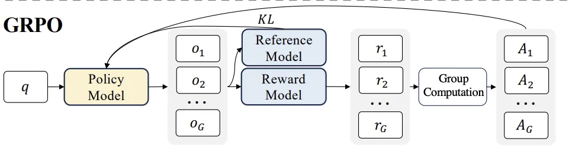
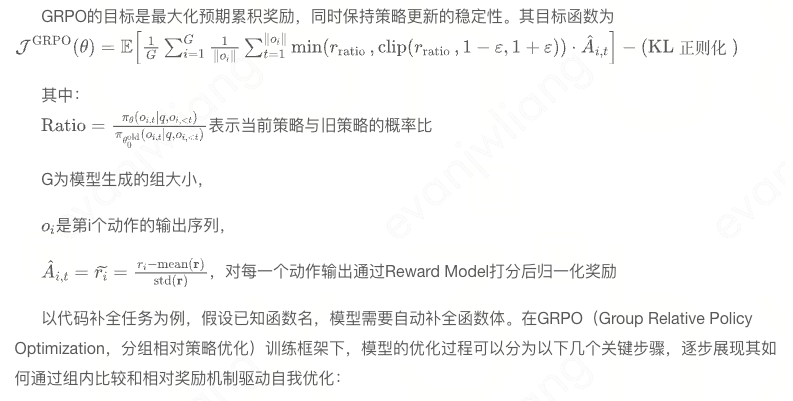
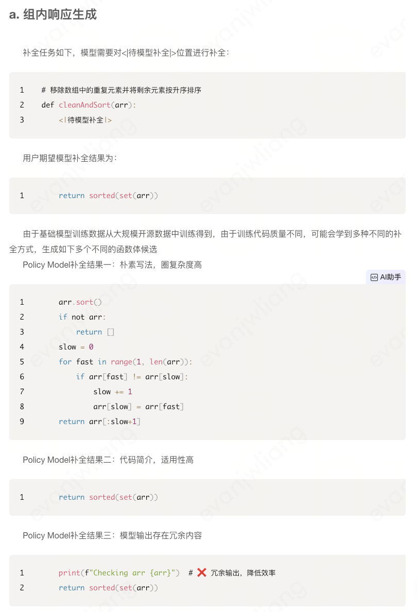
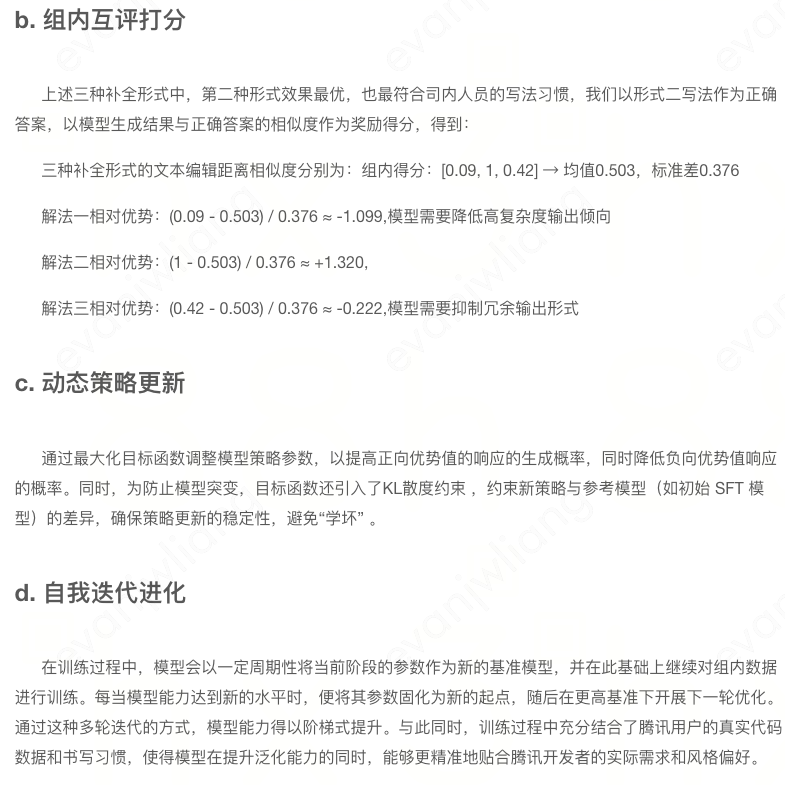
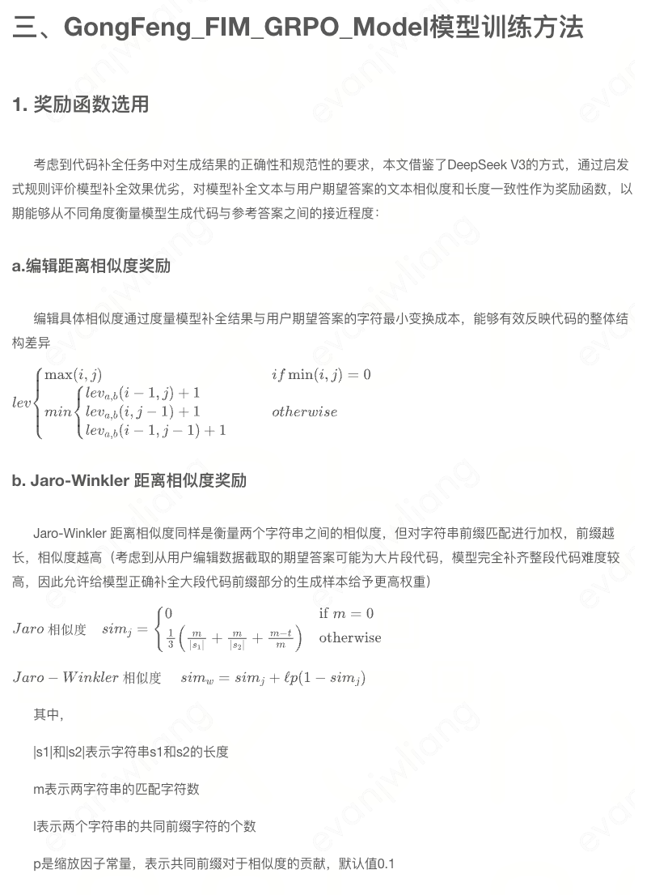
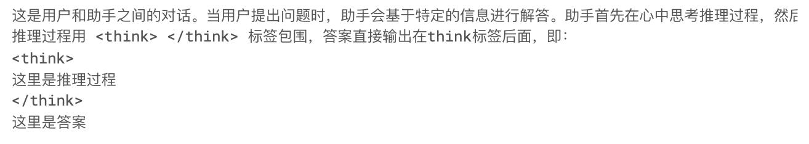

# Grpo
## PPO和DPO
### PPO
​​- 核心思想​​
PPO源于TRPO（Trust Region Policy Optimization）。它的核心是通过限制新策略和旧策略之间的差异来稳定训练。具体采用裁剪（clipping）机制来约束策略更新。
​​- 损失函数结构​​
包括优势估计和熵正则化项。优势估计有助于衡量一个动作相对于平均动作的好坏程度，熵正则化项是为了鼓励探索，防止策略过早收敛到次优策略。
​​- 应用场景及优缺点​​
广泛应用于各种连续和离散动作空间的任务，像游戏、机器人控制等。优点是相对稳定，在很多任务上有较好表现；缺点是依赖优势估计，计算相对复杂。
### DPO
- 核心思想
由DeepMind在2023年提出。它直接优化策略对奖励的偏好，绕过了计算优势函数这一环节。有两个关键组件：偏好模型和学习率调度。通过二值分类的方式，让策略在回报高的动作上概率更高，回报低的动作上概率更低。
​​- 应用场景及优缺点​​
在需要处理复杂奖励结构或高维动作空间的任务中可能表现更好，例如多智能体环境或长序列决策问题。优点是可能比PPO在样本效率和训练稳定性上有所提升，且更容易与其他技术结合；缺点是在某些情况下可能不如PPO稳定，在处理一些特殊奖励函数时可能存在局限性。
### 比较
PPO依赖优势估计，而DPO绕过了这一点直接处理偏好。这使得DPO在样本效率和训练稳定性上可能有优势，尤其是在高维动作空间中，并且DPO可能更容易与其他技术结合，比如使用预训练的奖励模型。
## GRPO
分组相对策略优化（Group Relative Policy Optimization, GRPO）方法通过“比较学习”来提升决策能力，针对同一个输入，模型会生成多个不同的候选输出，这些输出被划分为一组。随后，系统会对组内的所有候选答案进行相互比较和评价，而不是单纯依赖于与标准答案的直接对比。在GRPO框架下，每个候选输出会根据其在组内的表现获得一个相对分数，这一分数反映了该输出相较于同组其他答案的优劣。模型的优化目标是提升那些在组内表现更优的输出的概率，同时降低表现较差输出的概率（图一）。相比PPO，GRPO避免了复杂的策略裁剪和高方差梯度估计，训练更高效且更易收敛；相比DPO，GRPO不仅考虑偏好排序，更通过相对优势的连续度量促进模型生成多样且高质量的代码补全结果。此外，GRPO天然适配代码生成任务中多样化且结构复杂的输出空间，能够更好地捕捉代码逻辑的细节差异，显著提升模型在实际开发环境中的适应性和泛化能力。

# 数据和奖励函数实战
### 数据集
#### 评估标准
1. 当上下文与问题密切相关时，答案必须严格基于上下文作答，不得使用任何先验知识。若上下文包含图片，答案应携带相应图片进行说明，并确
保整体回复实现图文混排。
2. 当上下文与问题关联较弱时，仅回答可解答的部分，并对无法回答的内容提供引导性建议，引导用
户查询外部资料。
3. 当上下文与问题无关时，应简洁明了地返回特定标志（如 "NO_MATCH" ） ，以便业务方进一步处理，例如调用其他服务作答或返回通用兜底回复。
#### 特殊情况下避免推理
当上下文与问题无关时，由于后续业务流程需要同步处理，我们希望模型尽可能避免推理。在此类场景下，推理过程对业务侧而言无效，且可能因输出时间过长影响后续流程。我们期望的模型输出格式为：
#### 其他问题
现有的非推理模型仅通过SFT微调，仍存在一定程度的重复输出，图片输出幻觉，逻辑推理误差等问题，希望通过强化学习降低这些问题的发生概率。
### 数据准备
#### 文档问答相关COT数据集构建
基于相关程度划分强相关，弱相关，不相关三类
1. 基于原始数据通过R1蒸馏生成Cot数据，使用多轮对话的方式进行蒸馏：
第一轮输入query，context，并提grund——truth作为标准答案。
第二轮，重复相同的query和context，让大模型在这一轮输出带cot过程的答案。
2. 数据清洗
- 语义相似度筛选，对比蒸馏结果中的model——answer（除think）与ground——truth的寓意相似度并设定阈值进行筛选。
- 数据过滤:基于相似度阈值，筛选出优质数据集，最终得到(query, context, cot，ground_truth)格式的高质量数据。
图文混排强相关：12.2k
纯文本3.1k
弱相关1.2k
不相关5.4k
#### 通用数据集：
为了方便实验对比，验证强化学习阶段模型的学习效果，同时提高模型的泛化能力，我们还收集了一些基于R1 蒸馏的通用
领域 CoT 数据集，这部分数据主要来源于：
Chinese-DeepSeek-R1-Distill-data-110k-SFT
该数据集包含 11 万条 (query, cot, answer) 格式数据，相较于文档问答数据集，缺少 context 字段。
### 奖励函数设计
#### 格式

#### 思考步骤
当结果为 "NO_MATCH" 时，我们期望奖励 think 过程为空的采样结果，且 think 过程越长，奖励越低，从而让模型学会当结果需要是"NO_MATCH"时“不思考”。
“这是一个显式鼓励分步思考、惩罚多余思考的简单规则奖励函数：
• 如果模型回答“NO_MATCH”，就奖励空 <think>（不废话）；
• 否则按显式步骤标记**给分，≥3 步给满分，<3 步按比例扣。

#### 正确度
1. ROUGE-L（Longest Common Subsequence based ROUGE） ：通过计算生成文本与参考文本之间最长公共子序列的 F 值来衡量相似度。
2. Sentence Similarity：衡量语义相似度。
#### 图片正确性
文档问答数据集的上下文通常包含图片，如果模型总结阶段图片与问题相关，我们希望模型尽可能提到上下文提到的图片，同时惩罚产生伪图片的行为惩罚。
由于图片地址是可比的，奖励函数也可以作为正确度奖励函数的补充
#### 重复惩罚
提取所有可能的N-gram，计算重复率
len（n-grams） / total
如果没有重复 reward = 0，没有惩罚，有会产生负的重复，重复越多惩罚越大
### 对比实验
#### 直接强化学习：200步有显著提升，输出长度没有到期望，think过程过于简单。
#### 通用领域数据集微调后再强化学习
由于经过了一轮通用领域 CoT 的微调，模型已经初步具备了一定的推理机制，因此各项奖励指标的起点相较于未进行 SFT 微调的模型较高。尽管 completion_length 略有降低，但仍在我们可接受的范围内。
通过强化学习训练，模型能够进一步学习到我们额外要求的图文格式、思考步骤等特定规则。
#### 自建数据微调再强化学习
可以观察到，与使用通用 CoT 数据进行微调的模型相比，使用文档问答数据进行 SFT 微调后的模型在初始训练阶段具有更高的奖励，同时在训练到 500 步之前，模型表现出较好的训练趋势。然而，在 500 步时，模型突然出现了下降。通过分析采样日志，我们发现了一件有趣（哭笑不得）的事情：模型在此阶段生成了大量格式错误的图片，例如：
由于 ImageSource 奖励函数的逻辑只检查合法图片是否存在幻觉和重复输出，并且通过训练，模型确实能降低此类图片出现的概率。然而，对于上述非法图片格式，由于绕过了我们的正则表达式捕获，同时当上下文中没有图片时，模型会获得较大的奖励，进而使得模型在训练过程中将这种情况视为优质答案，并不断朝这个方向收敛。
解决方案也很简单：只需要增加一个校验非法图片闭合的奖励函数，当检测到这种输出时，给予较大的惩罚。

