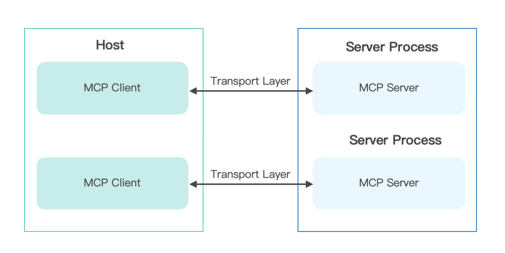
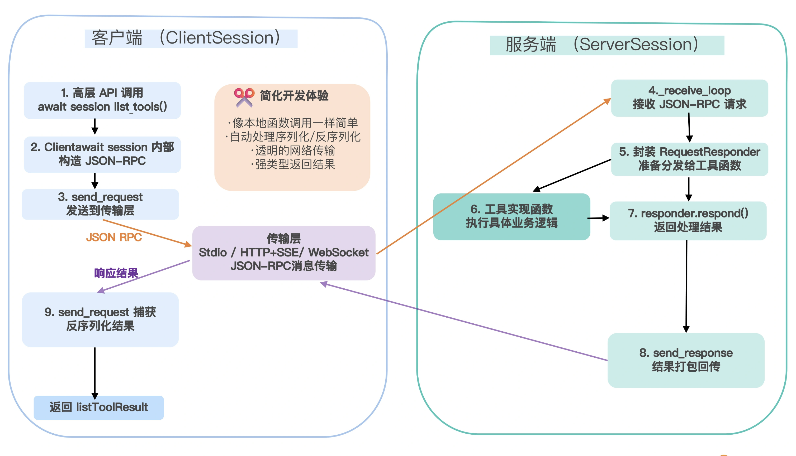
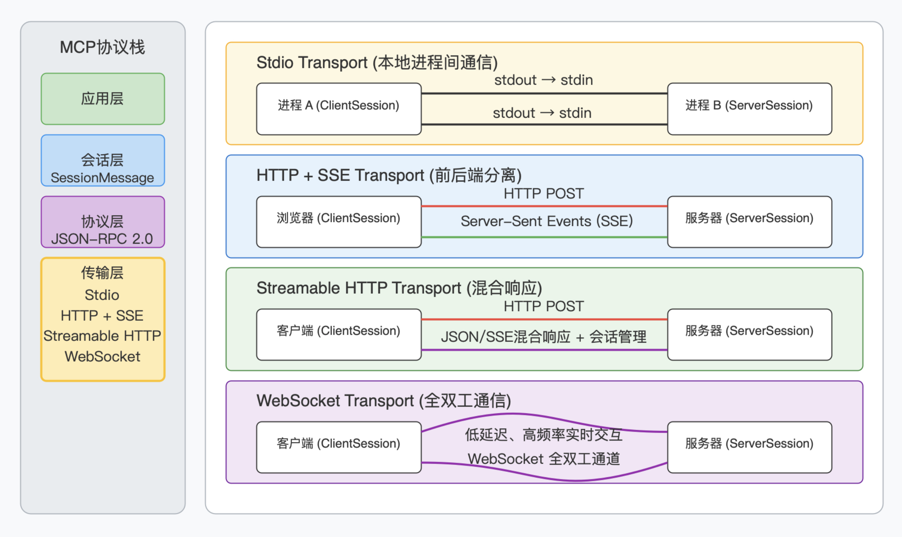
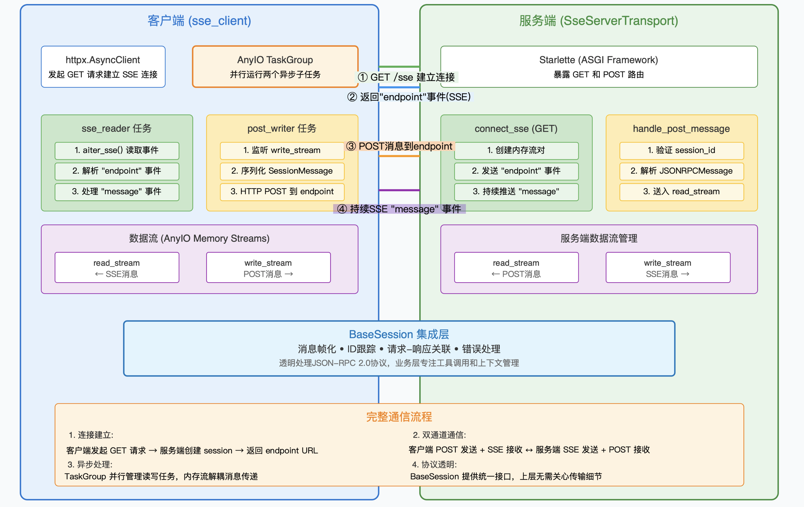
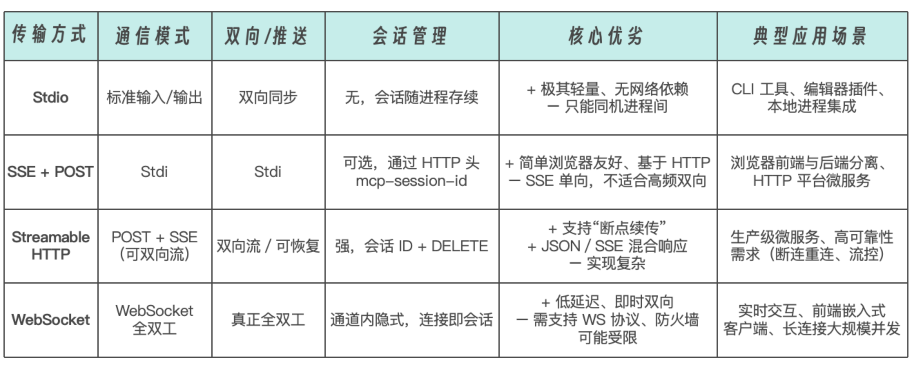

# MCP

## 概念
模型上下文协议
MCP 提供了统一的上下文管理与工具调用接口，整合了大模型驱动的概率计算与传统工具驱动的结构化计算。
传统上，将 AI 系统连接到外部工具需要集成多个 API。每个 API 集成都意味着单独的代码、文档、身份验证方法、错误处理和维护。这些 API 就像一扇扇独立的门，每扇门都有自己的钥匙和规则。

在引入 MCP 之前，如果我要让一个 Agent 同时具备“网络搜索”“数据库查询”“文本翻译”三种能力，通常要写三套适配器：
搜索工具：手动拼 HTTP 请求，处理 OAuth 鉴权，解析 HTML 或 JSON，捕获请求超时。
数据库查询：配置 JDBC/ODBC 连接，管理连接池，拼装 SQL，逐行读取 ResultSet。
翻译服务：对接 Google Translate 或腾讯翻译 API，关注签名算法、流量限速、错误码处理。每接入一个新工具，都要重复以上流程，代码冗余且难以维护，扩展成本极高。

MCP 则把这些繁琐细节都“藏”到服务器端：
服务端只需注册好 Search、QueryDB、Translate 三个工具能力；然后 Agent 发起同一套 JSON-RPC 调用：
```
{
  "method": "callTool",
  "params": {
    "tool": "Translate",
    "input": "Hello, world!",
    "target_lang": "zh"
  }
}
```
- MCP 服务器负责底层的 HTTP 请求、鉴权、连接管理和结果解析，最后把翻译结果一并返回给模型。
- 客户端 - 服务器的架构，其核心理念是“模型主控、客户端驱动服务器调用”

### 区别：
#### 传统方法
- OpenAI Function Calling 只绑在 GPT 系列上，其调用规范、参数定义和返回格式都深度耦合在 OpenAI 的 API 流程中，无法扩展到其他开源或私有模型。
- LangChain Tools 虽然支持多种模型和工具，但所有能力都要写在 LangChain 的框架里——跨框架、跨语言、跨团队复用时，得重造一套适配逻辑。
- JSON-RPC 作为通用远程调用协议，轻量却太过底层：它只管“发什么请求、收什么响应”，但显然不包含大模型的上下文管理、并发会话、流式返回、能力发现等核心需求。它们解决了“怎么调”或“调哪个好”这一维度的问题，却没形成一套“面向大模型 + Agent 协作”的统一、可插拔、开箱即用的接口规范。

#### MCP
- 统一工具描述：所有 Search、Translate、QueryDB 等能力用同一份 tool.json 注册，模型只按名字“call”就行。
- 会话与权限：自动管理多轮对话状态、工具访问权限与鉴权流程，模型无需关心鉴权细节。
- 流式与事件：内建流式数据返回、异步回调和事件订阅，让长任务、实时监控、异步通知都能自然融入推理流程。
- 多传输层：既可跑 HTTP/REST，也可挂 WebSocket、RPC 框架或消息队列，灵活适配不同部署场景。

## 协议详解 协议层
### host client和server
- host 界面应用
- client 客户端
- server 提供上下文工具和执行能力的的进程或服务

#### Host 的 MCP Client 向 Server 发起 initialize 请求，双方交换协议版本与能力列表，并用 initialized 通知确认；
2. 正常通信：Client/Server 可双向发起 Request–Response（同步调用）或单向 Notification（异步事件），大模型应用只需按需调用 Client 的接口；
3. 优雅收尾：通信完成后，任意一端可调用 close() 或因底层通道断开而触发连接关闭。
在上面的 MCP 连接生命周期中，Client 和 Server 之间可以传递下列类型的 MCP 消息类型：
- 1.Request：期待收到响应。
- 2.Result：请求成功的响应。
- 3.Error：请求失败时返回
- 4.Notification：单向消息，无需响应。
通过这种分层设计，MCP 将“业务逻辑”与“上下文 / 工具管理”解耦：Host 只管“我需要哪些信息 / 能力”；Server 负责“我怎样取到或实现这些能力”。最终，在 Host 内部，大模型得到的不再是死板的 API 返回值，而是经过精心组织的上下文提示，能够更灵活、更安全地调用外部工具、访问数据源，这样就扩展了大模型能力，让它可以对接更多复杂场景。

#### 通过 BaseSession 类实现底层协议层 (Protocol layer)
协议层负责消息的封装、请求 / 响应关联，以及高级通信模式的实现。其中的核心逻辑位于 BaseSession（定义在 mcp/shared/session.py）类，这里提供了所有 JSON-RPC 消息的读写、帧解析、请求–响应关联、通知分发的通用逻辑，是 MCP 协议层的通用实现，屏蔽了 JSON-RPC 消息的底层读写、请求–响应关联和通知分发细节。BaseSession 类承担了对所有 JSON-RPC 消息的统一管理与生命周期控制。它通过一系列核心属性和方法来维护读写流、请求 ID、响应管道和后台任务栈，确保异步收发、请求–响应关联以及资源清理都井然有序。它将“发送请求、等待响应”“发出单向通知”“接收并分发对端消息”这些通用逻辑全部封装，派生类（客户端或服务端的 Session）只需关注「收到请求／通知后如何处理」或「要发送哪些高层类型化消息」。

泛型参数：
```
Generic[
  SendRequestT,       # 我们能发出的 Request 类型
  SendNotificationT,  # 我们能发出的 Notification 类型
  SendResultT,        # 我们发出的 Response（Result）类型
  ReceiveRequestT,    # 我们会接收的 Request 类型
  ReceiveNotificationT# 我们会接收的 Notification 类型
  ReceiveResultT # 我们会接收的 Response（Result）类型
]
```

#### BaseSession 类的核心属性和上下文管理BaseSession 类的核心属性包括后面几项。
- _read_stream / _write_stream：AnyIO 内存流，用于异步收发 SessionMessage（JSONRPC 封装 + 元数据）。
- _request_id：内部自增计数器，用来给每个发出的请求分配唯一 ID。
- _response_streams: dict[RequestId, MemoryObjectSendStream]：每发一个请求就开一个「答案流」，收到对应 ID 的响应或错误时就往流里写，send_request 在此流上等待结果。
- _in_flight: dict[RequestId, RequestResponder]：跟踪当前正在处理但尚未完成的对端请求，方便在收到取消通知时进行清理或超时管理。
- _exit_stack：AnyIO 的异步上下文管理栈，用来统一关闭流和任务。
BaseSession 类通过 __aenter__ / __aexit__ 进行上下文管理。
- aenter：创建一个 TaskGroup 并启动 _receive_loop，开始并行地监听对端发来的所有消息。
- aexit：依次关闭所有资源、取消接收循环任务，保证退出时不会挂起。

BaseSession 类中的基本方法
BaseSession 类中有一系列协议实现方法，主要包括 send_request()、send_notification()、_send_response() 和 _receive_loop() 等，用于控制 MCP 基本交互流程。
发送请求：send_request()
发送请求方法完成的是如何把一个高层的 Pydantic 请求模型打包成 JSON-RPC 消息、发出去，并在底层管理好“谁发的请求”“等待谁的回应”这件事。
具体过程如下：

分配请求 ID：用 _request_id 自增取新 ID。
创建响应流：在 _response_streams 中为该 ID 注册一个缓冲大小为 1 的内存流。
构造 JSONRPCRequest：将 Pydantic 模型 request 序列化为 JSONRPC 格式，附带 ID。
写入 _write_stream：发往对端。
等待响应：在对应的响应流上阻塞读取，设置超时（可自定义或继承会话级别超时）。
错误处理：若拿到 JSONRPCError 就抛 McpError；若超时就抛带有 HTTP 408 码的 McpError；否则把 result 部分反序列化为 ReceiveResultT 并返回。
清理：无论成功或失败，都要把流和注册记录删除并关闭。

发送响应：_send_response()
当收到对端的请求时，如何基于成功或失败结果，及时生成正确的 JSON-RPC 响应或错误，并写回去呢？
当收到对端发来的 Request，需要给它回复时：
如果是正常结果 SendResultT，就构造 JSONRPCResponse（含 ID + result 字段）；如果是错误 ErrorData，就构造 JSONRPCError； 然后同样写入 _write_stream。

发送通知：send_notification()
在 send_notification() 方法中，会将那些只需单向推送、不需要回复的事件（如日志、进度、资源变化）等静悄悄地发给对端而不阻塞。具体实现上，是在方法内部构造 JSONRPCNotification（无 ID），部分传输层可携带 related_request_id（比如把进度通知关联到某次调用）；同时直接写入 _write_stream，不等待任何响应。
消息接收循环：_receive_loop()_receive_loop() 方法会不断从底层流里读入任意一方发来的 JSON-RPC 消息，按类型分流到“请求处理”“通知处理”或“回应分发”的正确管道里。
该方法会持续读取 _read_stream 中的 SessionMessage， 并根据消息类型分流。
- JSONRPCRequest：用 ReceiveRequestT 模型校验后，包装成 RequestResponder 放入 _in_flight，先调用 _received_request(responder) 钩子，让子类有机会同步响应；如果钩子未完成响应，再把 responder 传给 _handle_incoming（供上层或框架线程处理）。
- JSONRPCNotification：用 ReceiveNotificationT 校验后，调用 _received_notification(notification) 钩子，然后 _handle_incoming。如果是取消通知，还会查找并取消对应的 in-flight 请求。
- JSONRPCResponse / JSONRPCError：根据消息中的 ID，查找 _response_streams，并将结果或错误写入那个流，让 send_request 能读到。若找不到对应流，则视为意外消息，转交 _handle_incoming 处理。
可重写的钩子方法

BaseSession 类中还定义了一系列的可重用钩子方法，将上面分流后的“该如何处理”留给子类去实现——比如 ClientSession、ServerSession 用于握手、工具调用分发、能力校验等。
- _received_request(self, responder)
- _received_notification(self, notification)
- _handle_incoming(self, req_or_notification_or_exception)
BaseSession 的子类（如 ServerSession、ClientSession）会重写这些方法，注入初始化握手逻辑、工具调用分发、事件转发等具体行为，而无需再触及底层 JSON-RPC 和并发细节。
通过以上这些模块化、泛型化和异步化的设计，MCP 在保证性能和灵活性的同时，也极大降低了开发者对底层 JSON-RPC 细节的认知成本。

#### ClientSession，ServerSession 类的上层实现
BaseSession 将 JSON-RPC 的消息帧化、ID 跟踪、并发读写、超时与错误处理都做好了。 上层只需继承并重写少数钩子，就能快速实现“MCP 客户端”或“MCP 服务端”的会话逻辑。
客户端 (ClientSession) 如何“完成”协议设计
在 ClientSession 中，初始化阶段通过构造函数将下游的读写流、超时设置以及各类回调（包括取样、列出根目录、日志和通用消息处理）注入会话实例。调用 initialize() 时，客户端首先向服务端发送一个 initialize 请求，并在收到 InitializeResult 后，再发出一条 InitializedNotification 通知，让握手完成。
return await self.send_request( types.ClientRequest(types.ListResourcesRequest(method="resources/list")), types.ListResourcesResult,)
在消息接收方面，ClientSession 重写了 _received_request(responder) 钩子，当服务端发来诸如 sampling/createMessage、roots/list 或 ping 等请求时，钩子会从 responder.request.root 中提取请求类型和参数，调用相应的回调（如 _sampling_callback 或 _list_roots_callback），并将返回值（可能是正常结果或 ErrorData）传给 responder.respond() 完成响应。
对于通知，_received_notification(notification) 目前只对日志消息（LoggingMessageNotification）作出处理，其他非同步钩子捕获的消息和未在钩子中处理的所有请求、通知，都会统一委托给用户在构造时提供的 message_handler，以便在上层进行监控、界面更新或其他自定义处理。
服务端 (ServerSession) 如何“完成”协议设计
在 ServerSession 中，协议的握手逻辑被内嵌在 _received_request 和 _received_notification 两个钩子里：首次碰到来自客户端的 InitializeRequest，服务器会将请求参数保存到 self._client_params，随即利用 responder.respond(…) 返回包含服务端能力集、版本号和说明文字的 InitializeResult。当接收到 InitializedNotification 时，状态机才真正进入“Initialized”阶段，任何在未完成初始化前到来的其他请求或通知都会触发 RuntimeError，以确保交互顺序的正确性。
握手完成后，check_client_capability(cap) 方法会读取客户端在初始化时声明的能力集，并根据传入的能力需求判断哪些功能可用——例如是否允许发布 roots/list_changed 等通知，从而在后续工具调用中进行权限或兼容性检查。
为了让服务端调用体验更自然，ServerSession 提供了一系列高层接口：诸如 send_log_message(…)、send_resource_updated(uri)、send_tool_list_changed() 之类的方法，它们均转换成对应的 ServerNotification 并通过底层 send_notification 发送；同样地，create_message(…)、list_roots()、send_ping() 等方法封装了对 JSON-RPC 请求的构建与发送，让服务器可以像调用本地函数一样驱动模型取样、根列表查询或心跳检测。
至于上行消息的分发，ServerSession 在 _handle_incoming 中会将所有未由同步钩子处理的 RequestResponder 或 Notification 推送到自身维护的内存队列中，这正是框架层面通过 @server.call_tool()、@server.list_prompts() 等装饰器将队列内的请求与通知自动路由到用户业务函数的基础。
由此，ServerSession 不仅完成了底层 JSON-RPC 交互的所有复杂细节，也为上层的工具调用和事件处理提供了极简且一致的编程模型。

从“通用”到“可用”的核心流程
在 MCP 的典型部署中，首先由 Host 应用在启动时分别实例化 ClientSession 和 ServerSession，并将二者的底层读写流对接：本地场景通常将一个进程的标准输出连向另一个进程的标准输入，而远程场景则可以通过 HTTP 与 SSE 通道互联。
接着，客户端调用 initialize()，通过底层 send_request 向服务端发出 initialize 请求；与此同时，ServerSession 在其接收钩子中捕获到该请求并立即返回包含能力集与版本信息的 InitializeResult，客户端再发出一条 InitializedNotification 以完成握手，这样双方就进入了“已初始化”阶段，准备开始正常的消息交换。
在交互过程中，任何一方都只需像调用本地函数一样发起高层 API 调用。例如，客户端只要执行 await session.list_tools()，ClientSession 就会在内部构造一个 JSON-RPC 请求，将其通过 send_request 发出，并在 ServerSession 的 _receive_loop 中被接收，随后被封装成一个 RequestResponder 并交给注册在服务器端的工具实现函数处理；工具函数执行完成后调用 responder.respond()，ServerSession 底层的 _send_response 将结果打包回传，最后在客户端的 send_request 中被捕获并反序列化成 ListToolsResult 返回给调用者。

同样地，服务端也可以直接调用诸如 await server_session.create_message(…) 来触发大模型，并将结果通过响应或单向通知发回客户端，为大模型的上下文生成提供支持。
上层只要在 ServerSession 或 ClientSession 外面注册回调，就能无缝插入新的工具、扩展新的消息类型或自定义错误处理，BaseSession 的任何改动都不影响业务逻辑。
可以看到，client/session.py 和 server/session.py 这两个模块，在 BaseSession 打造的坚固底座上，完成了握手流程、能力协商、消息分发、工具调用、高层接口封装，以及上下文管理，真正将 MCP 从“一份协议文档”变成了“开箱即用、可扩展的客户端 / 服务端 SDK”。

### 协议传输层
#### MCP 的传输方式 (Transport layer)
MCP 支持多种传输方式以适配不同场景：
- Stdio Transport：这是最轻量的 stdio 通道，借助标准输入 / 输出即可完成同机进程间的双向通信，适合本地进程间的通信。
- HTTP + SSE Transport：基于 HTTP 的单向推流与单向发送组合（SSE + POST），适合浏览器前端与微服务后端的分离部署。服务器端使用 Server-Sent Events 推送消息给客户端。客户端通过 HTTP POST 发送请求。
- Streamable HTTP Transport：更完善的 Streamable HTTP 场景中，POST 请求能返回 JSON 或切换到 SSE 流，在同一路径上混合使用 HTTP POST（发送请求）和 SSE（接收流式响应），支持 mcp-session-id 会话管理、断点续传以及 JSON/SSE 混合响应。
- WebSocket Transport：基于 WebSocket 全双工通道，建立后客户端和服务端都可以随时推送 JSON-RPC 消息。适合低延迟、高频率的实时双向交互，以及真正的全双工 WebSocket 通道，为低延迟、高频双向交互提供最佳性能。


所有传输都遵循 JSON-RPC 2.0 格式，无论选哪一种，Host 启动时都会分别构造 ClientSession 和 ServerSession，将它们的读写流对接到相应的底层通道——本地时可把一端的 stdout 连到另一端的 stdin，远程时则通过 HTTP 或 WS 长连接互联。
标准输入／输出（stdio）
在 MCP 中，最轻量的本地进程间通信方式就是通过标准输入／输出（stdio）来传递 JSON-RPC 消息：你只需要在主机（Host）和工具进程之间把 stdout 接入对方的 stdin，就能用同一套 BaseSession 协议去读写消息，而不必开启任何网络端口。
从操作系统层面来看，这三条标准流其实都是文件描述符（file descriptor）。对应于打开的文件或管道，可以借助管道（pipe）将一个进程的 stdout 连接到另一个进程的 stdin，无需网络通信就能完成数据交换。例如在 Linux/Unix 下，你可以用 producer | consumer 将两个命令串联——这就把 producer 进程的 stdout 自动重定向（pipe）到 consumer 的 stdin。
在 MCP（Model Context Protocol）里，利用 stdio 的方式进行本地进程间通信，就是把“主机”（Host）的 stdout 通过管道接入“工具进程”（Tool）的 stdin，同时把工具进程的 stdout 接到主机的 stdin，再使用 JSON-RPC 的消息格式在这两条流上来回读写。这样做的好处有三点。
1. 无需网络端口：整个通信走的是进程内部的管道，避免了网络配置和安全隔离的复杂度。
2. 轻量透明：直接复用操作系统和语言自身对 stdio 的管理，既简单，性能开销又低。
3. 兼容性好：几乎所有编程语言和操作系统都原生支持 stdio，使得跨语言、跨平台的工具集成都非常方便。因此，stdio 在这里就是“最小代价、零配置”的进程间消息通道基础。
服务端的 stdio 实现
在服务端（也就是工具进程）里，stdio_server() 作为一个异步上下文管理器，重包装了系统的 sys.stdin 和 sys.stdout，确保它们都以 UTF-8 文本流的形式可读可写。
进入上下文后，两个协程分别启动：一个不断从 stdin 读取整行文本、把每行当作 JSON 去反序列化成 JSONRPCMessage，再封装为 SessionMessage 发入 read_stream；另一个从 write_stream 中取出需要下发给客户端的 SessionMessage，序列化成 JSON 并逐行写到 stdout。只要把这对 read_stream，write_stream 传给 Server.run(…)，服务端的 MCP 会话就能自动接收客户端的请求、发送响应和通知。
客户端的 stdio 实现
在客户端，stdio_client() 则把被管理的工具进程作为子进程打开。它首先根据平台（Windows 或类 Unix）拼装好可执行命令和环境变量，然后用 AnyIO 的 open_process（或特定的 Win32 接口）启动该进程，将其 stderr 重定向以便排错。启动后同样创建了一对内存流：read_stream 从子进程的 stdout 里读行、反序列化；write_stream 往子进程的 stdin 写行、序列化。stdio 客户端在退出上下文时会优雅地终止子进程，避免留下孤儿进程。
SSE
什么是 Server‐Sent Events (SSE)
Server-Sent Events（简称 SSE）是一种通过 HTTP 建立单向持久连接，让服务器可以不断地“推送”文本事件到浏览器或客户端的技术。与 WebSocket 的双向通信不同，SSE 只需客户端发起一次 GET 请求，随后服务器即可不断地以 text/event-stream 格式发送数据——保持 TCP 连接打开，事件到来便立即下发，无需客户端反复轮询。浏览器端原生支持 SSE，通过 EventSource 接口就能方便地接收服务器推送。
SSE 客户端的实现（sse_client）
在 MCP 的 sse_client 中，我们用 httpx.AsyncClient 搭配 httpx_sse.aconnect_sse 发起一个带有较长读超时（read=sse_read_timeout）的 GET 请求。一旦连接成功，就启动两个异步子任务：
1. sse_reader 它通过 event_source.aiter_sse() 逐个读取服务器发过来的 SSE 事件。遇到第一条 “endpoint” 事件时，解析出可用于 POST 客户消息的实际 URL，并通过 task_status.started(endpoint_url) 通知调度器；之后每收到一条 “message” 事件，就把事件体反序列化成 JSONRPCMessage 模型，封装为 SessionMessage 放入 read_stream，供上层 BaseSession 解析和分发。
2. post_writer 等待上层通过 write_stream 写入要发送给服务端的 SessionMessage。每当拿到一条消息，就把它序列化为 JSON，通过 HTTP POST 发往前面读到的 endpoint_url。如此，客户端就实现了“SSE 读”＋“POST 写”的双通道通信。
整个 sse_client 以 @asynccontextmanager 形式提供，内部用 AnyIO TaskGroup 并行运行上述两部分，并在上下文退出时进行清理（关闭流、取消任务）。
SSE 服务端的实现（SseServerTransport）
在 MCP 的服务端，我们用 Starlette（或任何 ASGI 框架）来暴露两个路由：一个用于 SSE 连接（GET），一个用于接收客户端 POST（写消息）。我们挨个看一下。
1.connect_sse（GET → 建立 SSE） 当客户端发起 GET /sse?session_id=…，我们为它创建一对 AnyIO 内存流 read_stream、write_stream，并生成一个新的 session_id。用 EventSourceResponse 把 write_stream_reader 的内容以 SSE 事件源的形式推送给客户端：首先发送一个 “endpoint“ 事件，告诉客户端接下来要往哪个 URL POST 消息，然后不断把 write_stream_reader 里的 SessionMessage 序列化成 “message”事件下发。
2.handle_post_message（POST → 接收客户端消息） 客户端在拿到 “endpoint” 事件后的 POST 请求中，把自己的 SessionMessage（即 JSONRPC 请求或通知）发到 /messages/?session_id=…。这里我们从查询参数里取出 session_id，校验后将请求体解析为 JSONRPCMessage，再封装到 SessionMessage，通过对应的 read_stream_writer 送入 read_stream。这样，ServerSession 的底层接收循环就能看到新的消息，交给协议层进一步处理。

通过这套读 SSE + 写 POST、另一端写 SSE + 读 POST 的组合，MCP 在 HTTP 之上实现了双通道、异步、安全的 JSON-RPC 2.0 消息交换。客户端和服务端都只要对接好各自的 read_stream/write_stream，就能透明地利用 BaseSession 提供的消息帧化、ID 跟踪、请求–响应关联等能力，把业务逻辑专注在“工具调用”“上下文管理”上，而无需自己盯着底层网络细节。





