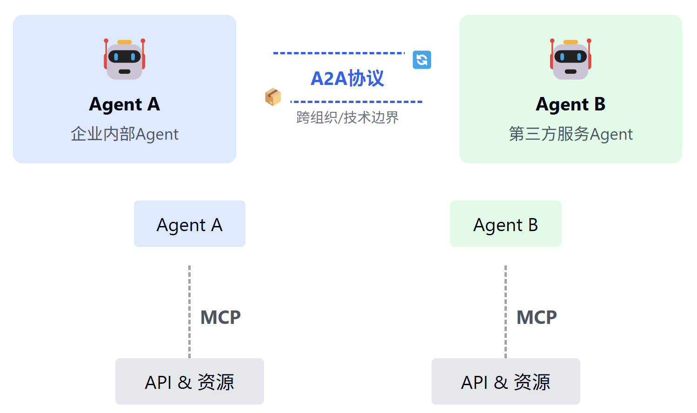

# a2a
为多 Agent 协同注入了开放标准
## 诞生
1. 模型与外部世界的割裂：大模型是基于概率计算的新范式，其思维、推理能力类似于人脑。这种新范式虽强大，但仍需要与传统的结构化计算范式相结合，也就是通过工具调用来完成精确任务。而目前传统结构化工具和大模型之间是割裂的，大模型难以直接、动态地接入实时数据、数据库或企业工具。传统的 API 调用方式零散且不标准，导致开发效率低下。
2. Agent 协作的孤岛效应：AI Agent 的兴起让“做事”的智能体成为可能，但不同框架（如 LangGraph、AutoGen、CrewAI）各自为政，缺乏统一的通信标准，跨平台协作如同“鸡同鸭讲”。
3. 复杂场景的工程化瓶颈：从搜索助手到企业知识中台，RAG（检索增强生成）与多 Agent 系统需要处理多源数据、多模态交互和长时任务，现有工具链难以提供统一的解决方案。

让不同的智能代理（Agent）能够无障碍地沟通和协作的标准语言。可以把它理解成大模型 Agent 们用来“聊天”的“通用语言”。它定义了一套清晰、标准的沟通方式，让所有智能代理可以顺畅地交流彼此的需求、能力、决策和状态。
- 统一协议：所有 Agent 均使用同一消息 schema 进行能力发现与调用。
- 异步协作：支持流式与异步返回，可并发处理多任务。
- 灵活扩展：新 Agent 即插即用，无需额外适配器。
- 解耦实现：Agent 专注业务，底层传输、鉴权、错误处理由协议层统一管理。

### A2A 和 MCP 是互补而非互斥关系
- LLM：大脑
- MCP：工具，agent的手
- A2A：Agent的嘴

#### Agent Card

#### Task
- submitted（已提交）
- working（处理中）
- input-required（需要额外输入）
- completed（已完成）
- canceled（已取消）
- failed（失败）
- unknown（未知）

#### Artfact

#### Message

### 协议工作流程
能力发现：每个 Agent 通过一个 JSON 格式的 “Agent Card” 公布自己能执行的能力（如检索文档、调度会议等）。任务管理：Agent 间围绕一个 “task” 对象展开协作。该对象有生命周期、状态更新和最终产物（artifact），支持即时完成与长跑任务两种模式。消息协作：双方可互发消息，携带上下文、用户指令或中间产物；消息中包含若干 “parts”，每个 part 都指明内容类型，便于双方就 UI 呈现形式（如图片、表单、视频）进行协商。状态同步：通过 SSE 等机制，Client Agent 与 Remote Agent 保持实时状态同步，确保用户看到最新的进度和结果。

Client 发送任务{ "jsonrpc": "2.0", "id": 1, "method": "tasks/send", "params": { "id": "de38c76d-d54c-436c-8b9f-4c2703648d64", "message": { "role": "user", "parts": [ { "type": "text", "text": "请分析下面5位候选人是否符合岗位需求，并推荐最佳人选。" } ] }, "metadata": {} }}
Remote Agent 响应{ "jsonrpc": "2.0", "id": 1, "result": { "id": "de38c76d-d54c-436c-8b9f-4c2703648d64", "sessionId": "c295ea44-7543-4f78-b524-7a38915ad6e4", "status": { "state": "completed" }, "artifacts": [ { "name": "result", "parts": [ { "type": "text", "text": "第二位候选人最符合你的需求!" } ] } ], "metadata": {} }}

