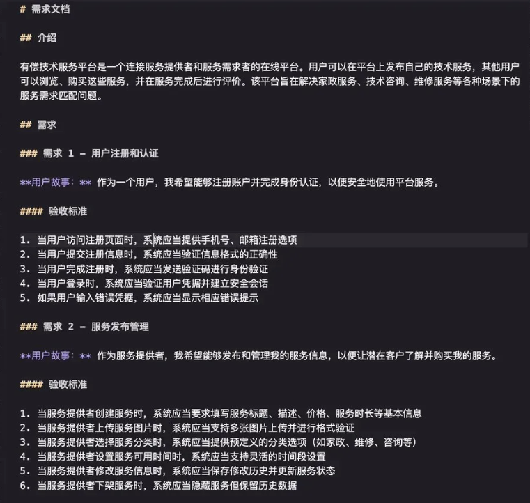

# kiro spec

AWS Spec工作流
Spec 是用来解决如何把模糊的想法转化为详细的实施计划、跟踪和验收标准的问题。

每个 Spec 都是一个文件夹，下有 3 个核心文件：
requirements.md —— 需求文档（用 EARS 语法写用户故事和验收标准）
design.md —— 技术方案（架构、流程、注意事项）
tasks.md —— 任务清单（todolist，便于跟踪）

## EARS语法
例子：

1. 在项目下建立 CLAUDE.md
提示词链接：https://github.com/TencentCloudBase/CloudBase-AI-ToolKit/blob/main/config/.cursor/rules/cloudbase-rules.mdc#L21C1-L59C12
2. 启动 Claude Code，输入原始需求
直接把你的想法、用户故事写进对话框。
Claude 会自动读取 CLAUDE.md，开始和你进行需求澄清和确认。
3. 需求确认后，Claude 输出 requirements.md
4. 技术方案设计
需求确认后，Claude 会自动进入 design.md 阶段，输出详细的技术方案。
包括架构、技术选型、接口、测试策略等。
5. 任务拆分
Claude 会根据 design.md 自动生成 tasks.md，把方案拆分为可执行的 todolist。
6. 逐步实现与验收

CloudBase AI ToolKit，直接内置了这套工作流：
https://github.com/TencentCloudBase/CloudBase-AI-ToolKit/
