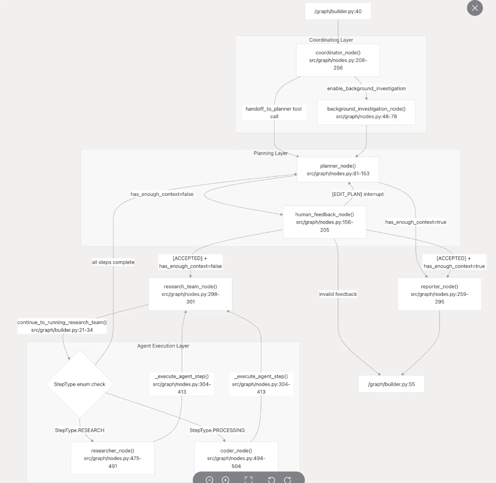

# langGraph
## 核心基础概念
LangGraph 是一个使用 LLM 构建有状态、多参与者应用程序的框架，它提供了用于编排复杂工作流的底层基础架构，无需抽象提示或架构。它由 LangChain Inc. 开发，让开发者能够完全控制其Agent实现，同时提供强大的执行保证。
LangGraph本质上是来定义一个“AI推理团队”里有哪些角色（节点）、他们之间如何进行逻辑接力（边）、他们共享的推理记忆是什么（状态），以及如何进行自我修正和迭代（循环）的框架。
#### 节点-推理链上的能力单元
#### 边-推理路径的逻辑连接线
- 常规边 (Normal Edge)： 这是最简单的“下一步”指令，是推理链上确定的、线性的步骤。
 - 产品设计： “在用户输入问题后，总是先交给‘需求分析师’节点处理。”
 - LangGraph术语： 从“入口点”到“需求分析师”节点有一条常规边。
- 条件边 (Conditional Edge)： 这是LangGraph的精髓，是“智能”的体现。它在推理路径上引入了一个“逻辑分叉口”，通常由一个“项目经理”角色的LLM来判断。
 - 产品设计： “在‘初稿撰写’节点完成后，让‘质量评审’节点判断。如果评审结果是‘通过’，则推理继续流向‘终稿发布’节点；如果结果是‘修改’，则推理路径返回‘初稿撰写’节点；如果结果是‘信息不足’，则推理路径转向‘网络搜索员’节点补充资料。”
- LangGraph术语： 从“初稿撰写”节点出来后，连接到一个“条件边”，该条件边根据状态（评审结果）决定路由到三个不同的节点之一。
#### 状态-贯穿始终的“推理记忆体”
“状态”是整个工作流的记忆。它是一个不断被更新的数据集合，是整个推理过程的上下文。
推理的可追溯性： 当最终结果出问题时，我们可以回溯整个“状态”的演变过程，就像查看一个Ticket的全部修改历史一样。我们可以清晰地看到推理是在哪个环节、哪个“团队成员”出了问题。这让调试和优化变得可视化、可理解。
协同推理的基础： 所有节点都围绕同一个“状态”工作，确保了信息的一致性，让集体推理成为可能。
用户交互的入口： 我们可以把“状态”里的某些信息暴露给用户，实现更丰富的交互。比如，在AI生成行程的同时，就可以在前端UI上实时显示“正在为您搜索机票信息...”、“已为您锁定酒店选项...”，这些都是从“状态”这个推理记忆体中读取的信息
## DeerFlow
### 核心工作流程

这个系统的三个主要部分（协调层、规划层、执行层）
- 协调层 (CoordinatorLog Layer - 右上角)：这是团队的“项目经理”。它接收你下达的初始任务，并进行一些初步的背景调查（background_investigation_node），然后正式把任务分配给“规划部门”。
- 规划层 (Planning Layer - 中间区域)：这是团队的“大脑”和“产品策划中心”。它会思考如何完成任务，并制定一个详细的行动计划（planner_node）。最关键的是，它会判断自己手上的信息够不够（has_enough_context），如果不够，它会非常谦虚地向你这位“人类专家”寻求帮助（human_feedback_node）。
- 代理执行层 (Agent Execution Layer - 左下角)：这是团队的“研发部”。一旦计划被批准，这个部门就会开始动手干活。它里面有不同的“专家”，比如负责上网查资料的“研究员”（researcher_node）和负责处理信息或写代码的“程序员”（coder_node）。
