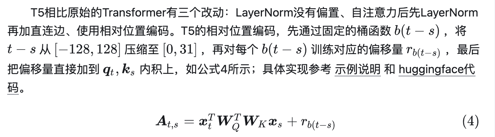

# 关键点
KL散度，用于限制强化学习后的模型不偏离原始模型太远，长cot的过程中删除，增加探索能力
clip：新旧策略概率比进行裁剪，防止模型更新幅度过大epsilon一般0.2，限制了模型探索的多样性，DAPO上下裁剪解耦，低概率token更多探索空间
动态采样：直到一个batch内所有的组内奖励既不全为0也不全为1
token级策略损失 grpo是距conversion级的损失每个样本对组内token损失求平均，长短样本贡献相同，长样本token多，所以每个token对损失贡献低，无法对高质量长样本进行奖励或者对低质量短样本进行惩罚。 drpo对组内所有的token求平均，长样本token多，对损失贡献大
ray：分布式深度学习训练框架，解决异步等问题，多机器训练一个大模型
fsdp
search-r1
位置编码：
绝对位置编码：最早transfomer，三角式位置编码，在输入xi，xj的嵌入维度上叠加不同的正余弦波 xi + pi  xj + pj，内积时得到若干余弦波的叠加，由于参数矩阵存在，相对位置信息中间有权重矩阵，映射后的矩阵缺少单调性。早期的绝对位置编码采取了较为直觉的思路，直接将pi替换为可学习的参数，即为每个输入下标训练一个嵌入向量刻画绝对位置特征；这种方案被称为学习式位置编码（Learned Position Embedding）。虽然学习式位置编码在可解释性等方面具有先天的不足，并且限制了最大输入长度，但在早期的Transformer相关工作，例如BERT、GPT-2中依然得到了广泛的应用。
相对位置编码：相对位置编码在计算自注意力矩阵时，根据矩阵元素的下标，直接考虑每个元素对应的两个token间的相对位置关系。此外，相比于绝对位置编码仅仅在输入层考虑顺序特征，相对位置编码则通过修改自注意力计算的过程，植入到Transformer架构的每一层。

旋转位置编码：实现了绝对位置编码和相对位置编码的统一，它通过绝对位置编码的形式，实现了相对位置编码的效果。RoPE抛弃了位置编码常见的改进思路，即以三角式位置编码公式为基础，调整自注意力计算偏置，而是通过旋转矩阵、复数乘法、欧拉公式等技巧，既能 以自注意力矩阵偏置的形式，反映两个token的相对位置信息，又能 拆解到特征序列上，通过直接编码token的绝对位置实现，兼顾绝对位置编码和相对位置编码的优势。在此基础上，又由于RoPE具有可拆分性，保证其可以与Transformer加速框架相结合，因而在长文本分类上具有一定优势；，
写一下rope代码
