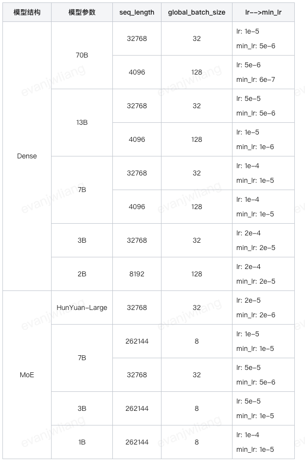

# 精调
## 混元中小模型精调
### 基座模型选择
- 选择MoE模型还是Dense模型
MoE模型一般有16个专家，每次激活2个
在通用领域评测上，MoE效果上会明显好于同系列的Dense模型
7b-netmoe模型好于7b-dense和13b-dense 3b-netmoe模型好于7b-dense 1b-netmoe模型好于3b-dense
- netMoE
​​NetMoE​​（Network Mixture of Experts，网络专家混合模型）是一种结合了​​Mixture of Experts (MoE)​​ 思想与​​网络架构搜索（NAS, Neural Architecture Search）​​ 或 ​​动态网络​​技术的变体模型。它的核心目标是通过​​动态路由专家​​或​​自适应网络结构​​来提升模型的效率、性能和可扩展性
- 选择Pretrain模型还是CHAT(SFT、DPO)模型？
如果自有精调数据量不多选择chat模型
DPO目标是让模型生成的回答更符合人类偏好（如更有帮助、更安全、更流畅），而传统方法（如 RLHF）通常依赖以下步骤：
​​预训练模型​​ → 2. ​​奖励模型（RM）训练​​ → 3. ​​强化学习（如 PPO）微调​​。
​​DPO 的创新点​​：​​跳过奖励模型（RM）和 PPO​​，直接优化模型参数，使其生成的回答更接近人类偏好的样本。通过 ​​二元分类任务​​（偏好 vs 非偏好）直接学习偏好数据，使训练更稳定、更高效。
如果自有精调数据量不多，建议优先选择CHAT模型
- 选SFT模型还是DPO模型？ DPO（Direct Preference Optimization，直接偏好优化）​
DPO模型更稳定（不容易调），可以锦上添花。如果本身模型覆盖的任务类型已经满足需求，可基于DPO模型进一步精调
SFT模型可以查漏补缺，适合有一定能力但遵循比较弱的场景
如果完全不具备这部份知识，需要基于Pretrain做增训continue training
- Continue Training（继续训练 / 续训）
Continue Training​​（续训）是指在已有预训练模型（Pre-trained Model）的基础上，​​加载已有权重​​，并继续进行额外训练（如 ​​SFT、LoRA 微调、全参数微调​​），以适应新任务或提升模型性能。
- 全参数微调（Full Fine-tuning）
方法：加载预训练权重，更新所有模型参数。
适用场景：数据量充足，需要大幅调整模型行为。
优点：模型能充分适应新数据。
缺点：计算成本高，可能导致遗忘预训练知识。
- 参数高效微调（PEFT）
LoRA：冻结预训练权重，仅训练低秩适配矩阵。
优点：计算成本低，适合资源有限场景。
缺点：受限于低秩近似能力。
Adapter：在 Transformer 层插入适配器，训练适配器参数。
优点：模块化，支持动态加载任务适配器。
- Prefix Tuning/Prompt Tuning：优化输入前缀或软提示，非模型权重。
优点：几乎零计算开销，适合快速实验。
- 混合微调（Partial Fine-tuning）
方法：冻结部分层，仅训练高层或特定模块。
适用场景：数据量较少，避免过拟合，保留预训练底层特征。
- 怎么区分模型是不稳定还是完全不会呢？
换多个角度提问，如果模型回答不了这个问题：“唐僧吃了自己的肉会怎么样”
可以问“唐僧肉可以长生不老吗”、“妖怪为什么总是想抓唐僧”……
- 同一模型下有多个序列长度的版本，选择哪个比较好？
序列长度都满足需求的情况下，优先选择训练日期最新的版本，比如`混元7B-Dense-SFT-240711-8k`优于`混元7B-Dense-SFT-240331-32k`
训练日期相近的情况下（<1-2月），优先选择与实际需求长度一致的版本
256k模型为了兼顾超长文，在短文任务上会有1-2%的能力折损，如果没有长文需求，可优先选择短文版本
混元一站式上6月份及之后上线的通用SFT模型，支持通过设置system prompt来提升角色扮演、套壳人设、指令遵循能力，如果有这方面需求可优先选择
基础人设：你是一个由腾讯开发的有用的人工智能助手。
元宝人设：你是一个由腾讯开发的有用的人工智能助手，你的名字是“腾讯元宝”，简称“元宝”，你的英文名是“Tencent Yuanbao”，你乐于帮助大家解答问题。
- 选择full-finetuning还是LoRA？
只考虑效果的情况下，建议Full-finetuning
- 什么时候会用lora？
资源受限，调不动base模型，只能追加一小部分额外参数来微调
不想base能力收到影响/劣化，希望追加的这一小部分参数赋予额外的特性
数据量不是特别多，调不动base那么庞大的参数规模
但数据量也不能特别少（比如只更新了100step），因为lora那部分参数是随机初始化的，更新步数太少，那部分新增参数完全没更新好，跟随机初始化差不多，这时候模型效果肯定不会好
- step
在深度学习中，​​"step"（步数）​​ 是训练过程中的一个关键概念，通常指 ​​模型参数更新一次（即完成一次梯度下降）​​ 所对应的训练样本数量或迭代次数。

### 数据处理
- 确保数据充分shuffle
数据 Shuffle​​ 是指在训练模型前或训练过程中，​​随机打乱训练数据的顺序​​，以确保模型不会因为数据顺序的固定模式而产生偏差。它是机器学习和深度学习中的一项重要数据预处理技术。
不建议用户使用离线算子进行bin文件打包，用户自行配置易出错
平台已支持直接传入json数据启动训练【推荐】
切记json数据需要充分shuffle【必须】
- seq_length设置
按实际需求长度来设置，但不建议配置最低值
比如input+output平均长度为128 tokens，可以考虑设置1024或4096的seq_length
不建议只设置128，否则会有数据丢弃、截断、单batch内样本过少而引起训练不稳定的问题
基于256k的SFT模型，可以继续训练成4k、32k的模型，而不是必须保持256k的序列长度
- 建议打开data packing / sample_merge，在保证训练迭代次数的情况下，有以下优势
合并真实样本到设置的序列长度，而不是padding
比如seq_length设置4096，如果第一条数据的input+<sep>+output没到4096，会继续用第二条数据填充…直至填满
不会截断数据，如果当前剩余长度不足以放下一条新数据时，会使用padding填充
提升训练速度的同时，单batch内样本更多，参数更新方向更准更稳定
样本跟样本之间会有分隔符，不是将两条完全不相干样本直接拼接；merge的两条样本不是多轮，之间也不交互attention
- data packing / sample_merge
Data Packing（数据打包）​​
将多个原始样本（如短文本、对话轮次）​​合并成一个更大的复合样本​​，使其在单个前向传播（forward pass）中处理，从而减少 padding（填充）和计算浪费。
Sample Merge（样本合并）​​
与 Data Packing 类似，但更广义，指 ​​将多个样本合并为一个训练样本​​
- system prompt设置
中小模型system prompt设置策略
数据中本身有system prompt设置，不做改动：角色扮演、工具调用、代码等
70%数据的system prompt为空，基础人设（"你是一个由腾讯开发的有用的人工智能助手。"）通过SFT数据灌入
20%数据的system prompt为元宝人设（"你是一个由腾讯开发的有用的人工智能助手，你的名字是“腾讯元宝”，简称“元宝”，你的英文名是“Tencent Yuanbao”，你乐于帮助大家解答问题。"）
10%数据的system prompt为其他，包括各种ToB人设
混元一站式上6月份及之后上线的通用SFT模型，所有训练数据中都默认带上了system prompt，除了原本就带有system prompt的角色扮演和复杂指令遵循数据，其余通用数据都使用基础人设，建议基于这些SFT模型再次精调时也带上system prompt
基础人设：你是一个由腾讯开发的有用的人工智能助手。
{"input": "海水为什么是咸的？", "output": "海水之所以咸，是因为其中含有许多溶解在水中的盐类和矿物质。", "system_prompt": "你是一个由腾讯开发的有用的人工智能助手。"}
### 模型训练及推理
#### 主要超参数说明
- 并行策略参数(mp_size, pp_size, cp_size)主要影响模型训练效率，对最终模型效果影响较小
如果觉得训练速度不可接受，大规模训练建议找平台、框架侧同学提供支持
mp(又叫tp)，指的是tensor_model_parallel，每张卡上有所有layer的一部份参数，每张卡只计算最终activation中的一部份，汇总才是最终完整的activation
pp，指的是pipeline_model_parallel，将模型按layer维度拆分，串行前向
一般SFT任务由于gpu数量不多，global batch不大，从而比较少用
cp，指的是context_parallel，比如训练256k序列长度时，cp=8表示每张卡先算256k/8=32k长度内的attention，最后再汇总
- global_batch_size：每次训练global_batch_size条样本后反向传播更新模型参数，取值推荐[32, 64, 128, 256…]
SINGLE_NODE_BATCH_SIZE=$(( ${BATCH_SIZE} * ${NUM_GPUS} / ${MP_SIZE} / ${PP_SIZE} / ${CP_SIZE}))
GLOBAL_BATCH_SIZE=$((${SINGLE_NODE_BATCH_SIZE} * ${TWO_D_BATCH_EXPAND_MULTIPLE})) #这里倍数可以根据自身的训练需求进行调整,默认开启梯度累积
- lr和min_lr
学习率从lr衰减到min_lr，一般来说min_lr比lr低一个数量级，比如lr取1e-4则min_lr取1e-5
学习率的调整需要考虑多方面因素
可以延续基础模型训练结束时的学习率
可以先选定一组常数学习率(如lr和min_lr都设置1e-5)跑训练，根据loss收敛情况来决定是要调大还是调小
根据不同训练数据的重要程度来决定
比如常见的二阶段训练中，一阶段通常数据多但质量差，二阶段为少部分高质量数据
这时二阶段的学习率就可以比一阶段学习率略高，比如分别设置5e-5和1e-5
- warmup_tokens_ratio
假设总训练token量为X
学习率从0开始，在前X*warmup_tokens_ratio的token学习中逐渐上升到lr
warmup_tokens_ratio为0表示不开启warmup
warmup适用于当前训练任务/数据与基座模型差异过大，loss起始值较高的情况
可以让模型从较小的学习率开始学习，避免一开始学习率过大导致loss震荡
- lr_decay_tokens_ratio
假设总训练token量为X
学习率从lr开始，在X*lr_decay_tokens_ratio的token学习中逐渐衰减到min_lr
- train_epochs和train_iterations：训练轮次和训练迭代次数
建议先跑3-5个epoch，根据loss收敛情况来增加或减少
如果发现模型的拟合效果很差，可以通过下列方式排查
使用少部份数据+50个epoch看看训练数据能否拟合，不能的话考虑是训练脚本或数据存在问题
训练迭代次数train_iterations = train_tokens * train_epoch / global_batch_size / seq_len 
迭代次数建议在500step以上
- positio_embedding_type和ntk_alpha
一般取值如下
seq_length: 4k, positio_embedding_type: rotary, ntk_alpha: 1.0
seq_length: 8k, positio_embedding_type: rotary, ntk_alpha: 1.0
seq_length: 32k, positio_embedding_type: rotary_ntk, ntk_alpha: 50
seq_length: 256k, positio_embedding_type: rotary_ntk, ntk_alpha: 1000和2500
seq_length: 1M, positio_embedding_type: rotary_ntk, ntk_alpha: 40000 
但务必要与基座模型保持一致，ntk_alpha的值是在预训练及通用领域SFT阶段已经调整好了，不建议用户自行更改，除非数据足够多可以充分训练position
基于ntk_alpha=2500的256k基座也可以训练seq_length=4k的sft模型，可以向下兼容，不要自行更改
#### 训练超参数取值参考
模型越大，学习率越小
batch越大，学习率越大
batch扩到2倍的时候，学习率可以考虑扩大`2倍`或者`2的开方倍`
可学习序列越长，学习率越大
如果只是input长但不算loss，则不需要特别考虑
netmoe模型比dense模型拟合能力更强，epochs可以适当减少
warmup_tokens_ratio建议取0.0，当起始loss震荡时才开启
lr_decay_tokens_ratio建议取1.0，即学习率从lr开始训练，然后结束时达到min_lr
epochs不能太多，建议3-5epochs观察下loss收敛
训练迭代次数train_iterations需要500step以上
global_batch_tokens = seq_length * global_batch_size
可以按global_batch_tokens为1M或者2M进行换算得到参考值
以下均为参考值，可根据实际训练迭代次数和loss收敛情况进行调整

#### 训练时需要关注什么
- 要关注初始训练loss
如果加载Pretrain模型，起始loss最佳值应该在1-2之间，3-5勉强
如果加载SFT模型，起始loss最佳值在0.5-1之间，2-3勉强
如果大于10，需要检查模型是否正常加载，数据处理使用的tokenizer是否正确
如果起始loss不在推荐区间内，通过以下方式排查
当前训练任务是否与基座模型的训练数据相差太多，比如要求一个通用模型只能用“阿拉伯语”回答问题
默认system prompt设置是否与基座模型一致
学习率是否设置过大
- 要关注整体loss收敛情况
收敛太快/震荡，说明学习率太大
收敛太慢/收敛值很高，说明学习率太小
training loss最终收敛值在[0.3, 0.5]左右为佳
大于1说明拟合还不够，可适当调大学习率和epochs
小于0.1可能存在过拟合的风险，需要降低学习率和epochs
validation loss刚开始往上升时可以保存一个ckpt用于评测，此时效果或许会比训练到最后的ckpt要好
- 出现loss异常怎么处理
初始loss就很高
请排查模型是否正常加载
如果是从pretrain模型开始加载，可以先将droput都设置为0
初始loss正常，前10个step开始出现loss激增
请排查json数据是否做了充分shuffle
用户的loss看起来是一开始就很高，但这其实是因为一站式从第10step开始打印导致的；这里用户的初始loss正常0.6，第二个step的loss开始升高 
解决方式：数据shuffle+sample_merge+warmup
初始loss正常，上百上千step后突然出现loss突增
先确认是否是数据问题
检查数据质量
不加载优化器参数，固定数据重启，看是否在同一位置出现
重新shuffle数据看是否还有出现
模型层面分析：
adam优化器实现导致（https://zhuanlan.zhihu.com/p/675421518，浅层参数长期不更新与深层参数持续更新的矛盾）
也可能出现在lora场景下，base参数长期不更新而lora参数在持续更新）
容易出现在过度增训的场景
如果只出现一次或波动幅度不大，可以先不用理会，等模型训练结束部署看看效果
如果出现多次，回退最近保存的checkpoint，重新shuffle数据、降低学习率、开warmup、dropout置0
### 部署推理时需要关注什么
创建模型卡片时，tokenizer设置务必正确。其中通用的SFT-tokenizer有两套
12w词表，请选择 hy_turbo_moe_sft 
29w词表，请选择moe_v1_math_unused5
如无特殊要求，请使用平台推荐的默认镜像部署
部署长度务必要覆盖测试长度，不然会被截断
一般pp_size=1, tp_size=部署卡数
并不是所有模型都能“8卡”部署，比如2B-dense的`NUM_KV_HEADS=10`无法被8整除
system prompt设置是否遵循训练模式
解码参数是否合理
推荐解码参数：{
    "temperature":0.7,
    "top_p": 0.6,
    "top_k": 20,
    "repetition_penalty": 1.05
}
对于“过度训练的模型”，如果观察到恶劣的重复case，可以考虑将"repetition_penalty"设置为1.0

repetition_penalty的原理是抑制已生成的token

最终词的预测概率会乘上repetition_penalty的倒数，即

token_prob = token_prob_ori * 1/repetition_penalty

以repetition_penalty=1.05为例，倒数1/1.05=0.95

假设一个token的预测概率为1.0，设置repetition_penalty=1.05后，其预测概率被调整为0.95 

但在实际实现中，会将input侧的token也计入已生成token中

极端情况下，模型可能无法遵循类似“什么都不要说，请直接回复123”的指令
“恶劣重复”只是表象，但根本原因是：本应正常生成的token被抑制后，有更大概率采样到其他完全在模型预期之外的token，从而引发生成一连串不可控token，造成答非所问的情况
测试数据是否遵循训练模式
有些业务训练数据，每条训练数据中都以"\n"结尾
模型过拟合训练后，遇到非"\n"结尾的提问都拒答了
### 效果异常问题排查
- 一站式提供的基座模型效果有问题
默认的system prompt设置是否正确（你是一个由腾讯开发的有用的人工智能助手。）
检查tokenizer是否正确、检查输入输出长度是否正确
解码参数（temperature=0.7、top_p=0.6、top_k=20、repetition_penalty=1.05） 
恶劣badcase反馈给算法同学排查链路问题，确认是模型效果问题的话需要等常规的模型版本更新（如一个月一次），短期内建议先尝试更换其他模型
请像使用chatgpt一样，善待小模型
多调整调整prompt，把问题描述得更清楚点
模型总是不遵循指令，可以尝试精调，或者在prompt添加反例告诉模型哪些是不能接受的
- 用户精调后的模型效果有问题
让用户用一站式提供的基座模型直接部署，排除部署是否有问题
让用户先用训练集测试，看训练集回复是否正常
建议用户修改训练超参：batch size，学习率，epoch
- 训练效果问题
loss不收敛
原因分析：用户的数据量太小或者与常规sft任务差异太大，lora拟合困难
解决方案：加大学习率，加大epochs，moe模型可以试试打开--disable-moe-token-dropping
lora训练效果问题，loss收敛但效果不好
原因和方案：v4.9.26之前的训练镜像存在问题，lora权重没有保存，使用最新镜像重新训练即可
为什么在dense模型上用lora可以收敛，在moe模型上用lora没法收敛
moe有16个专家，每个专家都会有初始化参数，要学习的参数更多，如果数据量很少没法调动
- 实际案例
用户反馈一站式提供模型效果不好
原因分析：这看起来就是在续写，大概率是调用了pretrain模型，或者输入长度不够导致截断，模型没看到问题就接着进行续写了
解决方案：建议用户调整输入输出长度就行
用户反馈loss正常收敛但效果异常
结论：数据处理用的tokenizer错了
2b-dense需要用hy_turbo_moe_sft
建议不要传额外处理的bin文件，直接传原始json
还有建议打开sample_merge

