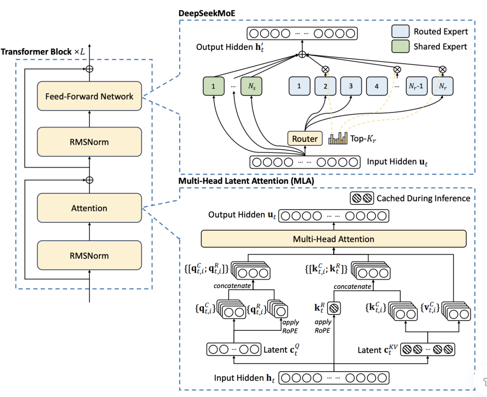
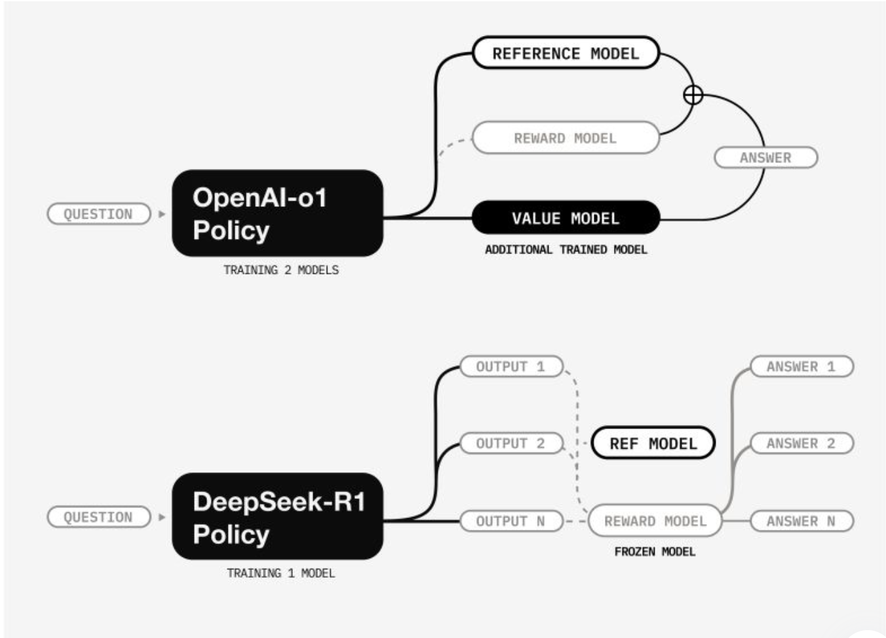

# 系统实战
## deepseek
### 混合专家
分而治之-混合专家：与其让一个超大的稠密网络对所有 token 做统一计算，不如把网络拆分为多个“专家模块”，通过门控机制在推理过程中只启用与该 token 最相关的模块。这样就能实现“稀疏激活”：大模型整体依然保持巨量参数，但每一次推理需要真正访问和计算的参数规模被极大缩减。
路由专家 共享专家

top-K路由
如何确保专家节点的合理利用，避免计算负载的极端倾斜，是混合专家模型落地应用时必须解决的问题。
DeepSeek V3 通过在门控网络中引入可学习的偏置项，使训练过程能够自适应地调整专家的选择概率，优化 token 在推理阶段的分配方式。具体来说，在模型训练时，门控网络会学习每个专家的工作负载，并通过引入轻微的偏置，让某些使用率较低的专家获得更多机会被选中参与计算，从而避免所有计算任务集中到少数几个专家上。
### 提示语和后训练
后训练指的是在模型已经拥有基础语言和推理能力后，再通过针对性的数据和任务，强化或微调模型的表现。目标是把预训练阶段意外找到的有效提示语，变成模型在任何场景下都能稳定触发的“技能”。
DeepSeek V3 对后训练阶段的重点调整之一是指令微调对齐。多任务联合训练
强化学习对齐GRPO
GRPO，其实可以看作是对传统强化学习对齐方法 RLHF 的一次重大升级。它不仅在策略更新过程中加入了奖励平滑与调控机制，更注重从长远反馈中提取信息，让模型在不断试错的过程中保持稳定性和高效性。

### MLA
像 GQA 就是将分组或多查询的概念引入到注意力里，通过少数几个投影来减少重复占用的空间。不过，这些方法序列一旦特别长，注意力的复杂度依然会往 n² 级别飙升。MQA 有太过激进，只留了一组 KV 来作为代表。
MLA 思路就相对折中些。它直接给注意力过程加了一道中间环节，也就是让模型先学到一组紧凑的隐式向量。这些隐式向量可以看作是对原始 Key/Value 的可学习压缩。换句话说，模型并不再为序列中的每个 token 都生成一份完整的 Key/Value，然后再两两交互，而是把那些信息聚合到一块小巧的潜在空间里，再在这里执行多头注意力的计算。
MLA 的核心就是让那部分“压缩”是可学习的，并且依然保留多头机制。这意味着不同 Head 还是可以去关注隐式向量里不同的维度或者特征，从而在保留丰富上下文的同时，大大降低长序列带来的算力和存储负担。
优化多头注意力，最根本的点还是减少重复存储和大规模交互，让模型学会用更紧凑、更聪明的方式表达上下文依赖。
### Rope
正余弦绝对位置编码

