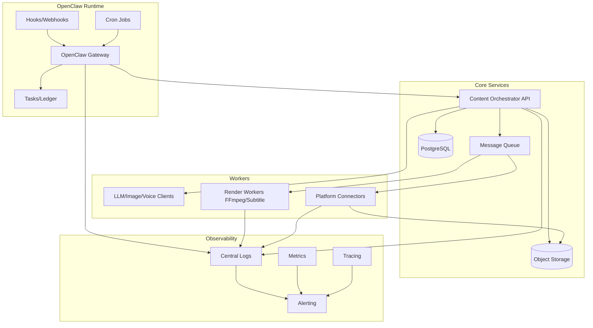
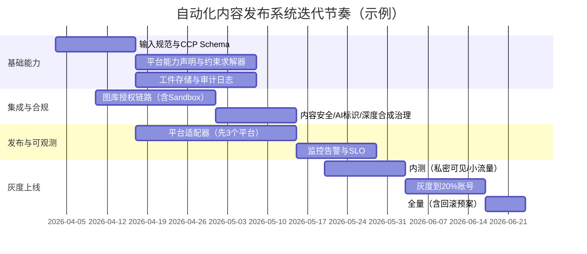

# 自动化内容发布工作流设计：从单条笔记到多平台一键发布

## 执行摘要

本报告给出一套“单条详细笔记 → 多平台内容（图文/短视频/语音）→ 自动发布”的端到端流水线设计，重点解决四个难点：平台形态差异（图文/视频/音频）、素材来源复杂（自有素材 + 版权图库 + 生成式素材）、发布链路碎片化（各平台鉴权/审核/限流不同）、以及在 OpenClaw 上以后台自动化方式稳定运行（可观测、可追溯、可回滚）。发布侧会优先采用平台官方 API（例如短视频直发、图文发布等），并显式纳入“未过审客户端内容仅私密可见/需审计才能放开可见性”这类平台审核机制，避免上线后出现“自动发了但别人看不到”的隐性故障。citeturn17view3turn17view1turn17view2

设计的核心思想是：先把输入笔记解析成“统一内容包（Canonical Content Package）”，再由“平台适配器（Platform Adapter）”按平台规则把内容包编译成各平台需要的脚本、元数据、素材清单与发布请求；同时把限制（字数/时长/尺寸/话题/水印/AI标注/限流配额）当作“可计算的约束”，在生成与发布前做静态校验与动态熔断。举例：短视频平台可能对文件大小与时长有硬限制，并对带品牌水印/Logo 的内容触发审核与降权/下架风险；海外平台则可能对 API 发布量做 24 小时滚动窗口限制。citeturn17view2turn26search3

合规层面，报告将版权与平台条款合规作为“与生成同等重要的流水线阶段”，覆盖：版权授权与可追溯（图库 API 的“先授权/后下载”模式、下载事件与署名要求）、生成式内容的标识与内容安全审核、以及中国大陆特有监管要求（生成式 AI、深度合成等规范）。citeturn27search6turn4search0turn4search1

## 目标与关键假设

本方案在“平台清单未指定、内容品类未指定、预算未指定”的前提下，默认支持两类运行模式：  
其一是“全自动直发”：对具备稳定官方发布 API 的平台进行自动发布与状态回读；其二是“自动生成 + 人工审核/一键确认”：对缺少稳定发布 API 或条款不鼓励自动化发布的平台，自动生成所有素材与脚本并进入“待审队列”，由运营确认后触发发布（仍由 OpenClaw 执行）。这一分层能显著降低条款风险，并把不可控的 UI/RPA 依赖降到最低。citeturn17view3turn26search32

为了让“一条笔记”可以映射到不同平台，输入必须足够结构化：至少包含主题、受众、核心观点、证据/素材引用、期望输出形态（图文/视频/语音可选）、禁用点（禁词/禁图/政策敏感）、以及发布指令（平台目标、发布时间/时区、是否允许 AI 生成素材、是否必须用自有素材）。输出将拆成三层：  
内容层（脚本与镜头/段落结构）、资产层（图片/视频/音频、字幕、封面、缩略图）、发布层（标题、标签/话题、可见性、评论/合拍等开关、AI内容标识、商业合作标识等）。在具备“AI 内容标识”字段的平台上，应明确设置，避免后续合规整改返工。citeturn17view3turn17view1

在 OpenClaw 上运行的关键假设是：你会把流水线拆成可重试、可回滚、可观察的后台任务；并用 OpenClaw 的定时（Cron Jobs）、事件触发（Hooks/Webhooks）与任务账本/执行记录（Tasks/Ledger）把“何时生成、生成了什么、用的哪些素材、发到哪里、结果如何”结构化沉淀，便于审计与追责。citeturn2search10turn2search12turn2search16

## 端到端流水线阶段

流水线建议拆为九个阶段，每个阶段都输出可持久化的结构化工件（artifact），以便失败重跑与后续复盘。

### 触发与摄取

触发来源建议同时支持：  
一是事件触发：当“新笔记/更新笔记/进入发布队列”发生时，通过 webhook 触发；二是定时触发：每天/每小时扫描待发布队列并执行；三是人工触发：运营在控制台点“立即发布”。OpenClaw 的 Cron Jobs 与 Hooks 适合承接这些触发与编排。citeturn2search10turn2search16

摄取输入可以是 Markdown、富文本（HTML）、或结构化 JSON/YAML。无论输入形态如何，都应立刻做：  
内容规范化（统一编码、去除不可见字符、解析引用）、敏感信息扫描（手机号/身份证/地址等）、以及“内容引用来源”抽取（URL、书籍、论文、图片来源标识），为后续版权与事实核查留证。中国大陆场景中，对个人信息的处理必须遵循合法、正当、必要等原则，并形成可审计记录。citeturn4search2turn4search3

### 统一内容包构建

把输入笔记编译成 Canonical Content Package（CCP），其本质是“平台无关的内容中间表示（IR）”。它至少包含：  
主题（topic）、核心主张（thesis）、要点列表（bullets）、结构化证据（citations）、目标受众（audience）、语气与风格（tone）、CTA、合规标签（compliance_flags）、资产需求（asset_needs）、以及发布意图（publish_intent：平台列表/排期/可见性）。这一步是后续一切映射的基石。

### 平台脚本生成与约束求解

对每个平台，运行“脚本生成器 + 约束求解器”两步：  
先生成候选脚本（可能分多稿），再用平台约束自动剪裁/重写，直到满足硬性限制（字数、标题长度、视频时长、封面比例、标签格式等）。例如，短视频标题里的话题与@提及可能需要配套提供 open_id 列表，且平台会对不相关话题/强导流行为影响分发；这类规则应被编码进约束器而非靠人工记忆。citeturn17view2turn17view3

### 素材策略决策与素材获取

素材策略建议按优先级分层：  
自有素材（最高优先，风险最低）→ 版权图库（可审计授权）→ 生成式素材（需内容安全与标识）→ 免费图库（风险与条款差异更大，需额外校验）。  

版权图库优先选择“API 可授权下载 + 可回溯订单/授权记录”的供应商；例如图库 API 通常要求鉴权并通过授权接口完成许可，再下载内容。citeturn27search6turn14search8  
免费图库方面，虽然某些站点允许商业使用且不强制署名，但条款通常仍限制商标/品牌、可识别人物、以及图中艺术作品等权利；API 使用还可能额外强制署名与下载事件上报。citeturn27search4turn27search8turn14search1

### 媒体生成与渲染

短视频与语音类平台建议把“脚本”进一步编译成“镜头表（shot list）/字幕轨（SRT/VTT）/配音轨（WAV/MP3）/封面规范”，再交给渲染服务（模板化合成、字幕烧录、响度归一化、转码、封面抽帧）。当使用生成式图片/视频/配音时，应把“生成参数、模型版本、提示词、负面提示词、seed、生成时间、内容安全结果”写入工件元数据，便于合规审计与复现。中国大陆对深度合成与生成式内容通常强调标识、可追溯与安全治理，流水线应内置“AI 生成标识”和“内容安全”节点。citeturn4search1turn24search3turn17view3

### 发布编排、鉴权与限流

发布阶段建议采用“队列 + 令牌桶（token bucket）+ 幂等键”的组合：  
每个平台适配器暴露统一的 `publish(draft_artifact)` 接口，内部处理 OAuth/签名鉴权、上传、发布、状态查询与重试。限流必须按平台粒度配置：例如某短视频平台对每个用户 access_token 的初始化请求做每分钟 6 次限制；另一些平台对 API 发布次数做 24 小时滚动窗口限制，并提供查询剩余额度的接口。citeturn17view3turn26search3turn26search7

### 发布结果回读与闭环

发布不是“请求成功=发布成功”。常见平台会异步处理转码与审核，发布接口返回成功后，仍需轮询/订阅回调确认最终状态，并在失败时自动进入“重试/降级/人工介入”。例如有平台明确提示发布视频为异步发布，需要通过查询接口确认是否最终发布成功，并给出错误码与用户/应用日请求上限。citeturn19view0

### 监控、审计与成本核算

监控至少覆盖：任务成功率、从笔记到发布的总时延、各平台 API 4xx/5xx、429 限流、资产生成失败率、内容安全拦截率、以及单位内容成本（LLM tokens/生成张数/视频秒数/语音字符）。OpenClaw 的 Diagnostics/Logging 体系适合对任务执行做统一日志与追踪，并与 OpenTelemetry 生态对接以落地分布式追踪。citeturn2search15turn26search32

下面用一张 Mermaid 图概览端到端流程（可直接作为 OpenClaw 任务编排的逻辑蓝图）：

```mermaid
flowchart LR
  A[Trigger: webhook/cron/manual] --> B[Ingest Note]
  B --> C[Normalize + PII Scan]
  C --> D[Build Canonical Content Package]
  D --> E{For each platform}
  E --> F[Generate Script Candidates]
  F --> G[Constraint Solver + Policy Filters]
  G --> H[Asset Strategy Decision]
  H --> I[Fetch Stock / Use Uploaded / Generate]
  I --> J[Render: video/voice/subtitles/covers]
  J --> K[Preflight: validate, rate-limit plan, idempotency key]
  K --> L[Publish via Platform Adapter]
  L --> M[Async Status Poll/Webhook]
  M --> N[Store Artifacts + Metrics + Audit Log]
  N --> O[Feedback: analytics -> prompt/style tuning]
```



## 统一数据模型与平台映射规则

### 统一输入与中间表示

建议把“输入笔记”定义为强约束结构（可由 Markdown Front Matter 或表单生成），并编译为 CCP。下述是一个可落地的输入模板（示例用 YAML；实际落地建议同时提供 JSON Schema 以做自动校验与 IDE 提示）：

```yaml
note_id: "2026-04-03-DeepWork-001"
title: "如何把碎片时间变成高质量产出"
language: "zh-CN"
audience:
  persona: "职场知识工作者"
  pain_points: ["注意力分散", "会议太多", "难以持续输出"]
goals:
  primary: "让读者学会一套可执行的深度工作微习惯"
tone: ["务实", "鼓励", "可操作"]
key_points:
  - "把任务拆成 25 分钟的可完成单元（micro-sprint）"
  - "每次开始前写下：本次产出物+完成标准"
  - "用环境触发器减少意志力消耗（固定时间+固定地点+固定动作）"
evidence:
  - type: "anecdote"
    content: "我用 3 天把拖延两周的报告拆成 6 个 micro-sprint 完成"
constraints:
  banned_topics: ["医疗诊断", "投资建议"]
  must_include_disclaimer: true
assets:
  uploaded:
    - asset_id: "img_brand_cover_01"
      type: "image"
      uri: "s3://bucket/brand/cover01.png"
publishing_instructions:
  schedule:
    timezone: "America/Toronto"
    preferred_windows: ["09:00-11:00", "19:00-21:00"]
  platforms:
    - name: "image_text_platform"
      objective: "收藏转化"
    - name: "short_video_platform"
      objective: "完播率"
    - name: "voice_only_platform"
      objective: "订阅"
ai_generation_policy:
  allow_generate_images: true
  allow_generate_video: false
  allow_generate_voice: true
  require_aigc_label: true
```

### 映射规则的“编译器”思路

把“从 CCP 到平台产物”的过程当作编译器更容易工程化：  

第一步是“平台能力声明（Platform Capability Descriptor）”。每个平台用机器可读方式声明：  
`content_types`（image_text / short_video / voice）、`text_limits`（标题/正文/标签）、`media_specs`（格式/尺寸/码率/时长/文件大小）、`metadata_fields`（话题、@、地理位置、商业合作、AI标识）、`auth`（OAuth/签名/Token）、`rate_limits`（RPM/日上限/滚动窗口）、以及 `review_model`（同步/异步审核、状态查询接口）。例如某平台文档明确：视频大小不超过 4G、时长在 15 分钟以内，且提示带品牌 logo/水印内容可能触发审核与分发降权甚至封禁；另一平台则给出文案最大长度（2200 UTF‑16 字符）与每分钟请求限制。citeturn17view2turn17view3

第二步是“内容映射规则（Mapping Rules）”，建议按以下优先级执行：  
语义保持（核心主张不变）→ 平台目标优化（完播/互动/收藏）→ 平台风格（句式、节奏、emoji/口语）→ 约束满足（硬限制）→ 合规满足（禁词/敏感/版权/AI标识）。其中“约束满足”必须是自动化可证明的：比如 Instagram 的 Content Publishing 24 小时发布上限是 API 强制执行的，应在调度器里提前计算并拒绝超额排期，或自动推迟到下一个窗口。citeturn26search3turn26search7

### 三个平台示例输出模板

下面给出同一条输入笔记生成的三类平台脚本示例：图文、短视频、语音。示例的目标是展示“结构如何变化”，不是展示“文案风格的唯一正确答案”。

#### 图文平台示例（图片 + 文字）

```yaml
platform: "Instagram_Feed_Image"
post_type: "image"
assets:
  image:
    source: "uploaded"
    asset_id: "img_brand_cover_01"
    required_aspect_ratio: "1:1 or 4:5"
text:
  caption: |
    你不是没时间，你是被“碎片”偷走了产出感。

    我把一件事从“拖两周”变成“3天搞定”，只做了 3 个动作：
    1) 把任务拆成 25 分钟 micro-sprint
    2) 开始前写下：本次产出物 + 完成标准
    3) 设定环境触发器：固定时间/地点/动作

    试试看：今天只做一个 micro-sprint，并把产出物截图保存。
    #深度工作 #效率 #时间管理
metadata:
  hashtags: ["深度工作", "效率", "时间管理"]
  alt_text: "一张封面图：标题为“把碎片时间变成高质量产出”的极简设计"
compliance:
  aigc_label: false
  disclaimer: "本文为经验分享，不构成专业建议。"
```

要点：图文平台更强调“可保存/可复用”的清单式结构（1-2-3）与易读排版；并附带可访问性字段（alt text）。发布量需遵守平台 API 发布上限。citeturn26search3

#### 短视频平台示例（视频 + 口播/字幕）

```yaml
platform: "Douyin_ShortVideo"
post_type: "short_video"
duration_target_sec: 35
video_spec:
  container: "mp4"
  orientation: "vertical"
  min_resolution: "1280x720"
storyboard:
  - t: "0-3s"
    visual: "强对比字幕：‘你不是没时间，是没有“开始系统”’"
    voiceover: "你不是没时间，是没有开始系统。"
  - t: "3-12s"
    visual: "镜头：桌面计时器/番茄钟"
    voiceover: "把任务拆成 25 分钟 micro-sprint。"
  - t: "12-22s"
    visual: "镜头：写在便签上的‘产出物+完成标准’"
    voiceover: "开始前写下：本次产出物和完成标准。"
  - t: "22-30s"
    visual: "镜头：固定环境触发器（咖啡+耳机+同一张桌子）"
    voiceover: "用环境触发器减少意志力消耗：固定时间、地点、动作。"
  - t: "30-35s"
    visual: "结尾 CTA：‘今天只做 1 个 micro-sprint’"
    voiceover: "今天只做一个 micro-sprint，你会立刻找回产出感。"
on_screen_text:
  style: "大字+高对比"
subtitle:
  format: "srt"
cover:
  strategy: "frame_at_2s"
text_metadata:
  title: "#深度工作 #效率 今天只做一个micro-sprint"
  at_users: []
  is_aigc: true
compliance:
  remove_logos_watermarks: true
  disclaimer: "经验分享，不构成专业建议。"
```

要点：短视频平台必须严格对齐媒体规格与审核风险提示（例如带品牌水印/Logo 可能触发审核与降权/下架），并建议平台侧开启 AI 内容标识（如提供相关字段）。citeturn17view2turn17view3

#### 语音平台示例（播客/音频 RSS 分发）

```yaml
platform: "Podcast_RSS"
episode:
  title: "把碎片时间变成高质量产出：3个微习惯"
  description: |
    这期用 5 分钟聊清楚：如何用 micro-sprint 把“拖延”变成“可完成”。
  guid: "2026-04-03-DeepWork-001"
  enclosure:
    url: "https://cdn.example.com/podcast/2026-04-03-DeepWork-001.mp3"
    type: "audio/mpeg"
    length_bytes: 12345678
  explicit: false
show_notes:
  - "动作1：25分钟 micro-sprint"
  - "动作2：产出物+完成标准"
  - "动作3：环境触发器"
voice_script: |
  开头：你不是没时间，你是缺少一个“开始系统”……
  （中略：三点展开）
  结尾：今天就做一个 micro-sprint，并把产出物保存。
```

要点：播客分发的基础是 RSS 规范与目录要求：每集需要唯一的 `<enclosure>`（含 URL/length/type），以及不变的 GUID；并要求 hosting 服务器支持 HEAD 与 byte-range 请求以便流式播放。citeturn26search2turn26search9

## 工具、API与合规版图

本节按“同一流水线在中国大陆与海外分别选型”的要求，给出两套推荐工具栈，并用对比表覆盖：功能、价格/计费方式、API 可用性、语言支持、中国大陆可达性。

### 中国大陆工具栈

中国大陆选型的基本原则是：优先选择能在境内稳定访问、具备中文能力与合规支持、且有明确计费与 SLA/协议的服务；对外部网络依赖（例如海外 SaaS）要么走合规出海链路，要么使用境内等价替代。

下表给出“内容生成与资产服务”建议选型（示例列出主流组合；实际可按预算与质量做 A/B）：

| 阶段 | 推荐服务（中国大陆） | 主要能力 | 定价/计费线索 | API/可用性 | 语言/可达性 |
|---|---|---|---|---|---|
| 文本/多模态生成 | entity["company","阿里云","cloud provider"] 百炼（千问） | 提供 OpenAI 兼容接口与原生接口（DashScope），便于迁移与生态集成 | 官方给出模型调用价格与计费规则（按 token 等）citeturn16search6turn16search2 | 有 | 中文强；境内稳定 |
| 图像生成 | 阿里云百炼（万相） | 按成功生成图片张数计费；任务与 URL 仅保留 24 小时；输入/输出均做内容安全审核 | 官方 API 参考含计费、限流、错误码citeturn24search3 | 有 | 中文强；境内稳定 |
| 视频生成/编辑 | 阿里云百炼（万相视频类） | 提供视频生成/编辑类模型（如影视后期场景） | 官方 API 参考citeturn24search11 | 有 | 境内稳定 |
| 文本生成/多模态生成 | entity["company","腾讯云","cloud provider"] 混元（生文/生图） | token 计费，支持免费资源包优先扣减；支持后付费开通开关 | 官方计费概述给出公式与规则citeturn23search5turn23search1 | 有 | 境内稳定 |
| 文本生成 | entity["company","科大讯飞","ai company"] 星火 | WebSocket/HTTP 接口；明确 token 计费说明与模型版本演进提示 | 官方接口文档说明计费与版本策略citeturn23search3turn23search7 | 有 | 境内稳定 |
| 文本/多模态生成 | entity["company","百度智能云","cloud provider"] 千帆 | 提供计费、token 计算等文档体系 | 官方文档入口与计费/计算说明citeturn23search12turn23search4turn23search8 | 有 | 境内稳定 |
| 文本生成 | entity["company","智谱AI","ai company"] 开放平台 | 提供开放平台定价与计费 FAQ | 官方定价页与费用 FAQciteturn23search0turn23search6 | 有 | 境内稳定 |
| 语音合成（TTS） | 腾讯云 TTS | 提供计费说明与购买指南（免费额度/预付费/后付费） | 官方计费概述/购买方式文档citeturn22search2turn22search6 | 有 | 境内稳定 |
| 语音合成（TTS） | 阿里云智能语音交互 | 给出长文本合成、流式合成等价格；并提供并发/QPS 说明 | 官方计费页与计费说明citeturn22search1turn22search5 | 有 | 境内稳定 |
| 版权图库 | entity["company","视觉中国","stock media company"] API | 提供搜索/授权下载等接口；说明接入流程（Client ID/Secret） | 官方 API 概述与接口页citeturn15search4turn15search16 | 有 | 境内稳定 |
| 对象存储/DAM | 阿里云 OSS | 简单上传限制 5GB，超出需分片上传；并按请求次数/存储/流量计费 | 官方上传与计费说明citeturn25search26turn25search22turn25search10 | 有 | 境内稳定 |

发布与平台侧（中国大陆）建议优先使用官方开放平台能力，并把平台规格写入“能力声明”。示例：entity["organization","抖音","short video platform"] 明确支持第三方系统通过 open_api 直接发布视频或图片，并给出视频格式/大小/时长建议与对水印/Logo 的风险提示。citeturn17view2 entity["company","快手","short video platform"] 则给出“发起上传→上传→发布”的三段式流程，并对用户/应用日请求上限给出提示与错误码。citeturn19view0

中国大陆合规（建议纳入流水线的强制检查项）：

- 生成式 AI 服务治理：应确保训练/生成内容来源合规、标识要求、内容安全与投诉处置机制等落地到流程与制度中。citeturn4search0  
- 深度合成治理：对“深度合成内容”的标识、内容安全、技术管理等要求应映射成流水线的“必经检查点”（例如默认开启 AIGC 标识字段、生成过程留痕）。citeturn4search1  
- 个人信息与数据安全：当笔记或素材中含个人信息时，需遵循合法、正当、必要与安全保护要求，尤其在触达外部平台/第三方 API 时要最小化传输与存储。citeturn4search2turn4search3

### 海外工具栈

海外选型的基本原则是：优先采用“官方 API + 审计/合规机制明确”的平台能力；素材侧优先可商用授权与 API 可追溯；生成侧优先多模态能力齐全、价格透明、并能在流水线内做成本控制。

下表给出海外“生成与媒体服务”建议组合：

| 阶段 | 推荐服务（海外） | 主要能力 | 定价/计费线索 | API/可用性 | 中国大陆可达性（参考） |
|---|---|---|---|---|---|
| 多模态生成（文/图/音） | entity["company","OpenAI","ai company"] | 覆盖语音转写、语音合成、图像生成与定价；适合把“脚本→配音→封面/插图”串成闭环 | 官方 API 定价与 Audio/TTS/STT 文档citeturn16search0turn16search9turn16search1turn16search8 | 有 | 受网络与合规影响（需评估） |
| 语音合成（TTS） | entity["company","Amazon Web Services","cloud provider"] Polly | 按字符数计费（标准/神经/长文本/生成式声音）并给出免费额度 | 官方定价页citeturn21search2 | 有 | 受网络影响；有区域化方案 |
| 语音合成（TTS） | entity["company","Google Cloud","cloud provider"] Text-to-Speech | 按字符数计费，含免费额度说明 | 官方定价说明citeturn21search0turn21search3 | 有 | 境内常受限 |
| 语音合成（TTS） | entity["company","Microsoft Azure","cloud provider"] Speech | 给出按字符计费与配额/限制文档 | 官方定价与配额文档citeturn21search1turn21search4 | 有 | 有中国区云（需区分） |
| 语音（TTS/STT） | entity["company","ElevenLabs","ai audio company"] | 提供 API 与定价页，适合更自然的配音链路 | 官方 API 定价/说明citeturn21search8turn21search16turn21search35 | 有 | 受网络影响 |
| 图像生成 | entity["company","Stability AI","ai company"] | API 以 credits 计费（1 credit=$0.01），适合大规模出图与预算控制 | 官方 pricingciteturn24search0 | 有 | 受网络影响 |
| 视频生成 | entity["company","Runway","ai video company"] | 既有订阅计划也有 API credits；并给出 API tier/limits | 官方 pricing 与 API pricing/tiersciteturn24search1turn24search5turn24search17 | 有 | 受网络影响 |
| 视频生成 | entity["company","Luma AI","ai video company"] Dream Machine | 给出订阅与 credits 信息（含商业使用、去水印等） | 官方 pricing/support docsciteturn24search6turn24search2turn24search29 | 部分 | 受网络影响 |
| 版权图库 | entity["company","Shutterstock","stock media company"] | API 支持鉴权、订阅查询、授权许可与下载；并提供 Sandbox 便于测试 | API reference 与 API pricing/支持文档citeturn27search6turn14search0turn27search34 | 有 | 受网络影响 |
| 免费图库（需额外校验） | entity["company","Unsplash","stock media company"] | 站点许可与 API 条款不同：站点下载不强制署名，但 API 集成必须署名与链接；默认 Demo rate limit 50 次/小时 | 许可/条款与 API 指南、限流说明citeturn27search0turn27search8turn14search9turn14search1 | 有 | 境内常受限 |
| 免费图库（需额外校验） | entity["company","Pexels","stock media company"] | 默认 200 次/小时与 2 万次/月；许可允许商用且不强制署名 | API 文档与许可/条款citeturn14search2turn27search9turn27search5 | 有 | 境内常受限 |
| DAM/媒体管理 | entity["company","Cloudinary","media platform"] | 提供图像/视频 API、转码与衍生资源（derived) 计数/credits 机制 | 官方 pricing 与 transformation countsciteturn25search3turn25search11turn25search27 | 有 | 境内访问需评估 |
| 对象存储 | AWS S3 | 建议 >100MB 用 multipart upload；给出 multipart 限制（最大对象、分片数、分片大小等） | 官方 multipart 指南与限制页citeturn25search1turn25search5 | 有 | 受网络影响 |

海外发布与平台侧（至少应覆盖的官方 API 示例）：

- entity["organization","TikTok","short video platform"] Content Posting API：明确 Direct Post 工作流（初始化→上传/传输→发布），并注明“未审计客户端发布内容仅私密可见”，以及每个用户 access_token 每分钟请求限制与 caption 最大长度、AI内容标识字段等。citeturn17view3  
- entity["organization","YouTube","video platform"] Data API：`videos.insert` 支持上传并设置元数据，给出文件大小限制、配额成本、以及“未验证项目上传默认为 private、需审计放开”的要求；并提供 `containsSyntheticMedia` 这类与合成内容相关的字段。citeturn17view1  
- entity["organization","Instagram","social platform"] Content Publishing：对 API 发布做 24 小时滚动上限（100 posts/24h），并提供查询发布数量/额度的接口；同时 Graph API 有通用 rate limiting 机制。citeturn26search3turn26search7turn26search32  
- entity["company","X","social network"] API：提供 POST /2/tweets（Create or Edit Post）与统一 rate limits 说明，超限返回 429 并在窗口重置前被限制。citeturn26search4turn26search0  
- entity["company","LinkedIn","professional network"] Posts API：官方说明了受众定向有最小规模要求等运营约束；接口用于社区管理与分享。citeturn25search24

语音分发（播客）侧，建议把“发布”抽象为“生成并更新 RSS + 托管音频文件”，并用目录规范做校验：entity["organization","Spotify","music platform"] 明确 RSS feed 的概念与包含的元数据（标题、描述、音频链接、封面等）；entity["organization","Apple Podcasts","podcast platform"] 强调 `<enclosure>` 与 GUID 等 RSS 要素与技术要求。citeturn26search1turn26search2turn26search9

### 版权、条款与风险控制的工程化做法

把“版权/条款/内容安全”当作工程问题，落地建议是三件事：

第一，素材与脚本必须“可追溯”：  
对付费图库走“先授权再下载”的 API 流程，并把授权响应、订阅 ID、license 类型、下载时间写入审计日志。citeturn27search6turn14search8  
对免费图库必须区分“站点许可”与“API 集成条款”，例如免费图库站点本身可能不强制署名，但 API 指南会强制署名与回链；这会影响你在产品 UI、落地页、甚至缓存策略里的实现。citeturn27search0turn27search8turn27search20

第二，平台条款与配额必须“可计算”：  
把每个平台的速率限制、日上限、审核可见性限制固化在配置里，并在调度器中做“发布预算（publish budget）”计算。比如 Instagram 的 API 发布 24 小时滚动上限、TikTok 的 6 RPM/token 限制、以及 X 的 per-endpoint rate limit，都是可以直接写成自动化限流规则的。citeturn26search3turn17view3turn26search0

第三，监管合规要“前置到生成与发布前”：  
中国大陆监管强调生成式 AI 与深度合成的安全治理与标识要求，建议在“脚本生成后、素材渲染前”做一次强制内容审核与标识策略决策；在“发布前”再做一次平台侧合规预检（是否含水印/Logo、是否需要 AIGC 标识字段、是否涉及禁词/引流）。citeturn17view2turn4search0turn4search1  
版权法层面，网络转载与信息网络传播权相关规则在中国具有明确监管文件与司法适用框架，应避免把“随手搬运”纳入自动化能力；对引用与转载必须有授权与来源标注策略。citeturn27search23turn27search3turn27search15

## OpenClaw 部署架构

本节提供一套“OpenClaw 负责编排 + 可扩展工作负载由独立服务承担”的部署架构，理由是：媒体渲染与生成通常 CPU/GPU/IO 密集，而发布编排更偏工作流与状态机；解耦有利于扩展与故障隔离。

### 组件划分

建议至少包含以下组件（按职责解耦）：

- OpenClaw Gateway：承接 Cron/webhook 触发、运行编排逻辑、调用工具（HTTP/脚本/浏览器自动化）、记录任务执行与审计（任务账本/运行日志）。citeturn2search10turn2search12turn2search15turn2search16  
- Content Orchestrator（自建服务）：实现 CCP 编译、映射规则、约束求解、工件存储与状态机（Draft → Ready → Publishing → Published/Failed）。  
- Media Render Workers（自建服务）：负责字幕合成、转码、封面抽帧、音频响度归一化；可按需加 GPU Worker（用于视频/图像生成或加速）。  
- Asset/DAM：对象存储（图片/视频/音频/字幕/工件）、元数据数据库、可选搜索索引。对象存储在中国大陆可用 OSS，并按请求/存储/流量计费；海外可用 S3，且大文件建议 multipart upload。citeturn25search26turn25search22turn25search1turn25search5  
- Platform Connectors：每个平台一个适配器服务（或同一服务内插件化），封装鉴权、上传、发布、状态查询、错误码归一。  
- Observability：统一日志、指标、追踪与告警。OpenClaw 文档强调 Diagnostics/Logging，并可对接 OpenTelemetry/平台日志系统。citeturn2search15

### 容器化与编排建议

- 开发/小规模：Docker Compose 一键拉起（OpenClaw + Orchestrator + DB + Object Storage + Queue）。OpenClaw 官方文档提供 Docker Compose 与 setup 指引，可作为基础模板。citeturn0search5turn1search11turn1search0  
- 中大规模：Kubernetes（或等价编排）拆分 Worker Deployment（横向扩缩）、队列驱动的 Job、以及按平台/任务类型隔离的资源配额。  
- 浏览器自动化（仅在必要时启用）：OpenClaw 的 Browser sidecar 可作为可选组件，用于处理“无官方发布 API 的最后一公里”，但默认应关闭或严格白名单化。citeturn2search6

### 存储、密钥与安全

- Secrets：所有平台的 client_secret、refresh_token、API key 必须进密钥管理（KMS/Vault/云密钥），通过短期令牌注入（env/sidecar）到任务运行时；不要把密钥写入工件与日志。OpenClaw 的配置与工具机制允许通过配置/环境变量管理运行参数，应结合最小权限原则做 allowlist。citeturn2search8turn1search2  
- 审计：每次生成与发布写入不可变审计日志（append-only），至少包括：输入 note_id、输出工件 hash、素材来源与授权信息、调用模型与版本、发布平台与返回 ID、状态变化时间线。  
- 合规数据隔离：若同时服务中国大陆与海外账号，建议物理或逻辑隔离（不同 VPC/不同存储桶/不同密钥域），并对跨境数据做显式开关与审批记录。citeturn4search2turn4search3

### 部署拓扑图（Mermaid）



## 测试迭代与上线清单

### 必做测试与实验设计

为了把“能跑”变成“可长期稳定运营”，建议把测试分五类，每类都直接对应一个线上故障模式：

第一类：映射与约束测试（单元测试为主）  
给每个平台能力声明写一组“极限用例”：最长标题、最多话题、最短视频、缺封面、含@、含AI标识字段等；确保约束求解器能自动把候选脚本收敛到合规输出。Instagram 的发布量上限、TikTok 的 RPM 限制等应该能在本地模拟并触发“排队/推迟”逻辑。citeturn26search3turn17view3

第二类：发布集成测试（沙箱/私密可见为主）  
优先使用平台提供的“审计前仅私密可见”模式做端到端测试；例如 TikTok 与 YouTube 都明确未审计/未验证项目上传会受可见性限制，需要通过审计流程放开；这应被视为“预期行为”并写入测试断言。citeturn17view3turn17view1  
图库侧优先用提供 Sandbox/测试机制的供应商（例如 Shutterstock Licensing Sandbox）验证授权逻辑与下载链路。citeturn27search34turn27search6

第三类：内容安全与版权实验（离线批测 + 人审抽检）  
对生成式图片/视频输出做批量安全扫描与人工抽检，记录“误杀/漏检”并迭代提示词与过滤器；同时对免费图库引入“权利风险提示”（人物肖像、商标、艺术作品）并做抽检，因为站点许可不等于免除全部权利风险。citeturn27search4turn27search24turn24search3

第四类：限流与稳态压测（队列 + 429 演练）  
用真实平台限流数字做“发布预算”压测：例如每分钟 6 次初始化请求的限制，会直接决定你能并发发布的账号数；X 的 rate limit 超限返回 429，需要回退到指数退避与窗口重置后重试。citeturn17view3turn26search0

第五类：成本实验（A/B Prompt + 缓存策略）  
对文案生成、配音生成、出图与转码做成本分解：token、字符、图片张数、视频秒数分别计量，并对可缓存环节启用缓存（例如同一笔记生成多平台脚本时共享“事实抽取/要点摘要”的中间结果）。OpenAI 与国内云厂商都明确按 token/张数等计费，成本可被精确预算。citeturn16search0turn24search3turn23search5

### 迭代节奏与发布治理（Mermaid 甘特图）



### 上线清单（可直接作为 Runbook）

上线前的检查项应覆盖“功能、权限、合规、稳定性、可回滚”五大类：

功能与数据  
输入笔记 Schema 校验与版本化；CCP 与平台工件可追溯（hash/版本/生成参数）；素材引用必须能追溯到来源与授权记录。citeturn27search6turn15search4

权限与鉴权  
所有平台 OAuth/Token 刷新链路跑通；平台侧需要审计/审核才能公开发布的，提前走完审计与验证流程，否则上线会出现“发布成功但仅私密可见”。citeturn17view3turn17view1  
对微信公众号等平台，若存在 IP 白名单/调用来源限制，需在上线环境提前配置并在灾备环境同步（避免切流后 401/403）。citeturn7search2turn6search2

限流与调度  
为每个平台设置 publish budget（RPM/日上限/滚动窗口），并在调度层做硬拦截；对 429/5xx 配置指数退避与抖动；对长耗时媒体任务走队列异步。citeturn17view3turn26search3turn26search0

合规与内容安全  
中国大陆：生成式 AI 与深度合成要求映射成流程节点（内容安全审核、标识、留痕与投诉处置）；个人信息处理遵循最小化与安全保护要求。citeturn4search0turn4search1turn4search2  
版权：明确“转载/搬运”不自动化；对图库与免费素材严格按许可与 API 指南落地（例如 Unsplash API 必须署名与回链）。citeturn27search23turn27search8turn14search5

可观测与回滚  
OpenClaw 任务执行日志、审计日志与指标齐备；一键停发（kill switch）、平台级熔断（某平台异常则暂停该平台但不影响其他平台）、以及“从已生成工件重新发布”的灾备路径可演练。citeturn2search15turn2search12turn2search10
