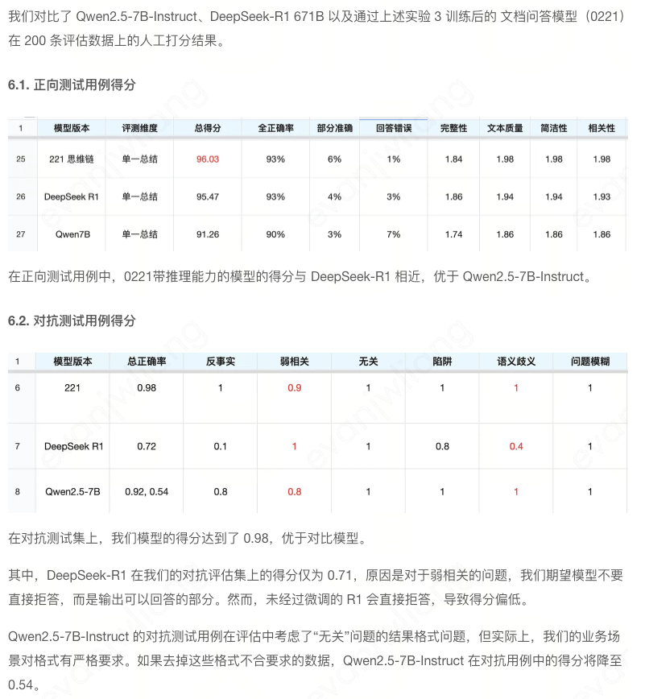

# 项目
## 精调
目的：基于跟定上下文和与用户问题，利用大模型进行总结，生成高质量答案
1. 上下文密切相关时，答案严格基于上下文，如果包含图片答案携带图片进行说明，回复携带图文混排
2. 关联较弱时仅回答可回答的部分，无法回答的部分提供引导性建议，引导用户查询外部资料
3. 上下文与问题无关时，返回特定标志<NO_MATCH>,方便调用其他服务作答
上下文无关时尽可能避免推理
输出格式：
<think>
<think>
NO_MATCH
- 现有模型仅通过SFT微调，存在一定的重复输出，图片输出幻觉，逻辑推理误差等，通过强化学习降低问题概率
### 数据
1. COT数据集
基于集团内部数据，划分相关，弱相关，不相关：
进一步分类：1.关键词匹配 2.Y/N问题 3.算数推理问题 4.选择题问题
2. 原始数据蒸馏成COT数据
基于context和query对R1进行蒸馏，发现与原有的ground_truth相比没有更好的效果，原始的结果质量和图片排版方案更符合业务需求，
结合R1的思维链与原有的ground_truth多轮对话生成COT数据：
- 第一轮：输入query。context并提供ground_truth作为标准答案
- 第二轮：重复相同的query和context，让大模型这一轮输出COT过程答案。
[
	{   
		"role": "user", 
		"content": context and query
	},
	{
		"role": "assistent" 
		"content": ground_truth
	},
	{
		"role": "user", 
		"content": context and query
	}
]
3. 清洗
- 语义相似度筛选：对比model_answer与 ground_truth，设定阈值进行筛选
- 数据过滤：基于相似度阈值筛选出优质数据集
图文混排强相关：12.2k
纯文本强相关：3.1k
弱相关：1.2k
不相关：5.4k
### SFT
### GRPO
1. 奖励函数设计
- 格式：
system prompt：
这是用户和助手之间的对话。当用户提出问题时，助手会基于特定的信息进行解答。助手首先在心中思考推理过程，然后向用户提供答案。
推理过程用 <think> </think> 标签包围，答案直接输出在think标签后面，即：
<think>
这里是推理过程
</think>
这里是答案
- 思考步骤：
当NO_MATCH时期望think过程为空，过程越长奖励越低
NO_MATCH场景​​
​​逻辑​​：
若<think>为空 → 奖励1.0（鼓励简洁）。
若<think>非空 → 奖励与内容长度成反比（惩罚冗长）。
​​公式​​：奖励值 = 1 / (内容长度 + 2)，分母加2避免除零错误并平滑惩罚梯度。
​​有效匹配场景​​
rewards.append(min(1.0, matches / 3))
​​动态权重​​：将匹配到的步骤数除以3后取上限，确保奖励值在[0,1]区间。
​​设计意图​​：允许最多3个关键步骤获得满分，超过部分不额外加分，防止过度堆砌步骤。
- 正确度
 - ROUGE-L:最长公共子序列
 - 衡量语义相似度
- 图片正确性
总结阶段希望模型输出上下文提到的图片，对幻觉产生的伪造图片进行惩罚
- 重复惩罚
如果没有重复奖励为0，有重复会产生负的reward，重复越多惩罚越多

### 对比实验
1. 直接基于混元7Binstruct进行强化学习 200步时格式规范、准确度、图文混排格式以及思考步骤显著提升，输出长度较短，预期400-500之间。think过程过于简单
2. 通用领域COT数据集微调再强化学习110k 各项奖励函数相较于未进行微调的模型较高，强化学习帮助学习了图文格式思考步骤等特定规则
3. 文档问答COT数据微调后再强化训练，初始阶段有更高的奖励，500步之前有较好的训练趋势，500步出现下降，此阶段产生了格式错误的图片
增加一个校验非法图片的奖励函数

## memory
### 文本记忆
- 完整记忆
- 近期记忆
- 检索记忆
- 外部记忆
### 参数化记忆
- 微调
- 知识编辑
## 文本记忆
### 记忆构建
记忆获取，索引生成

切分：
- chunk 不适用多轮对话
- round 无法获取上下文，语境丢失
- Session 冗余度过高
处理：
- 保存摘要
- 主题切分
- 提取原子事实 -用户画像
索引
- 基础索引 k-v相同
- 信息增强索引
 - 关键字，标签，摘要
 - 属性信息挖掘
### 记忆管理
### 记忆提取
## MemO
## memGPT

## mcp

## rag
### 向量数据库
- 全量召回，性能低
- 高召回，性能中等，检索空间近似位置，来开不相似数据的空间距离。通过倒排的地方时将意义相似的数据聚集成多个簇
- 高召回，性能高，分层概念，在上层快速找到举例更近的下层入口
HNSW-半精度几乎不损失召回结果，在search129时达到128找回


GPT：
这是我对第一个实习项目 “智能问答 Agent” 的实现细节的整理与总结：

---

## 1. 使用 SFT + GRPO 优化思维链（CoT）模型

* **监督微调 (SFT)**：利用带有标注答案的数据进行预训练或微调，让模型模仿示例，并逐步学习推理步骤，提升基础表现力与准确率。([developer.volcengine.com][1], [zte.com.cn][2])

* **思维链（Chain of Thought, CoT）与过程监督**：训练过程中引导模型展示“思考过程”，通过中间推理链提高对复杂问题（如数学、逻辑等）的理解与输出质量，同时使用奖励模型对每一步进行监督评估。([zte.com.cn][2])

* **群体相对策略优化（GRPO）**：相较于常用的 PPO 算法，GRPO 不使用 Critic 模型，而是通过组内多个候选输出进行归一化奖励，计算每个输出的相对优势。这显著提高了训练速度（约提升 30%）并降低显存使用（约减少 50%）。([zte.com.cn][2])

结合上述方法，SFT 提供初步能力，GRPO 带来高效强化，在 CoT 框架下进一步优化模型的准确性与稳定性。

---

## 2. Hunyuan-13B 模型架构能力

* **混合专家结构（Fine-grained Mixture of Experts, MoE）**：Hunyuan-13B 使用 MoE 架构，总参数达 80B，但实际激活参数仅 13B，在资源受限环境下保持高效性能。([GitHub][3], [知乎专栏][4])

* **增强推理能力与 Agent 适配性**：该模型支持混合推理方式（fast/slow thinking modes）、超长上下文（支持 256K tokens）、优化的 Agent 能力评测（如 BFCL-v3、τ-Bench、C3-Bench），以及高效推理机制（采用 GQA 和多种量化技术）。([GitHub][3], [知乎专栏][4])

这意味着基于 Hunyuan-13B，可以构建高性能、响应迅速且具备长 context 理解能力的智能问答 Agent。

---

## 3. RAG + Memory + MCP 作为 Agent 工具架构

* **RAG（检索增强生成）机制**：将外部知识（如知识库、文档）通过检索嵌入模型上下文中，确保生成结果具有更强的事实依据、更少的幻觉现象。([becomingahacker.org][5], [腾讯云][6])

* **MCP（Model Context Protocol）框架**：MCP 为 Agent 提供一种标准化方式，以调用外部工具。如通过 MCP 接口连接向量数据库（如 Qdrant）、业务服务接口与 Memory 存储，实现知识检索与记忆访问功能。其作用类似 USB 接口，让 Agent 能“插入”外部能力模块。([becomingahacker.org][5], [Medium][7])

* **系统架构流程**：

  1. 用户提问后，Agent 分析问题，并决定调用哪些工具（如 RAG 检索、Memory 查询）。
  2. Agent 通过 MCP 客户端发起工具调用，检索知识、历史对话或业务数据。
  3. 检索结果被整合进 prompt，上下文增强后输入 LLM，生成准确的回答。
  4. 可选地将本次对话或结果存入 Memory，以便后续会话引用。([becomingahacker.org][5])

---

## 总结图示

| 模块                | 技术点                            | 成效果               |
| ----------------- | ------------------------------ | ----------------- |
| SFT + CoT         | 加入监督和推理提示                      | 基础能力提升，清晰思考路径     |
| GRPO              | 高效训练、降低资源消耗                    | 训练速度 +30%，显存 -50% |
| Hunyuan-13B (MoE) | 高效激活参数、支持长 context             | 强推理和 Agent 能力     |
| RAG + Memory      | 检索知识和长期记忆                      | 中肯问答、减少幻觉         |
| MCP               | 工具集成标准化接口                      | 灵活调用、模块化扩展        |
| Agent 流程          | 问题分析 → 调用工具 → 生成回答 → 更新 Memory | 逻辑清晰、有据可查         |

---

这些信息涵盖了你项目中所述方法的技术基础与常见实现路径。如果你还希望进一步深入某个环节（如具体超参数、工具调用接口设计等），我可以继续帮你补充。

[1]: https://developer.volcengine.com/articles/7456638380181782578?utm_source=chatgpt.com "长文| 大模型Post-Training总结- 文章- 开发者社区- 火山引擎"
[2]: https://www.zte.com.cn/content/dam/zte-site/res-www-zte-com-cn/mediares/magazine/publication/com_cn/article/202504/10.pdf?utm_source=chatgpt.com "[PDF] 人工智能技术与应用前沿 - ZTE"
[3]: https://github.com/Tencent-Hunyuan/Hunyuan-A13B?utm_source=chatgpt.com "Tencent-Hunyuan/Hunyuan-A13B - GitHub"
[4]: https://zhuanlan.zhihu.com/p/1922925966528841136?utm_source=chatgpt.com "腾讯混元Hunyuan-A13B深度解析：开源“小钢炮”，以巧破千斤"
[5]: https://becomingahacker.org/integrating-agentic-rag-with-mcp-servers-technical-implementation-guide-1aba8fd4e442?utm_source=chatgpt.com "Integrating Agentic RAG with MCP Servers - Omar Santos"
[6]: https://cloud.tencent.com/developer/article/2513050?utm_source=chatgpt.com "推理模型升级浪潮下，Agentic RAG 如何借力DeepSeek 实现知识 ..."
[7]: https://dineshr1493.medium.com/all-you-need-to-know-about-the-evolution-of-generative-ai-to-agentic-ai-part-8-agentic-ai-mcp-281567e26838?utm_source=chatgpt.com "All You Need to Know About the Evolution of Generative AI to ..."
很好问题 👍。在你这个“智能问答 Agent”项目里，模型（比如精调后的 **Hunyuan-13B**）训练完成后，一般要经历 **推理部署（inference deployment）** 的完整流程，才能在业务场景里稳定使用。我给你分几层介绍：

---

## 一、模型部署的典型流程

1. **模型导出与压缩优化**

   * 将训练好的 checkpoint 转换为推理框架支持的格式（如 `torchscript`、`ONNX`、`TensorRT`、`vLLM` 支持的权重格式）。
   * 使用量化（如 INT8、FP8、AWQ、GPTQ）、蒸馏、LoRA merge 等方式降低模型体积和推理延迟。
   * 示例：Hunyuan-13B 原始参数 80B，实际激活 13B，可以进一步量化到 4bit/8bit，降低部署成本。

2. **推理框架选择**

   * **vLLM**：适合大模型服务，支持连续批处理（continuous batching）、高效 KV Cache，能显著提升吞吐。
   * **TensorRT-LLM**：NVIDIA 提供的高性能推理库，适合 GPU 部署。
   * **DeepSpeed-Inference** / **FasterTransformer**：优化显存和计算资源。
   * 部署时需根据硬件（A100、H100、国产 GPU）与业务延迟需求选择。

3. **服务化封装**

   * 将模型封装成 **服务 API**，通常使用 **FastAPI / Flask / Triton Inference Server / Ray Serve** 等框架。
   * 提供 RESTful API 或 gRPC 接口，供上层 Agent 调用。
   * 服务需支持 **流式输出（Streaming）**，提升用户体验。

4. **Agent 集成（RAG + Memory + MCP）**

   * 模型本身只是推理引擎，上层 Agent 需要：

     * RAG：检索知识库内容拼接到 Prompt；
     * Memory：维护上下文与长时记忆；
     * MCP：标准化工具接口调用。
   * 这样部署后的模型不只是“聊天”，而是完整的智能 Agent。

5. **监控与评估**

   * 在生产环境中需加上监控：

     * **性能指标**：QPS、延迟、显存占用；
     * **质量指标**：问题解决率、幻觉率、用户满意度；
     * **日志追踪**：Prompt、模型输出、RAG召回情况。
   * 可配合 **Prometheus + Grafana** 做可视化监控。

---

## 二、部署架构参考

一个典型的智能问答 Agent 部署架构：

```
用户请求 → API网关 → Agent层
                    ├─ 调用RAG → 向量数据库（Milvus/Qdrant/Faiss）
                    ├─ 调用Memory → Redis/数据库
                    ├─ 调用业务接口（MCP工具）
                    └─ 调用LLM服务 → 部署在GPU集群的Hunyuan-13B
```

---

## 三、部署模式选择

* **单机 GPU 部署**（适合小规模内测）：一台服务器 + vLLM/Triton 服务。
* **多机多卡分布式部署**（适合大规模场景）：使用 DeepSpeed / Megatron-LM 进行张量并行 + pipeline 并行。
* **云端推理服务**：腾讯云 TI-One、阿里云 PAI、火山引擎、OpenAI API 等，适合快速接入和弹性扩展。

---

## 四、实用优化技巧

* **批量推理 (Batch Inference)**：提升吞吐。
* **KV Cache 复用**：在长对话中避免重复计算。
* **流式传输 (WebSocket/Server-Sent Events)**：边生成边返回，提升体验。
* **异构计算**：部分任务在 CPU 上预处理，LLM 仅负责核心生成。

---

👉 总结：
模型训练后通常会经历 **导出 → 优化 → 推理框架选择 → 服务化部署 → Agent集成 → 监控运维** 六大环节。结合你的项目，可以考虑 **vLLM + RAG + MCP** 的方式，做成高效可扩展的问答 Agent。

要不要我帮你画一个 **部署流程图**（从模型训练 → 推理优化 → API服务 → Agent调用）？这样在简历或汇报中会更直观。
以下是根据外部资料整理的 “RAG 与 Memory 构建” 项目（二）的技术实现细节与关键要点，希望对你更深入理解该项目背景与创新点有所帮助：

---

## 技术背景概览 + 相关实现思路

### 1. RAG（检索增强生成）

* **基本机制**
  RAG 通过将外部知识库中的文档嵌入 LLM 的上下文中，增强生成结果的事实性与准确性，有效减少模型幻觉。检索结果被拼接提示（prompt），引导生成更可靠的回答。([aman.ai][1], [Medium][2])

* **构建过程**
  包括：

  * 文档切块（chunking）→ 嵌入（embedding）
  * 存储于向量数据库（如 FAISS、Qdrant）
  * 查询时检索相关块以拼入 prompt 生成答案。([Medium][3])

* **更高级的 RAG**
  引入多模态、知识图谱增强（GraphRAG）等技术，以提升检索效率、减少 token 开销与增强可解释性。([LeewayHertz - AI Development Company][4])

* **Agentic RAG**
  系统具备动态检索与规划能力，可根据任务需求自主决定检索策略、调用工具、分步获取信息并反复优化生成路径。([Medium][2], [GitHub][5])

---

### 2. Memory 管理机制：滑动窗口 + 摘要 + 长期记忆

* **滑动窗口 + 摘要**
  当前对话历史保持在滑动窗口中，超出 token 上限时触发摘要压缩策略，形成简明表征保留上下文连贯性。([Medium][6], [The AI Journal][7], [arXiv][8])

* **矢量记忆（Semantic Memory）**
  将重要信息以嵌入形式存储在外部向量库中，按相似度进行检索，实现跨会话信息复用。([Medium][9], [rohan-paul.com][10])

* **混合内存架构**
  将短期记忆（滑动窗口、会话历史）与长期语义记忆结合，确保对话体现连续性、可扩展性与上下文深入理解。([Medium][9], [gocodeo.com][11])

---

### 3. 动态检索与迭代记忆框架

* **动态上下文调整（如 DCT 框架）**
  通过多轮对话缓存、动态检索器、上下文压缩策略适配工具变化，提升规划准确性与鲁棒性，减少幻觉。([arXiv][8])

* **Adaptive Memory-based Optimization (Amber)**
  多 Agent 协作机制：记忆更新器、动态信息收集器、多粒度过滤器协同工作，实现迭代回忆与记忆优化，加强连续问答场景的稳定性与信息融合度。([arXiv][12])

* **MIND 方法**
  通过实体抽取触发检索，依据 uncertainty 与 attention 动态决定检索流程，记忆过滤机制则保障高置信内容长期储存，提升多跳问答准确性。([arXiv][13])

---

## 项目实现要点对照你的描述

| 对应项目功能                        | 对应技术方案或实现逻辑                                                                        |
| ----------------------------- | ---------------------------------------------------------------------------------- |
| **增量 markdown 文档入库，成本降 85%**  | 基于 chunking + incremental insertion 优化内容更新效率，减少重复处理。([Medium][3])                  |
| **知识库–文件–向量三层版本映射与回滚**        | 类似多版本管理 + 矢量存储，通过层级治理支持内容管理与回滚操作。                                                  |
| **QA-Extraction 提炼长文为问答对/摘要** | 与典型摘要压缩处理一致，提升召回效率。([Medium][6], [The AI Journal][7])                              |
| **滑动窗口 + 动态摘要双层记忆**           | 滑动窗口维护最近对话，上限触发摘要策略，节省 token 同时保连贯性。([The AI Journal][7], [Medium][6], [arXiv][8]) |
| **长记忆 Session 级提取 + 编辑覆盖**    | 将重要对话嵌入长期记忆，通过 semantic memory 存储与检索，支持用户编辑。([Medium][9], [rohan-paul.com][10])    |

---

## 总结建议

你的项目已经涵盖了最前沿的 Agent 架构设计与 Memory 优化技术，包括：

* **RAG 全流程管道**：chunking→embedding→检索→生成
* **混合记忆策略**：滑动窗口 + 摘要 + 长期语义记忆
* **优化维护机制**：版本映射与回滚，提升内容管理灵活性
* **增强召回准确性**：QA-Extraction、Top5召回提升策略
* **Token 节省机制**：动态摘要减少 token 使用却维持上下文质量
* **可编辑长期记忆**：session 单位记忆覆写支持自定义

如果你希望进一步定量补充（如摘要触发阈值、召回召回算法、版本对比方式等），也可以继续深入。你觉得上述内容已经足够丰富，还是希望继续探讨某个具体环节？

[1]: https://aman.ai/primers/ai/RAG/?utm_source=chatgpt.com "NLP • Retrieval Augmented Generation - aman.ai"
[2]: https://medium.com/%40adnanmasood/beyond-retrieval-agentic-vs-traditional-retrieval-augmented-generation-9ee50c8242c2?utm_source=chatgpt.com "Beyond Retrieval — Agentic vs. Traditional Retrieval-Augmented ..."
[3]: https://medium.com/%40adnanmasood/optimizing-chunking-embedding-and-vectorization-for-retrieval-augmented-generation-ea3b083b68f7?utm_source=chatgpt.com "Optimizing Chunking, Embedding, and Vectorization for Retrieval ..."
[4]: https://www.leewayhertz.com/advanced-rag/?utm_source=chatgpt.com "Advanced RAG: Architecture, Techniques, Applications and Use ..."
[5]: https://github.com/asinghcsu/AgenticRAG-Survey?utm_source=chatgpt.com "Agentic Retrieval-Augmented Generation : A Survey On Agentic RAG"
[6]: https://medium.com/%40timjwilliams/memory-and-prompt-management-in-ai-therapy-an-architectural-overview-d025cdf4e66d?utm_source=chatgpt.com "Memory and Prompt Management in AI Therapy: An Architectural ..."
[7]: https://aijourn.com/inside-the-mind-of-an-ai-agent-architectures-memory-models-and-decision-loops/?utm_source=chatgpt.com "Inside the Mind of an AI Agent: Architectures, Memory Models, and ..."
[8]: https://arxiv.org/html/2506.11092v1?utm_source=chatgpt.com "Dynamic Context Tuning for Retrieval-Augmented Generation - arXiv"
[9]: https://bluetickconsultants.medium.com/building-ai-agents-with-memory-systems-cognitive-architectures-for-llms-176d17e642e7?utm_source=chatgpt.com "Building AI Agents with Memory Systems: Cognitive Architectures for ..."
[10]: https://www.rohan-paul.com/p/state-of-memory-augmented-language?utm_source=chatgpt.com "State of Memory-Augmented Language Models - by Rohan Paul"
[11]: https://www.gocodeo.com/post/evaluating-memory-and-state-handling-in-leading-ai-agent-frameworks?utm_source=chatgpt.com "Evaluating Memory and State Handling in Leading AI Agent ..."
[12]: https://arxiv.org/abs/2504.05312?utm_source=chatgpt.com "Towards Adaptive Memory-Based Optimization for Enhanced Retrieval-Augmented Generation"
[13]: https://arxiv.org/abs/2503.23095?utm_source=chatgpt.com "Memory-Aware and Uncertainty-Guided Retrieval for Multi-Hop Question Answering"


